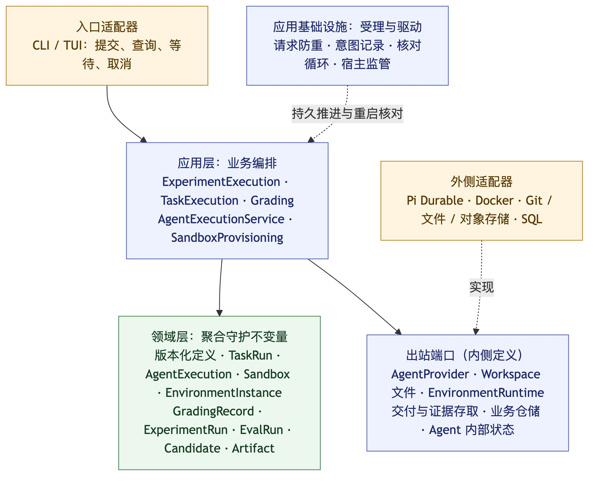
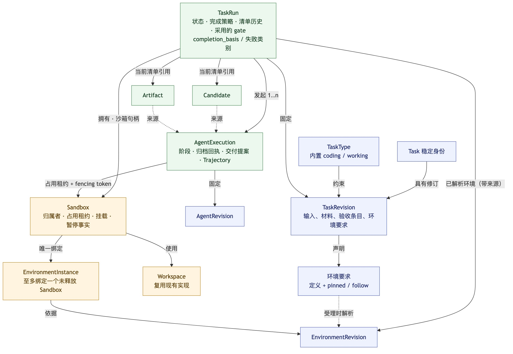
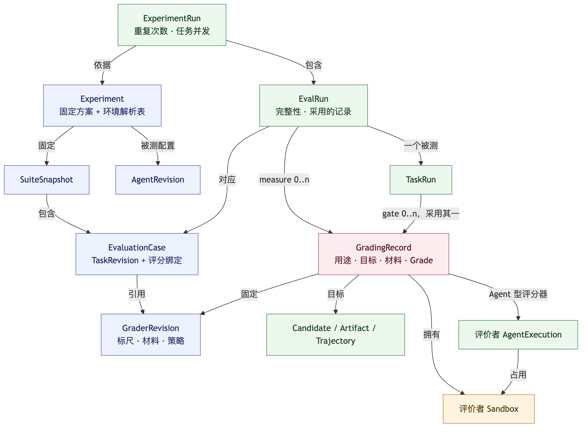
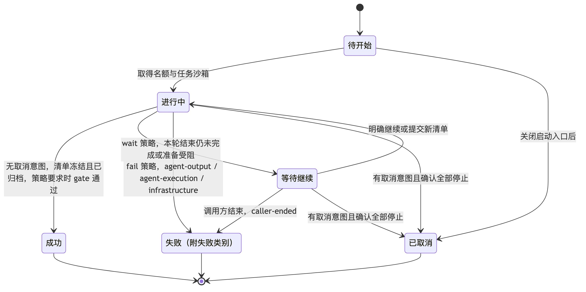
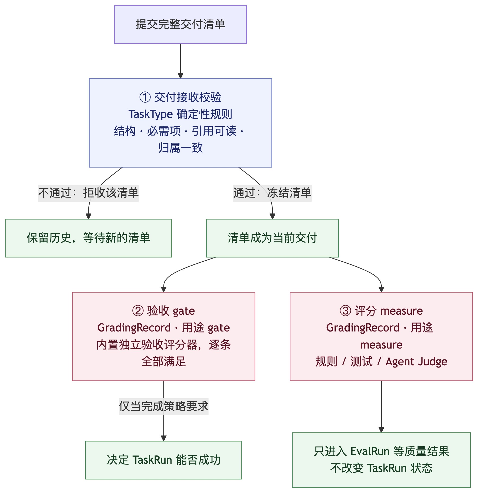
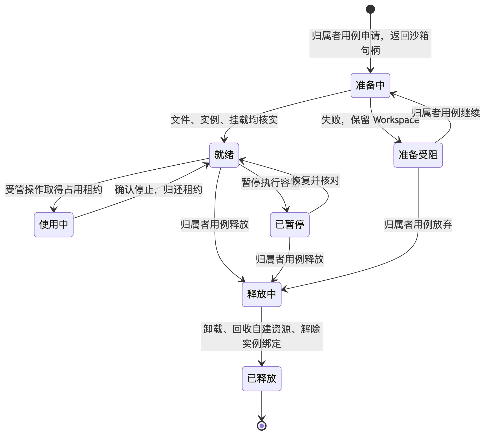
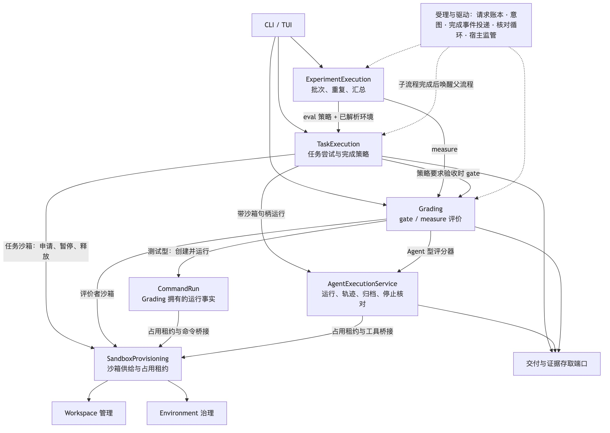
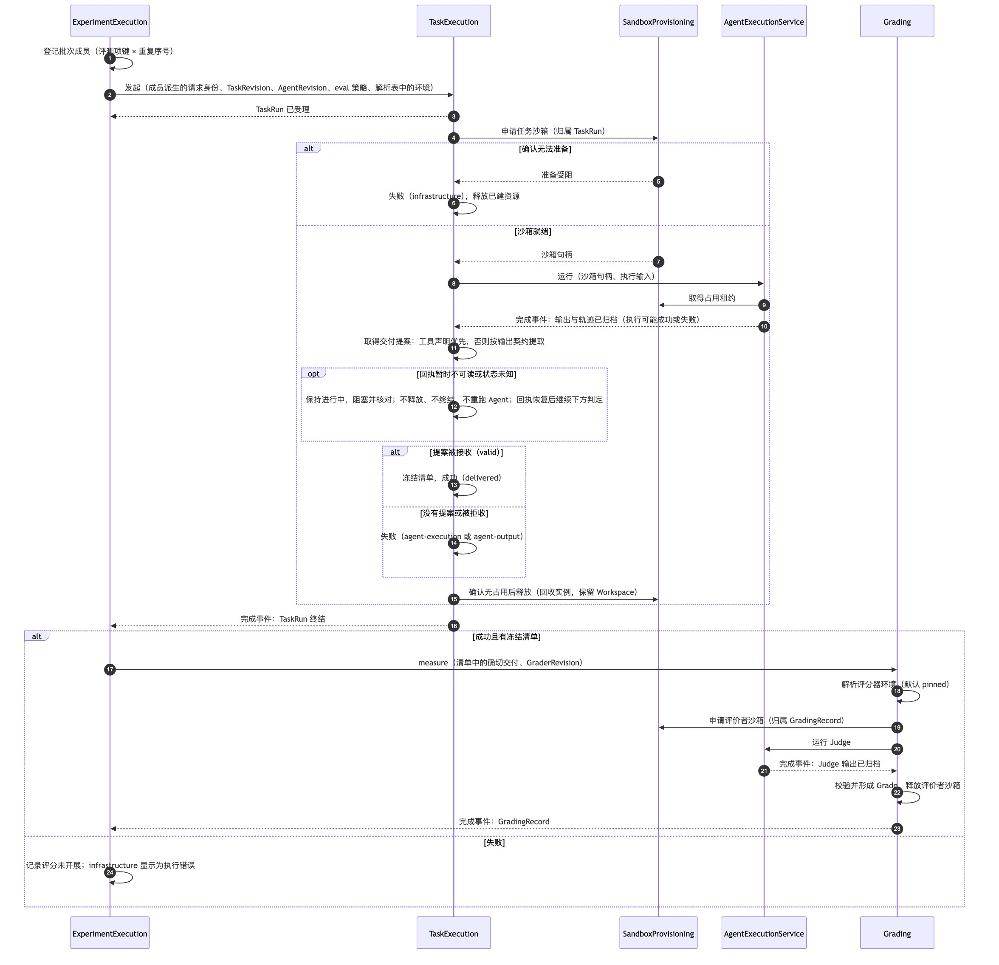
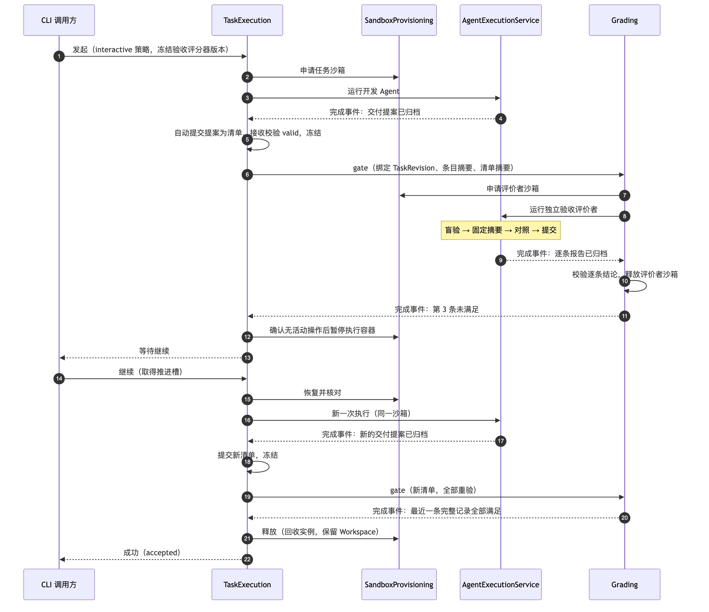

# 通用 Agent 执行与评测：目标模型 R1

- 日期：2026-11-02。
- 状态：**已确认，待实现**。这是助手按用户授权、依据领域与应用层评审结果对 [0001 决策记录](0001-unified-agent-evaluation.md) 作出的结构修订：D129–D137 为第一轮修订，D138 补齐第一轮独立评审的 22 处缺口，D139 补齐第二轮复审的 12 处缺口。均已于 2026-11-02 获用户确认。生产代码尚未实现。
- 用途：一份可以单独阅读的当前目标模型，与 0001 中旧决策冲突时以本文为准。0001 记录讨论历史与理由；开发时先读本文，再按需回查对应决策。

## 1. 一页结论

R1 保留 0001 的核心方向：通用任务执行在下、评测叠在上；Candidate / Artifact / Trajectory 并列；评分独立于实验；失败、未知与成功严格区分。修订集中在以下几处：

| # | 原设计的问题 | R1 的做法 | 决策 |
| --- | --- | --- | --- |
| 1 | TaskRun 成功必须全部验收通过；评测中未通过验收的被测交付会停在“等待继续”，评分无从开始 | TaskRun 携带发起方给定的**完成策略**；评测默认“无需验收、未完成即失败”，成功结果带 `completion_basis`，失败带失败类别 | D129、D138 |
| 2 | 交付契约检查、验收记录、GradingRecord 是三套相似的评价事实 | 三级检查：纯规则的**接收校验**；**验收**与**评分**统一为 GradingRecord，用途分 gate / measure；验收记录必须完整，并绑定契约与清单 | D130、D138 |
| 3 | Judge 走 TaskExecution，需要合成 Task，还要临时规定 Judge 任务不再验收以免递归 | 验收者与 Judge 都是**评价者执行**，直接使用 AgentExecutionService | D131 |
| 4 | 资源生命周期以 TaskRun 为单位，却由单次执行的服务准备 | **Sandbox** 聚合与 **SandboxProvisioning** 模块；沙箱句柄与占用租约分开；一个实例只能绑定一个 Sandbox | D132、D138、D139 |
| 5 | TaskRevision 固定环境版本，镜像小修会连带改 Task、评测项、快照和实验 | 声明**环境要求**，解析结果带来源记录；Grader 也声明自己的环境要求 | D133、D138 |
| 6 | 六组对称的“定义 / 修订”；一期就要求 TaskType 可扩展 | 共享**版本化定义机制**；一期只内置 coding / working，working 使用 Git 只读材料加一个可写输出目录 | D134、D135、D138 |
| 7 | “受理后后台推进”在三个模块里各写一遍，父子流程如何恢复未定义 | 共用一套**受理与驱动**基础设施，由子流程完成事件唤醒父流程 | D136、D138 |

第 10 节列出所有受影响的旧决策。

## 2. 分层总览

[Mermaid 源](../assets/r1-layers.mmd)

- **入口适配器**只把请求转换成应用调用，不编排步骤。
- **应用层**负责业务编排：调用领域对象进行状态转换，通过端口执行外部动作，再根据回执推进。
- **领域层**由聚合组成，各自守护不变量，不做 I/O。
- **受理与驱动**是应用层共用的基础设施，不承载业务规则（第 7.3 节）。

## 3. 领域模型

### 3.1 任务运行与资源

[Mermaid 源](../assets/r1-domain-run.mmd)

### 3.2 评价与评测

[Mermaid 源](../assets/r1-domain-eval.mmd)

颜色含义：蓝色为版本化定义，绿色为运行事实，橙色为资源，红色为评价记录。

### 3.3 术语

| 术语 | 含义 |
| --- | --- |
| 版本化定义 | 稳定的 Definition 身份加不可变 Revision。Task / TaskRevision、AgentDefinition / AgentRevision、GraderDefinition / GraderRevision、EnvironmentDefinition / EnvironmentRevision、Suite / SuiteSnapshot 都遵循这一模式，**SuiteSnapshot 就是 Suite 的 Revision** |
| 完成策略 | TaskRun 发起时固定的值：是否需要验收、未完成时等待还是失败，以及冻结的验收评分器版本 |
| 交付提案 | 一组已归档 Candidate / Artifact 的引用，表示本轮打算交付的内容。来源有两种：Agent 通过交付工具显式声明；或 Agent 没有声明时，由 TaskType 按已声明的输出契约，从归档输出中确定性提取 |
| 交付清单 | 提交给 TaskRun 的完整引用清单，通过接收校验后冻结；可整体替换，历史保留 |
| 受管操作 | 可以占用 Sandbox、可持久核对停止的工作单元：AgentExecution，或测试评分器的 CommandRun |
| 推进槽 | TaskRun 上同一时刻至多一个的“正在推进的工作”：执行预留（含已登记但尚未创建的执行）、清单处理或 gate |
| 沙箱句柄 | 申请 Sandbox 后得到的不透明引用，一期不承担安全承诺。只有负责归属者的应用用例可以凭它暂停、恢复、释放；受管操作只能凭它申请占用租约 |
| 占用租约 | 受管操作开始使用 Sandbox 时取得的互斥租约，带单调递增的 fencing token；确认停止后归还 |
| 已解析环境 | 环境要求解析出的 EnvironmentRevision，附带来源：由谁解析、何时解析、依据哪条要求 |

### 3.4 聚合与不变量

一个聚合内的规则在一次持久化中原子成立；跨聚合规则用唯一约束或应用层按回执推进来保证，第 3.5 节单独列出。每个聚合都有版本号，状态转换用版本比较（CAS）提交。

| 聚合 | 拥有的状态 | 必须守护的不变量 |
| --- | --- | --- |
| **TaskRun** | 六种状态；完成策略；TaskRevision；已解析环境；交付清单历史及当前清单；推进槽；采用的 gate 记录；取消意图；阻塞原因；`completion_basis` 或失败类别；任务 Sandbox | 成功需同时满足：没有取消意图；当前清单已冻结；清单所列交付与要求的轨迹都有归档回执；策略要求验收时，采用的 gate 记录满足第 5.3 节；名下没有运行中或停止未知的受管操作。提供交付的执行本身失败不妨碍成功，执行失败只保留为历史事实。推进槽至多被一项工作占用，继续执行、提交清单、发起 gate 都必须先以 CAS 取得推进槽，未取得的一方返回冲突和当前状态。成功必须写 `completion_basis`，失败必须写失败类别。记录取消意图后不再接受新的执行、清单或 gate。终态不可重开，晚到的回执只记为历史。清单只能整体替换 |
| **AgentExecution** | 发起方（TaskRun 或 GradingRecord）、角色（worker / evaluator）、AgentRevision、Sandbox、占用租约、阶段、输出与轨迹归档回执、交付提案、停止观测、协议阶段记录（评价者用） | 成功需约定输出与轨迹均已归档；归档受阻时只能补做归档；恢复沿用原身份；同一时刻只有一个运行拥有者 |
| **CommandRun** | 所属 GradingRecord、Sandbox、占用租约、命令规格、阶段、退出结果、停止观测 | 与 AgentExecution 遵守同样的停止确认与身份规则；没有模型会话。确认已停止却没有可信退出结果时，以“退出结果未知”终结，所属 GradingRecord 记为评分器故障，不自动重跑；重试必须由调用方明确发起新的 GradingRecord。只有适配器能证明同一操作身份可以安全续跑时，才允许恢复原 CommandRun |
| **Sandbox** | 归属者（TaskRun 或 GradingRecord）、Workspace 及其来源（自建或借用）、EnvironmentInstance、挂载状态、当前占用租约、执行容器暂停事实、保留意图 | 同一时刻至多一个占用租约；只有提交了当前 fencing token 的操作才能使用桥接；有占用或停止未知时不得卸载、暂停或释放；只回收自建资源；准备失败时保留已就绪的 Workspace。暂停事实只由 Sandbox 记录 |
| **EnvironmentInstance** | EnvironmentRevision、资源身份、主阶段（已登记 / 准备中 / 可用 / 释放中 / 已释放）、核对标记 | 状态未知时保留最后已知阶段并阻止新的绑定；回收未确认不得标为已释放 |
| **Workspace** | 复用现有 CodeWorkspaceInstance / Route | 沿用 D109 及现有清理保护 |
| **Candidate / Artifact** | 身份、类型、冻结内容、来源执行 | 提交后不可变；保存重试返回同一引用（D47） |
| **GradingRecord** | 用途（gate / measure）、发起来源、目标集合、GraderRevision、已解析环境、实际材料的确切身份、评价者执行或 CommandRun、评价者 Sandbox、评分状态、Grade；gate 另有绑定（第 5.3 节） | Grade 必须符合 GraderRevision 声明的形式与标尺；评分器故障与合法的“无法判定”分开；完成后不可改；gate 记录必须覆盖全部预期条目 |
| **ExperimentRun** | 计划成员（评测项键 × 重复序号）、重复次数、任务并发数、取消意图 | 成员在批次发起时一次登记，键唯一；恢复不新增成员；记录取消意图后不再为任何成员创建 TaskRun 或 GradingRecord |
| **EvalRun** | 成员键、恰好一个被测 TaskRun、所需评分集合、每个评分要求采用的 GradingRecord | 先登记成员，再用由成员键派生的请求身份幂等发起 TaskRun；采用规则按 D64；完整性由采用记录派生 |
| **版本化定义** | Definition 身份与 Revision | 发布后不可改；引用必须指向确切修订 |

不单独成为实体的值：交付提案、交付清单、完成策略、环境要求、已解析环境、EvaluationCase（快照内的值，带稳定键）、Grade、执行输入。

### 3.5 跨聚合规则及其保证方式

| 规则 | 保证方式 |
| --- | --- |
| 一个未释放的 EnvironmentInstance 至多绑定一个未释放的 Sandbox（落实 D34） | 仓储唯一约束（实例 ID + 未释放），由绑定操作在同一事务中检查 |
| 同一 ExperimentRun 内，每个成员键至多一个 EvalRun，每个 EvalRun 恰好一个被测 TaskRun | 成员键唯一约束，加上由成员键派生的请求身份（D122） |
| 子流程完成后父流程一定会被推进 | 子流程在终结的同一事务中写入完成事件，由受理与驱动可靠投递（第 7.3 节） |
| 已解析环境必须由要求派生 | TaskExecution / Grading 受理时校验来源与要求的一致性 |

## 4. TaskRun 与完成策略

[Mermaid 源](../assets/r1-taskrun-states.mmd)

### 4.1 完成策略

| 字段 | 取值 | 含义 |
| --- | --- | --- |
| `acceptance` | `required` / `none` | 成功是否还需要 gate 验收通过 |
| `on_unfinished` | `wait` / `fail` | 本轮结束仍不能成功时，等待继续还是终结为失败 |
| `gate_grader` | GraderRevision 引用 | `required` 时必填，受理时冻结，默认为当时的内置独立验收评分器 |

| 发起方 | 默认策略 | 成功时的 `completion_basis` |
| --- | --- | --- |
| 普通任务入口（开发） | `required` + `wait` | `accepted`：已交付并通过独立验收 |
| ExperimentExecution（评测样本） | `none` + `fail` | `delivered`：已形成有效交付并完成归档 |

策略在运行中不能修改。所有成功结果、事件和 API 都必须带 `completion_basis`，消费方不得只判断 `status === succeeded`。

### 4.2 失败的含义与失败类别（修订 D102）

`failed` 表示“这次尝试不再继续”，必须附带失败类别：

| 类别 | 触发 |
| --- | --- |
| `agent-output` | 本轮结束时没有可接收的交付提案或清单，或清单被拒收 |
| `agent-execution` | 被测 AgentExecution 确认失败，且本轮没有可接收的交付 |
| `infrastructure` | Sandbox 准备受阻、宿主或存储故障导致无法继续 |
| `caller-ended` | 调用方明确结束等待中的 TaskRun |

判定顺序：本轮结束时先处理交付提案；只要交付被接收且回执齐全，就按成功处理，执行失败只记为历史；没有可接收的交付时，才按执行是否失败归入 `agent-execution` 或 `agent-output`。`fail` 策略下前三类自动终结；`wait` 策略下进入等待继续，只有调用方结束时才终结，类别记为 `caller-ended`，原始原因保留。EvalRun 把 `infrastructure` 显示为执行错误，不计作质量结论；是否另发起新尝试由调用方决定，不自动补跑（D66）。归档受阻和停止未知不属于失败，TaskRun 留在“进行中”并记录阻塞原因（D1、D35）。

### 4.3 交付清单的形成

1. 交付提案的两种来源（D41）：Agent 通过交付工具显式声明；Agent 没有声明时，由 TaskType 按任务声明的输出契约，从已归档的最终输出中确定性提取（提取规则是纯函数，不做读写）。显式声明优先，此时不再提取。工作目录里未声明、也不在输出契约内的文件不算交付。
2. AgentExecution 归档完成后，TaskExecution 以“执行 ID + proposal”为操作身份，把提案作为清单自动提交，两种来源共用这个身份。重试时沿用该身份，不会产生重复清单。
3. 接收校验与“本轮结束”的判定在同一次 TaskRun 状态转换中完成：有提案就先校验，再判断能否成功；没有提案则视为本轮未交付。
4. 开发场景中，调用方可以提交新的完整清单替换当前选择（D116），但必须先取得推进槽：有执行预留、正在运行的执行、清单处理或 gate 时，提交返回冲突。在等待继续时提交，TaskRun 回到进行中并重新验收；同时到达的“继续”请求与它竞争同一个推进槽，只有一个成功。
5. 不按创建时间猜测“最新产物”（D43）。TaskRun 终结后再提交的清单只保存为历史。

### 4.4 取消与完成的竞态

- 所有转换都按 TaskRun 版本号比较后提交，先提交的终结转换生效。
- 若成功在取消意图登记之前已提交，取消请求直接返回成功终态（D124）。
- 取消意图一旦登记：不再启动新的执行或 gate，不再接受新清单；对进行中的受管操作发出停止请求；之后到达的执行或 gate 结果只记为历史，不会触发成功；确认全部停止后转为已取消。
- 从“待开始”转为已取消前，必须先关闭启动入口，并确认没有已预留的执行（D124）。

## 5. 三级检查：接收校验、验收、评分

[Mermaid 源](../assets/r1-checks.mmd)

### 5.1 接收校验

由 TaskExecution 先通过存取端口取得清单所列对象的归档回执与元数据，再交给 TaskType 的纯规则判断。结果分三种：

| 结果 | 含义 | 处理 |
| --- | --- | --- |
| `valid` | 结构、必需项、归属与任务的仓库 / 基线一致 | 冻结为当前清单 |
| `invalid` | 业务上不合规 | 拒收该清单并保留为历史 |
| `unavailable` | 存储暂时无法读取或回执未知 | 保留提交意图，阻塞并重试；不算拒收，也不算 Agent 失败 |

TaskType 自身不做任何读写。

### 5.2 Grade 的三种形式

数值、分类、**逐条结论**。逐条结论的每一项包含：条目 ID、独立判断、对照结论、最终结论（满足 / 未满足 / 无法判定），以及理由和证据引用。评分器故障与合法的“无法判定”分开记录（D13）。

### 5.3 验收 gate 的绑定与采用

一条 gate 记录必须绑定：TaskRevision、验收条目全集的摘要、清单摘要、GraderRevision，以及 GraderRevision 声明的全部目标与材料的确切身份（包括清单之外的材料，例如被验收的 Trajectory）。它必须覆盖全部预期条目，否则不能被采用。

- **补验（D111）**：清单与契约都没变时，补验也写一条新的完整记录；本次未重新核验的条目，引用旧记录中已满足的条目结论，不复制证据。被引用的记录必须与本次绑定完全相同；例如继续执行产生了新的 Trajectory，而验收需要读取轨迹，旧结论就不能再引用。
- **采用规则**：TaskRun 采用与当前完整绑定（清单、契约、冻结的 `gate_grader` 及材料）一致的**最近一条完整记录**，按稳定的创建顺序判断“最近”。成功要求该记录全部条目最终满足。gate 必须先取得推进槽，因此同一 TaskRun 同时只有一次 gate；宿主重启后的重新驱动沿用原请求身份，返回同一条 GradingRecord。
- **争议**：更早的、结论相反的记录保留为历史，查询中显示为 disputed；它们不会改变最近一条记录的采用。

### 5.4 内置独立验收评分器

这是一个 Agent 型 GraderRevision，由一个评价者一次核验全部条目。盲验、冻结、对照、交接、提交等阶段记录在评价者 AgentExecution 的协议阶段中：盲验结果在固定时记下摘要，之后对照阶段不能改写它。

现有数据的迁移映射：

| 现有 | 目标 |
| --- | --- |
| VerificationReport 的逐条 independent / reconciliation / final | gate GradingRecord 逐条结论中的三段 |
| VerificationRun 的 blind / freeze / reconcile / handoff / submit | 评价者执行的协议阶段记录；旧记录没有轨迹，按缺失标注，不补造 |
| 候选 standing 的 disputed 汇总 | 由同一组绑定下的多条 gate 记录派生的查询结果 |

## 6. 资源：Sandbox

[Mermaid 源](../assets/r1-sandbox-states.mmd)

- **归属**：任务 Sandbox 归 TaskRun，覆盖整次尝试；评价者 Sandbox 归 GradingRecord，评分结束即释放。暂停、恢复、释放请求必须由负责该归属者的应用用例（TaskExecution 或 Grading）发起，并携带匹配的归属者身份与沙箱句柄；SandboxProvisioning 再校验资源所有权。AgentExecutionService 与 CommandRun 拿到沙箱句柄后只能申请占用租约。
- **占用**：受管操作开始使用时取得占用租约，拿到新的 fencing token；文件与命令桥接只接受当前 token。确认停止后才归还。宿主崩溃后由核对循环确认实际停止，再归还或接管。
- **暂停**：只暂停本任务的执行容器，依赖服务不动（D113）。这一事实只记在 Sandbox 上；EnvironmentInstance 的主阶段不含“已暂停”。
- **释放**：卸载并回收自建实例；Workspace 按保留意图处理，默认保留（D96）；借用的资源只交还。被交还的实例要等原 Sandbox 解除绑定后，才能绑定到新的 Sandbox。
- **准备受阻**：保留已就绪的 Workspace 与准备进度；TaskRun 按策略处理（第 4.2 节）。

**一期 Workspace 形态：**

| 任务类型 | Workspace |
| --- | --- |
| coding | 现有配置：多仓只读基线，加目标仓库的可写 worktree |
| working | 复用现有配置，把所选 Git 仓库作为只读材料，另加一个由 Workspace 管理的可写输出目录；正式交付仍需通过交付提案声明 |

Git 以外的材料（普通文件、S3 等）推迟到有真实需求时再扩展，不新建 Workspace 模型。

## 7. 应用层

[Mermaid 源](../assets/r1-app-modules.mmd)

| 模块 | 调用方表达的意图 | 内部承担 | 明确不做 |
| --- | --- | --- | --- |
| **TaskExecution** | 发起（带策略，可附已解析环境）、继续、取消、提交清单、查询 | 推进 TaskRun 并管理推进槽；校验已解析环境确实来自 TaskRevision 的要求；申请、暂停、释放任务 Sandbox；带沙箱句柄调用 AgentExecutionService；必要时调用 TaskType 提取交付提案；收集回执后调用接收校验；按策略发起 gate | 不解析 Durable 事件，不执行挂载，不解释质量分数 |
| **AgentExecutionService** | 运行、查询、请求停止、核对、恢复一次执行 | 取得占用租约并建立工具桥接；驱动 Durable；归档轨迹、输出、交付提案与协议阶段；确认停止；管理宿主级 Agent 名额 | 不创建或回收资源，不判断任务成败 |
| **Grading** | 按 GraderRevision 以 gate 或 measure 用途评价确切目标 | 创建 GradingRecord 时解析评分器的环境要求；准备材料；规则评分器直接计算；测试评分器申请评价者 Sandbox 并运行 CommandRun；Agent 型评分器通过 AgentExecutionService 运行；校验 Grade 并保存 | 不修改 TaskRun，不依赖实验 |
| **ExperimentExecution** | 运行批次、补评、取消、查询 | 发起时登记成员；以评测策略和环境解析表中的结果发起 TaskRun；TaskRun 终结且有冻结清单时发起 measure，否则记录评分未开展；管理任务名额与采用规则 | 不复制执行或评分流程 |
| **SandboxProvisioning** | 申请（返回沙箱句柄）、暂停、恢复、释放、核对 Sandbox；签发与回收占用租约 | 协调 Workspace 管理与 Environment 治理，执行实例唯一绑定，封装挂载顺序与失败补偿，提供带 fencing 校验的桥接 | 不决定资源何时保留或释放 |
| Workspace 管理 / Environment 治理 | 仅由 SandboxProvisioning 调用 | 沿用 D109 / D121 | — |
| 交付与证据存取 | 保存、读取交付与证据，取得回执和元数据 | 按类型分端口（D46 / D47） | 不决定任务成败 |

### 7.1 评测样本流程

[Mermaid 源](../assets/r1-seq-eval.mmd)

### 7.2 开发任务流程（含一次验收不通过）

[Mermaid 源](../assets/r1-seq-dev.mmd)

### 7.3 受理与驱动

TaskExecution、AgentExecutionService、ExperimentExecution 以及异步评分，都遵循“持久化请求与意图、立即返回身份、后台推进、重启后先核对”的模式（D53、D73、D74）。共用基础设施提供：

- **请求账本**：按请求身份防重；同一身份输入不同时报告冲突（D54、D122）。
- **意图记录**：先登记下一步外部动作，再执行；回执与状态转换在同一事务中写入。
- **父子关联**：子请求记录父意图身份。子流程终结时，在同一事务中写入完成事件；投递器把事件交给父模块的处理入口，处理是幂等的。宿主重启后，未投递的事件重新投递，父流程因此不会漏推进。
- **核对循环**：对“意图已登记、结果未知”的工作调用对应模块的核对接口；只核对，不自动恢复执行（D74）。
- **宿主监管**：每个数据根一个本地 `grounds` 宿主进程，由 CLI 在首次受理异步工作时按需拉起，没有活动工作时退出；CLI 断开不影响执行。

它不定义业务步骤，也没有 DSL：下一步做什么始终由收到事件的模块自己决定。

**并发名额：** Agent 名额由宿主统一计数，默认 20，开发、被测与评价者执行共用；任务名额由 ExperimentRun 计数，默认 5。

## 8. 版本化定义与环境解析

**共享版本机制。** 第 3.3 节列出的五组概念使用同一组仓储与发布逻辑：修订序号、前一修订、内容摘要、乐观并发发布；各自只定义内容 schema。现有 WorkspaceConfigurationVersion 保持原样（D109）。

**TaskType。** 一期只内置 `coding` 与 `working`，用带 `kind` 的联合类型加版本化 schema 表示，类型版本随 Grounds 发布。配置扩展与插件注册推迟。

**环境要求与解析：**

| 声明方 | 默认选择方式 | 解析时机与记录位置 |
| --- | --- | --- |
| TaskRevision | `follow` | 普通任务：TaskRun 受理时，记录在 TaskRun 上。评测：Experiment 创建时形成环境解析表，ExperimentExecution 把表中结果附在发起请求里，TaskExecution 校验后采用 |
| GraderRevision（测试或 Agent 型） | `pinned` | GradingRecord 创建时解析并记录；重评新建记录时重新解析，`pinned` 保证结果一致 |

`pinned` 固定一个确切版本；`follow` 跟随定义的最新已发布修订。已解析环境始终带来源。评分器默认 `pinned`，因为评分条件的一致性比跟进新镜像更重要。

**D79 的准确含义：** 实验不接受用户另选或覆盖的环境；它可以保存由任务要求自动解析出的结果，作为固定方案的一部分，后续批次都使用这份结果。

## 9. 一期范围

- 内置 TaskType：coding、working；working 只支持第 6 节所述的 Workspace 形态。
- Durable 内部状态先只实现 SQLite，保留 D72 的存储端口。
- 不做 TaskType 扩展机制，也不做 D68 的通用 Provider 能力矩阵。

## 10. 受影响的旧决策

| 旧决策 | R1 中的处理 |
| --- | --- |
| D34 | 实例互斥改由“实例至多绑定一个 Sandbox”加 Sandbox 占用租约共同保证 |
| D37 | 实例主阶段改为已登记 / 准备中 / 可用 / 释放中 / 已释放；占用与暂停由 Sandbox 记录 |
| D56 | Agent 名额按宿主统一计数 |
| D72 | 端口保留，一期只交付 SQLite |
| D79 | 解释为“不接受另选的环境，可保存自动解析结果” |
| D80、D82、D83、D100、D117 中 Judge 经通用任务执行或产生 TaskRun | 由 D131 取代：Judge 是评价者执行，GradingRecord 关联的是 AgentExecution，而不是 TaskRun |
| D82、D86 的扩展方式 | 推迟 |
| D41、D43 | 两种交付来源都保留，统一形成交付提案，由 TaskExecution 以同一操作身份自动提交为清单 |
| D95、D110 | 只作为 `wait` / `required` 策略的规则 |
| D102 | `failed` 改为“不再继续”加失败类别 |
| D103、D104、D115 | 统一为 gate GradingRecord 与内置独立验收评分器 |
| D119、D120、D123、D125、D127 中的资源准备职责与准备失败去向 | 交给 SandboxProvisioning；准备失败按完成策略与失败类别处理 |
| D120、D121 中 TaskRevision 固定 EnvironmentRevision | 改为声明环境要求并解析 |

其余已确认的决策不变。

## 11. 留给实现方案的事项

以下不改变业务规则，在实现设计中给出具体结构：

- 宿主进程的拉起锁与退出协议，以及 CLI 中 Ctrl-C 的语义（停止等待还是取消）。
- 占用租约与 fencing token 的持久化字段、续期方式，以及桥接端口的签名；推进槽的持久化字段。
- 完成事件的表结构与投递重试策略。
- 旧 Verification 与 VerificationRun 的逐字段迁移脚本，以及环境解析表与历史实验的兼容读取。
