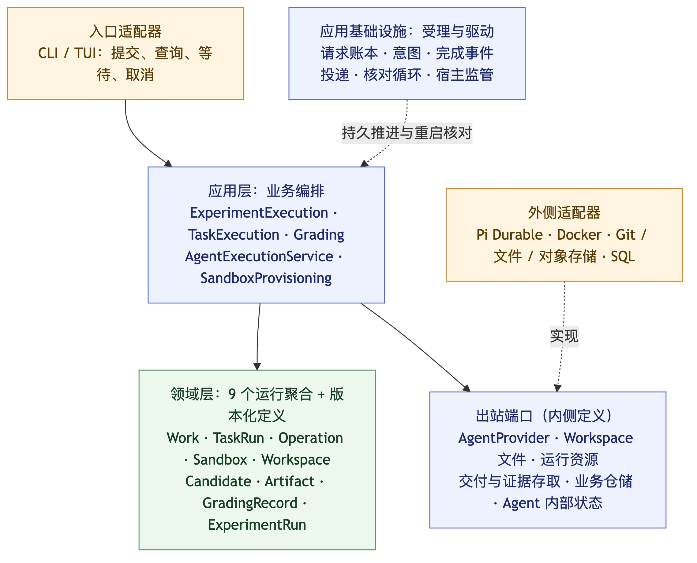
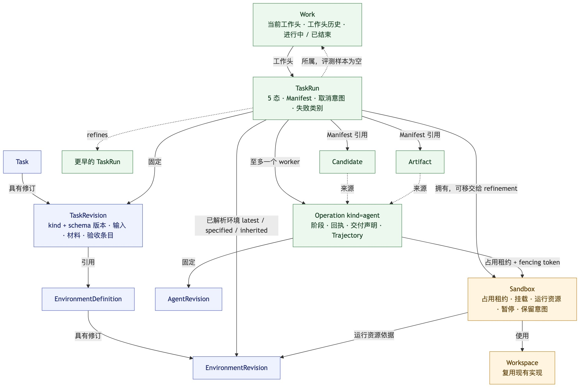
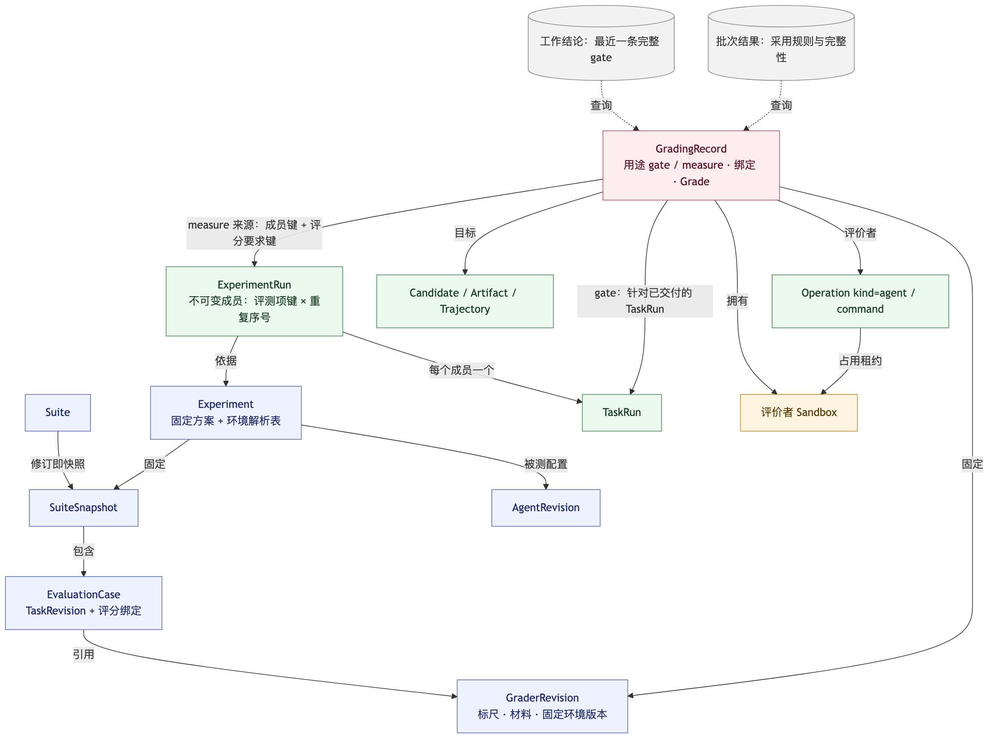
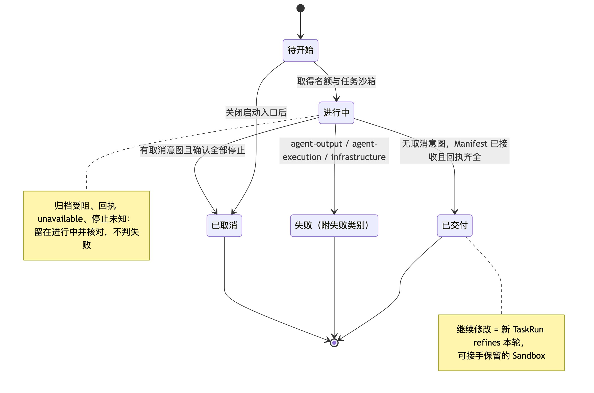
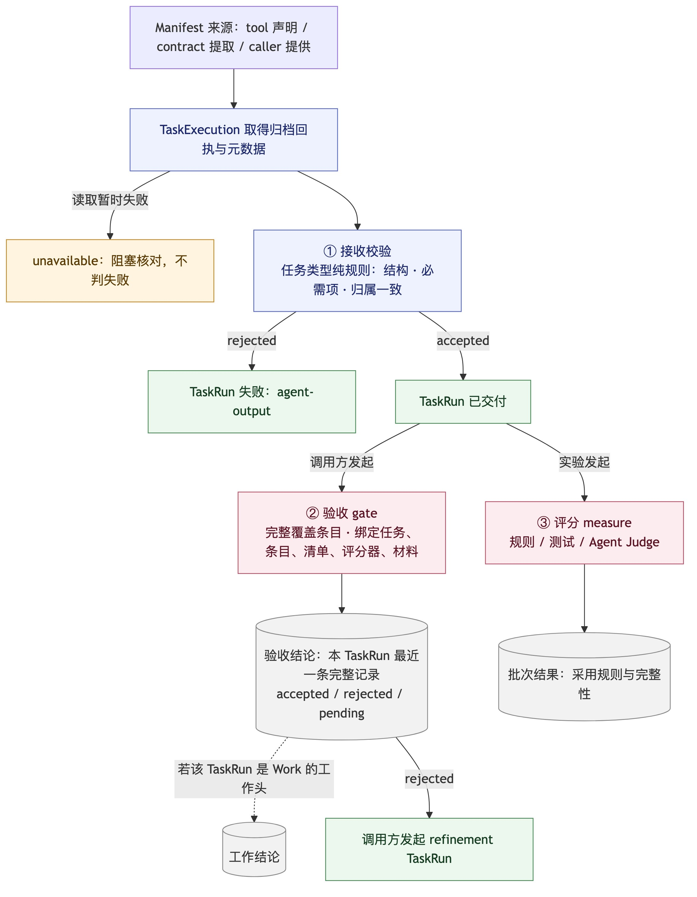
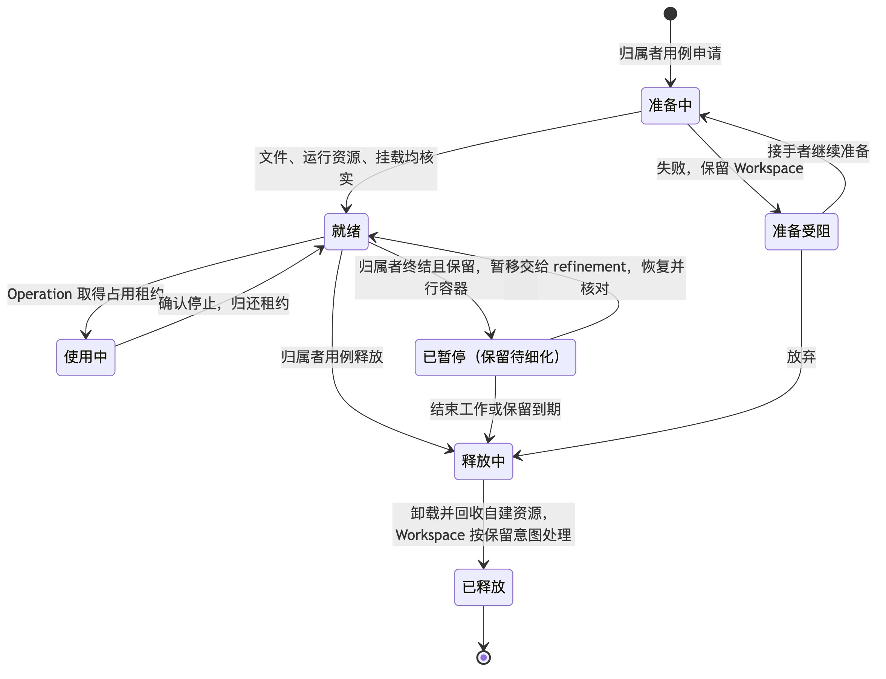
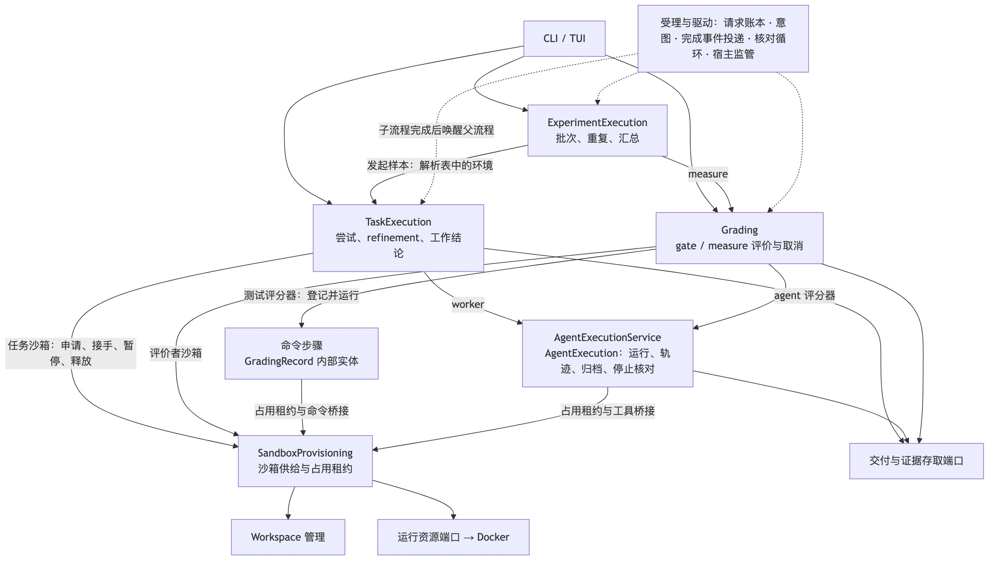
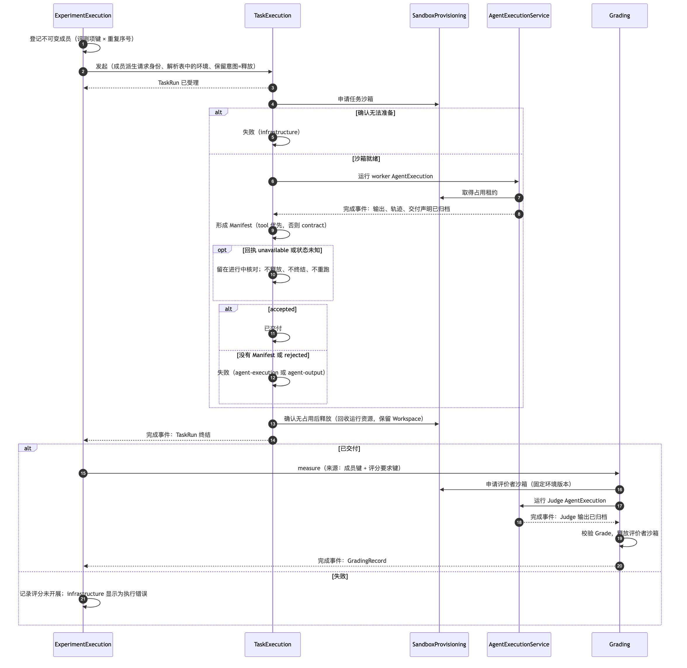
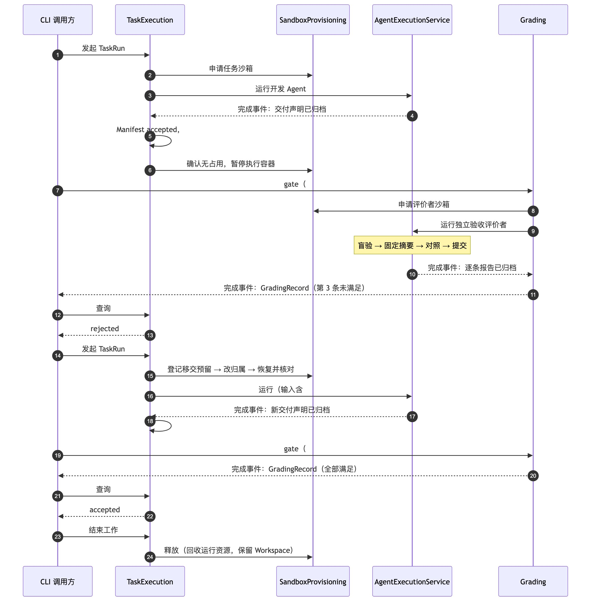

# 通用 Agent 执行与评测：目标模型

- 版本：R2，日期 2026-11-02。
- 状态：**已确认，待实现**。由助手按用户授权，依据设计评审与独立复审对 [0001 决策记录](0001-unified-agent-evaluation.md) 作出的结构修订：
  - R1：D129–D137，并经两轮复审补齐（D138、D139）。
  - R2：D140，按“领域层挑战”合并概念，并把“继续修改”改为 refinement 尝试链；D141 补齐 R2 复审发现的缺口；D142 增加“当前工作头”（Work 聚合）；D143 把执行模型改为 AgentExecution 聚合加 GradingRecord 内的命令步骤，两者共同实现 Sandbox 的占用者契约；D144 补齐 Work 结束协议、评分终态竞争与迁移原则。

  均已获用户确认，生产代码尚未实现。
- 前提：本文以[项目愿景与核心原则](../vision.md)为前提。愿景第 7 节列出的差距（自带 Agent 的开发路径、沙箱集成优先、本地低摩擦）将在后续修订中补入本文。
- 用途：一份可单独阅读的当前目标模型，与 0001 中的旧决策冲突时以本文为准。0001 记录讨论历史与理由；开发时先读本文，再按需回查对应决策。

## 1. 一页结论

保留的方向：通用任务执行在下，评测叠在上；Candidate、Artifact、Trajectory 并列；评分不依赖实验；失败、未知与成功严格区分；交付与轨迹先归档、再判成功；宿主崩溃后先核对、再由调用方手动恢复。

| # | 设计要点 | 决策 |
| --- | --- | --- |
| 1 | **TaskRun 只回答“这一轮交付了没有”**：五个状态，没有完成策略，没有“等待继续”。验收不通过时，发起一次 refine 上一轮的新 TaskRun，并接手上一轮保留的 Sandbox | D140 |
| 2 | **交付与验收是两件独立的事**：TaskRun 的“已交付”与验收结论分开记录。验收结论针对单个 TaskRun，由验收记录查询得出；一项开发工作的**工作结论**由当前工作头的状态推导，仅当工作头已交付时取其验收结论 | D130、D140、D141、D142 |
| 2a | **当前工作头**：开发工作由一个 Work 记录，它指向当前选中的 TaskRun；“继续”会 refine 工作头并原子地移动它，也可以把工作头显式切到树上的任意节点 | D142 |
| 3 | **验收与评分统一为 GradingRecord**（用途分 gate / measure）。gate 记录完整绑定任务、条目、清单、评分器和材料，采用“最近一条完整记录” | D130、D138、D139 |
| 4 | **执行按实际生命周期建模**：Agent 执行是独立聚合 AgentExecution，被测与评价者共用；测试评分器的命令运行是 GradingRecord 内部的命令步骤。两者都实现 Sandbox 的占用者契约。评价者执行不产生 TaskRun | D131、D143 |
| 5 | **资源统一为 Sandbox**：Workspace、运行资源、挂载、占用和暂停都在一个聚合里。归属者是 TaskRun 或 GradingRecord，可以移交给 refine 它的下一轮 | D132、D140 |
| 6 | **环境**：任务引用环境定义，受理时解析为确切版本，也可由调用方显式指定；评分器直接固定环境版本 | D133、D140 |
| 7 | **版本化定义共用一套机制**；任务类型降为任务修订上的 `kind` 加 schema 版本，一期只有 coding、working | D134、D135、D140 |
| 8 | **受理与驱动共用基础设施**：请求账本、意图记录、完成事件投递、核对循环、宿主监管 | D136、D138 |

第 10 节列出受影响的旧决策。

## 2. 分层总览

[Mermaid 源](../assets/model-layers.mmd)

- **入口适配器**只负责把请求转换为应用调用，不编排步骤。
- **应用层**负责业务编排：调用领域对象完成状态转换，通过端口执行外部动作，并按回执推进。
- **领域层**由聚合组成，每个聚合守护自己的不变量，自身不做 I/O。
- **受理与驱动**是应用层共用的基础设施，不承载业务规则（第 7.3 节）。

## 3. 领域模型

### 3.1 任务运行与资源

[Mermaid 源](../assets/model-domain-run.mmd)

### 3.2 评价与评测

[Mermaid 源](../assets/model-domain-eval.mmd)

图中颜色：蓝色为版本化定义，绿色为运行事实，橙色为资源，红色为评价记录，灰色为查询结果。

### 3.3 术语

| 术语 | 含义 |
| --- | --- |
| 版本化定义 | 稳定的定义身份，加不可变的修订：Task / TaskRevision、Agent / AgentRevision、Grader / GraderRevision、Environment / EnvironmentRevision、Suite / SuiteSnapshot。SuiteSnapshot 就是 Suite 的修订 |
| 任务类型 | TaskRevision 上的 `kind`（一期为 coding、working）加 schema 版本。类型规则随 Grounds 发布，不单独建实体 |
| refinement 链 | 一个 TaskRun 可以 refine 一个更早的 TaskRun（同一 Task，引用其交付）。由此形成一棵尝试树，用来表达“验收不通过后继续修改” |
| Manifest（交付清单） | 一轮尝试正式交付的 Candidate / Artifact 引用清单。来源（origin）有三种：`tool`（Agent 用交付工具声明）、`contract`（按输出契约从归档输出中提取）、`caller`（调用方提供）。状态有 pending-receipt、accepted、rejected、unavailable 四种 |
| AgentExecution | 一次确定配置的 Agent 执行：会话、轨迹、输出与交付声明的归档、恢复、Agent 名额。被测 worker 与评价者共用这一概念，只是归属与角色不同 |
| 命令步骤 | 测试评分器在 Sandbox 内的一次命令运行，属于 GradingRecord 内部的实体：命令规格、退出结果、停止观测。不能恢复，也没有独立于这条评分记录的生命 |
| 占用者契约 | Sandbox 对占用者的要求：使用桥接时出示当前 fencing token；报告“已确认停止”的事实；能被核对循环核对。AgentExecution 与命令步骤各自实现，不共享父类 |
| 占用租约 | 占用者使用 Sandbox 时取得的互斥租约，带单调递增的 fencing token；确认停止后才归还。租约记录带类型的占用者引用：一个 AgentExecution，或“某条 GradingRecord 的某个命令步骤” |
| 已解析环境 | TaskRun 实际使用的 EnvironmentRevision，并记录来源：`latest`（受理时取最新发布修订）、`specified`（调用方显式指定）或 `inherited`（从移交来的 Sandbox 继承） |
| 验收结论 | 针对**一个**已交付的 TaskRun：在与其 Manifest 和验收契约一致的完整 gate 记录中，按稳定的请求顺序取最近一条，得出 accepted、rejected 或 pending。这是查询结果，不另存状态 |
| Work（工作） | 一项开发工作：同一 Task 下的一棵 refinement 树，加一个**当前工作头**（当前选中的 TaskRun）。评测样本不属于任何 Work |
| 工作结论 | 由 Work 当前工作头推导的查询结果，覆盖全部情况：工作头待开始或进行中 → `in-progress`；失败 → `failed`；已取消 → `cancelled`；已交付 → 其验收结论 `pending` / `accepted` / `rejected`；迁移而来、尚未选择工作头 → `head-unselected`。不另存状态 |

### 3.4 聚合与不变量

共 9 个运行聚合，外加一组版本化定义。每个聚合都有版本号，状态转换按版本比较后提交（CAS）。跨聚合规则见第 3.5 节。

| 聚合 | 拥有的状态 | 必须守护的不变量 |
| --- | --- | --- |
| **Work** | Task；当前工作头（一个 TaskRun；仅迁移而来的 Work 可以暂时为空）；工作头变更历史（只追加，原因为：发起、继续、手动选择、迁移默认）；状态（进行中 / 结束中 / 已结束）；结束事实（结束时的工作头与当时观察到的工作结论） | 同一 Task 可以有多个 Work，各自的工作头与可变 Sandbox 互不共享。工作头必须是本 Work 下的 TaskRun。移动工作头时按版本比较，并带上期望的旧工作头：两个“继续”同时到达时只有一个成功，另一个返回冲突与当前工作头。进入“结束中”后不再接受新的 TaskRun 或工作头变更。结束协议见第 4.5 节 |
| **TaskRun** | 五个状态；TaskRevision；所属 Work（可空，创建时固定，评测样本为空）；refines（可空，必须指向同一 Task、同一 Work 下已终结的 TaskRun）；已解析环境；至多一个 worker AgentExecution；Manifest；取消意图；阻塞原因；失败类别；任务 Sandbox | **已交付**需同时满足：没有取消意图；Manifest 已被接收（accepted），且所列交付与要求的轨迹都有归档回执；名下没有运行中或停止状态未知的 AgentExecution。worker 本身失败不影响已交付的判定。**失败**必须附失败类别。取消意图登记后，不再启动执行，也不再接收 Manifest。终态不可重开，晚到的回执只记为历史。一个 TaskRun 至多一个 worker AgentExecution；恢复执行时沿用原身份 |
| **AgentExecution** | 归属（TaskRun 或 GradingRecord）；角色（worker / evaluator）；AgentRevision；Sandbox；占用租约；阶段；Durable 会话映射；回执（输出、轨迹、交付声明）；停止观测；评价协议阶段与只追加的协议命令观测（评价者用，承接旧 VerificationRun 的 `RunCommand`） | 成功需要输出与轨迹的归档回执全部到齐。归档受阻时只补做归档，不重跑模型。恢复沿用原身份。同一时刻只有一个运行拥有者 |
| **Sandbox** | 归属者；Workspace 及其来源（自建或借用）；运行资源（依据的 EnvironmentRevision、资源身份、阶段）；挂载；当前占用租约；执行容器的暂停事实；保留意图；生命周期操作预留（移交 / 释放 / 暂停 / 恢复，带操作身份）；移交记录 | 同一时刻至多一个占用租约，桥接只接受当前 fencing token。同一时刻至多一个生命周期操作预留：任何会做外部 I/O 的生命周期操作，都必须先以 CAS 登记预留，再执行 I/O，最后核对并完成；崩溃后沿原预留核对，不重新竞争。存在占用、或停止状态未知时，不得卸载、暂停、移交或释放。只回收自建资源。准备失败时保留已就绪的 Workspace。只能移交给 refine 当前归属者的 TaskRun，且需满足：原归属者已终结、没有占用、保留意图为“保留待细化”。每次移交只有一个接收方 |
| **Workspace** | 复用现有的 CodeWorkspaceInstance / Route | 沿用 D109 以及现有的清理保护 |
| **Candidate / Artifact** | 身份、类型、冻结内容、来源 AgentExecution | 提交后不可变；保存重试返回同一个引用（D47） |
| **GradingRecord** | 用途（gate / measure）；来源；目标集合；GraderRevision；实际材料的确切身份；评价者 AgentExecution（Agent 型）或命令步骤（测试型，内部实体，0..n）；评价者 Sandbox；评分状态（进行中 / 已完成 / 评分器故障 / 已取消）；取消意图；Grade；gate 用途另有绑定（第 5.3 节） | 命令步骤的状态：启动意图 → 运行中 → 停止请求 → 停止未知 / 已停止有结果 / 已停止结果未知；只有确认已停止才归还占用租约。终态按“先提交者生效”唯一确定（第 4.6 节）：未登记取消意图时，命令确认已停止却没有可信退出结果，整条评分记为评分器故障，不自动重跑；所有命令步骤都已停止并取得结果后，评分才能完成。登记取消意图后，不再启动评价者执行或命令步骤，主状态只能走向已取消，退出结果未知仅作为诊断保留；之后到达的 Grade 只记为历史。对已终结的评分发取消请求，返回现有终态。Grade 必须符合 GraderRevision 声明的形式与标尺。评分器故障与合法的“无法判定”分开记录。完成后不可修改，重评只能新增记录。gate 记录必须覆盖全部预期条目 |
| **ExperimentRun** | 计划成员（评测项键 × 重复序号，以及由成员键派生的 TaskRun 请求身份）；重复次数；任务并发数；取消意图 | 成员在批次发起时一次性登记，键唯一，记录不可变。“评分未开展”及其原因（TaskRun 失败、批次取消、尚未调度）由成员 TaskRun 状态、取消意图和评分记录的缺失推导，不另写事实。恢复时不新增成员。登记取消意图后，不再为任何成员发起 TaskRun 或评分 |
| **版本化定义** | 定义身份与修订 | 发布后不可修改；引用必须指向确切的修订 |

以下只是值，不单独成为实体：Manifest、已解析环境、EvaluationCase（快照内带稳定键的值）、Grade、执行输入、失败类别。

### 3.5 跨聚合规则及其保证方式

| 规则 | 保证方式 |
| --- | --- |
| 子流程结束后，父流程一定会被推进 | 子流程在终结的同一事务里写入完成事件，由受理与驱动可靠投递（第 7.3 节） |
| 已解析环境必须属于任务引用的环境定义 | TaskExecution 受理时校验 |
| 在 Work 中受理任何 TaskRun（包括移动工作头的“继续”，以及不移动工作头的分支） | TaskRun 受理与 Work 的状态和版本检查（必要时连同工作头更新）在同一个账本事务中提交；Work 处于“结束中”或“已结束”时一律拒绝。两者都是业务记录，不涉及外部 I/O |
| refinement 接手 Sandbox 时，接收 TaskRun 与 Sandbox 的归属变更要一致 | 先在 Sandbox 上登记以接收 TaskRun 请求身份为键的移交预留，再受理 TaskRun；移交失败时 TaskRun 改用新 Sandbox 或受理失败，不会出现“记录了 inherited 环境却没有 Sandbox”的状态 |

## 4. TaskRun 与 refinement

[Mermaid 源](../assets/model-taskrun-states.mmd)

### 4.1 五个状态与失败类别

状态：待开始、进行中、已交付、失败、已取消。“已交付”是唯一的成功终态，只表示交付有效且已归档；是否通过验收看验收结论（第 5.3 节）。

| 失败类别 | 触发条件 |
| --- | --- |
| `agent-output` | 本轮结束时没有可接收的 Manifest，或 Manifest 被拒收（rejected） |
| `agent-execution` | worker AgentExecution 确认失败，且本轮没有可接收的 Manifest |
| `infrastructure` | Sandbox 确认无法准备，或宿主、存储故障导致本轮无法继续 |

判定顺序（互斥，自上而下取第一条）：

1. Manifest accepted 且回执齐全 → 已交付，worker 失败只记为历史；
2. Manifest rejected → `agent-output`，不再看 worker 成败；
3. 没有 Manifest 且 worker 失败 → `agent-execution`；
4. 没有 Manifest 且 worker 正常结束 → `agent-output`。

以下情况既不算失败，也不算交付：归档受阻、回执 unavailable、停止状态未知。此时 TaskRun 留在“进行中”并记录阻塞原因，由核对循环处理（D1、D35）。调用方如果要放弃，走取消流程。

批次结果查询把 `infrastructure` 显示为执行错误，不计入质量结论；是否重新尝试由调用方明确发起，不自动补跑（D66）。

### 4.2 Manifest 的形成

1. **agent 来源的 TaskRun**：worker AgentExecution 归档完成后，TaskExecution 以“执行 ID + manifest”为操作身份形成 Manifest。Agent 已用交付工具声明的，以声明为准（origin = `tool`）；没有声明时，由任务类型规则按输出契约从归档输出中确定性提取（origin = `contract`，提取是纯函数）。工作目录里既未声明、也不在输出契约内的文件，不算交付。
2. **caller 来源的 TaskRun**：调用方直接提供完整清单，例如人工修正后的 Candidate。这样的 TaskRun 没有 worker 执行，origin = `caller`。清单引用的交付必须来自同一 Task 下的 TaskRun（与现有 Candidate 必须属于同一 IssueRevision 链的规则一致）；一期不支持跨 Task 采用交付。
3. **接收校验**：先取得归档回执与元数据，再交给任务类型的纯规则判定。结果有三种：`accepted`（冻结 Manifest）、`rejected`（失败，类别 agent-output）、`unavailable`（阻塞核对，不判失败）。
4. 不按创建时间去猜“最新产物”（D43）。一个 TaskRun 只有一份 Manifest；想换一份清单，就发起一个新的 refinement。

### 4.3 Work 与 refinement：验收不通过后继续修改

开发入口有三种：

| 操作 | 效果 |
| --- | --- |
| 开始工作 | 创建 Work 和第一个 TaskRun，工作头指向它 |
| 继续 | 发起一个 refine 当前工作头的 TaskRun，并把工作头移到它（期望旧工作头 = 当前工作头）；默认接手工作头保留的 Sandbox |
| 选择工作头 | 把工作头显式切到同一 Work 中的另一个 TaskRun，例如回到之前那份更好的交付；不发起新的执行 |

也可以 refine 树上的任意节点而不移动工作头（形成分支），但必须显式选择；这时默认不接手 Sandbox。

- 调用方发起新的 TaskRun，并指明 `refines`：被 refine 的 TaskRun 必须已终结，且属于同一个 Task；尚未终结（例如停止状态仍未确认）时，受理直接拒绝并返回原因。新的 TaskRun 可以使用更新的 TaskRevision；验收契约变化时按 D111 全部重验。
- 如果被 refine 的 TaskRun 保留了 Sandbox（保留意图为“保留待细化”），新 TaskRun 可以申请接手。移交分三步：
  1. 在 Sandbox 上以 CAS 登记移交预留，绑定接收 TaskRun 的请求身份。前提是归属者已终结、没有占用、没有其他生命周期预留。同一个 Sandbox 只有一个预留能成功；失败的一方可以显式改用新的 Sandbox。
  2. 归属改为接收 TaskRun，然后按 Sandbox 当前阶段继续：已暂停的就恢复并核对，准备受阻的就继续未完成的准备步骤。
  3. 核对完成后清除预留。崩溃后沿原预留继续，不重新竞争。
- 环境优先级：接手 Sandbox 时，已解析环境一律继承（inherited）。如果调用方同时显式指定了不同的版本，或新 TaskRevision 引用了另一个环境定义，则不允许接手，返回“请改用新 Sandbox”。
- 上一轮的交付会作为执行输入提供给新一轮，例如“在 Candidate X 的基础上修改，修正第 3 条”。worktree 里未提交的现场随 Sandbox 一起保留，但不属于正式交付（D93）。
- refine 的对象也可以是失败的 TaskRun，例如执行崩溃后接着在原 worktree 里修。
- 评测样本不发起 refinement。每个样本就是一个 TaskRun。

### 4.4 取消

- 若“已交付”或“失败”在取消意图登记之前已经提交，取消请求直接返回该终态（D124）。
- 取消意图一旦登记：不再启动执行，也不再接收 Manifest；对正在运行的执行发出停止请求；之后到达的结果只记为历史；确认全部停止后，状态转为已取消。
- 从“待开始”转为已取消之前，必须先关闭启动入口，并确认没有已预留的执行。
- 取消 TaskRun 不影响已经发起的 gate 评分。gate 评分属于 GradingRecord，通过 Grading 的取消入口单独取消（第 3.4 节）。

### 4.5 结束工作

1. 登记结束意图：Work 进入“结束中”，关闭新 TaskRun 和工作头变更的入口。
2. 如果 Work 下还有待开始或进行中的 TaskRun，结束请求返回冲突并列出这些 TaskRun。调用方需要先取消它们（并等待停止确认），或等它们自然终结后再重试。系统不会自动取消。
3. 对该 Work 下所有“保留待细化”的 Sandbox 登记释放预留，然后提交“已结束”，同时记录结束事实：结束时的工作头，以及当时观察到的工作结论。释放 I/O 按预留在后台完成。
4. 尚未终结的 gate 不受影响，它们属于 GradingRecord。结束后，工作结论仍是查询结果，后续重验可能改变它；结束事实保留结束那一刻的观察，两者并列展示。

### 4.6 评分的取消与终态竞争

GradingRecord 和 TaskRun 一样，所有转换都按版本比较后提交，**先提交的终结转换生效**：

- 已完成或评分器故障先成为终态时，之后的取消请求直接返回该终态。
- 取消意图先提交时，主状态只能走向已取消；之后核对出的“退出结果未知”或晚到的 Grade 只作为诊断和历史保留。
- CAS 冲突时，必须重读整条 GradingRecord，再按上述规则重新判定，不能盲目重试旧的变更。命令的流式输出写入外部证据存取，聚合内只保存摘要与最终回执，避免频繁更新同一个版本。

## 5. 三级检查：接收校验、验收、评分

[Mermaid 源](../assets/model-checks.mmd)

### 5.1 接收校验

接收校验属于 TaskRun 内部的一步（第 4.2 节第 3 条）。任务类型的规则只检查结构、必需项，以及与任务仓库和基线的一致性，本身不做任何读写。

### 5.2 Grade 的三种形式

数值、分类、**逐条结论**。逐条结论的每一项包含：条目 ID、独立判断、对照结论、最终结论（满足 / 未满足 / 无法判定），以及理由和证据引用。评分器故障与合法的“无法判定”分开记录（D13）。

### 5.3 验收 gate、验收结论与工作结论

- **由谁发起**：gate 由调用方针对一个已交付的 TaskRun 显式发起，与现有的独立验收工作流一致。TaskRun 本身不触发验收。
- **绑定**：一条 gate 记录绑定以下内容，并且必须覆盖全部预期条目，否则不能被采用：
  - TaskRevision；
  - 验收条目全集的摘要；
  - Manifest 摘要；
  - GraderRevision；
  - GraderRevision 声明的全部目标与材料的确切身份，包括 Manifest 之外的材料，例如被验收的 Trajectory。
- **补验（D111）**：清单和契约都没变时，也写一条新的完整记录。这次没有重新核验的条目，引用旧记录中已满足的条目结论，但只能引用绑定完全相同的旧记录。
- **验收结论**：查询某个已交付 TaskRun 的验收结论时，在 Manifest 摘要和验收条目摘要都与它一致的完整 gate 记录中，按稳定的请求顺序取**最近一条**，不论评分器版本。该记录全部条目最终满足即为 accepted，有任何条目未满足或无法判定即为 rejected，还没有完整记录则为 pending。更早的、结论相反的记录保留为历史，在查询中显示为 disputed。
- **单一性**：同一 TaskRun、同一组绑定上，同时只允许一个未终结的 gate 请求（请求账本防重）。宿主重启后的重新驱动沿用原请求身份。
- **评分器版本**：调用方未指定时，使用当时的内置独立验收评分器版本。评分器版本或材料不同就是不同的完整绑定，补验时旧结论不能被引用；但采用时只看请求顺序。
- **工作结论**：由 Work 当前工作头的状态推导（第 3.3 节）；仅当工作头已交付时，取其验收结论。工作头只能由“继续”或“手动选择”显式移动，绝不按创建时间或验收结果自动推断。例如 #1 后来的 gate 通过、#2 的 gate 不通过，而工作头在 #2 上，那么工作结论就是 rejected；用户若认可 #1，就把工作头切回 #1，工作结论随之变为 accepted。CLI 同时展示整棵树和各节点的验收结论，并标出工作头。

### 5.4 内置独立验收评分器

这是一个 agent 型 GraderRevision：一个评价者一次核验全部条目。盲验、固定、对照、交接、提交等阶段，记录在评价者 AgentExecution 的协议阶段里；盲验结果在“固定”阶段记下摘要，之后的对照阶段不能改写它。

| 现有 | 目标 |
| --- | --- |
| VerificationReport 逐条的 independent / reconciliation / final | gate GradingRecord 逐条结论中的三段 |
| VerificationRun 的 blind / freeze / reconcile / handoff / submit | 评价者 AgentExecution 的协议阶段；旧记录没有轨迹，标注为缺失，不补造。旧记录中的 `RunCommand` 对应为协议阶段中的命令记录 |
| 候选 standing 中的 disputed 汇总 | 由同一组绑定下的多条 gate 记录派生的查询结果 |
| DevRun.refines_candidate_id | TaskRun.refines 加上一轮的交付输入 |

## 6. 资源：Sandbox

[Mermaid 源](../assets/model-sandbox-states.mmd)

- **归属**：
  - 任务 Sandbox 归 TaskRun。TaskRun 终结后，按保留意图处理：
    - 评测样本默认“释放”：卸载、回收自建运行资源，按 D96 保留 Workspace 文件。
    - 开发任务默认“保留待细化”：确认没有占用后，暂停执行容器，依赖服务不动（D113）。之后的去向有三种：被 refinement 接手；结束 Work 时释放该 Work 下所有保留的 Sandbox；或保留到期后由现有清理机制处理。移交、释放和到期清理都必须先取得生命周期预留（第 3.4 节），先成功的一方生效，另一方失败并返回原因。这与现有 Workspace 清理的 `cleanup_operation_id` 预留方式一致。
  - 评价者 Sandbox 归 GradingRecord，评分结束即释放。
- **生命周期操作**：暂停、恢复、移交、释放，都必须由负责归属者的应用用例（TaskExecution 或 Grading）发起，并携带匹配的归属者身份；SandboxProvisioning 还会校验资源所有权。占用者（AgentExecution 或命令步骤）只能申请和归还占用租约。
- **占用**：取得占用租约时拿到新的 fencing token，文件桥接和命令桥接只接受当前 token。宿主崩溃后，由核对循环确认实际已停止，再归还或接管租约。
- **运行资源**：原 EnvironmentInstance 并入 Sandbox，记录依据的 EnvironmentRevision、资源身份和阶段。一期不支持多个 Sandbox 借用同一份运行资源；需要时再拆出来。Workspace 可以借用，借用的只交还、不删除。

**一期 Workspace 形态：**

| 任务类型 | Workspace |
| --- | --- |
| coding | 现有配置：多仓库只读基线，加目标仓库的可写 worktree |
| working | 复用现有配置：所选 Git 仓库作为只读材料，另加一个由 Workspace 管理的可写输出目录 |

Git 之外的材料（文件、S3 等）推迟到有真实需求时再扩展。

## 7. 应用层

[Mermaid 源](../assets/model-app-modules.mmd)

| 模块 | 调用方表达的意图 | 内部承担 | 明确不做 |
| --- | --- | --- | --- |
| **TaskExecution** | 开始工作、继续、选择工作头、结束工作；发起独立 TaskRun（可指定 refines、是否接手 Sandbox、显式环境版本、保留意图、Agent，或直接提供清单）；取消；查询 TaskRun、验收结论、Work 与工作结论 | 维护 Work 的工作头（与 TaskRun 受理同一事务）；推进 TaskRun；解析并校验环境；申请、接手、暂停、释放任务 Sandbox；调用 AgentExecutionService；形成 Manifest 并做接收校验 | 不自动发起验收，不解析 Durable 事件，不执行挂载，不解释质量分数 |
| **AgentExecutionService** | 运行、查询、请求停止、核对、恢复一个 AgentExecution | 取得占用租约并建立工具桥接；驱动 Durable；归档轨迹、输出、交付声明和协议阶段；确认停止；管理宿主级的 Agent 名额 | 不创建或回收资源，不判断任务成败 |
| **Grading** | 按 GraderRevision 以 gate 或 measure 用途评价确切目标；取消一条评分 | 准备材料。规则评分器直接计算；测试评分器申请评价者 Sandbox，在 GradingRecord 内登记命令步骤并经 Sandbox 的命令桥接运行，自行核对命令步骤的停止事实；Agent 评分器通过 AgentExecutionService 运行。校验 Grade 后保存 | 不修改 TaskRun，不依赖实验 |
| **ExperimentExecution** | 运行批次、补评、取消、查询 | 发起批次时登记成员；用环境解析表中的版本发起 TaskRun（保留意图为“释放”）；已交付后发起 measure；“评分未开展”由查询推导；采用规则（D64）与完整性按查询得出；管理任务名额 | 不复制执行或评分流程 |
| **SandboxProvisioning** | 申请、暂停、恢复、移交、释放、核对 Sandbox；签发与回收占用租约 | 协调 Workspace 管理与运行资源端口，封装挂载顺序与失败补偿，提供带 fencing 校验的桥接 | 不决定何时保留、何时释放 |
| Workspace 管理 | 只由 SandboxProvisioning 调用 | 沿用 D109 | — |
| 交付与证据存取 | 保存与读取交付和证据，取得回执与元数据 | 按类型分端口（D46、D47） | 不决定任务成败 |

依赖关系无环：ExperimentExecution 依赖 TaskExecution 和 Grading；这两者依赖 AgentExecutionService 和 SandboxProvisioning；它们再依赖 Workspace 管理与各端口。

### 7.1 评测样本流程

[Mermaid 源](../assets/model-seq-eval.mmd)

### 7.2 开发流程（验收不通过后 refinement）

[Mermaid 源](../assets/model-seq-dev.mmd)

### 7.3 受理与驱动

TaskExecution、AgentExecutionService、ExperimentExecution 和异步评分都遵循同一模式：持久化请求与意图，立即返回身份，在后台推进；宿主重启后先核对（D53、D73、D74）。共用的基础设施包括：

- **请求账本**：按请求身份防重；同一身份如果输入不同，报告冲突（D54、D122）。
- **意图记录**：先登记下一步外部动作，再执行；回执与状态转换在同一事务中写入。
- **父子关联**：子请求记录父意图的身份。子流程终结时，在同一事务中写入完成事件；投递器把事件幂等地交给父模块，宿主重启后重新投递尚未投递的事件。
- **核对循环**：对“意图已登记、结果未知”的工作调用对应模块的核对接口。它只核对，不自动恢复执行（D74）。
- **宿主监管**：每个数据根一个本地 `grounds` 宿主进程，由 CLI 在首次受理异步工作时按需拉起，没有活动工作时退出。CLI 断开不影响执行。

这套设施不定义业务步骤，也没有 DSL；收到事件后下一步做什么，由各模块自己决定。

**并发名额：** Agent 名额由宿主统一计数，默认 20，worker 与评价者共用；任务名额由 ExperimentRun 计数，默认 5。TaskRun 终结即释放任务名额；保留的 Sandbox 不占名额。

## 8. 版本化定义与环境

**共享版本机制。** 第 3.3 节列出的五组定义共用一套仓储与发布逻辑：修订序号、前一修订、内容摘要，以及乐观并发发布；每组只需定义自己的内容 schema。现有的 WorkspaceConfigurationVersion 保持原样（D109）。

**环境：**

| 引用方 | 引用方式 | 解析 |
| --- | --- | --- |
| TaskRevision | 引用 EnvironmentDefinition | 普通任务在受理时取最新发布的修订（来源 `latest`）；调用方可以显式指定同一定义下的某个修订（来源 `specified`），例如复现历史运行、或使用实验的环境解析表；接手 Sandbox 时继承（来源 `inherited`）。结果记录在 TaskRun 上 |
| Experiment | 创建时为每个评测项解析一次，形成环境解析表 | 该实验的所有批次都以 `specified` 方式使用这张表 |
| GraderRevision（测试型或 agent 型） | 直接固定一个 EnvironmentRevision | 不解析；更换环境就发布新的 GraderRevision |

D79 的准确含义：实验不接受用户另选或覆盖环境，但可以保存由任务要求自动解析出的结果，作为固定方案的一部分。

## 9. 一期范围

- 内置任务类型 coding 与 working；working 只支持第 6 节所述的 Workspace 形态。
- Durable 的内部状态先只实现 SQLite，保留 D72 定义的存储端口。
- 不做任务类型扩展机制，不做 D68 的通用 Provider 能力矩阵，也不做跨 Sandbox 借用运行资源。

## 10. 受影响的旧决策

| 旧决策 | 处理 |
| --- | --- |
| D34、D37 | 环境实例并入 Sandbox：互斥由 Sandbox 的占用租约保证，暂停事实由 Sandbox 记录 |
| D41、D43 | 交付的两种来源都保留，形成 origin 为 `tool` 或 `contract` 的 Manifest；每个 TaskRun 只有一份 Manifest |
| D56 | Agent 名额按宿主统一计数 |
| D72 | 端口保留，一期只交付 SQLite |
| D79 | 解释为“不接受另选的环境，可以保存自动解析出的结果” |
| D80、D82、D83、D100、D117 中 Judge 走通用任务执行 | 由 D131 取代：Judge 是评价者 AgentExecution |
| D82 | 任务类型的扩展方式推迟；AgentExecution 保留（D143） |
| D87、D95、D97、D98、D112、D116、D123、D126、D129 | 由 D140 取代：TaskRun 改为五个状态，没有完成策略和“等待继续”。同一次尝试内的修正、继续执行、替换清单，改为 refinement TaskRun 接手 Sandbox；暂停作用于终结后保留的 Sandbox |
| D7、D49、D50、D52、D60–D66 中 EvalRun 作为有状态记录 | 由 D140 取代：改为 ExperimentRun 内不可变的成员记录，采用、补评关联、完整性与样本计数都按成员键和 GradingRecord 查询得出 |
| D94、D117、D125、D127 中同一 TaskRun 多次执行、六态 TaskRun 与 Verification 模块 | 一个 TaskRun 至多一个 worker AgentExecution，继续工作走 refinement；Verification 并入 Grading |
| D138、D139 中的 CommandRun 聚合，D140 中的 Operation | 由 D143 取代：AgentExecution 聚合，加 GradingRecord 内部的命令步骤；共有规则落在 Sandbox 的占用者契约 |
| D84、D85 中独立版本化的 TaskType | 降为 TaskRevision 上的 `kind` 与 schema 版本 |
| D102 | `failed` 表示“本轮不再继续”，失败类别为 agent-output、agent-execution、infrastructure |
| D103、D104、D110、D115 | 统一为 gate GradingRecord；“全部条件必须满足”作为验收结论 accepted 的规则 |
| D119–D121、D125、D127、D133 中的资源与环境 | 资源准备交给 SandboxProvisioning；任务引用环境定义并解析，评分器固定环境版本 |

其余已确认的决策不变。

## 11. 留给实现方案的事项

以下事项不改变业务规则，在实现设计中给出具体结构：

- 宿主进程的拉起锁与退出协议，以及 CLI 中 Ctrl-C 的语义。
- 占用租约与 fencing token 的持久化字段和续期方式，以及桥接端口的签名。
- 完成事件的表结构与投递重试策略。
- 开发场景中保留待细化的 Sandbox 的默认保留期，以及生命周期预留与现有清理机制的衔接。
- CLI 的 Work 视图、“继续”与“选择工作头”命令的交互形式。
- 旧 Verification、VerificationRun、DevRun 的逐字段迁移，以及环境解析表与历史实验的兼容读取，遵循第 12 节的迁移原则。

## 12. 迁移原则

以下原则在实现方案中作为第一个迁移决策落实，具体字段映射由实现设计给出。

- **Work 的划分**：同一 Issue 下，不 refine 任何 Candidate 的 DevRun 各自作为一棵树的根；`refines_candidate_id` 指向的 Candidate 由哪个 DevRun 产生，该 DevRun 就是父节点。每棵树形成一个 Work。
- **历史工作头**：树只有一个叶子时，以“迁移默认”为原因把工作头设为该叶子；有多个叶子时，工作头暂时为空，工作结论显示 `head-unselected`，等用户首次显式选择。迁移不伪装成用户选择，也不按创建时间推断。
- **状态映射**：submitted 且有冻结 Candidate 的 DevRun → 已交付，Manifest 的 origin 为 `caller`，并标注迁移来源；abandoned → 已取消；切换时仍为 open 的 DevRun → 已取消，原因记为迁移（D114 已规定切换时不存在运行中的 DevRun）。
- **验收记录**：Verification → gate GradingRecord；VerificationRun 的阶段与 `RunCommand` → 评价者 AgentExecution 的协议阶段与协议命令观测，并标注轨迹缺失。测试型评分器的 `ProcessResult` → 命令步骤。
