# 通用 Agent 评测：开发共识与实施依据

- 日期：2026-10-31；最近更新：2026-11-02（D129–D143 目标模型 R2 已确认）。
- 决策状态：**已接受总体方向；实现尚未完成**。
- 范围：Grounds CLI 的评测领域模型、Agent 适配、轨迹与产物、并发，以及评测与开发共用的环境治理领域模型和容器执行。
- 用途：持续维护的开发依据。后续讨论形成的新结论更新本文件；提议、已确认要求与实际完成情况分别记录。

阅读顺序：**先读[目标模型](0001-target-model.md)**，它是 D129–D143 修订后可以单独阅读的当前目标模型（R2）（已确认，待实现）；第 3 节“D128 历史收敛版”只用于查阅旧迁移表与修订前的关系；后续旧图仅作历史说明。深模块边界仍见第 3 节；当前源码状态看第 5 节；第 7 节保留方案比较与此前评审，第 9 节为尚待验证的验收目标。

## 1. 我们要交付什么

让用户构建自己的题集，为每个任务提供输入、上下文或工具、预期表现和评分标准，再评测自己的 Agent。首批覆盖编程和知识问答，两者使用共同的执行与评测基础；后续类型通过扩展接入。

例如，同一套基础设施可以让一个 Agent 修改仓库并交付代码变更，也可以让另一个 Agent 使用知识工具回答问题。任务、可用工具和产物类型不同，但都需要执行任务、记录过程、收集产物并独立评分。

核心价值是**增加软件的通用评测能力和执行可靠性**：接入不同 Agent、保留可核查的过程与产物、并行处理任务，并清楚处理失败和恢复。降低用户和 Agent 的协调成本是收益之一；仅增加状态展示不足以完成本次目标。尚无真实用户对比数据，不能宣称已经提升多少效率或降低多少缺陷。

## 2. 已确认的设计原则

1. **业务流程依赖接口，具体 Agent 和任务类型通过适配器接入。** 先厘清领域概念，再组织流程；避免业务逻辑散落在 Codex、编程、问答的条件分支中。
2. **共同执行机制与任务特有语义同时保留。** 共用调度、运行记录、轨迹与产物采集；代码候选、答案、评分各自保留必需的字段与校验。
3. **同一个 Agent 执行接口服务于做题和评分。** 角色、提示、权限、工具与配置可以不同，做题和评分使用独立会话。
4. **一期采用 Pi Durable 单一内核（D69）。** 做题与 Agent Judge 共用小的 AgentProvider 端口，使用独立会话和配置；业务层不依赖 Durable 的具体类型。Codex、Pi Coding Agent SDK 和通用 ACP 不作为一期新增实现；现有 Codex 路径按迁移验证计划处理。具体发布版本、部署方式与最终 API 仍需落实。
5. **统一环境治理模型并复用容器执行能力。** 按 D28，评测与开发的底层环境治理收敛为一套领域模型；准备、启动、执行、回收遵守共同契约，Agent 适配器处理自身协议。不能只包装统一入口而在内部长期保留两套独立的环境身份、状态与恢复规则。
6. **失败、未知与成功必须可区分。** 轨迹缺失、结果不确定或容器启动失败，不能被当成答案质量差，也不能被记为成功。
7. **采用六边形架构，先对齐最内层领域模型。** 区分纯领域规则、应用用例协调、端口和外部适配器；深模块划分不等于把所有协调与 I/O 放进最内层。

### 逐项确认的关键决定

#### D1：执行完成包含结果归档——已确认，待实现

用户已明确接受：**执行模块交付已经保存好的结果，评测模块负责组织评测与评分。** 对成功执行宣布“完成”时，约定的产物与轨迹已经持久化，并可通过返回的身份 / 引用读取。Agent 进程结束与这一交付完成分别记录；执行完成本身不包含评分。

执行模块协调证据存取完成保存；证据存取仍拥有具体存储实现。若 Agent 已生成答案，但保存失败，应记录“Agent 已结束，归档未完成”，优先核对或补做原归档；无法确认时明确阻塞，不直接重新调用 Agent 产生新答案或费用。失败执行仍尽可能保留已有证据，不冒充成功交付；归档完成也不等于轨迹覆盖完整，覆盖限制需如实表达。

对比过的另一方案是“Agent 回答即完成，评测模块随后负责保存和补救”。不采用这一方案，因为它让上层必须理解临时路径、证据清单和归档恢复顺序，破坏执行模块应承担的封装边界。本条是设计决定，不表示代码已经落实。

#### D2：Provider 协议与任务语义分别封装——已确认，待实现

推荐在执行模块内部组合两类适配：Codex / Pi Provider 适配器负责调用对应 Agent 和解释其事件协议；任务 / 产物类型适配器负责把任务转换为公开执行输入、声明能力与输出契约，并从执行输出中提取、校验代码或答案等业务产物。二者经公共执行请求与结果契约协作，由执行模块统一负责环境、轨迹与归档衔接，调用方不手工拼接。

另一方案是在每个 Provider 内分别处理编程、问答、Judge 等所有业务格式，会使新增产物类型时同时修改所有 Provider。用户已同意上述职责分工；评分输出的业务解释仍由评分模块的策略负责，普通 Provider 无需理解分数。适配器的确切粒度与接口形状仍待设计。

按已确认的六边形架构进一步定位：**任务与产物的业务含义、合法性规则属于领域内部；任务适配器负责外部文本、文件与领域值之间的转换，并调用领域校验。** 不能把“任务语义不归 Provider”误解为“所有任务业务规则都搬到最外层适配器”。

#### D3：采用六边形架构，先讨论领域核心——已确认，待实现

用户明确要求按六边形架构设计，并优先逐项对齐最里面的领域层。此前四个深模块表示能力与知识边界，其中包含领域规则、应用协调和基础设施实现，**不能将整张模块职责图统称为纯领域层设计**。D1、D2 的边界决定继续有效，但启动 Agent、协调保存和回收资源由应用用例通过端口完成，领域对象自己不执行外部 I/O。

#### D4：Task 独立于具体执行者和评分策略——已确认，待实现

用户已接受：Task 只表达“做什么、允许使用什么公开输入 / 能力、应交付什么类型的结果”，不绑定具体 Agent 或评分器。AgentSpec 表达“谁来做及其配置”，GraderSpec 表达“按什么标准评价”；评测项 / 实验通过固定版本的引用将三者组合。任务自带的验收要求可以属于任务语义，但将其转换为某个 Judge 提示或规则程序属于评分策略。这样同一任务可以由 Codex 或 Pi 完成，也可使用不同版本的评分策略重评。本条确定领域职责，具体字段和现有 TaskDraft / Grader 绑定的兼容迁移仍待实现。

#### D5：AgentSpec 作为不可变版本定义——已确认，待实现

用户已接受：AgentSpec 表达为可固定引用的一份 Agent 配置，包括实现与版本、模型、通用指令、Skill / 工具定义及相关策略；任务内容仍由独立 Task 提供。一个已发布版本不原地改写，修改配置产生新版本；每个 AgentExecution 引用执行时选定的版本，同时记录实际观测信息。多个执行可复用同一个配置版本，不为每次执行复制一份新的 Agent 定义。

例子：同一个 Pi 内核从“不带检索 Skill”变为“带某个固定版本的检索 Skill”，两者是可区分的 Agent 配置版本；历史执行仍引用原版本，不能因后来修改配置而改变其被测对象身份。配置固定保证记录可解释，不保证线上模型每次给出相同结果。身份 / 版本 / 摘要的具体字段、是否单独持久化，以及运行时绑定结构在后续设计中落实；本条的不可变版本语义已确认，不代表这些字段或存储已经实现。

#### D6：评分器定义不等于评分 Agent——已确认，待实现

用户已接受评分器独立建模，统一支持规则、测试或 Agent Judge，不将评分器直接等同于 Agent。GraderSpec 表达“依据什么标准、评价什么产物、允许读取什么证据、应返回什么标尺的结果”；不同策略遵循同一评分契约，不要求每个评分器都启动 Agent。数值标尺、通过 / 不通过或其他受支持的判定必须由评分定义事先声明并校验，不能由运行时任意改变。

例如，对同一回答可以用规则核对某个明确字段，也可以让独立 Judge 按准确性和引用支持程度评分；代码产物可以由测试产生判定。确定性计算中的领域判定可留在内层，外部测试进程与模型调用通过端口完成。Agent Judge 引用自己的 AgentSpec，普通评分定义不能与 Codex / Pi 的 SDK 对象绑定。统一评分能力及分工已确认；具体规则与测试适配器、标尺范围和记录版本规则后续逐项细化，不能据此宣称已经支持任意规则或测试语言。

#### D7：单任务评测运行与实际 Agent 执行分别建模——已确认，待实现

> **R2 修订（D140 / D141，已确认）：** EvalRun 不再是独立实体，改为 ExperimentRun 内的不可变成员记录；AgentExecution 保留为独立聚合（D143）。见[目标模型](0001-target-model.md)。

用户已接受 EvalRun 与 AgentExecution 独立建模：EvalRun 负责组织一个任务的一次评测，关联作答来源和各次评分；AgentExecution 负责记录一次确定配置与输入下的逻辑 Agent 执行。一个 EvalRun 可关联一次做题执行和多个独立的 Judge 执行；规则评分不必创建 AgentExecution。执行对象不要求内嵌 Experiment / EvalRun 的业务规则，关联由评测或评分对象维护。

例子：同一个任务作答一次，再由三个 Agent Judge 评分，对应一个 EvalRun、一份作答产物、四次 AgentExecution 和三条 Grading。纯规则评分不占 AgentExecution；重评可以引用原产物而不重新做题，新的重评记录不增加原作答次数。本条对象职责和一对多关联已确认；具体归属字段、恢复与重复尝试的状态规则另行展开。

#### D8：产物具有独立身份，提交后不可变——已确认，待实现

用户已接受 Artifact 具有独立身份，表示一次交付内容的固定快照，具有明确类型和来源；它不是可继续修改的工作目录。当时方案将 Candidate 与答案放在共同 Artifact 契约下；用户随后在 D20 提出 Candidate 与 Artifact 并列的修订方向。本条保留的核心是确切身份、冻结与历史引用，二者的从属关系以最新讨论为准。

成功提交后不原地改写内容，评分记录引用当时确切的产物身份；内容变化产生新产物，旧评分仍绑定旧产物。同一份产物可供多个评分器读取，评分器不修改被评价的产物。这样修订答案或代码后，原评分不会被误认为评价了新内容。本条身份、冻结和评分只读规则已确认；Working 的产物数量与必需项已由 D42 确认；修订关系和具体身份字段在后续展开，不能将总体抽象视为已完成兼容迁移。

#### D9：轨迹按执行归属，历史不被覆盖——已确认，待实现

用户已接受每个 AgentExecution 具有自己的 Trajectory，做题和各个 Judge 的轨迹分别归属相应执行。轨迹持续记录实际观测到的消息、工具调用 / 返回和错误，已记录的历史事件不原地改写或由后来一次运行替换。未完成执行被可靠恢复时，可追加有明确边界的事件分段，并保持逻辑执行身份；不能将重新运行取得的新轨迹冒充原历史。

采集不到、只拿到部分事件或发生截断时，应显式记录缺失或部分覆盖及原因，不补造过程；启动前失败也不能伪造 Provider 会话。轨迹表示过程事实，Artifact 表示交付内容，两者关联但分别表达。本条归属、历史保留、可靠恢复追加分段与缺失声明已确认；追加、封存、完整性及恢复的具体状态协议后续细化，不代表已经完成跨 Provider 的统一采集。

#### D10：评分记录承载一次评价，Grade 是其结果值——已确认，待实现

用户已接受 Grading 承载一次具体评分，记录“按哪个固定版本的评分器，对哪个确定对象进行了一次评价”，包含输入绑定、评分状态、证据和结果；Agent Judge 时关联独立的 AgentExecution。Grade 是该记录内的评分结果值，不另设一套独立启动、保存、完成的业务生命周期。

完成评分后，原结果及其依据保留；明确重新评分创建新的 Grading，继续引用指定产物和评分器版本，不覆盖旧评分，也不重新执行做题 Agent。原评分尚未完成时的可靠恢复或同一提交的防重不自动创建一次新的评分尝试。用户已确认记录与结果值的关系，以及重新评分保留历史；新旧评分与 EvalRun / 重评运行的具体关联及状态设计仍需落实。

#### D11：Experiment 固定评测方案，运行记录可以增加——已确认，待实现

用户已接受 Experiment 固定评测方案、方案变化创建新实验，同一方案下可增加单任务运行和明确的重复尝试。方案引用确定的题集 / 任务版本、被测 AgentSpec 版本、所选 GraderSpec 版本，以及适用的环境条件；固定的是方案，不是禁止新增运行事实。预算讨论最终由 D12 决定暂不纳入一期，不作为实验新增配置。

若方案发生变化，例如修改题集、换用带新 Skill 的 Agent 配置或切换评分标准，应创建新的实验，而不原地改写旧实验的条件。新实验在语义兼容时可复用原产物做重评，不因此自动重跑被测 Agent。临时路径、容器 ID 等实际资源身份属于执行事实，不混入方案的业务定义。实验组合与冻结原则已确认；具体环境值、重复次数和重评兼容规则仍待落实。一期不以资源限制框架为前提。

#### D12：第一期暂不建设预算或通用执行额度限制——已确认范围，待实现

用户明确提出第一期保持简单，暂不建设预算或其他执行额度限制。据此将这些能力移出一期开发范围：

- 不新增费用、token、模型 / 工具调用次数等配额控制、软阈值、额度预留或超预算调度。
- 不新增 ExecutionPolicy / Budget 等限制策略领域对象、实验预算字段、策略引用或用户配置步骤；不以“可选”的名义保留一套仍需实现的限制框架。
- 可获取的耗时、用量及其来源继续作为执行事实记录；无法获取时明确未知，不为一期额外建设费用计算或计费接入。
- 现有超时、取消、工具预算参数和容器回收等机制保持现有行为，本次不新增统一限制机制，也不顺带移除或改造这些既有执行行为。
- 一期不承诺金额封顶。这里的取舍是暂缓建设控制能力，不是断言执行不会消耗费用。

一期聚焦任务执行、轨迹与产物归档、独立评分、Provider 适配及三个任务的并发闭环。后续只有出现明确需求，再讨论额度控制的范围、可执行能力和配置归属。

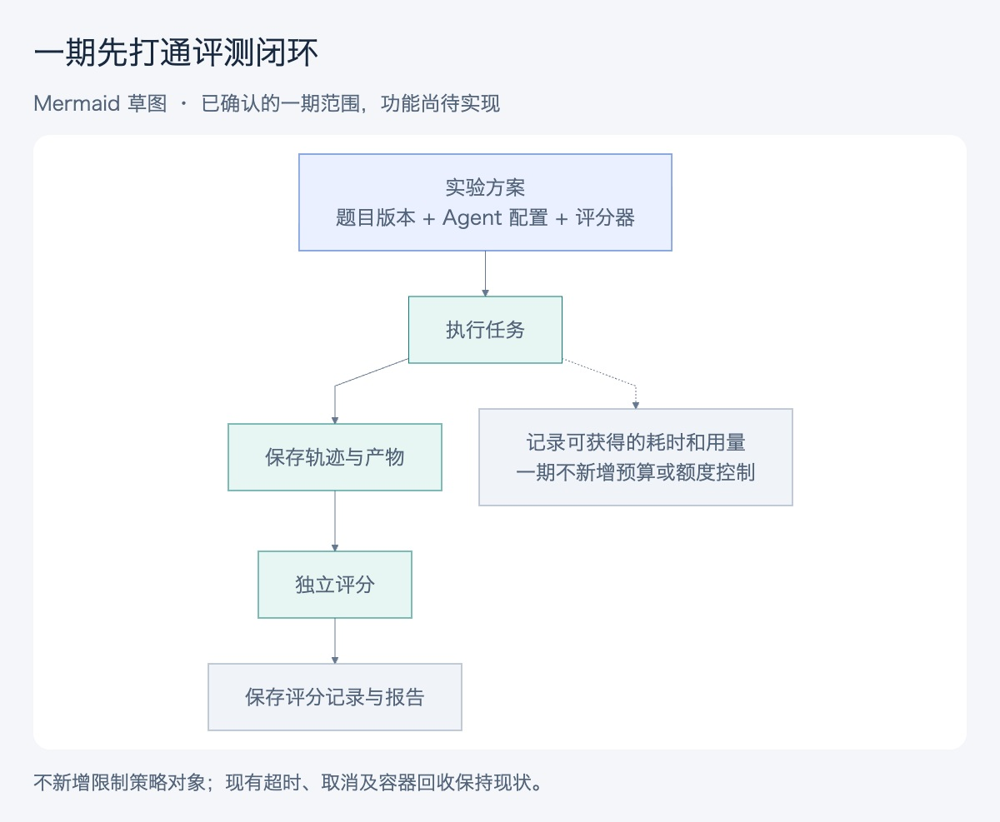

[当前草图源文件](../assets/phase1-evaluation.mmd)。此前的[预算边界草图](../assets/budget-boundary.mmd)及其 [JPG](../assets/budget-boundary.jpg)只作为未采纳方案的历史背景，不得据此添加一期预算能力。此前“可选引用”及“默认限制策略”框架建议均由本条取代；先前误收的旁谈不是同意，此次明确简化范围的指令才是本条依据。

#### D13：评分器出错、质量不通过与无法判定分别表达——已确认，待实现

用户已接受 Grading 的评分执行状态与 Grade 的质量结论分别表达，不把评分器出错自动折算为零分或质量不通过：

- 测试正常执行并发现代码不符合要求，或 Judge 按标准确认回答有误：评分正常完成，Grade 为相应的不通过或数值分数。
- Judge 的服务调用失败、评分器自身异常或无法产生合法结果：记录评分错误及原因，不伪造质量分数。这里针对评分器故障，不是将被测 Agent 的缺陷都归为基础设施错误。
- 评分器正常返回，但缺少评价所必需且无法核实的依据：可记录合法的“无法判定”及原因，不冒充通过、零分或其他确定质量结论。

要区分“被测产物缺陷”和“评分依据不可获得”：任务要求引用而答案没有引用，可以按标准判不通过；评分系统遗失必需材料，才可能无法判定。无法判定应符合 GraderSpec 的契约并附理由，不是跳过负面结果的通道。

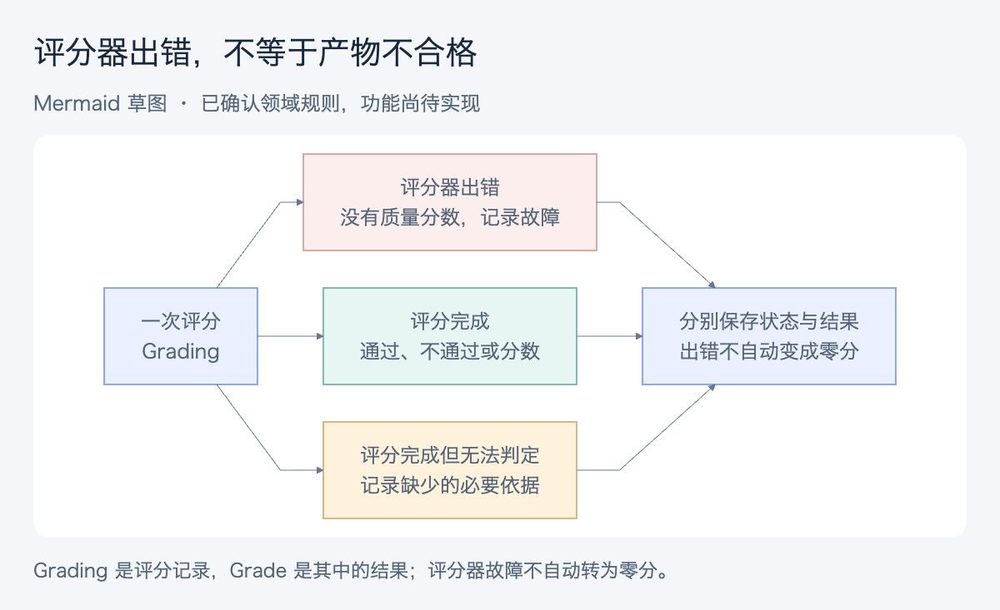

[Mermaid 源草图](../assets/grading-outcomes.mmd)。本条先确认业务语义，不提前固定全部状态字段、重试机制或统计口径，也不新增 D12 已暂缓的限制框架。当前代码已有部分错误 / 结果区分，可在后续实现时复用；设计确认不等于实现或验证完成。本条业务语义已确认；字段、重试机制和统计口径仍待细化。

#### D14：领域评分记录统一命名为 Grading——历史命名，已由 D48 替代

用户明确指定领域中的一次评分记录采用 **Grading**，替代早期草稿的 Assessment；D10 的职责与关系保持不变。GraderSpec 表示评分器定义，Grading 表示一次具体评分记录，Grade 表示其中的结果值。评分用例协调服务在文档中写作 GradingService，避免与领域记录同名。

本次同步设计正文及当前草图的名称；历史讨论表中的对象名称也统一为 Grading，以本条保留更名依据。此为目标领域设计的术语约定，尚未修改生产代码或发布机器契约。

#### D15：评分材料由评分契约声明，并绑定实际依据——已确认，待实现

用户已接受每个 Grader 预先声明所需材料，轨迹按需提供，每条 Grading 记录实际使用的材料及其版本。统一评分接口的命名已由 D16 单独确认；材料的实际准备属于外层用例协调。

按本项已确认的边界，GraderSpec 声明评分材料要求：评价交付质量时读取任务、标准、确切产物和指定参考材料；需要评价工具使用或执行过程时，才显式要求对应轨迹，不能默认将整个被测会话都交给 Judge。过程材料是否必要由评分标准决定，不由 Codex / Pi Provider 临时决定。

比较两种做法：默认提供完整会话可以减少材料选择，但会引入与标准无关的身份、历史结论和噪声；按评分契约声明材料需要多写清楚一次要求，却能让独立重评与结果比较有确定依据。用户接受后者，标准确需完整轨迹时仍可明确声明。

每条 Grading 绑定实际使用的材料及其版本 / 内容身份；任务相同、答案相同但评分材料发生变化时，不能假装评分条件没有变化。轨迹始终作为执行证据保存，但保存轨迹不自动意味着所有评分器都可以看到它。所需材料不可获得时，按 D13 表达错误或合法的无法判定，不临时放宽标准。缺少任务要求的产物内容仍可构成质量缺陷。

例如，只评价问答准确性时，Judge 读取答案、引用和指定参考资料；若标准还评价是否正确调用知识工具，再加入相应工具轨迹。关于是否默认隐藏被测 Agent 品牌、实验处理组和其他 Judge 的评分，以及具体的盲评例外，仍需另行讨论；此次材料需求声明的确认不自动确定所有可见性细则。已有盲评分的兼容要求仍保留。

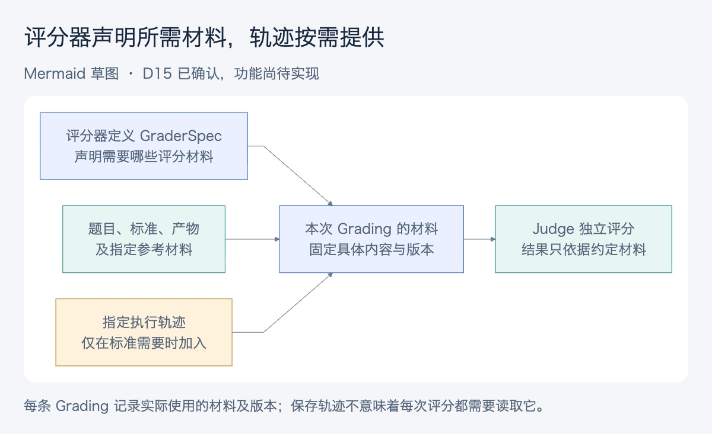

[Mermaid 源草图](../assets/grading-evidence.mmd)。本项材料声明、轨迹按需提供及实际依据记录已确认；具体字段、可见性细则与实现待落实。不新增通用权限策略对象，也不提前决定材料投递、文件挂载等实现方式。

#### D16：统一评分接口命名为 Grader——已确认，待实现

用户明确接受统一接口命名为 **Grader**。它表达提供评分能力的抽象，规则评分、测试评分和 Agent Judge 是三种实现策略；不将统一接口命名为 Judge。GraderSpec 是评分器的固定版本定义，区别于能力接口；Agent Judge 策略引用独立的 AgentSpec，不重复拥有其中的模型、通用指令与工具配置。

术语含义保持区别：Grader 表示评分者 / 评分器，Grade 表示评分结果，Grading 表示评分过程，并按 D10、D14 在本领域用作一次评分记录的名称。不能将 Grader 同时作为结果类型名称。本条仅固定接口命名及既有抽象关系；评分材料范围由随后单独确认的 D15 约定，方法签名与生产代码迁移仍待实现。

#### D17：Grade 的确定结果先支持数值与分类，标尺由评分器声明——已确认，待实现

用户已接受在 D6 “评分定义提前声明标尺”的基础上，一期支持两类确定质量结果：数值型，如准确性 0–5 分；分类型，如测试通过 / 不通过，或预先定义的等级。GraderSpec 声明结果类型、允许的数值范围或分类集合及其业务含义；Grade 保存实际结果与依据，并按对应版本的定义校验。返回超出范围的分数或未声明类别属于无效评分结果，按 D13 处理，不能静默截断或猜测转换。

比较两种方案：统一换成 0–100 分便于展示，却会掩盖测试判定、等级与数值标尺之间的语义差异；保留原始标尺可以清楚解释评分依据，跨标尺比较时需要另行声明转换规则。本项保留评分器声明的原始标尺；跨标尺转换与不同评分器的总分汇总另行设计，不隐式换算或合并。

类型与取值要区分：平台支持数值与分类两类结果形式；采用分类的 GraderSpec 再声明具体允许的类别及其含义，采用数值的定义则声明范围和评分规则。Agent Judge 根据这些规则和评分材料选择类别或给出数值并提供依据，不能临时发明新类别或改写标尺；规则和测试实现可直接计算结果，无需 Agent 再次判断。系统按领域契约校验返回值是否合法后记录 Grade。

D13 的“评分器故障”和合法的“无法判定”继续分别表达，不强制塞进数值或普通分类，也不折算零分。本项只对齐确定质量结果的类型与校验；多维结果组织、汇总权重、统计比较和具体字段另行讨论，不为一期引入任意评分公式或通用统计框架。

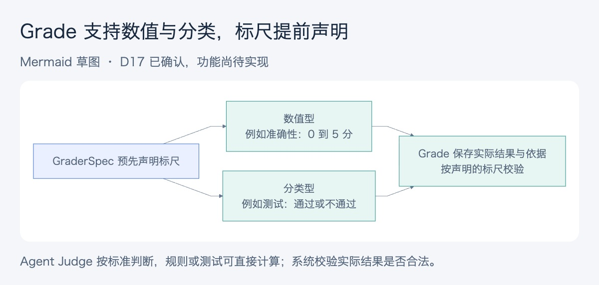

[Mermaid 源草图](../assets/grade-scale.mmd)。本条结果形式与提前声明标尺的边界已确认，现有问答判定契约仍待迁移和验证。

#### D18：早期多产物提议——Working 部分由 D42、Coding 附带交付范围由 D51 替代

当前状态：在 Candidate 与 Artifact 并列关系及 D41 交付边界确认后，用户已通过 D42 确认 Working 的多产物和完整性规则。以下保留早期提议及当时状态，当前 Working 规则以 D42 为准。本条旧 Coding 示例仅保留历史，不恢复为当前类型方案；此前被误识别的接受仍不作为确认依据。

本项建议一次 AgentExecution 可以交付多个独立 Artifact，由 Task 声明哪些必需、哪些可选，多个产物仍属于同一次作答。执行记录可关联零个、一个或多个实际产物。用户正在 review，尚未确认本项。零个产物可用于表达尚未交付或失败的事实；成功交付仍必须满足本次任务声明的必需项及 D1 的归档条件。材料齐全与质量通过分别表达，产物缺失也不自动禁止符合自身契约的评分器评价该次失败。

例如，一次编程任务要求代码变更，并允许附带分析报告：代码与报告若需要独立引用、冻结或评分，可成为两个产物，归属同一次执行和同一次作答；不因此计算成两个作答样本。Grading 按 D15 绑定本次评分实际需要的确切产物，不能隐式使用后来产生的“最新报告”。

比较两种方案：固定一个产物使入口简单，但多个独立交付物需要强行包装，后续难以分别引用；允许多个产物能保留各自身份，但要明确必需项与实际交付的对应关系。本项推荐后者，并保持普通单产物任务的简单性；该建议仍待用户确认。多个文件不必拆成多个 Artifact：一份报告及其附件可属于同一个产物，只有具有独立交付含义时才拆分，不按文件数量创建领域实体。

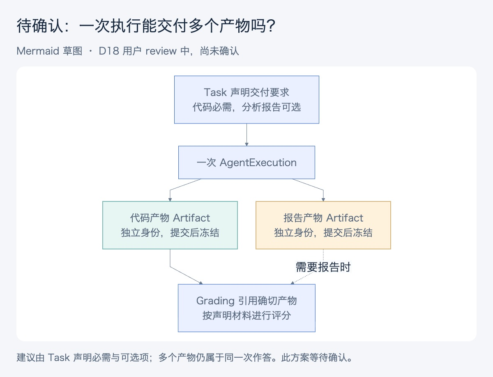

[Mermaid 源草图](../assets/execution-artifacts.mmd)。本条数量、必需项 / 可选项和同一次作答的关系尚待确认，具体角色字段、清单格式与集合归档协议留待后续设计，不新增独立的产物工作流对象。

#### D19：先区分 Coding 与 Working 任务语义——用户已确认场景范围，模型细节待对齐

用户在 review D18 时提出，应先明确通用 CLI 所支持的任务类型，再讨论一次执行的产物数量。本轮明确的两类场景是：

- **Coding Task**：完成需求开发，接入本产品已有的需求开发流程，围绕代码变更与 Candidate 交付。不能将其简化为脱离现有领域流程的一次任意模型调用。
- **Working Task（暂称）**：读取文件、多个仓库或业务资料，调用相应工具，形成答案等内容产物。本轮描述的这类任务不修改仓库代码，不产生代码提交或 Candidate；读取仓库本身不使任务成为 Coding Task。其他工具副作用的边界尚未展开。

共同的 Task 表达要做什么、可使用的输入 / 能力及交付要求，具体类型保留各自业务语义；公共执行能力记录执行与轨迹，并按类型提交产物。Working 不应为接入公共执行与评分而被迫创建代码候选。任务类型与是否用于评测是两个维度：编程和问答均可用于评测，评测在相应产物及声明材料之上组织 Grading。

用户已确认上述两类场景的理解。Working 的最终命名、类型表示（如类型字段或具体领域类型）、Coding 开发流程与公共执行的衔接还需对齐；不据此引入继承框架、认定生产代码已经支持这些类型，或确认 D18 的多产物方案。D18 保持待确认，当前先澄清 Task 类型。

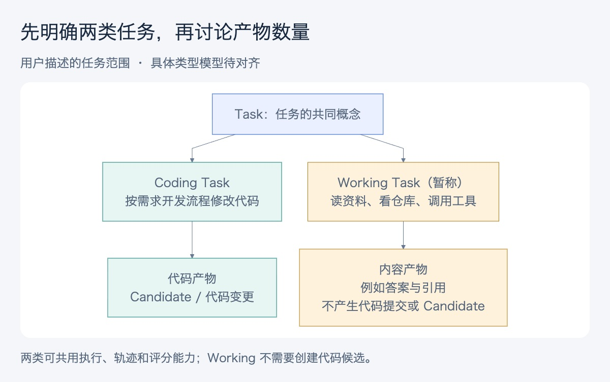

[Mermaid 源草图](../assets/task-kinds.mmd)。图中每类只举一个典型产物，未决定一次执行必须是单产物或多产物。

#### D20：Candidate 与 Artifact 并列，均可被评分——关系已确认，待实现

用户提出并在关系图中确认：Coding Task 交付 **Candidate**；Working Task 交付 **Artifact**。Candidate 与 Artifact 是两种并列的领域抽象，Candidate 不实现、继承或包装为 Artifact。Artifact 内部仍可区分答案等具体内容类型，Candidate 则保留需求开发流程中的代码、仓库与候选身份语义。

评分能力统一在 **Grader**：该接口允许针对 Candidate 或 Artifact 进行评分（D21 随后补充 Trajectory 也可作为目标），具体评分器声明支持的对象类型，并按 D15 声明需要的材料。不是每个具体评分器天然适用于两类对象，例如代码测试评分器不必接受问答产物。**Grading** 关联本次被评对象的明确类型与身份，并记录评分过程及结果；**Grade** 是其中的结果值，不承担发起评价的职责。

实现建议是在评分边界表达有明确类型的目标引用，由相应读取能力提供材料；不为统一评分强行增加共同业务父类或把 Candidate 再塞进一个 Artifact。公共执行与轨迹能力可以复用，两类交付仍保留各自业务规则与存取方式。目标引用的具体类型、评分输入数量与接口签名后续再定。

本条改变了此前“代码候选与答案都是 Artifact 实现”的讨论方向。第 3 节的当前文字按本轮并列方案修订，旧统一 Artifact 图与历史决定只保留演进依据；此前冻结身份、保留历史和独立评分的原则继续适用。D18 的数量方案仍未确认，不能用该方案的代码 Artifact 示例推断 Candidate 的从属关系。用户已确认两类抽象并列且可被评分的关系；具体接口、聚合或存储方案仍待对齐。

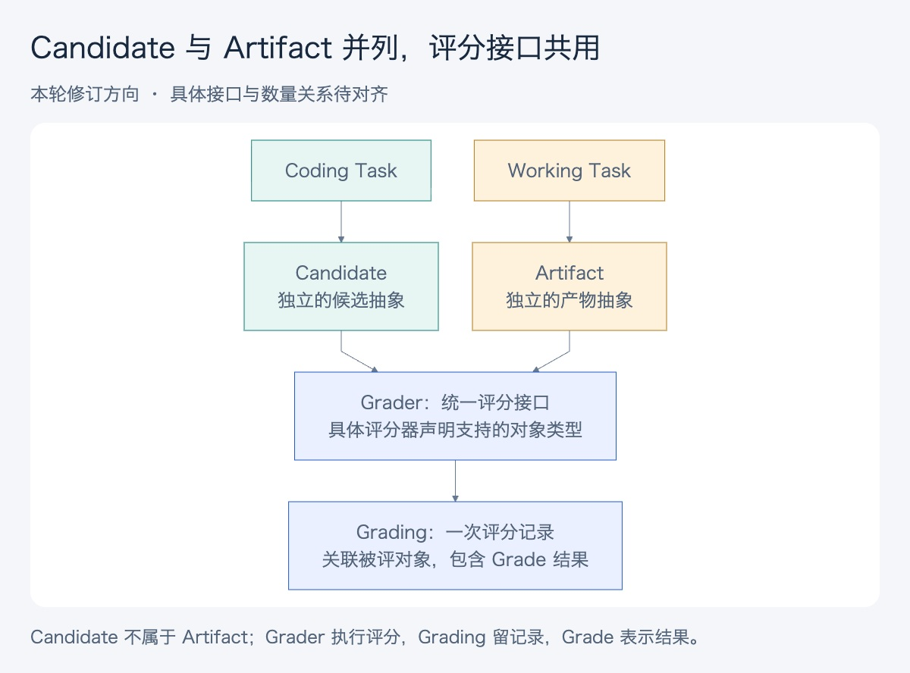

[Mermaid 源草图](../assets/candidate-artifact-grading.mmd)。此图保留为补充轨迹前的讨论记录；当前已确认的实现 / 评价关系以 D21 图为准，生产代码迁移尚未实施。

#### D21：Trajectory 也可作为独立评分对象——关系已确认，待实现

用户明确补充执行轨迹 **Trajectory** 也属于可以被评价的对象；此前口述的 transaction 已澄清为执行轨迹，不新增业务交易领域对象。当前讨论的评分目标因此包括 **Candidate、Artifact、Trajectory**，三者保留各自业务含义，不为了评分统一成 Artifact。

**用户已确认图中的两类关系：** Candidate、Artifact、Trajectory 是被评价的领域对象，均不实现或继承 Grader。规则评分器、测试评分器、Agent Judge 才是 Grader 的实现策略。“实现评分接口”与“被评分器评价”是两种不同关系，图中必须标明，避免使用“这三类对象共用 Grader 接口”这种容易误解的表述。具体实现按声明的适用范围评价对象，不要求每个评分器支持所有目标类型。

必须区分“评分目标”和“评分材料”：评价答案准确性时，Artifact 是目标，相关工具日志可以是依据；评价工具选择、调用顺序等执行过程时，Trajectory 本身就是目标。GraderSpec 声明支持哪类目标及需要什么材料，Grading 记录本次实际评价的对象与依据，Grade 仍是结果值。具体评分器不要求同时支持全部类型，也不因轨迹可评分就自动对每次执行增加一轮过程评分。

Trajectory 继续按 D9 归属 AgentExecution，做题与评分 Agent 的轨迹独立，历史不覆盖。本轮确认的是轨迹可作为独立评分对象；评分引用字段与完整性要求留待具体设计，不因此引入中途评分或评分后恢复执行。D22 的相关示例已撤回。

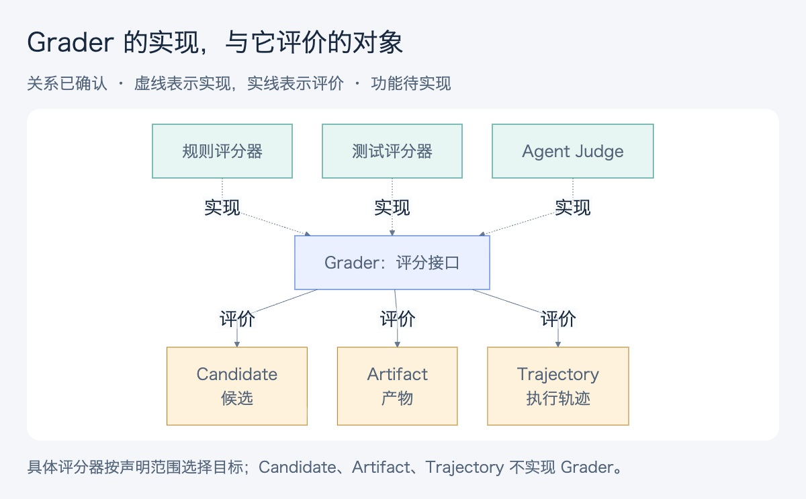

[Mermaid 源草图](../assets/grading-targets.mmd)。图中三类被评对象及其与 Grader 的评价关系已由用户明确确认；规则 / 测试 / Agent Judge 与 Grader 是实现关系。Grade 表示记录内结果值，不新增独立实体生命周期；D18 的交付数量方案仍待确认。

#### D22：轨迹增长后再次评分的示例——已撤回，不作为新增要求

此前用“先评价十条事件，恢复后再评价二十条”解释评分引用，混入了尚未讨论的中途评分场景。用户指出正常评分后为何还要恢复执行；经澄清，用户同意撤掉该例子，仅保留 D21 已确认的“Trajectory 可以独立作为评分对象”。

评分完成不会自动触发被测 Agent 恢复执行；重新评分与恢复任务执行是不同操作。本轮不新增中途评分、实时评分或轨迹范围 / 快照协议要求，不将原示例用于一期开发或验收。有关证据引用的具体实现，后续按已经确认的可追溯与历史保留原则设计。

#### D23：Grading 可独立于实验存在——已确认，待实现

用户已接受一次评分不以创建题集、Experiment 或 EvalRun 为前提。需求开发流程可以对已产生的 Candidate 发起评分，Working 流程可以评价 Artifact 或 Trajectory；实验中的 EvalRun 则组织并关联本任务的评分记录。Grading 自身记录确切被评对象、固定版本的 GraderSpec、实际材料、状态和 Grade，发起流程负责关联来源。

这修正了此前关系表中“每条 Grading 归属一个 EvalRun”的建议。D7 已确认 EvalRun 可以关联多次评分，但没有要求所有评分都必须发生在实验里；D10 已确认评分记录与结果值的关系，也不必因此引入实验依赖。具体来源字段、生命周期所有权与持久化约束仍需设计。

比较两种方案：每次评分先创建 EvalRun 能统一评测入口，但需求开发中的候选验收也必须带上实验结构；允许评分记录独立，则由需求开发或评测用例分别组织，评分模块只需要理解评分对象和契约。用户已接受后者，保持既有重评新增记录、规则评分无需 Agent 的原则，不新增通用工作流引擎或默认复用旧评分结果。

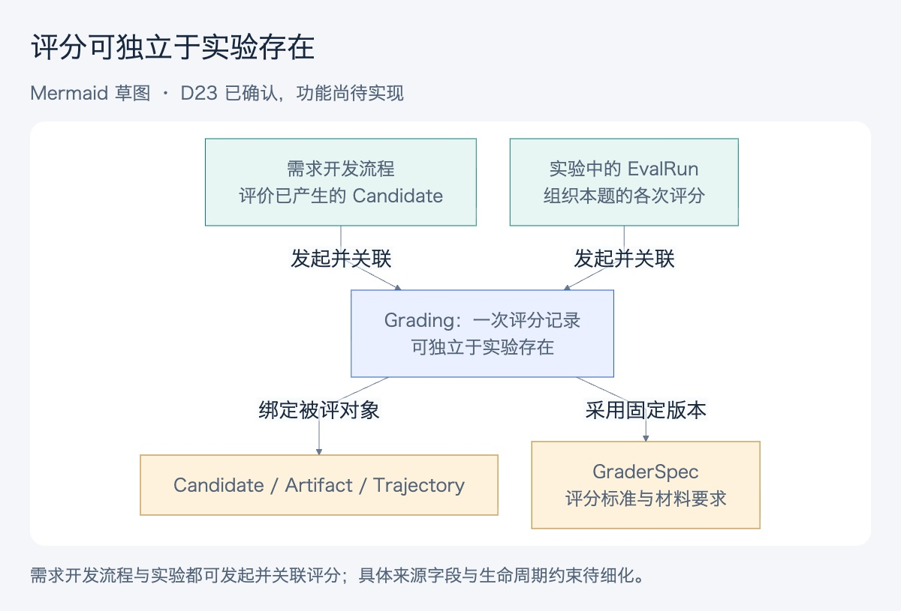

[Mermaid 源草图](../assets/grading-independence.mmd)。图中两条入口表示不同使用场景，不要求同一条评分同时归属两个流程。本条独立性与关联边界已确认，具体字段、生命周期与持久化约束待实现，生产代码未改变。

#### D24：通用 Task 按标准或偏好评分，参考答案可选——范围已确认，归属由 D40 补齐

用户明确领域中的对象是 **Task / Agent 任务**，可以是 Coding、Working 或后续其他类型。“题目”只是部分评测场景对任务的称呼，不应作为通用领域对象名称；EvalRun 在领域说明中相应称为“单任务评测运行”。此前用问答示例解释评分时，不应把整个模型缩窄成有正确答案的题目。

评分可以依据明确的标准或偏好，表达“怎样完成才算好”，不要求预先知道唯一正确答案。例如 Coding 可按需求满足程度、可维护性评价 Candidate，Working 可按信息充分性、清晰度或用户表达的简洁偏好评价 Artifact，Trajectory 可按工具使用是否符合约定评价。参考答案或参考证据仅在适用且评分契约需要时提供。

没有参考答案并不自动意味着无法判定；若评分契约依据标准或偏好即可评价，就应产生有依据的 Grade。只有实际缺少该评分契约必需的材料，才按 D13 处理。评分标准、偏好及实际材料仍须可追溯，不能由评分 Agent 临时改写。

此前 D24 的“每题参考答案与通用评分方法分离”提议据此重述为任务评分要求与可复用评分能力的分工。用户此次明确的是任务的通用性和参考答案非必需；任务特定标准 / 偏好如何与 GraderSpec 组合、哪些要求属于公开任务输入、材料绑定字段等仍待进一步对齐，不能把本轮澄清当成完整归属方案已被确认。

后续状态：2026-11-01 已通过 D40 确认公开任务要求、通用评分契约与任务特定评分输入的职责归属；以上“待对齐”描述保留本轮讨论历史，当前规则以 D40 为准，具体字段仍待实现设计。

针对“Task 包含还是关联 Grader”的讨论澄清：沿用 D4 的职责边界，Task 不拥有具体 Grader 实现。建议在配置评测或发起独立评分时，组合任务上下文、被评对象及所选 GraderSpec 的固定版本引用；这是关联关系，不要求新增一个专门的领域实体。一个 Task 可以采用多个评分器，同一个评分器也可用于多个符合其输入契约的 Task。Task 的验收要求与 Grader 的评价方法需要区分，例如“退款查询应返回哪些信息”属于任务要求，“通过自动测试还是 Agent Judge 检查”属于评分方式。本段记录关系解释与绑定建议；任务特定评分要求的归属现已由 D40 确认，具体配置结构仍待实现设计。

#### D25：显式命名任务与评分策略的组合——整体关系已认可，细节待对齐

此前草图中的“评测配置或独立评分请求”把两个层次放在同一框内，不能作为一个已确认领域对象。当前设计已确认 Experiment 固定实验方案；关系表也已建议 SuiteSnapshot 包含“评测项”值对象，但该评测项的正式命名和结构尚未确认。

建议把任务版本与所选 GraderSpec 版本的组合明确称为“评测项（EvaluationCase，暂名）”，作为领域值对象表达“这个任务采用哪些评分方式”。这是独立可表达的领域概念，不意味着需要独立身份、生命周期或单独建表。Experiment 通过评测项集合的快照引用这些评测项，并固定被测 Agent 与环境。任务特定标准和偏好的归属按已确认 D40 表达，具体绑定字段待实现设计；独立 Grading 继续不要求先创建评测项、题集或实验。用户认可本条整体关系，具体字段与命名细节仍待对齐，不代表现有代码已实现。

集合含义澄清：此前图中的“任务集合”准确说是 EvaluationCase 的集合，沿用 Suite / SuiteSnapshot 的概念；集合成员不是裸 Task。每个 EvaluationCase 引用一个 Task 版本和所选 GraderSpec 版本，Experiment 引用该集合的固定快照。Suite 组织评测项，SuiteSnapshot 固定某一版集合，避免后来编辑集合改变已有实验的定义。

用户随后确认上述评测集与快照关系没有问题；具体接口字段仍待实现。

#### D26：Experiment 的组成——环境直接绑定部分由 D79 修订

以下为历史讨论；最新模型通过评测项引用 Task 的环境要求，不在 Experiment 重复配置环境。

实验的固定方案包含三个核心部分：SuiteSnapshot 回答“做哪些任务、如何评分”，被测 AgentSpec 的固定版本回答“由谁执行”，适用的环境条件回答“在什么条件下执行”。所选 GraderSpec 已通过快照中的 EvaluationCase 固定，不在 Experiment 再维护一份可独立变化的评分器配置。环境条件描述所需运行条件及其固定配置，不是临时容器 ID；具体字段及与 Task 输入、Agent 工具配置的边界仍待设计。

Experiment 另有身份、名称等管理信息，并关联实际产生的 EvalRun；运行状态、执行轨迹、评分和用量属于运行事实，不是固定方案的组成配置。重复次数与并发调度的具体归属尚未确认，不在本轮列成既定字段。预算及统一额度限制继续按 D12 排除在一期范围外。

#### D27：环境建模现状与统一边界——现状核对，目标细节待对齐

现有代码已有环境建模，不能视为从零新增：`typescript/src/eval-environment.ts` 定义 EnvironmentDefinition、EnvironmentBinding、Preparation、EnvironmentInstance；实验环境目前分别绑定 answer 与 grade 环境。定义描述配置，绑定固定环境引用和参数，准备与实例记录实际执行状态。另有 `typescript/src/repository-environment.ts` 中按仓库保存的不可变 RepositoryEnvironmentVersion，以及 `typescript/src/env-definition.ts` 中共享执行层的环境声明。它们覆盖不同路径，尚不能等同于本方案已经确认了统一的环境领域模型。

建议后续沿用“环境定义 / 固定版本”与“实际环境实例”的区分：实验固定所使用的环境条件，每次执行关联实际实例；不把临时容器 ID 当成实验方案。环境与 AgentSpec 的工具 / Skill 配置、Task 的输入材料之间的归属，以及做任务与评分各自的环境绑定，仍需逐项对齐。此次仅核对数据契约与相关代码，不代表完成跨路径集成或运行验收。

调用链进一步核对：这些评测环境契约仍被当前受管评测代码调用，`grounds_eval_run.py` 使用 ManagedCoordinator，后者在 `grounds_eval_managed.py` 登记 Preparation 与 EnvironmentInstance；`grounds_eval_runtime.py` 的实际容器执行调用共享 `grounds env up/run/down`。固定测试评分的 `eval-process.ts` 也调用共享 environmentUp/startRun/environmentDown。另一条代码工作区路线由 `code-route-cli.ts` 创建 CodeRouteExecutions 与 DockerRouteEngine，`code-route-execution.ts` 可选择仓库环境版本、默认环境或直接镜像，并记录 RouteExecution。这条路线不使用上述评测 EnvironmentInstance 作为执行记录。因此“评测环境模型仍在调用链中”不等于“所有 Agent 容器模式统一使用该模型”；本次确认的是源码入口和依赖，未查询近期真实运行记录，也未重新启动容器验证。

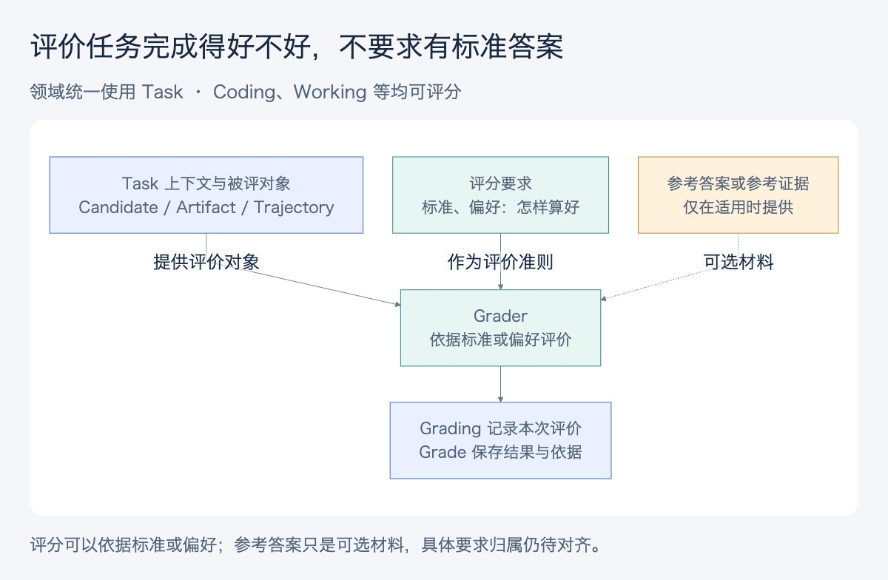

[Mermaid 源草图](../assets/grader-reference-materials.mmd)。图中参考答案为可选材料，评分关系仍遵循 D20 / D21，生产代码未改动。

#### D28：评测与开发的环境治理收敛为一套领域模型——已确认，待设计与实现

用户明确将底层环境治理统一纳入本次重构范围：评测与代码工作区开发共享一套环境领域模型，不能只统一名称或 API 外观。共同的环境定义与版本、实例身份、资源归属、生命周期及失败恢复规则应集中建模，领域层通过端口使用外部运行能力。

设计约束：保留两条现有路径中的有效治理能力，包括隔离、资源归属校验、未知状态处理、可恢复记录和受控回收；代码工作区的候选、Git 路线及需求流程仍属于相应业务模块，不因环境统一而强迫 Working 任务创建代码路线。Docker 等实现细节封装在适配器中，不把具体 SDK 或容器命令带入纯领域对象。统一模型不要求所有类型使用同一镜像或同一组环境配置。

实现前需逐项映射现有评测定义 / 实例与仓库环境 / 路线执行的职责，确定共同模型及迁移兼容方式。迁移可分阶段进行，但完成时当前评测与开发入口必须委托共同治理能力，不能长期双写两套状态事实。具体对象名、聚合边界、状态机和迁移顺序仍待对齐；本条是已确认范围，不是实现完成声明。D12 的一期不新增预算或统一额度限制仍有效。

#### D29：统一环境定义与实际实例分开建模——已确认，待实现

继续环境治理讨论，先对齐两个核心概念：EnvironmentSpec（暂名）表示可复用的环境定义，发布后通过确定版本引用；EnvironmentInstance 表示依据某个定义版本实际准备的一份环境，记录自身身份、资源归属、状态和回收事实。同一版定义可创建多个实例，修改定义不改变已创建实例的原始定义引用。

例如三个并发任务可以采用同一版 Python 环境定义，但分别使用实例 A、B、C；停止 A 不应破坏 B、C 正在使用的资源。实例是受治理的运行环境，不等同于一个 Docker 容器，可以关联工作目录和配套服务。底层可共享镜像等资源，但共享资源的所有权与回收规则需要明确。

用户已同意定义与实例的职责边界；字段、状态机、实例与 AgentExecution 的基数或复用规则仍待对齐，不据此规定每次 Agent 调用都必须新建容器。Artifact 源码调研继续作为第 10 节待办，不在本轮启动。

#### D30：环境实例与 Agent 执行的生命周期解耦——已确认，待实现

建议一次 AgentExecution 结束不自动意味着环境实例必须销毁。同一工作过程可明确保留实例，供后续执行顺序使用，例如开发 Agent 先实现，再依据反馈继续修改；每次执行仍有独立身份和轨迹，实例保留先前的工作状态。后续使用是明确关联，不按配置相同自动寻找并复用任意旧实例。

独立评测尝试使用独立实例，避免上一轮残留状态影响结果；Agent Judge 使用独立环境并仅获得评分契约允许的材料。用户已同意实例可跨同一工作过程的顺序执行保留；具体使用权、并发占用、取消与回收触发条件另行对齐，不据此授权多个执行同时修改同一实例。

#### D31：环境提供运行条件，Agent 配置选择行为能力——已确认，待实现

建议 EnvironmentSpec 声明运行时、软件依赖和配套服务等运行条件；AgentSpec 固定 Provider、模型、通用指令及选用的工具 / Skill 版本。工具或 Skill 所需的程序与服务由环境能力满足，其对 Agent 的启用声明由 AgentSpec 表达，避免两处分别维护可独立变化的选用清单。执行前检查两者兼容；缺少依赖时明确报错，不静默删减工具或 Skill 后继续运行。

例如 AgentSpec 选用数据分析 Skill，该 Skill 需要 Python；EnvironmentSpec 提供相应 Python 运行时及依赖。用户已接受上述职责划分；具体依赖声明、安装机制、权限交集和 Task 材料挂载仍待对齐，不意味着环境中安装的软件自动成为 Agent 可调用的工具。

#### D32：任务材料作为执行输入，与可复用环境定义分开——已确认，待实现

建议 Task 声明任务所需的公开材料引用，例如待修改仓库及起始版本、供分析的文档或数据文件；运行时将选定材料绑定到环境实例，由应用服务通过适配器完成准备。EnvironmentSpec 定义可复用的运行条件，不为每一份业务文档或每一个任务的仓库版本重新创建环境定义。材料引用及可获得的版本 / 摘要作为执行依据记录，不能仅凭临时挂载路径认定材料身份。

例如同一份数据分析环境定义可以服务不同公司的报告任务，各任务绑定自己的材料。软件构建配方对仓库或依赖版本的实际依赖仍必须保留，不将有差异的运行环境假称相同。隐藏评分材料继续由评分契约单独提供，不自动混入 Task 的公开输入。用户已接受材料由 Task 声明、环境负责承载的职责分工；具体引用类型、可写范围、动态数据及挂载协议待对齐。

#### D33：环境实例具有明确归属，业务决定释放时机，环境模块负责回收——已确认，待实现

建议每个实例记录明确的生命周期归属，不能仅凭“最后使用它的 Agent”推断谁有权释放。管理本次开发或评测过程的用例决定是否保留实例、何时发起释放；环境模块依据统一规则校验归属、使用状态和资源范围，并通过适配器执行回收。实例与具体业务记录的关联形式仍待设计，不在本轮新增强制的通用工作流实体。

一次 AgentExecution 结束不会自动释放仍供后续工作的实例；开发或评测过程明确结束使用后才发起释放。存在活动执行时，先协调停止并确认，再回收；状态未知时不冒充已释放。释放执行环境不等于删除已归档的 Candidate、Artifact、Trajectory 或需要保留的数据卷，共享资源不得因单个实例释放而被误删。用户已接受业务流程决定释放时机、环境模块统一负责回收的边界；具体状态机、异常恢复和数据保留策略另行对齐。

#### D34：一期同一环境实例的执行使用权互斥——已确认，待实现

> **R2 修订（D140，已确认）：** 环境实例并入 Sandbox，互斥只由 Sandbox 的占用租约保证，不再需要“实例唯一绑定”约束。见[目标模型](0001-target-model.md)。

> **R1 修订（D138，已确认）：** 互斥由两条规则共同保证：一个未释放的实例至多绑定一个 Sandbox，Sandbox 同一时刻至多一个占用租约。见[目标模型](0001-target-model.md)第 3.5 节。

建议一期同一环境实例同一时刻只接受一个顶层 AgentExecution 使用；明确结束使用后可以按 D30 顺序复用。并发的多个执行使用不同实例，可依据同一版 EnvironmentSpec 创建。已有执行仍活动或其停止状态未知时，不向新的执行交付该实例的使用权。

用户已接受这一期边界。互斥规则针对独立 Agent 执行之间的环境占用，不限制一个执行内部的并行工具调用或测试进程；共享只读镜像等底层资源仍可按资源归属规则复用。多 Agent 同时协作修改同一实例不纳入该默认行为。具体租约、排队、锁与故障恢复机制仍待设计，本条不是 D12 排除的费用或执行额度限制。

#### D35：中断后先核对真实状态，再恢复环境使用——已确认，待实现

建议将环境最后记录的生命周期状态与当前状态是否已核实区分。控制进程中断或失联不证明执行已经停止，也不证明环境已释放。恢复时由环境治理模块通过适配器核对资源身份、归属及运行状态；仍在执行则保留原占用，确认停止后再检查环境完整性和遗留操作，满足可用条件才允许后续使用。资源不存在时也需核对关联资源和记录后才能确认释放。

无法核实时明确标注状态未知并保留诊断依据，阻止新的执行占用和缺乏归属依据的清理，不自动重跑 Agent。用户已接受这一恢复原则。未知不是质量失败或空闲；本项不要求每次中断都由用户手动介入，可验证的核对由系统自动完成。具体状态字段、重试及恢复命令仍待设计。

#### D36：任务材料明确读写用途，环境落实访问边界——已确认，待实现

建议在 D32 的材料声明中区分参考材料与待修改工作材料：参考材料默认只读；Coding 任务明确声明需要修改的目标，在受管工作区提供可写工作副本，继续遵守现有 Git / Candidate 流程，不因此直接授予修改宿主仓库的权限。Working 任务可读取参考资料并写入自己的输出区域，产生答案或报告不要求修改来源材料。

Task 声明用途不等于自行授予权限，执行前需与已授权范围及环境能力校验；环境适配器落实实际读写边界，不能只靠提示词约定。用户已接受上述分工；具体字段、路径映射和权限校验复用方式仍待设计。本项表达统一模型中的隔离语义，不引入新的通用权限策略框架或额度限制。

#### D37：环境实例的主生命周期与异常信息分开表达——主阶段已确认，待实现

> **R2 修订（D140，已确认）：** 环境实例不再是独立聚合，其阶段并入 Sandbox 的运行资源；占用与暂停由 Sandbox 记录。见[目标模型](0001-target-model.md)。

> **R1 修订（D132 / D138，已确认）：** 执行占用与暂停事实改由 Sandbox 记录，实例主阶段调整为已登记 / 准备中 / 可用 / 释放中 / 已释放。见[目标模型](0001-target-model.md)第 3.4、6 节。

建议主生命周期先采用六个业务阶段：已登记、准备中、可用、占用中、释放中、已释放。先登记身份与归属，再准备资源；仅准备和兼容性检查成功后进入可用。新的顶层执行必须先取得占用权再启动；执行停止且使用权结束、环境检查通过后才回到可用，进程退出本身不保证可用。

发起释放时进入释放中并关闭新的占用入口；若仍有活动执行，先协调停止并核实，再回收属于本实例的资源。核实回收完成后进入已释放；保留的共享资源或数据按其独立归属管理。已释放的实例身份不重新启用，需要环境时创建新实例。

异常信息与上述阶段分别表达：记录受阻操作、原因及可核实的进度，准备失败不能标可用，回收失败不能标已释放；不以一个笼统失败值抹去资源现状。按 D35，状态未知是对实际状态尚未核实的标记，保留最后已知阶段并阻止新占用，核对后再决定转移。用户已接受六个主阶段及阶段与异常信息分开表达的设计；具体代码字段、重试与恢复转换仍待设计，本轮确认不代表完整异常状态机已经定稿。

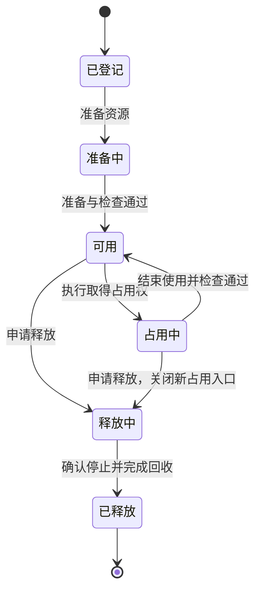

准备阶段取消或失败后的清理也必须遵守释放规则；草图省略这些分支以便先对齐主要路径。

#### D38：提取公共环境治理，分阶段迁移现有入口——方向已确认，待实现

本轮核对：`env-environment.ts` 的 environmentUp 当前要求单个当前任务仓库，Docker 模式要求固定 inputCommit，并直接初始化任务 Git 仓库；`code-workspace-route.ts` 管理仓库、需求版本、开发身份与 Git 路线；`code-route-docker.ts` 的 DockerRouteEngine.prepare 调用 Git 视图准备。因此不能只将某条旧路径改名为通用环境模块，便视为统一完成。这是源码职责核对，不是运行验证。

比较两种迁移方向：直接让所有任务使用某一旧执行器，短期调用改动可能较少，但需携带旧路径的仓库、路线或评测角色假设；按已确认领域边界提取公共治理，迁移工作较多，但可让 Working 无需虚构 Git 任务，同时保留 Coding 的必要约束。建议采用后者，复用经过验证的资源操作与检查，不推倒重写全部 Docker 代码。

职责归属：公共环境领域模型负责定义版本、实例身份、占用、生命周期和状态转移约束；环境应用服务协调准备、核对与回收，通过端口调用资源适配器。Docker、文件挂载和服务资源操作位于外层。Coding 模块保留 Git 路线、开发准入、候选与交付规则；评测模块保留评测项、实验、评分材料可见范围和评分记录。业务模块通过材料与使用请求接入共同治理，不再各维护一套环境状态机。纯领域对象不调用 Docker 或文件系统。

建议迁移步骤：先对照旧行为补齐关键回归用例并建立公共核心；以一条完整执行链验证准备、执行、状态核对和回收，再迁移另一条入口；最后停止旧治理入口独立创建新实例。具体先后次序和模块拆分在实施方案中确定。一个实例在任何阶段只有一套权威治理状态，禁止让新旧控制器同时管理同一资源。D114 后续明确切换时无正在运行的旧 DevRun，本次不建设运行中资源移交或旧任务收尾机制；历史记录仍不能靠字段改名猜造事实，兼容读取不代表保留两套新实例治理。

用户已接受上述迁移方向：提取公共环境治理、逐条迁移入口、停用旧的独立治理逻辑，并确保一个实例只有一套权威状态与控制逻辑。尚未开始代码迁移；兼容数据格式、存储位置及代码切换步骤仍需实现设计；进行中实例移交已由 D114 排除。

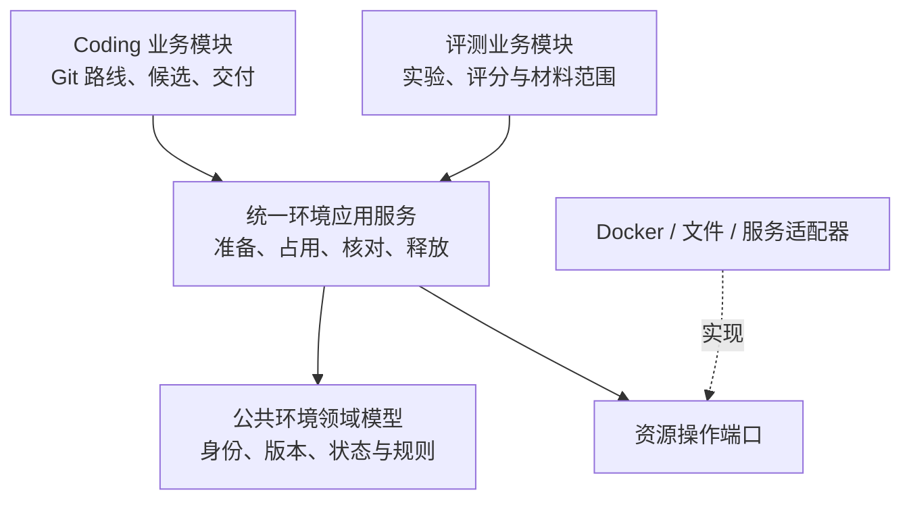

#### D39：实验固定各评测项与评分所用的环境选择——直接绑定归属已被 D79 修订

以下保留历史方案；环境选择归属以 D79 为准，Experiment 不再直接维护环境绑定。

建议 Experiment 的环境条件表达一组确定的绑定，不强制整个实验只有一个 EnvironmentSpec。每个 EvaluationCase 的任务执行，以及其中需要环境的评分步骤，均能确定所使用的环境定义版本；所选 GraderSpec 仍由 EvaluationCase 固定，不在实验重复定义评分器。绑定放在实验方案中，以便同一评测集可在不同环境条件下开展不同实验，具体字段与默认值语法待设计。

例如一个实验包含 Python 开发任务和文档分析任务，二者可分别选择匹配的环境；Agent Judge 使用自己的评分环境实例。可用统一默认环境减少配置，但形成实验固定方案时必须明确解析到哪些版本，不能在后续执行时无记录地改用最新版本。允许复用同一环境定义，不等于共用同一个运行实例；实例隔离仍遵循 D30 / D34。纯规则评分若不需要外部执行，不强制创建环境。

只绑定一个实验级环境较简单，但会迫使异构任务使用包含所有依赖的环境，也无法清楚表达评分环境差异。用户已接受按评测项及评分用途明确绑定的方案，不引入动态自动选环境引擎。当前代码已有 answer / grade 两个实验级绑定，只证明角色分离有基础，不代表已支持本方案的逐项绑定。具体字段、默认值解析与兼容迁移仍待实现设计。

#### D40：通用评分契约与任务特定评分输入分开——已确认，待实现

为解决 D24 保留的归属问题，建议 Task 保留公开的任务目标、交付要求和已声明偏好；GraderSpec 定义评分方法、标尺、判定规则及允许的输入契约；EvaluationCase 为选定的每个 GraderSpec 绑定本任务所需的具体评分输入，例如验收条目引用、特定评价偏好、参考材料或隐藏测试数据。参考答案继续可选，不将其设为统一必需项。

Task 已包含的公开要求直接按版本引用，不在评测项复制另一份可独立变化的要求；仅用于本次评价的补充材料或偏好在评分绑定中保存。只有 GraderSpec 明确允许的输入才能参数化其评价，不允许用任意附加提示偷偷覆盖固定标尺或评分规则。若评价方法、标尺或判定规则本身改变，应发布新的 GraderSpec 版本。配置具体标准的能力可以由规则、测试或 Agent Judge 实现，不限定 Agent Judge。

例如“分析报告质量”评分器声明按给定评价维度使用固定标尺，某评测项传入“建议可执行性”的具体检查要求；另一个评测项可提供其任务适用的要求，而不用把所有任务内容塞进通用 GraderSpec。公开任务要求与仅供评分使用的材料依 D15 / D32 分开提供；评分上下文绑定随评测集快照固定，每次 Grading 记录实际使用的定义及输入。

比较把所有任务标准写入 GraderSpec 与将可参数化的任务标准作为绑定输入：前者适合专用评分器，但每换任务可能产生评分器配置副本；后者使声明了通用输入契约的评分器复用，并保留专用评分器的空间。用户已接受后者的归属方式，不强制每个评分器都必须通用。独立 Grading 可直接提供同等的评分输入，不以创建 EvaluationCase 或实验为前提。职责归属已确认，字段及版本结构仍待实现设计。

#### D41：明确交付内容，再经统一接收与保存形成 Artifact——已确认，待实现

> **R2 修订（D140 / D141，已确认）：** 两种来源分别形成 origin 为 `tool` 和 `contract` 的 Manifest；不再有单独的“交付提案”概念，也不再有推进槽。见[目标模型](0001-target-model.md)。

> **R1 修订（D139，已确认）：** 两种来源都保留，统一形成“交付提案”：工具显式声明优先，否则由 TaskType 按输出契约确定性提取；TaskExecution 以“执行 ID + proposal”为操作身份自动提交为清单。见[目标模型](0001-target-model.md)第 4.3 节。

已完成 ADK、LangChain 与 smolagents 三个官方仓库固定提交的首轮源码阅读，覆盖存取接口、生成示例、工具输出和最终回答处理，并读取相关上游测试；未执行框架测试或模型实验。完整证据与比较见 [Artifact 源码调研](../research/agent-artifact-design.md)。ADK 展示版本化内容服务，LangChain 展示模型回执与应用数据分离，smolagents 展示显式终结输出；三者的 Artifact / 最终输出含义不能直接等同于 Grounds 的正式交付。

建议 Working 正式交付必须有明确选择：可以由 Agent 通过工具声明内容或文件，也可以由任务适配器按已声明的最终输出契约提取；两者进入同一接收与归档流程，校验后持久保存、冻结，返回可读取的 Artifact 引用并关联来源执行。普通工作文件、输入材料和工具中间结果不因出现就自动升级为正式交付；不扫描整个工作目录猜测应交付什么。接收校验检查结构与契约，质量评价仍由 Grader 完成，不把低质量回答直接当作基础设施失败。

比较自动扫描收集所有输出与明确交付协议：前者调用方工作少，但混淆临时文件与最终结果，且难以确定交付边界；后者需要提供交付入口或输出适配，但能让完成规则、归档恢复和评分对象一致。建议采用后者，工具名、协议字段、幂等规则及一次执行的 Artifact 数量仍待设计；不新增必须由用户手工完成的发布步骤，不改变 Candidate 独立模型。

用户已接受明确选择交付内容、经统一校验和持久保存形成正式 Artifact 的边界。工具提交与按输出契约提取均通过共同归档流程；尚未开始实现，具体字段、幂等协议和产物数量不因本条接受而自动定稿。

#### D42：Working 一次执行可交付多个 Artifact，Task 声明完整性要求——已确认，待实现

在 D20 / D41 基础上重新讨论 D18：建议一次 Working 任务执行允许交付多个具有独立业务含义的 Artifact，Task 提前声明必需与可选交付项。多个 Artifact 仍属于同一次任务尝试，不因产物数量增加执行次数或评测样本数。失败或未交付时实际关联数量可为零，成功交付则需满足 Task 的必需项与 D1 / D41 的归档条件。

例如市场分析任务要求一份分析报告和一份可单独使用的数据表，可选附一张图表：报告、数据表及可选图表分别有确切身份，均关联同一次执行。若报告正文与配图共同组成同一个交付物，可建模为一个多文件 Artifact；领域数量不按物理文件数量计算。普通问答可只交付一个答案 Artifact，不需要用户手工建立额外集合对象。

已保存部分结果可以保留，但必需项缺失时不能将任务标为成功交付；交付齐全与 Grader 的质量结论分别记录。提交后修改内容仍产生新 Artifact，不覆盖已有身份。集合提交、逐项保存后的确认协议、失败补交与幂等规则另行设计，本条不预设跨所有文件的存储事务。

用户已接受 Working 一次执行允许多个 Artifact、由 Task 声明必需与可选交付项的边界。多个产物属于同一次任务尝试，缺少必需项不算成功交付，多文件不自动拆为多产物。Candidate 保持独立；D51 随后确认 Coding 可另带 Artifact，具体对应关系、提交协议和字段尚未实现。

#### D43：逐项保存与整次交付确认分开，完成时固定清单——已确认，待实现

> **R2 修订（D140 / D141，已确认）：** 每个 TaskRun 只有一份 Manifest；替换清单改为发起 `origin = caller` 的 refinement TaskRun。见[目标模型](0001-target-model.md)。

> **R1 修订（D139，已确认）：** 最终清单由交付提案自动提交，开发场景可由调用方整体替换；提交须先取得 TaskRun 的推进槽。

建议多个 Artifact 可逐项接收并持久保存，每项保存成功即有确定引用；Task 本次交付尚不因此自动完成。执行适配器或 Agent 的交付操作明确提供最终清单，将 Task 声明的交付项对应到确切 Artifact 引用；应用服务校验必需项完整、引用可读和归属合法后，保存并冻结这份清单。可选项未提供不阻塞完整性，但已声明纳入清单的内容必须保存成功。

清单表达“本次最终交付了哪些产物”，先作为任务尝试 / 执行结果中的值，不据此新增独立身份和生命周期的 Delivery 实体。成功执行仍须满足 D1 的轨迹与结果归档条件，不只检查清单；交付完整不代表 Grader 判定质量通过。已有单产物仍可独立评分，多产物整次评分可依据清单选择契约所需对象与材料，评分具体目标结构另行对齐。

例如报告已存、必需数据表保存失败时，保留报告引用，整次交付待完成；恢复优先补存已生成的数据和确认清单，不重新调用 Agent 生成另一份报告。清单冻结后不悄悄追加或替换引用，后续修订的归属协议另行设计。重复确认与回执丢失必须沿既定操作身份核对，不靠查询最新同名文件猜结果；具体幂等字段与事务边界仍待实现设计。

比较将所有产物上传视为一个大事务与逐项归档后确认固定清单：前者对跨文件及存储失败的恢复要求更复杂，后者保留部分已保存结果并明确整次完成边界。用户已接受后者：逐项保存，最终校验并冻结交付清单。两个逻辑阶段可封装成一次提交调用，普通问答自动完成接收与确认，不增加用户手工确认步骤，也不要求 Agent 对每份产物都额外发起两次工具调用。具体操作身份、事务与恢复协议仍待实现。

#### D44：Grader 可以接收若干个 Artifact 作为评价输入——用户明确，待实现

用户将本轮要求明确为：Grader 可以接收若干个 Artifact 作为评价输入。沿用已有 Grading 与 Grade 模型即可，不额外引入“联合评分”领域概念，也不要求将多个 Artifact 包装成一个新的 Artifact。

例如报告和数据表一起作为某个 Grader 的输入，由它按既定标准评价，Grading 记录实际使用的确切产物引用及 Grade。输入多个产物不自动意味着逐个打分或自动汇总；评分含义和结果形式仍由对应 GraderSpec 声明。具体输入字段、角色或数量约束待实现设计，不将此前提出的多目标结构一并视为用户已确认。

已确认的 Candidate、Artifact、Trajectory 与 Grader 的评价关系保持不变；本轮只明确多个 Artifact 输入，不把其他类型转换成 Artifact，也不限制 Grader 只能评价 Artifact。D15 / D21 关于声明所需材料、区分评价对象与参考材料的原则继续有效。

#### D45：Artifact 的最小公共契约——已确认，待实现

建议 Artifact 的公共契约表达四类信息：独立身份、内容类型与契约、已保存且可读取的冻结内容、来源。答案可以有正文与引用，报告可以有正文及附件，数据表可以有列与数据；公共抽象不要求这些内容字段相同。内容类型表达业务含义，不仅是 MIME 类型；文件名或临时路径不能代替 Artifact 的独立身份。

Agent 交付的 Artifact 关联来源 AgentExecution，执行状态、环境和轨迹通过关联读取，不在每份产物中重复建模。外部导入产物若后续纳入范围，应声明真实来源，不伪造一次 Agent 执行；导入协议本轮不展开。沿用 D8，提交后内容冻结，变化产生新的 Artifact。

比较“所有产物必须先变成文件”与“领域契约统一、存储表示隐藏”：前者使普通答案也承担文件管理流程；采用后者，让答案可保存为结构化内容，报告附件可通过持久内容引用读取，由存取端口及适配器隐藏数据库、文件或对象存储细节。用户已接受独立身份、内容类型、冻结内容与来源这四项最小边界。确切存储格式、摘要及字段命名留待实现，不能将当前 QAArtifact 的执行元数据内嵌结构直接视为目标公共契约；外部导入协议不因此定稿。

#### D46：应用层定义 Artifact 存取端口，外层适配器实现——用户提出方向，具体契约待细化

用户提出在领域层外的应用层定义 Artifact 读写接口，由外层适配器实现，例如 S3 或本地文件存储。这与 D3 / D45 的内侧定义需求、外侧实现存储机制一致。应用用例依赖存取端口，适配器实现端口；具体实现由启动装配处注入，纯领域对象不直接调用文件系统或存储 SDK。

端口可暂称 ArtifactStore，名称和方法签名仍是设计建议。它应表达保存新产物、按确切引用读取产物的业务需求，返回领域可理解的引用与读取结果，不暴露 bucket、对象键、临时目录或 SDK 响应类型。写入遵守 D8 / D45 的冻结规则，不提供任意覆盖既有正式产物的业务语义；幂等重试不能伪装成内容修改，具体协议待细化。

S3、本地文件及数据库均是可选实现方向，本条不要求一期全部实现或迁走已有 SQL 存储。Artifact 的身份、类型、来源等元数据和内容均须能通过契约取得；若适配器组合数据库元数据与对象存储内容，应封装保存顺序、失败恢复及可读性保证，不能仅以文件上传成功代表整份 Artifact 已保存。最终交付清单及执行完成仍由应用服务依据 D1 / D43 协调，存储适配器不决定任务或评分是否完成。

相比应用用例直接操作通用文件接口或 S3 SDK，Artifact 存取端口能隐藏文件布局、序列化和后端选择；只有出现明确复用需求时再拆分元数据仓储与内容存储端口，避免现在要求每个调用方拼装多个后端。上述具体操作、组合实现及恢复设计尚待细化，未声称代码已实现。

#### D47：同一次产物保存的重试返回同一引用——已确认，待实现

用户已接受将同一次保存请求的幂等性作为 ArtifactStore 端口契约：应用层在首次保存前确定并保留操作身份，失败或回执丢失后沿用该身份重试。相同操作身份及相同产物内容和元数据，完成后返回原有 Artifact 引用；相同操作身份却提交不同内容或元数据，明确报告冲突，不覆盖原产物。新一次交付即使内容相同，也不自动合并为同一个领域产物；底层字节去重不等于领域身份合并。

相比每次重试都创建新产物，这能避免已存成功但回执丢失造成重复交付，也避免调用者按文件名或最新记录猜测结果。应用层负责稳定提供操作身份，适配器负责并发重试下的保存与核对；具体字段、事务和恢复方式待实现设计。尚未完整保存时只能继续恢复或明确返回未完成，不能提前返回成功；本条不承诺整个 Agent 执行或外部工具调用的恰好一次语义。本条是 D43 / D46 的保存边界细化，已获用户确认，具体实现尚未完成。

#### D48：Grading 应用层接口、领域记录及材料准备分工——已确认，待实现

用户明确 Grading 应为应用层接口，表示调用方发起一次评分的用例入口。接口与实现分开：应用服务实现 Grading 接口，协调材料准备、调用 Grader 以及保存评分事实；Grader 表达可替换的评价能力，规则、测试和 Agent Judge 实现它。用户已分别确认命名与材料准备职责分工；具体接口签名及大文件呈现方式仍待细化。

此前 D10 / D14 用 Grading 表示评分记录，与本轮应用层接口命名冲突。保留既定评分事实及其关联、Grade 值、重评新增记录等规则；用户已接受将领域评分记录命名为 GradingRecord。Grading 为应用层接口，GradingRecord 为领域记录，Grade 为记录内的结果值；历史记录中的旧称不代表仍要求接口与记录同名。材料准备分工随后经单独讨论获得确认，详见下文。

用户已接受由实现 Grading 接口的应用服务依据 GraderSpec 声明的输入需求，通过 ArtifactStore 按确切引用读取和准备若干 Artifact，再交给 Grader 评价。Grader 负责理解材料并按既定标准产生 Grade，不自行选择存储后端、解析对象键或管理存储凭据；应用服务记录本次实际使用的产物引用及评分结果。Candidate 与 Trajectory 仍通过各自适用端口准备，不因此转成 Artifact。

相比每个规则、测试或 Agent Judge 实现自行拉取存储内容，将共同的材料准备集中在应用用例能减少重复的存储、引用核对与失败处理逻辑。这里不要求把所有文件一次性塞入内存或模型提示词：具体实现可提供已准备的内容、只读文件或受限的按需读取能力，但均固定本次允许读取的材料，不能借此任意查询其他产物。呈现方式、接口签名与大文件读取方案留待细化，不新增独立材料实体。

因存储或网络故障未能读取必需材料时，按 D13 记录准备失败，不将空内容交给 Grader 打零分；材料成功读取但依据不足以作出质量判断时，仍可由 Grader 按契约表达无法判定。评分材料准备失败可恢复，不因此重跑被测 Agent。材料准备、调用评分与保存记录的职责分工已确认；接口签名、具体读取方式与代码实现尚待完成。

#### D49：任务尝试按一次明确发起的工作划分，不按内部修改轮次划分——已确认，待实现

> **R2 修订（D140 / D141，已确认）：** 一次尝试 = 一个 TaskRun；开发中的继续修改是新的 refinement TaskRun，不计入评测样本；评测成员不做 refinement。见[目标模型](0001-target-model.md)。

用户已接受一次任务尝试表达在既定任务与执行条件下，明确发起的一次工作。交付前的阅读、工具调用、自检及修改属于这次工作的内部过程，不因每一轮修改、一次测试或一次进程启动就增加评测样本。例如写代码、运行测试、修正失败、再次测试并交付 Candidate，仍可是一份任务尝试；Working 的阅读多份材料、整理并修订报告同理。

可靠恢复尚未完成的同一次工作，保留原尝试身份与已有归属，按 D9 / D35 核对执行并追加真实轨迹；归档重试依 D1 / D47 处理。明确重新做一次则产生新尝试，保留前一次的交付和历史；只对既有交付重新评分则新增 GradingRecord，不新增作答尝试。不把已完成的交付重新打开以覆盖冻结内容，也不据此批准评分后自动恢复做题的流程。

相比按内部循环或 Provider 调用次数计数，按业务上明确发起的一次工作划分能避免技术恢复与自检次数污染评测样本数。任务尝试是本轮用于说明身份边界的业务用语，尚不要求新增 TaskAttempt 实体、数据库表或应用接口；它与现有开发流程、EvalRun、多个 AgentExecution 的具体映射，以及同一开发需求下提交多个 Candidate 的规则需另行对齐。本条业务划分已确认，具体模型映射与代码实现尚未完成。

#### D50：评分部分失败时保留已有结果，完整性与质量分别表达——已确认，待实现

> **R2 修订（D140 / D141，已确认）：** 补评与 EvalRun 的关联，改为 GradingRecord 来源中的成员键与评分要求键。见[目标模型](0001-target-model.md)。

用户已接受评分部分失败时保留已有结果的规则。以一次 EvalRun 要求三个相互独立的 Grader 为例，每次评分分别形成 GradingRecord；两个完成、一个评分器报错时，保留已完成结果并明确缺少哪项有效评分，不能把整体标成完整评测，也不能把评分器错误解释为被测 Agent 质量不通过。单个评分故障不要求取消其他可独立完成的评分；用户取消或共同环境故障等情况另行处理。本条不扩展成整个实验批次的失败策略。

完整性表示本次要求的评分是否都按契约正常完成，质量结论保留在各 Grade 中。合法的低分、不通过或无法判定都是正常评分结果；无法判定不等于得到确定质量结论，但不能与评分器执行错误混为一类。“所有评分尝试已终结”和“所需评分完整”分别表达，具体状态字段待定，不要求评分错误后永远保持运行中，也不新增自动总分。

相比任一评分出错就丢弃整次结果并重跑，采用允许明确补评失败项的方案，复用原有交付与已完成评分，不重新执行被测 Agent。已经终结的错误评分保留，补评新增 GradingRecord 并关联原缺失项；尚未终结操作的可靠恢复仍按原身份处理。补评与 EvalRun 的汇总关联及冻结回执更新规则尚待细化，不以覆盖旧结果或重新打开已冻结交付实现。本条业务规则已确认，具体实现、自动重试次数与调度算法尚未确定。

#### D51：Coding 任务可在 Candidate 之外交付 Artifact——已确认，待实现

用户已接受 Coding 任务在交付 Candidate 时，也可以将分析报告、测试报告或数据文件作为独立 Artifact 交付。这些对象属于同一次任务尝试的交付，分别保留身份、类型与冻结规则，不因多种交付而增加作答样本。Candidate 仍保留代码与仓库语义，不成为 Artifact 的子类型；Artifact 也不必成为 Candidate 内部的从属对象。

相比规定 Coding 只能有 Candidate、报告必须塞进代码提交或拆成另一个 Working 任务，允许同一次工作交付两种对象能保留真实交付关系，并复用既定 Artifact 存取与评分能力。没有报告需求的 Coding 任务仍可只交付 Candidate，不强制新增 Artifact。具体必需与可选交付声明、Candidate 与报告的精确对应以及跨存储确认协议后续细化；文件存在本身仍不等于正式交付。

例如实现一个功能并交付性能分析报告，代码候选与报告分别可被 Grader 按其输入契约评价；不据此强制所有 Grader 接收两类对象或自动产生综合分数。本条已确认允许 Coding 同次交付 Candidate 与 Artifact，具体实现待完成；不扩大 Working 修改仓库的权限或一期任务范围。

#### D52：实验评测的应用层编排接口——职责已确认，接口由 D118 更名

> **R2 修订（D140 / D141，已确认）：** EvalRun 改为成员记录；ExperimentExecution 的编排职责不变。见[目标模型](0001-target-model.md)。

**命名修订：** 下文保留历史名称 Evaluation；当前应用接口统一为 ExperimentExecution（实验运行），职责与领域 Experiment / ExperimentRun 保持区别。

用户已接受将已有评测模块的应用入口明确为 Evaluation 接口，由应用服务实现。调用方提供已固定的 Experiment 引用及本次运行请求；应用服务读取评测集快照与固定配置，组织各 EvaluationCase 的 EvalRun，调用 Execution 执行任务，再将确切交付引用及评分绑定交给 Grading，保存运行与执行、交付和评分记录之间的关联。Experiment 继续是领域中的固定方案，Evaluation 不替代 Experiment，也不新增同名领域实体。

相比让 CLI 逐步调用执行、存取和评分并自行拼接恢复状态，集中在 Evaluation 应用服务能让 CLI 及其他入口复用同一流程规则。Evaluation 依赖 Execution、Grading 等内侧能力接口，不直接操作 Codex / Pi SDK、Docker 或 S3；具体提供者协议和资源操作仍由相应服务与适配器处理。普通规则评分无需 AgentExecution，Agent Judge 由 Grading 经 Execution 发起，避免 Evaluation 复制评分策略。

本条不改变 Execution 与 Grading 可独立于实验使用的边界；已有交付重评可跳过做题执行，不强制重新生成产物。并发调度在应用层协调，领域记录仍按 D49 / D50 保持样本身份和部分失败语义。接口是职责契约，不预设必须同步等待整个实验完成；方法名、运行选择、查询取消、重复次数与并发参数另行细化。本条职责分工已确认，具体接口与实现尚未完成。

#### D53：Execution 的受理与执行完成分开——已确认，待实现

用户已接受 Execution 应用接口将发起执行与等待完成分开。有效请求被持久登记并分配稳定 AgentExecution 身份后，可返回执行引用及当前状态；这表示已受理，不表示 Provider 已启动、产物已交付或执行成功。调用方使用同一执行引用查询进度或等待终结，完成结果仍按 D1 要求约定交付与轨迹已保存且可读取；失败、归档未完成及未知状态不能伪装为成功。

相比只提供阻塞到 Agent 完成的单一调用，受理后可查询的契约使 CLI 和 Evaluation 能持续查看长任务并组织并发，而不以一次调用是否保持连接推断工作是否完成。CLI 仍可提供默认等待体验，内部组合发起与等待；无需将所有用户操作改成两条命令。接口方法名、查询与事件通知方式、启动防重协议及取消流程另行细化。

本条不强制引入消息队列或独立微服务，也不自动承诺 CLI 退出、进程崩溃后执行仍会持续运行。进程宿主、后台运行和恢复实现须另行设计并验证；先持久登记启动意图再驱动执行，便于核对未启动、启动中或状态未知的工作。本条接口边界已确认，尚未实现，不改变 AgentExecution 的领域身份与 D49 的尝试计数。

#### D54：同一次启动请求重试关联原执行——已确认，待实现

用户已接受发起方在首次调用 Execution 前生成并保留稳定请求标识，同一次请求因网络故障或回执丢失而重试时沿用该标识。Execution 持久记录请求与 AgentExecution 的对应关系：同一标识及相同执行输入返回原执行引用和当前状态，不再次创建逻辑执行；同一标识携带不同任务输入、Agent 配置或环境绑定时报告冲突，不覆盖原执行条件。不同请求标识表示明确的新一次发起，即使配置与任务相同也可独立执行，不按内容相同合并重复实验。

相比回执丢失就重新创建执行，稳定请求身份可避免重复消耗和样本重复计数；调用方负责跨重试保留标识，服务负责并发受理时唯一建立对应关系。具体字段与作用域、持久化事务及启动锁协议留待实现。CLI 可自动管理重试所需标识，但重新输入命令不能仅凭任务相同被推断为同一次请求。

请求防重不等于外部 Provider 或工具天然具备恰好一次语义。若 Provider 启动后失联且无法核实是否正在运行，保留原执行及未知状态，先核对，不能仅因重复请求再次启动 Agent；明确未启动时才可继续驱动原执行。该规则延续 D35 / D49 / D53，不增加任务尝试或伪造已完成状态。本条启动防重规则已确认，具体实现尚未完成。

#### D55：取消请求与确认停止分开，保留已有事实——已确认，待实现

用户已接受 Execution 接受针对既有执行引用的取消请求，持久记录取消意图，再协调 Provider 与执行环境停止本次受管执行。返回请求已受理不等于执行已取消；对于尚未启动的执行，确认启动入口已关闭且不会随后启动；对于已启动执行，确认本次受管运行及相关受管工具进程停止后，才记录已取消。取消与正常完成并发时依据已确认的终结事实处理，已正常完成的执行不被事后改写为取消。

相比收到取消请求立即标记已取消并释放环境，先核对停止事实可避免后台仍在运行、环境却被再次分配。无法确认停止时保留取消意图及未知 / 受阻信息，不释放其占用，也不悄悄启动替代执行。此规则衔接 D33 / D35 / D37；取消执行不等于销毁环境，实例是否保留与何时回收仍由既定归属及使用规则决定。超时升级、强制停止手段与具体状态字段留待实现。

取消不删除已保存的 Candidate、Artifact、轨迹和评分历史；对仍可获取的过程证据继续归档，轨迹不完整或归档失败需明确记录。停止事实与归档状态分开，不能因为记录了已取消就暗示交付完整或轨迹完整。取消也不承诺撤回已经发生的外部工具副作用；具体工具停止能力由适配器如实表达。本条单次 Execution 的取消边界已确认，具体实现待完成；实验级取消传播与自动补评策略另行确定。

#### D56：Agent 执行并发可配置，默认 20，做题与 Judge 共用——已确认，待实现

> **R1 修订（D136，已确认）：** Agent 名额改为按受管宿主统一计数，默认 20，开发、被测与评价者执行共用。见[目标模型](0001-target-model.md)第 7.3 节。

此前要求支持三个评测任务并发；本轮用户已确认按实际 Agent 执行计数，并明确并发数可配置、默认 20。比较两种方案：按 EvalRun 计数容易表达同时推进几个任务，但每个任务包含多个 Agent Judge 时，实际 Agent 并发可能超过配置；按正在占用执行名额的顶层 AgentExecution 计数，能让做题与 Agent Judge 的实际并发保持在所声明范围内。一期该参数为 Agent 执行并发数：未显式配置时默认 20，做题 Agent 与 Agent Judge 合计最多占用 20 个执行名额，其余等待；显式配置覆盖默认值。例如配置为 3 时合计最多占用三个名额，原三任务并发场景继续作为配置与隔离验收用例，不代表默认值。

并发调度属于应用层运行选项，不改变 Experiment 固定的任务、Agent、评分器与环境定义，也不是 D12 暂缓的费用预算或通用额度策略。范围先限定一次评测调度管理的执行，不声称限制系统中所有独立命令或其他实验。具体调度运行身份与配置字段尚待细化。

调度必须覆盖 Grading 经 Execution 发起的 Judge，避免只限制做题入口。等待或仅协调子调用的上层流程不占用 Agent 执行名额；可靠确认本次受管执行停止后方可释放名额，状态未知时先核对。纯规则评分不占 Agent 名额，测试进程、环境准备及 Agent 内部工具并行的资源调度另行设计，不把 Agent 并发数等同于容器或进程总数。D34 的环境独占规则继续适用。并发计数口径、可配置性和默认值 20 已确认，具体实现尚未完成；调度算法与配置字段另行细化，不据此引入费用上限。

#### D57：单任务故障不终止其他独立任务——已确认，待实现

用户已接受一期 Evaluation 的批次策略为：单个任务执行或评分发生局部故障时，保留其运行、交付、轨迹及错误记录；不取消其他仍可独立完成的任务，并继续调度不受影响的待执行任务。低分、不通过或合法无法判定仍按 D13 / D50 视为评分结论，不作为批次调度故障。一个任务内部分评分失败仍依 D50 处理，不能把该任务已经获得的评分全部丢弃。

相比遇到首个局部错误就停止整个批次，这种策略能保留其余任务的评测覆盖，报告须包含全部请求任务的实际状态，失败、未执行与未知状态不得被悄悄过滤，也不能仅以成功任务形成完整成功结论。批次处理结束与所有任务成功、所有评分完整分别表达；后续汇总口径需明确失败或缺失数量，不能把失败自动换算成质量零分。

该策略仅适用于局部故障。用户取消批次应进入单独的停止流程；共享存储不可用等共同依赖故障导致无法可靠执行或记录时，应阻止受影响的新任务启动并保留受阻事实，而不是盲目继续。具体共同故障分类、恢复与批次取消协议后续细化，不默认为每个失败任务自动重跑。一期先采用一种明确行为，不因此新增失败即停等策略配置。本条局部失败策略已确认，具体实现尚未完成。

D58 的执行顺序确认后，本条按独立任务流程重新说明：例如任务 A 因局部故障未能形成某评分所需的有效交付，则保留错误和已有证据，明确该评分未执行；任务 B、C 仍分别执行、归档并评分，不等待 A 修复。若某个 Grader 明确支持评价现有失败轨迹等材料，则仍按其契约判断能否运行，不把所有执行失败一律解释成所有评分都不可进行。

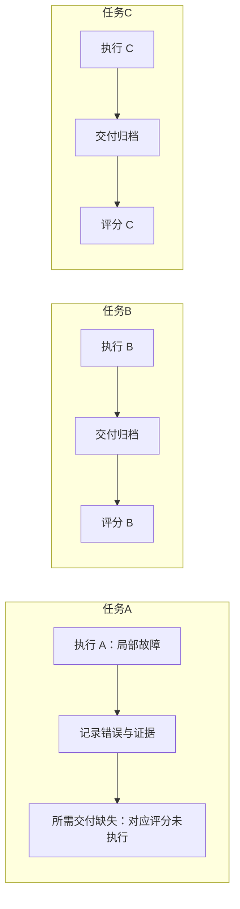

#### D58：单任务先执行后评分，独立任务之间可并发推进——已确认，待实现

用户指出 D57 草图省略评分步骤，可能被理解为先并发执行全部任务、再统一评分，并提出先执行 A、评分 A，再执行与评分 B 的串行方式；随后要求比较方案。经比较后，用户明确采纳每个任务内部先执行后评分、不同任务之间可以并发的方案；D56 继续有效，D57 的局部失败策略也已在随后讨论中确认。

比较三种调度方式：

| 方式 | 任务间依赖 | 适用性与代价 |
| --- | --- | --- |
| 逐任务串行闭环 | A 执行与所需评分结束后，B 才开始执行 | 流程容易观察，适合逐步调试；独立任务也相互等待，难以利用已要求的任务并发。 |
| 全批次分阶段 | 所有任务执行结束后才开始任何评分 | 阶段清晰，但已完成任务的评分会被其他慢任务推迟；当前没有要求这种全批次同步点。 |
| 单任务内有序、任务间并发 | 评分 A 只依赖 A 的有效交付与所需材料；不等待 B 或 C 执行完毕 | 已采纳为一期正常评测流程；可尽早得到单任务完整结果，同时利用独立任务并发，但需明确就绪队列和名额分配。 |

已确认采用第三种：每个 EvalRun 独立衔接执行、结果归档、所需评分和运行状态记录；其交付及评分材料满足既定契约后，评分进入可调度状态，不等待全批次做题结束。任务之间不存在默认的 A 完成才能启动 B 的依赖。多个 Grader 分别评价的关系不变，质量不通过不会触发隐式修改产物或重新做题。任务执行失败且未形成有效评分输入时，明确记录无法开展的后续评分，不能将空内容当作正常交付评分。

调度继续遵循 D56：本次评测的顶层做题 Agent 与 Agent Judge 共用可配置执行名额，默认 20，不把每个 EvalRun 当成额外名额。就绪不等于立刻启动，仍需等待可用名额；调度应允许已就绪的评分与其他任务执行交错推进，不能用队列规则隐式退化为整批执行后评分。具体公平性、优先级和队列实现留待细化，当前只建议保证就绪评分不会一直被新增做题任务挤占。

并发数设为 1 只表示同时一个 AgentExecution，并不自动保证 A 的所有评分都先于 B 执行；若未来需要严格逐任务串行，应明确相应调度顺序，不能混淆容量参数与任务依赖。并发带来的时间收益取决于实际执行耗时、资源竞争及服务限制，本轮仅为设计推演，没有性能实测。本条流程边界已确认，具体调度实现与性能验证尚未完成。

#### D59：两层并发可配置，任务级默认 5、Agent 级默认 20——已确认，起止协议待细化

用户要求除已确认 D56 的 Agent 执行并发参数之外，再提供可配置的任务级评测并发参数。两者独立约束同一次评测调度：任务级控制同时推进的 EvalRun 数量，Agent 级控制实际占用名额的做题 AgentExecution 与 Agent Judge 总量；Agent 级默认 20 不变，用户已明确任务级默认 5，两项均可配置并由显式设置覆盖默认值。具体参数名称待细化，不以其中一个参数的数值推算另一个。

建议任务名额覆盖该任务从获准推进、执行、归档到所需评分终结的完整过程，等待 Judge 时仍属于活动任务；进入明确终结状态后释放名额，评分不通过或含已终结错误不要求永远占用。未获准推进的任务在外层排队。一个任务内的多个 Judge 不新增任务名额，但每个运行中的 Agent Judge 分别占 Agent 名额。此占用起止细节是对用户意图的实现建议，需与状态协议一并确认；未知且无法确认停止的执行继续遵循 D55 / D56。

例如任务级配置为 5、Agent 级为 20，最多五个任务各自推进执行后评分的流程，全部做题与 Judge 合计不超过二十个 Agent 执行，并非每个任务各有二十个名额。任务级设为 1 可用于逐任务完成再推进下一个任务的调度，而该任务内部仍可在 Agent 限额内运行多个 Judge。相比仅控制 Agent 数量，第二层能控制同时处于执行与评分流程中的任务数量；两层名额必须分别管理，协调流程不得占住 Agent 名额等待子执行而形成死锁。此为调度配置，不新增费用预算、领域实体或固定物理容器数限制。两层参数及默认值已确认；具体配置位置、名额起止协议及调度实现待细化。

#### D60：实验结果由已保存数据查询和计算，不依赖 Agent 撰写报告——用户明确，待实现

> **R2 修订（D140 / D141，已确认）：** EvalRun 改为成员记录；查询依据为成员键、TaskRun 与 GradingRecord。见[目标模型](0001-target-model.md)。

用户明确实验报告应由执行及评分数据通过代码产生；也可以不预先生成独立报告，而是在需要查看时通过 CLI 查询实验整体结果。因此采用以持久运行事实为依据、按需计算并展示结果的方向，不把 Agent 撰写报告设为评测完成条件。结果查询可以覆盖运行中的进度与当前已存结果，以及终结后的完整或部分失败结果，须明确查询范围与读取时点；读查询不发起新的做题、评分或模型调用。

应用层查询能力读取 Experiment、ExperimentRun、EvalRun、AgentExecution、GradingRecord 及相关引用，按明确定义的统计规则计算视图，CLI 负责请求与展示。视图包含各任务执行和评分状态、各 Grader 的结果及错误或缺失数量；不同标尺不默认混成总分，不因局部失败只展示成功子集。补评新增事实后，后续查询可反映这些变化，历史记录不被视图改写。默认选择范围按已确认 D63 分层表达，统计口径按 D65 分组并展示覆盖情况；查询接口名称、可聚合声明与展示格式留待细化。

相比强制创建报告文件或调用 Agent 写总结，按需查询减少重复事实和额外执行，不要求一期新增 Report 领域实体；如需导出，可从相同视图派生文件，持久缓存也不能成为另一份可独立修改的结果权威。此处实验结果视图与 Working / Coding 任务交付的报告 Artifact 不同：后者仍是被测任务的正式交付。代码与 CLI 尚未实现本条目标。

#### D61：固定实验方案与一次批次运行分别记录——已确认，待实现

> **R2 修订（D140 / D141，已确认）：** ExperimentRun 直接持有不可变成员，不再有可变的 EvalRun。见[目标模型](0001-target-model.md)。

D56 / D59 的并发参数作用于一次评测调度，D60 的结果查询也需要明确读取范围，因而需区分同一 Experiment 的多次发起。用户已接受增加一层轻量的批次运行记录 ExperimentRun：Experiment 保存不可变评测方案；一次明确发起的批次对应一个 ExperimentRun；其中各任务的一次评测仍对应 EvalRun，不改变 AgentExecution 和 GradingRecord 的职责。本条对象关系已确认，当前模型同步为 Experiment → ExperimentRun → EvalRun；具体字段与迁移尚未实现。

例如今天和明天按同一方案各跑一次，产生两个批次记录，各自关联本批次的 EvalRun、运行状态与实际采用的任务级 / Agent 级并发配置。配置默认值仍为 5 / 20，属于批次执行选项，不复制或改写 Experiment 的固定任务、Agent、评分器与环境条件。查询、停止或恢复一批运行可以指向确切批次，不误将同实验的其他运行算入。可靠恢复同一批次不创建新的批次身份，明确重新发起才形成新批次；受理防重协议另行设计。

相比将所有 EvalRun 平铺在 Experiment 下、依靠时间范围推断某次 CLI 调用的范围，显式批次记录能稳定表达名额共享范围、取消范围与结果分组；相比每次重新执行都复制 Experiment，它保留同一固定方案的身份。只增加必要的批次身份、关联与运行事实，不预设独立微服务、通用工作流引擎或完整新增调度框架。批次内独立重复次数按 D66 可配置且默认 1；任务选择、补评关联、状态及具体字段仍待细化。实验总览可列出各批次，不能默认把所有重复运行或重评记录混成一份样本统计。本条分层与范围已确认，具体协议与实现待完成。

#### D62：取消批次时停止新增工作并取消本批次活动执行——已确认，待实现

> **R2 修订（D140 / D141，已确认）：** 批次取消时，进行中的评分通过 Grading 的取消入口取消。见[目标模型](0001-target-model.md)。

用户已接受 Evaluation 接受针对确切 ExperimentRun 的取消请求，持久记录意图并关闭本批次新增工作入口：不再启动排队任务、不再发起后续评分或自动恢复启动。对已由本批次拥有的活动做题 Agent 和 Agent Judge，经 Execution 按 D55 请求取消并确认停止；规则或测试评分的活动工作由 Grading 协调停止或等待其已开始的有限操作结束，不能把非 Agent 工作漏算为已停止。具体操作的取消能力由相应适配器表达。

批次中已经完成的 EvalRun、GradingRecord 及交付保留，不改写为取消。未开始的工作明确记录因批次取消而未执行；已执行但尚未评分的任务保留交付并记录评分未完成，不为收尾继续启动 Judge。属于其他 ExperimentRun 或独立发起的执行和评分不受影响，不能仅凭共享 Experiment、Agent 配置、产物引用或 Provider 会话标识传播取消。

相比只停止排队任务、让全部在途 Agent 继续工作，采用取消同时覆盖本批次已启动工作的方案，符合停止本批次的明确意图；但取消受理不等于所有工作立即终止。只在入口已关闭、已启动的本批次工作均确认终结后，才能确认批次取消完成；未知执行继续保留停止核对与占用信息，不误报完成，不影响其他批次。若批次本已正常终结，则保留其终结事实。证据归档和环境回收依 D33 / D55 独立表达，不因取消删除历史或宣称清理全部成功。本条批次取消范围已确认，完整状态字段、协议及具体实现尚待完成。

#### D63：结果查询按实验总览、批次结果与任务详情分层——已确认，待实现

> **R2 修订（D140 / D141，已确认）：** 任务详情查询的对象，从 EvalRun 改为成员键加 TaskRun。见[目标模型](0001-target-model.md)。

用户已接受 D60 的只读查询按现有对象身份表达范围：仅指定 Experiment 时，展示固定方案及各 ExperimentRun 的身份、时间和运行概况；指定 ExperimentRun 时，展示该批次的任务进度、评分结果与错误或缺失情况；指定 EvalRun 时，展示对应执行、交付、各 GradingRecord 的 Grade 与依据，并提供轨迹和产物的确切引用。各视图由代码从持久数据计算，不新增 Agent 或独立报告实体。

相比只给 Experiment 就隐式选择最近批次或混合所有批次，显式分层能避免用户误把重跑和原运行混成同一份结果。若后续提供 latest 等便利选项，应要求显式选择并在输出中给出实际批次身份，不能把别名当作稳定结果引用。实验总览可包含逐批次摘要，但本条不规定跨批次自动合并分数；重评记录选择按已确认 D64 执行，单批次汇总按已确认 D65 保留标尺并同时展示有效覆盖。

查询在运行中也可使用，须说明读取时点及未完成状态；不为了补齐展示而启动评分、恢复执行或修改原记录。具体应用查询接口与 CLI 命令名、分页、格式和一致性实现留待细化。默认查看范围与追溯层级已确认，具体接口和实现尚待完成。

#### D64：同一评分要求重评后默认采用最近一次正常完成结果——已确认，待实现

> **R2 修订（D140 / D141，已确认）：** 采用规则作用于“成员键 + 评分要求键”下、完整绑定一致的 GradingRecord，按稳定请求顺序选取。见[目标模型](0001-target-model.md)。

已确认重评新增 GradingRecord 且不增加作答样本；用户已接受本条结果视图的选择规则。对同一批次、同一 EvalRun 中的同一评分要求，若重评仍使用确切相同的目标、评分器版本与绑定评分材料，则默认展示并汇总最近一次正常完成且返回合法 Grade 的评分记录，保留全部历史。不同评分器或版本、不同评价目标与评分输入不因此被当作同一重评序列，独立发起且未关联该评分要求的记录也不自动改变批次结果。

例如原评分为 4 分，同条件重评正常得到 2 分，当前结果采用 2 分并保留 4 分记录；如果重评发生评分器错误，保留此前有效结果，同时明确显示最近重评失败及原因，不能隐藏失败。合法的无法判定依 D13 属于正常结果，不因其没有数值就跳过它而保留旧高分。结果视图应标出采用的确切 GradingRecord 引用；同一评分要求的多条历史记录不能算成多份任务样本。

比较固定采用首次结果、选择最高分和采用最近一次正常结果：首次结果会使明确重评后默认视图仍停留在旧评价，选择最高分会引入挑选偏差；采用最近一次正常结果，符合按需查询更新事实的使用方式，同时保留历史供追溯。此选择是视图规则，不覆盖原评分，也不自动修改已导出的历史报告。并发重评的先后须使用稳定且可追溯的发起顺序，不能依赖完成快慢随机覆盖；具体序号及采用规则实现待细化。本条默认选择规则已确认，尚未实现；一期汇总口径已由 D65 确认。

#### D65：按评分维度与标尺汇总，质量统计与覆盖情况同时展示——已确认，待实现

> **R2 修订（D140 / D141，已确认）：** 汇总所需的预期评分集合，由成员与评测项的评分绑定推导。见[目标模型](0001-target-model.md)。

用户已接受一期批次结果在 D64 选定评分记录后，按评分器版本、评价维度和标尺分别统计，不把不同评分器或不同语义的数值直接平均，也不默认换算为单一实验总分。可比较的数值评分显示有效数值数量与算术平均值；分类评分显示各类别数量，如展示比例须明确以哪些结果为分母。仅因同为数字或范围相同不足以认定标尺可合并，序数等级等不适合平均的标尺应保留分布与原始结果，具体可聚合声明方式待细化。

每个统计组同时展示本批次预期评分项数量、已有合法数值或类别结果、合法无法判定、执行错误及尚未取得结果的情况；运行状态明细保留未开始、运行中、取消等原因。错误、缺失和无法判定不填零、不加入数值平均的分母；真实得到的零分照常纳入。没有有效数值时显示暂无有效分数，不输出零分或伪造平均值。例如同一 0–5 分评分维度预期十项，八项有效评分、两项错误，显示八项平均分和八 / 十的有效数值覆盖，同时明确两项错误，不能只展示平均分暗示全量完成。

统计按每个 EvalRun 的对应评分要求选定记录计数，不按全部 GradingRecord 历史条数计样本；任务数与评分项数分别表达，一个任务有多个 Grader 时不能混用分母。若原有有效结果被采用而最近重评失败，仍显示该有效结果，同时额外披露最近重评错误；这类错误提示可能与有效结果共存，不把两者强行当成互斥计数。补评和重评选择继续遵循 D50 / D64。

相比只给总分，分组结果与覆盖情况更易追溯其含义；相比把故障记零分，可将系统执行可靠性和质量评价区分。上述一期统计展示规则已确认，不引入自定义权重、跨批次混合或显著性推断，也不自动判定哪个实验更好。查询实现、可聚合声明与具体字段待细化。

#### D66：批次可配置独立重复次数，默认每个评测项一次——已确认，待实现

> **R2 修订（D140 / D141，已确认）：** 每个“评测项 × 重复序号”成员对应一个 TaskRun。见[目标模型](0001-target-model.md)。

用户已接受 ExperimentRun 支持明确的重复次数参数，默认 1：同一固定评测集快照中的每个 EvaluationCase，在本批次独立执行 N 次，每次对应不同 EvalRun 及做题 AgentExecution、交付、轨迹和评分记录。N 在批次发起时确定并保存为执行选项，不修改 Experiment 固定的任务、Agent 和评分器条件。这里按评测项计数，不按 Task 身份合并：同一个 Task 若关联不同评分绑定形成多个评测项，仍是不同的计划项。具体选择子集的能力本条不新增。

例如一个评测项配置重复 3 次，产生 A1、A2、A3 三次独立作答及各自评分，不是在同一对话里要求 Agent 连续回答三遍。独立环境与会话边界遵循 D30，条件定义保持一致，不能复用上一尝试留下的可变状态；每个 EvalRun 占自己的任务级名额，其内部做题与 Judge 共用批次 Agent 名额，继续遵循 5 / 20 的可配置默认值。隔离不意味着保证模型输出随机性或统计独立，种子与外部数据可变性按实际能力记录。

相比为了重复一次评测项而要求手工发起多批次，批次内明确重复次数能统一记录计划与完成覆盖；默认一次保持常见路径简单。明确重复产生新作答样本；故障后的可靠恢复不增加样本，对原交付重评也不增加样本。计划十个评测项、每项三次时，应分别显示十项定义、三十次计划尝试及各自完成情况；不得把三十次尝试称为三十种不同任务，也不因失败偷偷追加尝试直到得到三十次成功。

数值或分类汇总仍按 D64 / D65 使用各 EvalRun 对应的采用结果，必须保留评测项与重复序号供查看波动，不默认挑每项最高分，也不据此新增显著性或稳定优胜结论。本条独立重复能力与默认值已确认，参数名、字段与实现待完成。

#### D67：Provider 适配器输出统一事件并保留原始记录——已确认，待实现

在 D2 / D9 已确认的 Provider 协议隔离和轨迹保存原则下，用户已接受由内侧 AgentProvider 端口定义公共执行事件契约，Codex、Pi 等适配器将各自可观测记录转换为公共事件，交给 Execution 协调轨迹归档。公共语义覆盖消息输出、工具调用与结果、错误以及 Provider 运行终结等；字段不直接引用某个 SDK 的类型。Provider 终结仅表示其运行事实，不等同于 D1 的交付与轨迹已归档完成。

除公共事件外，保留可获得的 Provider 原始记录及其来源关联，作为协议追溯与重新解析的依据；公共事件是同一轨迹事实的规范化表示，不建立两套独立执行状态权威。无法可靠转换的 Provider 特有事件保留为原始或扩展记录，缺少某类消息或工具事件时按 D9 标记覆盖限制，不推测或补造。只有实际公开且采集到的事件才能进入轨迹，不承诺获得 Provider 未提供的内部过程。

相比让 Execution、Grader 或报告查询分别解析每个 SDK 的事件格式，适配器统一转换可将协议变化局限于对应 Provider；相比只保存通用字段，原始记录有助于解释转换缺失。原始数据通过既有证据存取与访问边界保存，不因需要追溯而将凭据或私有配置直接写入用户报告。本条接口责任与两种记录的关系已确认；具体事件字段、版本、源序号、分段及防重协议留待实现设计，代码尚未实现。

#### D68：Provider 显式表达能力差异，不隐式降级运行语义——待讨论

建议 AgentProvider 端口除公共请求、事件与结果契约之外，还能表达所选适配器及其实际运行配置支持的能力，例如继续既有会话、查询既有运行、协作停止以及可采集的事件范围。能力表达是端口契约的一部分，不要求所有 Provider 达到同一能力全集；具体字段及必要最小集合留待核对实际 SDK 与容器接入后确定，本条不声称任何具体 Provider 版本已经支持这些功能。

应用层在使用某项能力前核对支持情况。若请求的必要能力不受支持，应明确返回不支持或不兼容，不静默忽略要求。例如不能把不支持继续原会话降级为启动新会话，却仍写入原 AgentExecution 的轨迹并称为恢复；新做一次须遵守 D49 / D54 的明确新执行语义。轨迹覆盖有限时如实保存限制；若所选过程评分必须依赖缺失事件，明确说明不能满足评分输入要求，不能伪造过程或质量分数。

Provider 能力与整个 Execution 的有效能力分别判断：Provider 没有原生停止接口时，执行宿主或容器适配器可能提供可验证的停止机制；由 Execution 协调并遵守 D55 的停止确认，不能仅凭 Provider 的单一能力标志推断运行必然不可取消，也不能将已有未知状态宣称为已停止。静态能力声明不替代实际调用结果，运行时失效、失联与不支持应分别表达。

相比强迫所有适配器实现虚假的恢复与控制方法，显式能力能保留 Provider 差异；相比让上层按 Codex / Pi 名称写分支，能力契约能隐藏 SDK 决策。能力检查由应用模块封装，调用方表达实际需要，不新增通用插件协商框架。本条尚待用户确认，能力矩阵及其行为验证属于后续实现。

2026-11-01 补充：[多 Agent 内核接入源码调研](../research/multi-agent-kernel-adapters.md)已核对 Harbor、Vibe Kanban、ACP / Codex / Pi 适配器及 Pi 原生接口。Harbor 已有 Codex 与 Pi 专用实现，证明多内核接入有直接参考；会话继续、历史重放、取消与轨迹覆盖仍存在语义差异。建议借鉴能力声明并保留 Grounds 自己的 AgentProvider / Execution 边界。此为 D68 的研究依据，D68 仍待确认；没有选定新的生产依赖或宣称集成验证通过。

#### D69：一期采用 Pi Durable 单一内核——已确认，待实现

用户接受选型建议：一期使用 Pi Durable 作为唯一新增 Agent 内核，用于 Coding / Working 执行及 Agent Judge；保留 Execution 与小的 AgentProvider 端口，将 Durable 的协议、内部任务与持久状态封装在适配器内。Grounds 继续负责业务 Task、实验、评分、正式交付、证据归档、统一环境治理与两级并发。

本条替代早期一期同时支持 Codex 和 Pi 的范围。Pi Coding Agent SDK、Codex 新适配器及通用 ACP 接入不作为一期交付要求；早期决策、研究及图片中的多内核例子仅说明依赖隔离和历史方案，不能解释为当前支持清单。现有 Codex 执行路径不因确认选型立即删除，须核对入口、配置与历史记录，并在替代验证后落实迁移和退役方案。

取舍是减少不同内核的协议、事件与恢复语义兼容工作，集中复用 Durable 的内部检查点和持久提交机制；代价是接受其实验性 API 的锁版与升级维护成本，一期不直接运行 Codex / Claude Code 等其他完整内核。Durable 不接管 Grounds 领域对象，也不自动保证工具副作用不重复或业务归档完成。D54 的请求内容冲突校验、D55 的停止确认及未知状态核对仍由本项目落实。

具体发布版本、执行宿主与存储所有权仍待细化并验收；先前底座实验不能代替主流程集成验证。D68 的通用多 Provider 能力矩阵不列为一期前置条件，也未因本条自动获得确认；单一 Durable 实现仍须明确实际支持的恢复与事件范围。

#### D70：一期按 AgentExecution 隔离 Durable 运行宿主与内部存储——已确认，待实现

> **R2 修订（D140 / D143，已确认）：** 进程与存储隔离规则不变，适用于 AgentExecution。见[目标模型](0001-target-model.md)。

用户已接受：一期每个顶层 AgentExecution 由独立的 Durable 运行进程管理，并有独立的持久存储归属；被测 Agent 和每个 Agent Judge 分别管理。这里讨论应用层执行部署和适配器边界，不新增领域实体，也不把进程数量定义成新的并发参数。D56 的 Agent 并发默认 20 仍按顶层执行计数；内部工具、子进程不因此成为新的顶层执行。

与一个全局 Harness / 存储承载所有任务相比，独立运行宿主增加进程与存储管理开销，但更容易限定取消、进程崩溃及存储故障影响范围，并与已经确认的独立执行环境边界对应。它不消除共享主机、磁盘或模型服务故障，是否满足目标并发仍需测量；不宣称该方案性能最优。

运行进程可被替换，持久存储按执行身份保留，不随临时容器自动删除。只有在核对旧拥有者已停止、执行环境可继续且恢复条件满足后，新进程才能接管原存储并继续同一执行；状态未知时保持阻塞，不能两个进程同时打开它。独立重做建立新执行和新存储，不通过复用旧记录伪装成独立样本。归档失败优先补归档，不借恢复重新做题。

该内部存储用于 Durable 的会话和检查点，不替代 Grounds 的实验、正式交付、GradingRecord 与证据存取。恢复所需工作区和工具状态须另行核对，不能仅凭数据库存在认定可恢复。D30 允许环境实例在明确工作过程内顺序保留，本条不改变该规则；显式会话交接的协议仍需细化。

本条已确认“一次执行一个运行宿主及独立存储归属”；D71 已进一步确认 Durable 位于宿主侧、任务工具在容器内。数据库介质、持久目录、保留期限和保护机制仍待设计；不把内部状态文件自动作为 Agent 可读写的任务材料。具体实现与集成验证尚未完成。

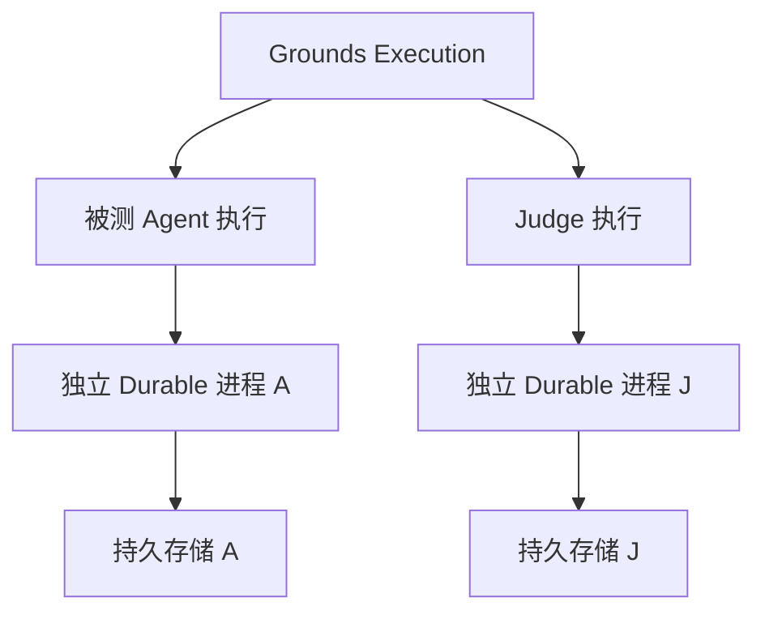

#### D71：Durable 运行进程与任务工具容器分离——已确认，待实现

用户已接受：在 D70 的独立进程及存储归属下，一期由 Grounds 宿主侧管理每个执行的 Durable 进程及其持久状态，模型驱动的文件读写、命令和任务代码执行通过环境适配器进入该执行占用的任务容器。这里的宿主侧指 Grounds 的受管执行服务所在环境，不要求固定部署在用户个人电脑上；任务容器仍由统一环境治理分配和回收。

与将 Durable 和全部工具放入同一个任务容器相比，该安排使内部检查点不必暴露给任务工作区，任务镜像也不必承载 Durable 的完整运行依赖；代价是需要实现并验证文件访问、命令、输出与取消的跨环境桥接。容器内运行方案仍是可行替代，不能仅为图面简洁就认定宿主侧方案实现成本更低。

此建议依赖明确的执行边界：Durable 内置工具必须绑定容器环境适配器，不能默认使用宿主 NodeExecutionEnv；模型生成代码以及任务提供的可执行插件不能直接在宿主侧运行。宿主只加载受信任的运行与桥接代码；远端知识工具等通过已授权的工具连接调用，不能由放置位置推导任意宿主访问权限。该限制属于本方案能成立的必要条件，实际隔离须验证。

停止 Durable 进程不等于容器内工具已停止；Execution 仍要核对两侧运行事实，遵守 D55。恢复时同时检查 Durable 存储、原容器和工作区状态，不能因宿主记录仍在就自动新建空容器继续。进程隔离、数据库介质和桥接实现由外层适配，不改变领域模型。

本条部署边界已确认，具体桥接与运行代码尚未实现。源码可行性依据见[多内核研究](../research/multi-agent-kernel-adapters.md)中的 Durable ExecutionEnv 分工，尚未完成 Grounds 容器桥接实测。

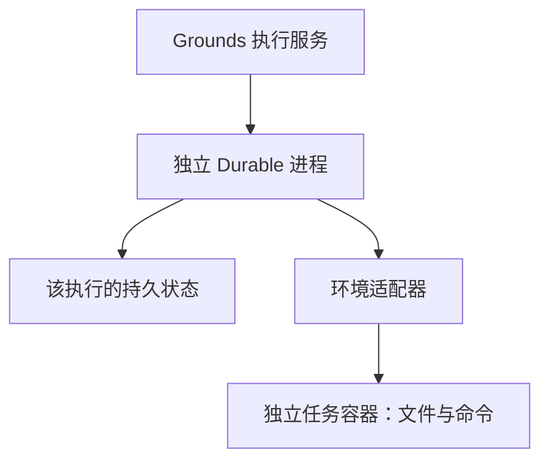

#### D72：Agent 内部状态通过独立存储接口支持可选数据库——用户明确要求，待实现

> **R1 修订（D137，已确认）：** 保留存储端口，一期只交付 SQLite 后端，其余后端推迟。

用户澄清：ArtifactStore 是正式产物的独立存取接口；Agent 内部状态同样要依赖存储抽象，而不绑定某一种数据库或本地文件形态。应支持 SQLite、PostgreSQL、MySQL 等可选择的数据库后端，具体数据库适配位于外层。此前“限定每次执行一个宿主本地 SQLite 文件”的提议撤回，不作为一期约束。多后端支持是目标要求，具体交付顺序和默认后端尚未确定，不能据此声称当前均已支持。

Durable 已有 Storage 契约，工程上优先评估复用或桥接该契约以及仓库现有数据库基础设施，不为形式上的分层再复制一套相同方法。应用边界表达打开某执行的内部状态存储所需的身份与配置，连接、SQL 方言、表结构和事务实现由外层隐藏；具体端口名称及签名待设计。该接口不与 ArtifactStore 合并，不把业务账本模型塞入 Durable 内部状态。

D70 的“每执行独立存储”明确为独立的逻辑归属和访问范围，不强制独立数据库服务器、物理数据库或文件。不同执行可以在同一数据库服务上由隔离命名空间或带执行身份的数据范围保存，但不能串读串写或共用可变会话。一个逻辑存储范围仍只能有一个有效运行拥有者；远程数据库支持多连接不等于允许两个 Durable 进程同时恢复同一次执行。

D71 的宿主侧管理指内部状态由受管运行服务管理、不得作为任务材料暴露给容器工具，不要求数据物理落在宿主磁盘。SQLite 文件和远程数据库连接都是外层选择，凭据不传入任务可见材料。采用远程数据库本身不自动提供跨主机恢复；接管仍需核对拥有者、容器和工作区状态。

数据库适配必须满足 Durable 所需的原子提交、提交顺序与回执、失败后重开及逻辑隔离契约。仓库已有某类数据库驱动，不代表已经有可直接用于 Durable 的 Storage 实现；实施时核对现有代码，复用连接和事务基础设施并补充存储契约测试。具体迁移、备份、清理和恢复策略另行落实。

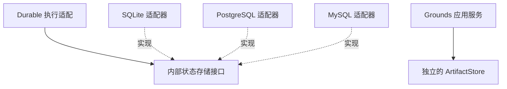

#### D73：CLI 连接结束不隐式取消已受理的执行——已确认，待实现

用户已接受：CLI 作为提交、查询、等待和取消的客户端，已受理工作由受管执行宿主驱动。关闭终端、等待连接断开或只读查询失败不自动成为任务取消指令；已启动执行在宿主仍正常运行时继续。用户可通过稳定的执行或批次身份重新查询；明确取消经 D55 / D62 的应用接口处理。

这补齐 D53 的宿主责任，不仅是返回一个 ID：实现须确保执行进程及其输出、输入不依赖原 CLI 的终端和管道存活，执行身份与受理记录可在客户端重开后发现。客户端断开时处于受理与启动之间的工作也不能被误报已启动；受管宿主是否已取得责任须可核对，沿原请求防重处理，不能重新提交重复执行来恢复等待。

相较于把工作绑定到前台 CLI，分离后长时间实验不依赖终端连接；代价是需要管理宿主生命周期、查询发现与显式取消入口。Ctrl-C 等交互究竟表示停止等待还是发起取消，须在 CLI 设计中明确，不能把本条直接解释为忽略所有中断操作。

本条不承诺宿主关机、崩溃或数据库不可用时工作仍继续，也不自动批准开机恢复所有执行。此类故障遵循已有未知状态核对及恢复规则；后台进程启动方式、监督机制和重启后的恢复触发策略另行设计，不预先要求新建常驻守护服务。本条客户端与执行生命周期分离已确认，代码尚未实现。

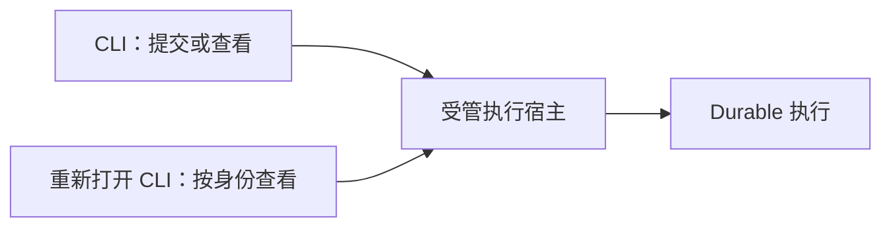

#### D74：宿主重启后先核对，手动恢复才继续未完成工作——已确认，待实现

用户已明确选择：一期受管宿主重启后先发现未完成记录并核对真实状态，再手动恢复；不因启动服务或打开查询就自动恢复模型及任务工具执行。确认原执行仍在运行时重新接管监控而不再启动；确认已停止且数据、环境与版本兼容时，展示可恢复状态，由用户手动发起恢复原执行或原批次的请求，经应用接口处理。状态未知时保持受阻，不能将恢复请求变成无条件重新启动。

与自动恢复所有未完成任务相比，明确恢复减少重启后意外重新消耗或执行外部操作的情况；代价是宿主故障后需要一次明确操作，暂不提供无人值守自动恢复策略。此规则不影响 D73：仅 CLI 断开、受管执行仍正常时任务继续，无需用户再次恢复。

恢复沿用原执行 / 批次身份和持久状态，遵守请求防重、占用核对及已确认的尝试边界。已有明确取消意图的工作应继续停止确认与清理，不作为待恢复的正常任务；已完成任务不重跑，只有归档未完成时补归档。若恢复条件不足，应说明缺失条件；明确重做是另一个操作，产生新身份。

本条已确认宿主重启后的恢复触发方式，不决定完整异常状态机和命令名；一期不实现自动恢复策略。具体实现与验证尚未完成。

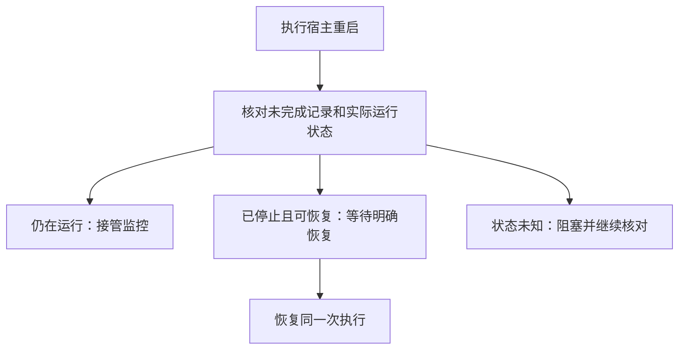

#### D75：工具中断后按可重试清单处理，其余默认人工确认——已确认，待实现

用户接受先列明可自动重试的工具清单，其余中断操作默认等待人工确认。清单由受信任的工具定义或适配器维护，模型不能自行修改。只读调用经核实不会产生业务副作用后可列入；具有副作用的工具只有在稳定操作身份下具备已验证的幂等或结果核对协议时才可列入，并沿原身份恢复调用。未列入清单的工具不能仅因 HTTP 方法、名称、看似只读或返回异常就自动重试。

例如创建 Candidate 已写入业务账本但回执丢失，先按原操作身份查询结果；确认已成功则取回原引用；确认未执行且具备防重保证时，清单内操作才允许自动补执行，清单外仍等待人工确认。无法确认则阻塞该执行并说明待核对操作。不能换一个新请求身份再创建，也不能把未知结果当成失败让模型盲目决定重试。

Durable 已有工具 replay 策略，但对不安全中断返回 interrupted 并交回模型的机制不足以单独落实本条；适配器与 Execution 需要在副作用状态未知时暂停后续任务推进，保存原工具调用及核对结果，避免模型通过另一条等效调用绕过防重。具体暂停、工具结果补录、核对及人工处置接口待设计；用户手动恢复 D74 不是确认副作用可以重复的授权。

只读调用重试仍可能读到变化后的内容，须保存实际重试记录及其结果，不能冒充原调用输出或保证外部数据未变。工具正常返回的业务错误、模型失败与操作结果未知分别处理；本条只规定中断后副作用处理，不新增无限自动重试策略，不承诺任意外部工具恰好执行一次。

本条可重试清单与其余默认人工确认的策略已确认，既有 D47 / D54 的保存和受理防重继续有效；具体清单条目、人工处置交互、工具能力映射、测试和实现尚未完成。

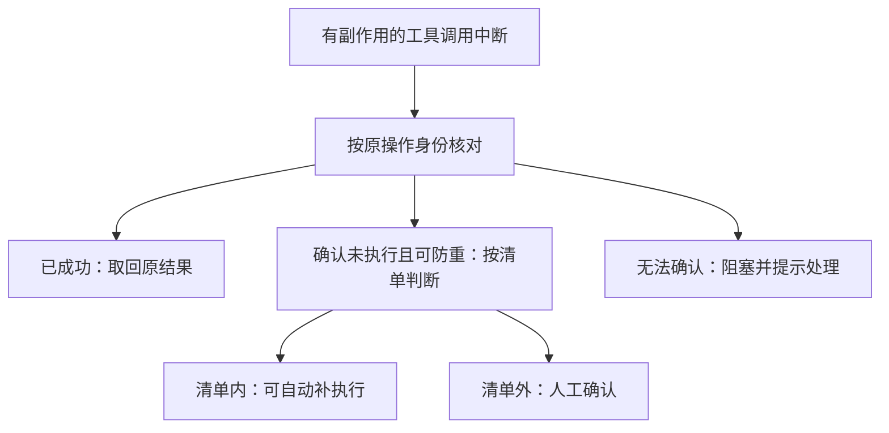

#### D76：启动前拦截已知不满足条件的工作——原则已确认，校验范围与应用设计待定

用户明确希望启动前拦住已知不满足必要条件的工作，但具体检查做到哪里、由哪些应用服务组织仍待设计，不能将后面的清单与两阶段流程视为全部接受。当前仅作为讨论候选的范围包括：固定的任务、AgentSpec、GraderSpec 与环境引用可解析；任务声明的交付契约能满足评分器声明的输入要求；公开任务材料和隐藏评分材料分别在授权范围内可取得；所选工具与环境依赖匹配；运行状态存储与证据存取后端的必要能力可用。校验自身不调用被测模型或 Judge，不产生伪造作答或评分结果。

分两步执行：受理前完成无副作用的结构与引用校验，准备环境后、启动模型前核对实际运行条件。校验失败返回具体缺失或不兼容项并保留适当的受理或准备记录，不误报 Agent 已运行，也不记质量零分。检查尚未产生的正式交付时只判断契约是否兼容，不能要求实际内容提前存在。

共享方案错误或共享必要依赖不可用时阻止受影响的新工作；局部任务材料或配置问题只阻止对应任务，不取消其他独立可执行任务，延续 D57。预检并不保证运行期间依赖不会变化，实际工具执行、归档及评分仍校验真实结果；校验通过不能作为成功完成证据。

相比让 CLI 或每个 Provider 各自散落校验，应用层封装公共流程可使不同入口获得一致的诊断。具体接口、连接检查方式、环境准备开销及凭据可用性的验证方式待实现，不为预检发起有业务副作用的测试工具操作。本条仅拦截原则已确认；具体清单、时机、接口与以下流程图仍是提议。用户要求先回顾领域整体，再继续应用层设计，未修改代码。

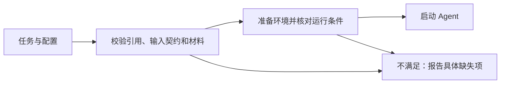

#### D77：Workspace 作为执行的文件空间——可见空间职责已确认，对象关系待讨论

用户要求核对现有 workspace，并讨论 Agent 加载文件、读取材料与写入工作文件的空间如何纳入统一环境治理。以下为 2026-11-01 的源码阅读结论和设计建议，未改运行代码，未运行容器或行为测试。

**用户确认范围：** Workspace 用于控制 Agent 可见的上下文空间，当前讨论具体落在文件空间；用户要求逐条讲清它与 EnvironmentSpec、EnvironmentInstance 和 AgentExecution 的关系，尚未确认这些关联的全部设计。不能将本条整体标为已接受。非文件上下文（提示、远程工具返回等）是否纳入 Workspace 尚未提出明确规则，不能宣称文件空间能控制 Agent 的所有信息来源。

**逐条解释用的关系提案：** EnvironmentSpec 描述所需运行条件，例如 Python 和文档解析依赖；EnvironmentInstance 是按这些条件实际准备、可占用和释放的运行资源。Workspace 描述本次可见的文件及读写范围，例如只读的两份报告和可写的输出目录；环境实例负责通过适配器落实这种文件视图。AgentExecution 是某个 Agent 配置执行一次任务的记录，绑定实际使用的环境和文件视图，并产生自己的轨迹。按 D71，Durable 进程仍在宿主侧，文件和命令工具进入任务环境；“执行使用环境”不表示整个 Agent 进程必须在容器内。文件工具与命令工具必须遵循同一可见范围，不能只有文件读取入口受约束。具体绑定保存位置、数量与生命周期仍待定。

| 现有能力 | 源码依据与边界 |
| --- | --- |
| 编码工作区 | [CodeWorkspaceInstance / WorkspaceConfiguration](../../typescript/src/code-workspace.ts) 固定多仓库配置、commit/tree 基线，并关联 Issue、目标仓库及回收/恢复信息；当前不是通用 Working 工作区。 |
| 独立可写开发目录 | [CodeWorkspaceRoutes](../../typescript/src/code-workspace-route.ts) 准备独立开发 worktree；准备代码不等于授予执行权限。[DockerRouteEngine](../../typescript/src/code-route-docker.ts) 在开发模式挂载可写 `/workspace`，基线与 Git 元数据只读。 |
| 问答材料空间 | [评测环境脚本](../../plugins/grounds/scripts/grounds_eval_environment.py) 校验 workspace/materials，保存文件清单并将准备后的材料设为只读；包含 code/doc/fixture 材料角色。 |
| 运行条件独立定义 | [RepositoryEnvironmentConfiguration](../../typescript/src/repository-environment.ts) 描述镜像和依赖服务；[RouteExecution](../../typescript/src/code-route-execution.ts) 组合代码路径、基线和运行环境。当前两条路径尚未统一治理。 |
| 其他同名概念 | [WorkspaceModule](../../typescript/src/workspace.ts) 用于需求与 Issue 的 Markdown 编辑发布，不能直接当作 Agent 文件空间；[WorkspaceLease](../../typescript/src/workspace-provider.ts) 区分 managed/external 目录归属，统一时应保留这种所有权差异。 |

**建议边界：** 保留 Workspace（执行工作空间）作为可识别的领域概念，纳入统一环境治理。EnvironmentSpec / EnvironmentInstance 表达运行条件和运行实例；Workspace 表达 Agent 实际可见的文件材料、来源版本、读写范围及工作区域。Task 声明材料需求，Workspace 记录实际准备出来的文件绑定，两者不重复拥有需求定义。AgentExecution 关联所使用的环境实例与工作空间；环境实例绑定或承载文件空间。图中的箭头表示关联，不预先确定聚合所有权、数量关系或事务边界。

Coding 可使用只读仓库基线、可写开发目录及输出区域；Working 可使用只读资料与仓库、可写临时和输出区域，无须 Git 提交或 Candidate。工作区里的普通文件不自动成为 Artifact，仍遵循 D41 / D43 的显式交付与归档规则。Workspace 只覆盖文件系统上下文；提示、Agent 配置、远程工具和隐藏评分依据仍分别遵守既定边界。

**方案比较：** 全部塞入 Environment 可减少一个名称，但会混合运行条件、材料版本、文件写入权限和编码流程；保留 Workspace 并由统一环境模块封装准备与绑定，能复用文件空间能力，同时隐藏 Git worktree、目录布局和容器挂载的实现差异。建议采用后者，不要求上层分别拼装底层文件与挂载步骤。现有 Issue、DevRun、Candidate 恢复等编码语义保留在编码业务中，不能机械搬到通用 Workspace。

**用户补充的设计方向：独立生命周期与挂载关系。** Workspace 有自己的生命周期，环境实例通过挂载使用它，卸载解除使用关系；回收环境实例不应隐式销毁 Workspace。需要清理工作空间时应依据其自身的归属与保留规则处理。这里的“挂载”首先是领域上的附加 / 解除文件空间关系，具体由适配器实现，不预设必须使用操作系统的实时挂载命令。Workspace 的文件与来源身份可以保留，再交由新的兼容环境实例使用；这不等于恢复旧进程或自动恢复 Agent 执行。

设计收益是环境替换、回收与工作文件保留可以分别决定。**卸载约束已由用户确认：** 只有确认相关执行及其工具不再使用该文件空间后，才允许解除挂载；整个执行已停止是满足此条件的一种情况。发出停止请求或 CLI 断开不代表已经停止使用，无法确认时保留占用并核对。此约束不要求一期支持运行中动态切换；同时多环境挂载及写入互斥仍待讨论，不由“独立生命周期”自动推出。

待对齐：具体 Workspace 状态、一次执行的绑定数量、外部目录的管理责任，以及是否需要再区分定义与实例。此处不新增已经确认的状态机或共享规则；D34 的实例执行隔离等既定规则继续适用。

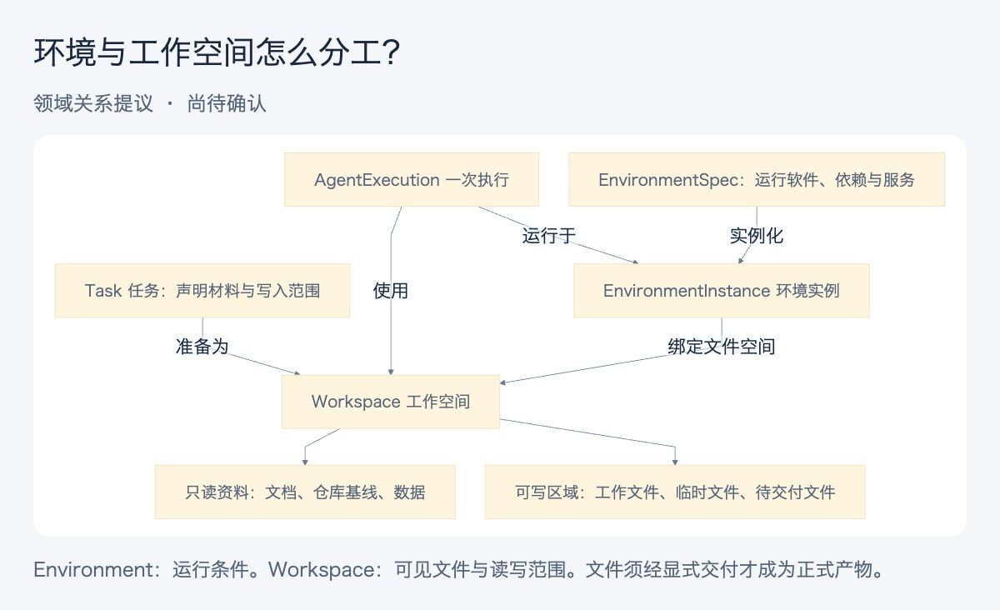

[Mermaid 草图源文件](../assets/workspace-environment-proposal.mmd)。本图为待确认建议，不替换第 3 节已经确认的领域关系。

#### D78：应用层 Execution 串联工作空间、环境与 Agent 运行——职责已确认，接口待细化

用户明确执行用例负责串联创建工作空间、准备环境实例、挂载工作空间和启动 Agent 等流程。这里的“业务层执行”对应六边形架构的应用层 Execution 服务；与第 3 节 AgentExecution 领域记录区分。沿用既有 Execution 名称，不因本条新增同义服务或强制改名。

**后续澄清优先于下文历史分层表述：** 用户再次指出“Agent 执行”本身就是应用层编排。对此明确：运行任务的执行能力属于应用层，技术操作通过适配器完成；不能仅因需要持久化执行身份、状态和轨迹，就断言必须存在独立的 AgentExecution 领域实体。原图将执行记录直接列为领域对象的分类重新开放审查。记录需求、身份与恢复规则继续保留；记录究竟包含独立领域行为，还是主要作为应用层运行记录，应按实际不变量和业务语义判断。此澄清不表示已决定删除记录或迁移代码，也不把原有记录的领域归属算作本次用户确认。

**最新讨论方向：两层可以同时存在，职责不同。** 用户随后提出领域层可以保留一次 Agent 执行的业务实体 / 记录，应用层另有执行接口负责串联业务动作。按此方向，AgentExecution 表达一次执行的身份、事实与合法状态；Execution 应用接口及其用例实现组织 Workspace 准备、环境准备、挂载、Agent 调用、归档和释放。领域实体表达记录，不自行写数据库；持久化通过端口与存储适配器完成。用户所说“最终实现在适配器层”需区分技术操作与用例编排：建议业务顺序和完成规则的实现留在应用层，具体文件、容器、Pi Durable、存储操作在适配器层；通过外层组装将这些适配器注入应用服务。不能把整段业务流程仅留下应用接口、全部放到 Provider 适配器里，否则替换内核会牵动业务规则。此处记录最新理解及澄清建议，最终命名、实体行为和具体端口尚待细化。

- 应用层 Execution 实现用例编排：创建或取得本次所需 Workspace，按 EnvironmentSpec 准备或取得适用的 EnvironmentInstance，确认挂载和准备条件后调用 Agent 执行端口，并协调轨迹、交付归档与停止后的资源处理。所述顺序是可理解的典型流程，不强制每次创建新 Workspace 或新环境；复用须满足既定归属和隔离规则。
- 领域层保存 Workspace、EnvironmentInstance、AgentExecution 等身份、关联和合法状态，表达“仍在使用不可卸载”等规则；领域对象不直接启动进程、操作 Docker、读写文件或调用 SDK。
- 外层适配器实现应用所需端口，例如实际文件空间准备、容器创建与挂载、Pi Durable 调用和存储。**编排实现本身留在应用层**，不能把整个业务流程搬进 Docker 或 Durable 适配器；上层也不必记忆挂载命令、文件布局和 Provider 协议。

该分工与 D1 的归档完成边界、D71 的宿主侧 Durable、D74 的核对后手动恢复及 D77 的卸载约束一致。流程失败时的具体补偿、端口签名和绑定持久化结构待设计，不因本次职责确认而视为已经实现。

#### D79：环境归属通用任务执行，评测通过任务间接使用——用户明确修订

> **R1 修订（D133 / D138，已确认）：** 实验不接受用户另选或覆盖的环境，但可以保存由任务要求自动解析出的结果（环境解析表），作为固定方案的一部分。见[目标模型](0001-target-model.md)第 8 节。

用户指出环境能力适用于一般 Agent 任务执行，不应直接隶属于实验或评测。Task 关联所需 EnvironmentSpec，并声明材料需求；Execution 应用服务依据任务要求准备 Workspace、环境实例与挂载，AgentExecution 记录实际使用的资源。EnvironmentSpec / EnvironmentInstance / Workspace 不引用 Experiment、ExperimentRun 或 EvalRun。实验通过 SuiteSnapshot 中的 EvaluationCase 引用 Task，间接固定相应任务要求，不另维护一套环境绑定。本条替代 D26 / D39 中“Experiment 直接固定环境选择”的归属设计，不撤销环境版本可追溯、隔离与回收等既定规则。

**能力边界：** Evaluation 负责实验、批次、重复和任务级评测组织；它调用通用 Execution，取得执行及交付引用，再调用 Grading 并关联结果。Execution 负责通用任务执行，不要求 Experiment / EvalRun 身份，也不自行决定评测集、评分方法或实验汇总。环境治理提供准备、挂载、占用和回收能力，不反向依赖评测概念。评测侧保存 EvalRun 到执行记录的关联，而非让通用执行记录必须归属实验。Task 与环境定义的具体关联字段、版本冻结方式和缺省规则仍待细化。

Agent Judge 所需运行条件同样由通用执行路径处理，不重新塞回 Experiment；评分需求怎样形成执行输入仍待应用接口设计，不能据此强制新建持久化 Task 或让 Judge 继承被测任务的工作空间与材料权限。纯规则评分不要求启动 Agent。

#### D80：Agent Judge 构建在通用 Agent 执行之上——用户明确方向，细化方案待确认

> **R1 修订（D131，已确认）：** Agent Judge 直接使用 AgentExecutionService 作为评价者执行，不再经过 TaskExecution，也不产生 TaskRun。

用户明确 Agent Judge 本身也通过 Agent 执行完成工作，应在通用执行能力上构建。结合 D48，Agent Judge 是 Grader 的一种实现，通过组合调用 Execution 完成评分工作；不是与 Execution 并列的第二套执行引擎，也不是要求 AgentExecution 领域实体继承出 Judge 子类。规则或测试 Grader 仍按自身策略执行，无须启动 Agent。

建议职责链：Grading 根据 GraderSpec 固定目标和实际评分材料，交给所选 Grader；Agent Judge 实现将标准、允许材料、所需环境和结构化输出要求组织为评分任务描述，引用 Judge 的 AgentSpec 调用 Execution。Execution 按一般任务流程准备 Workspace、环境与挂载，运行 Agent，归档约定输出与轨迹，并返回稳定结果引用。Agent Judge 实现从已保存输出解析、校验并构造 Grade；Grading 保存 GradingRecord，关联评分目标、GraderSpec、实际材料以及本次 Judge 执行引用。格式 / 范围的公共约束由 Grade 契约统一维护，不能在各 Provider 内重复定义。

评分任务使用与普通任务一致的描述契约，并明确自身环境要求。评分目标不是原被测任务：材料范围和工作空间独立准备，不继承被测 Agent 的可写目录或所有可见资料。是否将每次派生的评分任务独立持久化为可管理的 Task，还是作为版本化执行输入保存，尚待定；不能把使用通用任务语义等同于必须将 Judge 任务加入 Suite 或 Experiment。Judge 环境具体如何从评分任务定义 / 模板选定也须进一步明确，不能凭默认继承掩盖要求来源。

执行成功与评分成功分开：Judge 可以成功交付一段已保存响应，但响应不符合评分契约，这时保留成功执行事实和原始轨迹，评分记录为解析 / 契约失败，不生成零分或回写成 Agent 未执行。Execution 只理解约定的通用输出契约，不理解正确、部分正确等评分含义；业务判分解释属于 Grader / Grading。独立重评新增 GradingRecord，需调用 Agent 时新增 Judge 执行，不重跑被测任务。此处不强制 Judge 原始响应必须额外注册成用户可见的 Artifact，输出保存载体待与 D1 / D43 对齐。

当前明确的是复用通用执行的方向；任务构造接口、结果读取 / 解析接口和持久化表示为建议，尚未实现或逐项确认。

#### D81：Task 与 Requirement / Issue 的抽象关系——源码核对与建模建议，待确认

用户认可前述 Agent Judge 基于通用执行的关系，继续要求厘清 Task 是否为基本概念、Requirement / Issue 是否为其实现，以及接口、继承等技术如何选择。此处不将用户的探索性问题自动转为已确认继承结构。

**现有源码：** [RequirementInput / RequirementRevision](../../typescript/src/domain.ts) 表达需求摘要、背景、预期成果、决策与开放问题；IssueRevision 引用确切 RequirementRevision，并携带仓库基线、目标、约束和验收条目。[CreateIssueCommand 及需求下 Issue 规则](../../typescript/src/module.ts) 也表明 Issue 在需求与仓库上下文中形成，两者不是并列的可执行类型。[TaskDraft / EvalTask](../../typescript/src/evaluation.ts) 当前包含 Issue 或 QA 引用及 graders，更接近未来 EvaluationCase，而非通用执行任务；[QADraft](../../typescript/src/eval-qa.ts) 还混合问题输入、评分标准与可选参考答案，迁移时应按公开任务输入和评分依据拆分，不能把全部字段直接暴露给被测 Agent。

**建议的领域含义：** Task 是“可交给执行能力完成的一份工作说明”的公共契约。它不等于一次运行，不拥有实验或 Grader，也不自行启动 Agent。一次任务可执行多次，每次产生独立 AgentExecution；公共描述需要明确工作目标、允许材料 / 工作空间要求、所需环境和交付要求，并能固定来源版本。共同字段是读取视图或经验证的描述，不要求所有业务系统再复制一份权威数据。

CodingTask 以确切 IssueRevision 为业务来源，沿其引用保留 RequirementRevision 的意图背景。Issue 的目标、约束和基线仍由编码业务维护，不在 Task 中再产生可独立修改的副本。Requirement 本身通常不是一个已经具备执行条件的 CodingTask；若用户要求“分析需求”或“拆解需求”，应创建以 Requirement 为输入的工作任务，这不意味着 Requirement 实体继承 Task。

WorkingTask 表达问答、资料分析、报告等工作，其公开目标与交付契约可以直接定义。Agent Judge 可构造同一任务契约下的评分工作任务，暂不因“用于评分”强加一个新的持久化 Task 子类；是否需要独立类型由不同校验规则决定。Judge 输出与正式 Grade 的解释仍按 D80 分工。CodingTask 与 WorkingTask 是建议的任务类型，不表示将所有任务强行固化为永远只有两类。

| 技术方案 | 取舍 |
| --- | --- |
| Requirement、Issue 都继承抽象 Task 基类 | 易混合需求意图、可执行工作与运行生命周期；基类字段可能迫使未分解需求伪造仓库或交付信息，也会把通用执行依赖带回编码领域。不建议。 |
| 直接让 Issue 实现最小只读任务接口 | 若接口完全匹配其语义可以成立，但环境 / 材料通用字段加入后可能不断改动现有 Issue；不利于隔离迁移。可作为局部视图实现，暂不作为全局改造要求。 |
| Task 公共契约 + 各任务类型组合业务来源 | 推荐。CodingTask 引用 IssueRevision，WorkingTask 保存自身工作说明；类型对应的应用组件负责解析与校验，把通用执行需要的视图准备好。保留业务权威来源，代价是需要明确映射与版本固定规则。 |

**TypeScript 表达建议：** 公共只读数据用 interface，已支持的任务变体用带 `kind` 的联合类型（例如 coding / working），按类型提供解析与交付校验组件。联合类型可让不同任务必需字段在编译期有区别；输入仍需运行时 schema 校验，接口不会自动校验外部 JSON。不先使用带 `run()`、容器句柄或持久化方法的抽象基类，不用一个包含大量可选字段的巨型 Task。当前类型有限，可集中按 kind 分发；将来若确有外部动态插件需求，再引入处理器注册，不为未来所有类型先建框架。

公共契约依赖的是任务描述与业务规则；通用 Execution 不深入 Requirement / Issue 仓储，也不在 Provider 中识别任务种类。编码任务解析和交付处理由编码业务的应用组件完成，底层 Git、文件、容器调用仍通过端口。已有需求开发的 DevRun、候选生成、独立验证与交付决策不能被“把 Issue 转成提示词、运行一次 Agent”替代；一个编码工作过程可以组织多个通用执行，任务、执行与整个工作流程的粒度须保持区别。

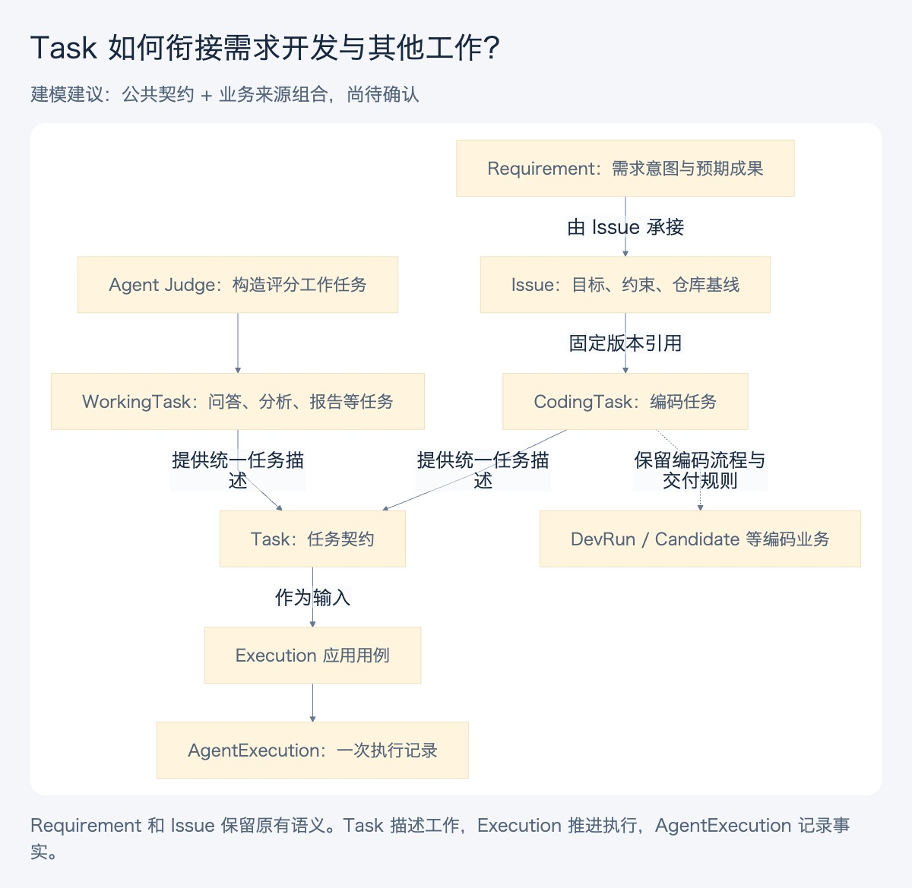

[Mermaid 源文件](../assets/task-model-proposal.mmd)。箭头表达业务关联与描述适配，不是类继承图；图不宣称 Requirement 已改造成 Task 或所有任务类型已经实现。Task 身份是否独立保存、CodingTask 与 Issue 是否一一对应、描述固定方式及具体字段仍待确认，本轮不改生产代码。

#### D82：统一任务核心，编码作为特化而非并行执行体系——尝试与执行两层已确认，其余方案待细化

> **R2 修订（D140 / D143，已确认）：** AgentExecution 保留为独立聚合；TaskType 降为 TaskRevision 上的 `kind` 与 schema 版本。见[目标模型](0001-target-model.md)。

> **R1 修订（D131 / D135，已确认）：** 一期 TaskType 只内置 coding / working，本条的用户配置与开发者扩展推迟；Agent Judge 不再“通过同一任务执行路径产生自身尝试”，而是评价者执行（D131）。

用户指出 D81 若只包一层 Task 而保留 DevRun 与其他任务各自的运行体系，仍未实现统一；要求所有任务共用一套领域 / 应用核心，编码、抓取以及未来任务是特化，并支持配置或便于开发者扩展。此目标修订 D81 中可能被理解为长期保留两套完整生命周期的表述。编码的仓库、候选、验收规则继续保留，但不因此单独拥有通用启动、恢复、取消和资源回收机制。

**代码事实与不能直接合并的粒度：** [DevRun](../../typescript/src/domain.ts) 固定 IssueRevision、代码基线、开发身份与 refinement 来源，状态为 open / submitted / abandoned；[startDevRunInTransaction](../../typescript/src/devrun-lifecycle.ts) 创建开发尝试并登记事件，单独调用它不等于已经运行 Agent。Candidate 绑定 dev_run_id 及 issue_revision_id；实际容器执行又由 [RouteExecution](../../typescript/src/code-route-execution.ts) 记录。因此 DevRun 与 AgentExecution 不是同粒度对象，直接重命名会把“交付候选”误当成“Agent 会话结束”，并可能破坏人工 / 外部执行的现有来源记录。

**推荐的统一核心（新的提案，不视为已确认实体清单）：**

| 概念 | 通用职责 | 编码特化 / 其他任务例子 |
| --- | --- | --- |
| TaskType 固定版本 | 任务输入结构、通用执行需求的解释方式、交付契约与类型特有校验；不持有运行状态 | coding 的 Issue / 仓库与 Candidate 规则；文档分析的材料与报告规则；抓取任务的来源与结构化数据规则 |
| Task 固定版本 | 一份明确的工作定义，类型引用、输入、环境与材料要求、交付要求；不绑定实验或评分器 | Issue 可作为 coding Task 的业务定义 / 视图，保留 Requirement 意图来源；不另复制一份可独立修改的 Issue 内容 |
| TaskRun 名称暂定 | 某一次明确的任务尝试，固定任务输入、运行关联、工作空间与交付归属；由公共规则维护尝试进度 | DevRun 的开发尝试语义纳入 coding TaskRun，特有基线 / refinement 保留为有 schema 的扩展事实；其他任务使用同一种尝试模型 |
| AgentExecution | 实际逻辑 Agent 执行的配置、状态、恢复身份、轨迹和执行输出；属于通用能力 | 一次 TaskRun 可先准备而尚无执行，之后关联一个或多个执行；多次执行不是 coding 专属模型。单次任务的常见路径是一份 TaskRun 对应一次执行 |
| 交付与评分 | TaskRun 固定已归档交付引用；Candidate 与 Artifact 保持并列，Trajectory 保留过程语义；Grading 独立 | 编码交付 Candidate / 附件，抓取交付数据 Artifact；质量评分或候选是否被采纳不等于运行是否结束 |

**已确认：** 用户接受 TaskRun 表示一次任务尝试，AgentExecution 表示具体 Agent 执行，两者作为各类任务共同的概念。TaskRun 关联任务、参与的执行及本次最终交付；每个 AgentExecution 保存自身配置、执行状态与轨迹。一次尝试可关联多个执行，但不要求所有任务都使用多个 Agent。中断恢复继续原执行身份，不自动新增尝试；明确重新做一遍任务则创建新的 TaskRun，保留旧结果。DevRun 的通用尝试职责纳入 TaskRun 的方向随本条确定，编码特有字段及具体兼容迁移仍待设计。

两层各保留对应粒度的事实，不能保存两份同义 running / succeeded 状态并要求调用者同步。TaskRun 维护尝试 / 交付进度，执行状态归 AgentExecution；具体状态表、是否有可派生字段和多执行组合规则需进一步验证。本条替代 D49 当时“不强制新增 Attempt”的暂定选择，但不等于已批准所有 TaskType 字段或开始建表实现。

**统一应用路径：** 请求执行 Task → 固定定义和输入、创建或恢复同一 TaskRun → 按任务规则准备工作空间与环境 → 调用通用 Agent 执行 → 按任务类型验证 / 接收交付并归档 → 结束本次尝试及处理资源。编码类型通过应用扩展组件贡献仓库准备要求、Candidate 提交校验与特有事实；公共应用服务拥有顺序、幂等、取消、恢复和失败处理。扩展组件不能自行启动另一套 Provider / 调度器或绕过公共占用和归档规则。类型独有的验证、候选选择及交付决策仍可组织后续动作，不被强制塞入所有 TaskRun 的基础状态机。是否执行评分由调用用例决定，通用任务不必评分。

**两种扩展方式：**

- 用户配置：在已支持的能力中指定输入 schema、工作指令或模板、材料、环境要求与交付 schema，形成一个固定版本的任务类型 / 模板。例如资料抓取使用已注册工具，声明 URL 输入与数据文件交付。配置不自动提供新的工具、任意代码处理器或完整新工作流。
- 开发者扩展：当任务需要新的业务规则或交付处理方式时，实现小而明确的任务类型处理接口，并注册类型及版本。重点是解释输入、形成执行需求、校验 / 接收特有交付，而不是暴露能任意改运行状态的生命周期钩子。有副作用的处理仍使用可追踪操作身份和现有端口，不因插件而跳过 D75 的重试规则。

这一新增的明确扩展需求意味着不能永久把类型封死为 `coding | working`。建议持久化采用版本化类型标识加经运行时 schema 校验的 payload，公共字段仍强类型；内建类型可保留各自 TypeScript 类型。相比编译期封闭联合，注册方式增加版本和兼容管理成本，但能支持用户定义的任务类型；不使用任意 `any` 代替契约，也不先建设通用工作流 DSL。已发布类型版本固定，历史任务引用的处理语义不可无记录地改用最新版本。

**评测与旧模型的收敛：** EvaluationCase 引用通用 Task 与评分定义；EvalRun 关联一次通用 TaskRun 及其评分，不再另造评测专属的“做题尝试”身份。Agent Judge 通过同一任务执行路径产生自身尝试 / 执行记录，它被 GradingRecord 关联，不计作被测作答样本。DevRun 的旧 CLI 名称可作为编码任务入口或兼容视图保留，目标实现不长期维护两份权威运行状态。代码中的映射、ID 兼容与历史记录必须实查后迁移；旧人工或外部执行没有受管 Agent 轨迹时明确保留缺失，不补造 AgentExecution。

建议实施时先明确 TaskRun / AgentExecution 与 DevRun / EvalRun 的身份和状态映射，再让一个编码案例与一个非编码案例走同一条受管执行路径；验证归档失败只补归档、停止确认后才卸载、候选关联不丢失、旧入口读取同一事实。之后再开放配置类型与开发者处理器。迁移允许分阶段，但不把“双写两套状态再对账”当最终架构。本轮只形成提案，未改运行代码。

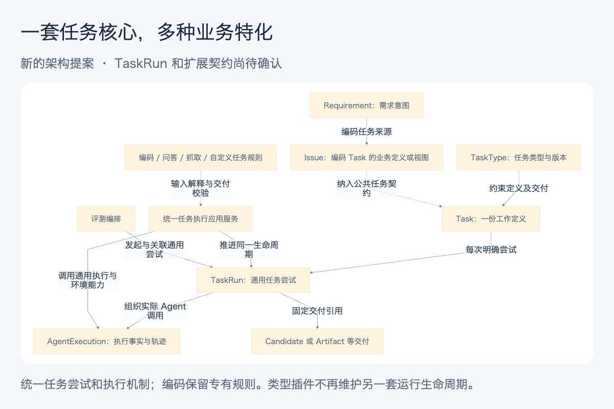

[Mermaid 源文件](../assets/unified-task-core-proposal.mmd)。Requirement / Issue 仍有编码领域含义；保留业务名词不等于保留独立运行引擎。TaskRun / AgentExecution 两层关系已确认；图中的 TaskType 详细契约和兼容映射仍待确认，图片整体仍标为提案以避免将其余内容视为已接受。

#### D83：TaskRun 成功完成以有效交付为界——已确认，待实现

> **R1 修订（D129 / D131，已确认）：** 成功条件按完成策略区分，成功结果带 `completion_basis`；Agent Judge 不再通过通用任务执行形成交付，而是评价者执行。

用户进一步确认成功的准确表述：**交付满足该 TaskRevision 按 TaskType 声明的交付契约，且要求保存的交付与轨迹已归档。** 本文将此称为“任务交付验收成功”；它不自动包含后续 Grader 的质量评分通过。轨迹按约定的采集与保存要求验收，不能将该条件解释为保证采集所有 Provider 内部信息。

用户接受：任务要求的交付已完整保存、通过交付契约检查且取得可读取的固定引用，TaskRun 才能标记成功完成。最后一个 Agent 执行停止或结束本身不足以证明任务成功；缺少所需交付、归档未完成或契约校验失败时不能冒充成功。具体失败、阻塞、取消等状态及转换另行细化。

交付检查覆盖声明的必需项、格式、合法性及可读取性：编码任务要求的 Candidate 已提交并保存，抓取任务要求的数据文件已保存并符合声明格式，分析任务要求的报告与附件齐全。仅有文件存在不等于有效交付。TaskRun 的成功不表示代码值得合并、报告质量优秀或交付已被采纳；Grading 和业务采纳独立进行，不强制所有任务都启动评分。

本条与 D1 的执行归档边界、D43 的交付清单、D82 的任务尝试 / 具体执行区分一致。实现时共用归档事实与引用，不要求 TaskRun 和 AgentExecution 重复保存同一内容。评分所需的 Agent Judge 自身仍可通过通用任务执行形成交付；质量评价与其执行成功不是同一状态。此规则已确认，代码未改。

#### D84：TaskType 定义类型契约，Task 提供具体工作内容——已确认，待实现

> **R2 修订（D140 / D141，已确认）：** TaskType 降为 TaskRevision 上的 `kind` 与 schema 版本，三层语义保留。见[目标模型](0001-target-model.md)。

用户接受三层语义：TaskType 定义一类任务的输入、交付及类型特有规则；Task 按这些规则提供某份工作的具体内容；TaskRun 记录实际执行这份工作的一次尝试。类型不保存某次运行状态，具体任务不另建一套运行生命周期。

例如网页抓取类型要求网址、抓取字段以及规定结构的数据文件；具体 Task 给出三个网址和需要提取的字段；TaskRun 表示今天对这份任务的一次尝试。编码类型规定 Issue 版本、仓库上下文和 Candidate 交付契约；具体 Task 绑定确切的业务来源、材料和环境要求，已有 Issue 内容仍遵守单一权威来源原则，不重复建立可独立修改的副本。

用户配置类型和开发者扩展特有校验的方向继续沿用 D82，所有类型使用公共执行生命周期。具体配置能力边界、处理器接口和注册机制仍待设计；本次接受不代表批准任意代码插件或任意工作流覆盖。类型与任务版本规则随后由 D85 确认。

#### D85：类型与任务按版本固定，升级显式进行——已确认，待实现

> **R2 修订（D140 / D141，已确认）：** 类型版本随 Grounds 发布，记录在 TaskRevision 上，不再作为独立实体发布。见[目标模型](0001-target-model.md)。

用户接受：修改已发布的 TaskType 时产生新版本，不原地改变旧版本的规则；已有 Task 继续引用原 TaskType 版本，不自动升级。明确升级任务时，按新类型契约校验并形成新的 Task 版本，不覆盖旧任务版本。TaskRun 固定引用受理时确定的 Task 版本，并经其引用固定类型版本；历史交付不因后续规则修改而被重新解释。

例如网页抓取类型从“标题、正文”升级为另需“发布日期”，旧任务及其运行仍按原契约理解；采用新要求需要显式形成新的任务版本。记录版本固定并不意味着业务必须永久接受旧类型的新运行，类型停用政策尚待讨论，也不承诺未来仍可取得全部外部依赖。类型引用的处理实现如何与版本绑定、兼容升级与存储迁移细节仍待实现设计。本次仅确认版本与显式升级规则，未改生产代码。

#### D86：配置组合已有能力，代码扩展特有规则，运行生命周期统一——已确认，待实现

> **R1 修订（D135，已确认）：** 两种扩展方式推迟到出现第三种类型的真实需求时再实现。

用户接受任务类型的两种扩展方式：配置扩展组合已经提供的能力，声明输入、指令模板、材料及环境要求和交付格式；代码扩展通过处理接口补充配置无法表达的业务处理或校验，例如检查 Candidate 对应的仓库与基线。配置本身不提供新的工具实现，也不等于允许任意代码执行。

两种方式都使用统一的任务执行流程。扩展提供类型特有的输入解释、业务约束和交付处理，不另建启动、取消、恢复或资源回收机制，不维护另一套通用运行状态。具体处理接口、注册形式及允许的调用能力仍待设计；本条不要求现在实现插件加载器或通用工作流 DSL。

类型的交付检查与 Grader 的质量评分继续按 D83 分开：前者用于判断交付是否符合声明契约，后者用于形成独立质量判断；采用代码校验并不自动意味着它属于任务类型，也可能是测试型 Grader，应按业务目的归属。已确认扩展原则，未改运行代码。

#### D87：交付修正与交付契约归属——修正已允许，契约细化待确认

> **R2 修订（D140，已确认）：** 同一次尝试内的修正改为发起 refine 上一轮的新 TaskRun，并可接手其 Sandbox。见[目标模型](0001-target-model.md)。

用户明确允许：TaskRun 尚未成功完成、交付检查未通过时，可以在同一次尝试内修正交付。保留已归档内容与历次执行事实；修正不原地覆盖既有不可变产物，也不等于授权校验失败后自动重跑 Agent。需要追加执行时按既定执行身份和重试规则办理。已经成功完成后明确重做产生新 TaskRun、质量评分不回改成功交付状态，继续依据 D82 / D83。

用户进一步询问交付验收条件是否应归 TaskType。结合 D84，建议 TaskType 拥有类型级交付契约及校验规则，Task 提供契约允许的具体参数；TaskRun 固定本次适用的任务和类型版本并记录检查结果，不复制一套可独立编辑的规则。具体交付要求由固定的类型规则和任务参数共同确定。

例如抓取类型规定必须交付可读取的数据产物，并覆盖任务声明的字段；具体任务声明本次需要标题、正文、日期。编码类型规定必须提交合法 Candidate，且与任务指定的 Issue / 仓库 / 基线对应；具体任务提供这些确切引用。Task 只能在类型声明的参数范围内取值，不能任意关闭类型的必需检查；新增或变更通用规则遵循 TaskType 版本升级。

应用层调用类型对应的检查能力取得结果并据此推进 TaskRun；规则声明在领域契约中，涉及读取内容、Git 或外部程序的操作仍经端口 / 适配器实现，不把存储或命令执行塞入纯 TaskType 数据。运行不可绕过的归档可读性、身份一致性等公共不变量由核心保持，类型只增加或具体化特有规则。

这里的“交付验收”指 D83 的交付契约检查，不自动合并需求目标是否达成、候选是否值得采纳等质量 / 业务验收。Grader 可依据具体任务的标准进行评价；相同测试技术也可能用于交付检查或独立评分，归属取决于其业务用途，不以“是否写成代码”判断。评分后是否另设业务采纳门槛尚需独立约定，不擅自将评分结果加入 TaskRun 成功条件。

类型规则 / 任务参数 / 检查结果的上述分工为对用户问题的细化建议，尚未逐项确认，未改运行代码。

#### D88：TaskType 的定义、组成与职责边界——已确认，待实现

**TaskType 是一份可版本化的任务类型契约，定义一类任务允许怎样描述、需要满足哪些类型特有的前提，以及什么交付符合该类型的契约。** 用户已认可这一定义、下列五项组成和职责边界。它用于校验和解释具体 Task，并约束其交付；它不是一次任务、一次执行、Agent 配置或独立工作流引擎。D84 的类型 / 任务 / 尝试区分继续适用；这里确认业务组成，具体字段名、接口签名和 schema 仍待实现设计。

已确认的五项组成：类型标识与版本；输入契约（具体 Task 要提供哪些业务参数及其约束）；执行前提契约（由这些参数如何得到所需材料、工作空间读写要求和环境要求，可复用公共默认能力而非每类型重复定义）；交付契约（需要哪些种类 / 数量 / 格式 / 关联一致性的交付）；必要时引用类型特有处理实现及其确定版本。纯配置类型可以使用内置通用处理能力，不要求每个类型都有代码插件。具体 Agent 的 Provider、模型、工具 / Skill 选择仍由 AgentSpec 表达，类型仅声明满足任务所需的能力或兼容要求。

例如 `web-extract` 类型规定任务输入包含网址列表和待提取字段，交付为覆盖所声明字段的数据 Artifact，并可引用相应格式检查器；具体 Task 给出实际网址、字段及满足要求的环境定义引用。类型不存这次的抓取进度、实际容器 / Workspace 身份、产物实例或评分结果，这些分别属于具体任务输入和运行事实。类型的交付合法性不代表数据真实性与整体质量已经通过独立评分。

实现表示建议为普通的版本化定义数据，使用 schema 校验输入与交付；需要业务代码时通过明确处理接口接入。不能把规则“收在 TaskType”理解为领域对象直接执行 Git / Docker / SQL，也不让类型处理器重定义公共启动、取消、恢复和归档生命周期。哪些处理接口需要公开，以具体任务的必要差异为依据继续收敛。

#### D89：将 Issue 收敛为编码任务类型与实例，避免双重任务定义——已确认，迁移待设计

**后续修订：** 本条保留 Requirement 实体的早期决定由 D107 替代；新目标模型移除 Requirement / RequirementRevision，任务内容与历史来源仍需保存。

**已确认的简化方向：** 新核心模型不再保留与 Task 并列的独立 Issue 实体。原 Issue schema 及其任务规则成为编码 TaskType 的输入 / 交付契约；某一条具体 Issue 对应该类型的一条 Task，原 IssueRevision 对应其固定任务版本。类型可命名 coding（或保留 issue 作为类型名，命名待定），不能把一条具体 Issue 当成 TaskType。Requirement 引用、仓库、基线、目标和约束保留为编码任务的数据与规则，不因删除实体名而丢失业务语义。

下文先前建议保留“公共 Task + Issue 业务表达”的表述，现进一步收敛为“TaskType + Task”即可；Issue 名称可以仅出现在迁移映射或兼容入口。用户随后明确认可该方向，并要求 Task 参考 IssueRevision 版本化，详见 D90。类型名称、旧命令与历史 ID 的兼容方案仍待设计，不能据此立即删除历史对象或入口。

TaskType 定义已通过 D88 确认，下一项建议收敛 Issue 与通用 Task 的身份关系：Issue 表达一份 coding 类型 Task 的编码业务内容，公共任务契约和编码特有字段组成同一份业务任务，不维护可各自修改目标 / 约束的两份任务。公共部分包含任务身份、类型版本、通用执行需求等；编码部分保留 Requirement 版本来源、仓库与基线、目标和约束。字段具体放在公共部分还是扩展部分应按知识归属落实，不为所有任务加入 Git 字段。

Requirement 继续表达上游需求意图；一项需求可由具体编码任务承接，不因统一 Task 就强迫 Requirement 实现 Task 或拥有运行状态。独立分析需求的工作另按相应 TaskType 定义，其输入可以引用 Requirement。

相比“创建 Issue 后再复制为一个可独立编辑的 Task”，采用同一业务身份的公共契约与编码扩展可以避免内容漂移。通过 Issue 专用入口或通用任务入口修改同一任务时，应遵守同一权威版本边界及编码校验；TaskRun 固定该完整版本，不能组合更新前的公共字段与更新后的编码字段。这里不预定数据库表数、接口继承方式或旧 ID 必须直接复用，历史 Issue / Task 引用的兼容映射需另行设计。

本条是对 D81 中 CodingTask 包装 Issue 的进一步收敛建议：可以保留来源引用和适配，但不将包装层作为第二份可独立变更的业务任务。现有 Requirement / Issue 编辑入口、历史版本、Candidate 关联应在迁移中保留；本次仅讨论最终业务语义，没有实施迁移。

#### D90：Task 稳定身份与不可变 TaskRevision 分开——已确认，待实现

用户明确要求 Task 参考现有 IssueRevision 版本化。在 D85 已确认的版本规则上明确：Task 表达一份任务的稳定身份；TaskRevision 表达该任务某个已发布的完整定义版本，包括固定的 TaskType 版本引用、具体业务输入、材料与环境要求及任务级交付参数。具体字段结构仍待细化，不能把该说明当作已发布 schema。

修改任务定义并发布时新增 TaskRevision，保留旧版本，不原地覆盖；每次 TaskRun 固定引用一个确切 TaskRevision，不能运行中按“当前最新任务”重新解析。升级 TaskType 也必须先按新契约校验并发布新的任务修订。任务版本更新不会修改已有运行、已归档交付或评分的依据；新版本不会让已运行中的尝试自动换题。

版本关系应可追溯到同一 Task 身份和前一修订，具体 revision ID、版本序号及并发更新校验沿现有 IssueRevision 经验设计。当前版本选择属于读取 / 发起入口，不能替代执行保存的精确引用。Requirement 等外部业务来源如影响任务语义，也应固定对应版本，不通过可变引用悄悄改写旧任务。本条确认身份 / 修订 / 运行引用的业务关系，草稿机制、存储表结构、旧 IssueRevision 映射和迁移仍待设计。

#### D91：不同 TaskRun 默认隔离可写空间，共享固定只读材料——默认规则已确认，待实现

用户接受不同 TaskRun 默认取得各自隔离的可写工作区域，不因为引用相同 TaskRevision、材料或环境定义就自动复用可变目录；允许共享固定版本的只读材料；同一 TaskRun 内可在前一执行停止使用后顺序复用工作空间。只将一个挂载标记为只读、底层内容仍可被其他写入者修改，不满足这里的固定只读材料条件。

同一 TaskRun 内顺序执行的 Agent 可按明确安排继续使用本次工作空间，前一执行须停止使用后再交接，延续既定占用与卸载规则。本条不将 Workspace 生命周期绑死在 TaskRun 上；尝试结束仍可保留它，但不能自动交给另一个独立尝试写入。跨尝试基于既有交付继续工作时，建议引用冻结的 Candidate / Artifact 或明确的输入快照，形成新的隔离可写区域，不能通过复用可变现场悄悄改变新尝试的输入。

已确认的是不同尝试之间的默认隔离，不预定每次都创建新的物理卷或强制全量复制。具体 Workspace 身份、共享只读挂载与复制 / 写时复制实现另行设计。同一 TaskRun 内多个 Agent 并发写入、用户显式共享协作模式及恢复旧目录的核对协议仍待讨论。本条规则已确认，代码尚未实现。

#### D92：执行文件依据与快照成本——原逐执行快照建议撤回，交付复用方向由 D93 确认

用户质疑逐执行起止快照的存储成本，并要求按奥卡姆剃刀审查必要性。重新评审后撤回“默认每个 AgentExecution 都保存可写工作区起始内容”的建议；这不是既有已确认要求。以下旧方案保留为讨论历史，不作为一期实现范围。

**必要性判断：** 当前需要固定任务与配置、记录轨迹、保存正式交付并能独立重评，尚未要求恢复任意历史执行点的完整文件系统。逐执行快照为后一种更强能力付出成本，不能仅因方便追溯就默认引入。全量起止复制的粗略内容量随执行数与工作区大小相乘，另有扫描、传输、一致性与回收开销；增量 / 内容去重可减少重复字节，但不会消除持续生成新数据、索引及治理成本，不能据此宣称快照廉价。

**简化建议（待用户确认）：**

1. 保留已定 TaskRevision、TaskType / AgentSpec / EnvironmentSpec 的固定版本，运行关联其实际使用的 Workspace、环境及执行事实。
2. TaskRun 使用已声明的输入材料引用；有可取得的不可变版本时直接引用，不为每个 AgentExecution 复制。Git 输入复用受管理的固定对象或已有归档，文件材料优先复用存储中的版本。来源可能消失且业务确实要求保留时，仅归档必要的声明输入内容一次，再共享引用。版本或摘要本身不保证内容未来可取得，未保留者须明确限制。
3. 继续保存约定轨迹及正式 Candidate / Artifact 交付，不自动归档临时文件、缓存或每次执行的完整可写目录。轨迹只表示实际采集到的过程，不能等同于完整历史文件系统。
4. Workspace 按自身生命周期保留或回收。恢复时核对现有工作空间与检查点；缺少所需文件状态时明确阻塞，不能由“有 Durable 状态”推断一定能恢复。工作区保留不等于每个历史时刻都有快照。

**收益和明确取舍：** 简化方案足以保存任务依据和已交付对象用于追责与重评，但不承诺重现每次 AgentExecution 开始时全部可写文件，也不承诺原任务精确重跑。D91 的尝试隔离与固定只读材料要求保持不变；无法固定的动态来源须按任务要求处理或标注限制，不能伪装成不变输入。

**若后续出现明确需求：** 对特定任务或人工指定的检查点选择性保存快照，复用 Git / 已有存储的内容去重，只覆盖声明工作区域并明确保留期；先验证业务价值和实际成本，不现在建设通用快照引擎。内容去重、增量保存和检查点策略是届时的实现选项，不新增本期已经接受的框架要求。

**原提议（已撤回其默认逐执行保存要求）：**

建议每个 AgentExecution 开始实际使用文件前，固定本次允许访问的文件视图，以及声明输入和可写工作区起始内容的可追溯引用。后续 Workspace 内容改变不改写该引用。TaskRun 的首次执行和后续顺序执行可有不同的起始依据，执行记录分别绑定；恢复已有执行时不能覆盖其原始起始依据或假称工作区已还原。

优先引用已经保存的不可变材料版本、Git 对象或归档内容；没有可读取的固定版本时保存需要的文件内容及清单，不能只留临时路径或摘要却声称可以取回原文。范围是本次有效文件视图内的任务材料与起始工作内容，不是整个宿主文件系统、容器镜像或秘密凭据。环境版本仍由环境记录追踪。

本条建议保存起始依据和正式交付，不要求对每次工具写文件都创建全量快照；中间过程由轨迹及已声明证据记录，不能据此承诺重建任意时刻的全部文件状态。动态远程工具响应按轨迹采集契约处理，不假称都属于启动文件快照。具体快照表示、存取保留、成本和一致性检查待设计；此为 D77–D79 review 中历史文件视图问题的下一项提案，尚未确认或实现。

#### D93：复用 Candidate / Artifact 保存正式交付，不另做 Workspace 快照——已确认方向，待实现接线

用户明确 Coding 的可写业务工作目录为 Worktree，其他声明材料按只读使用；任务所需代码结果最终通过 Git Candidate 保存，因此不为 Workspace 另建一套起止快照系统。Coding 如有附加报告、数据等产物，则走既定 Artifact 存取能力，Candidate 与 Artifact 保持并列。通用执行协调并记录已有存储机制的成功回执，不再复制完整工作区作为另一份交付事实。

源码核对：[submitCandidate](../../typescript/src/module.ts) 要求固定 Git 来源及 Git 归档，拒绝新增仅 patch 的候选；[GitArchiveBinding](../../typescript/src/candidate-git-archive.ts) 固定 source_commit、result_tree、base_commit 与 archive_ref，并提供归档核对；[DockerRouteEngine](../../typescript/src/code-route-docker.ts) 在开发模式开放工作目录写入，同时将基线和 Git 元数据挂为只读。这些是现有机制证据，不表示 TaskRun 等新模型已接入，也不构成当前运行的归档或灾难恢复测试。

**保存保证的准确范围：** 代码交付必须进入固定提交并完成 Candidate 所要求的归档确认，附加必需产物必须完成 Artifact 保存，之后才满足 D83 的成功交付条件。只在本地执行 git commit 不等于全部交付已经可靠归档。未提交修改、未纳入提交的必要文件及未声明的临时输出不因使用 Git 自动保存；中途环境丢失也不承诺恢复任意未提交现场。需要交付的内容须进入 Candidate 或 Artifact，缓存和中间态不默认归档。

D91 的固定只读材料与隔离写入要求继续有效：只读限制阻止修改，但长期可读取性仍依赖材料本身的固定来源和保留，不从挂载权限推导永久存在。执行轨迹继续按独立契约保存，不能由 Git 提交替代。Workspace 保留、停止使用后卸载、资源回收仍按既定生命周期规则处理。

本条确认以已有交付存储解决正式结果留存，不新增通用 Workspace 快照。材料长期归档的具体策略、TaskRun 与 Candidate / Artifact 的适配及历史兼容仍待实现；不把“无需新快照系统”误解为“无需做统一流程和保存回执衔接”。

#### D94：调用方明确组织执行，一期不自动编排多个 Agent——已确认，待实现

> **R2 修订（D140 / D141，已确认）：** 一个 TaskRun 至多一个 worker AgentExecution；继续工作改为发起 refinement TaskRun，恢复执行则沿用原 AgentExecution。见[目标模型](0001-target-model.md)。

用户接受：一期由调用方明确发起或继续任务执行，调用方可以是通过 CLI 操作的用户，也可以是上层应用用例，不强制每次由人操作。调用方决定是否继续及使用哪个 Agent；统一任务执行服务校验允许的状态与资源条件，协调执行并记录事实。TaskType 提供任务规则，不自行调度 Agent；TaskRun 表达尝试事实，不主动启动下一次执行。

同一 TaskRun 可在明确继续后增加新的 AgentExecution；中断后可靠恢复则沿用原 AgentExecution 身份，不能将二者混为自动重试。原执行状态未知时仍先核对，不因收到继续请求而绕过占用规则或重复启动。执行尚未结束、输出归档失败等情况按已有规则处理，不默认通过重新执行解决。

核心提供统一发起、继续、恢复能力，一期不建设根据结果自行选择 Agent、任务分解或循环重试的通用自动编排器。本条不取消已确认的评测批量调度、明确配置的重复尝试与 Grading 调用 Judge；这些是上层用例的既定组织行为，同样调用公共执行接口。具体命令、请求结构和允许的状态转换待细化，尚未改动代码。

#### D95：单次 Agent 执行失败不自动终结 TaskRun——已确认，待实现

> **R2 修订（D140，已确认）：** 单次执行失败且没有可接收交付时，TaskRun 直接失败；继续工作改为发起 refinement TaskRun。见[目标模型](0001-target-model.md)。

> **R1 修订（D129，已确认）：** 本条仅适用于 `on_unfinished = wait` 的完成策略；评测样本默认 `fail`，单次执行失败即终结。

用户接受：一次 AgentExecution 失败时保存该次失败事实、轨迹以及已有交付，不自动将整个 TaskRun 置为失败终态；任务尝试进入等待处理的业务阶段，由调用方明确选择继续或结束。这里“等待处理”为语义描述，具体状态枚举仍待统一设计。

明确继续且条件满足时可在原 TaskRun 下新增 AgentExecution；原执行及工具是否停止仍须确认，未知状态先核对，不能因收到继续请求而重复启动或破坏资源占用。可靠恢复同一个逻辑执行仍沿用原执行身份，遵循 D94；不是每种失败都保证能继续。若问题仅在输出归档，则补做归档，不重新执行任务。

等待处理期间不自动启动新 Agent，不覆盖旧执行或丢弃已保存产物。调用方明确结束尝试时，按停止确认与归档事实处理后终结，不将失败终结伪装为成功交付。本条不重新定义已成功尝试、批量取消或评分结果规则；TaskRun 终态名、等待阶段的资源 / 并发占用以及完整状态表仍待细化。代码尚未改动。

#### D96：结束后回收自建环境，保留工作空间与交付——已确认，待实现

用户接受 TaskRun 成功完成或被明确结束之后的默认资源处理：本次创建的环境实例在确认不再被使用后回收，调用方明确要求保留时除外；借用的环境或 Workspace 只结束本次占用并交还，不擅自删除；本次 Workspace 保留文件，后续显式清理；Candidate、Artifact 和轨迹按各自存储规则保留，不随环境回收删除。

处理时沿用已定归属、占用和卸载约束，不能只凭 TaskRun 已终结就跳过工具停止确认。借用与自建的判定依据明确来源记录，不按最后使用者推断所有权。归档未完成时不能误报成功，也不能先删除唯一的待归档内容。回收失败保留资源事实并报告，不把“已请求回收”记为“已释放”。具体清理入口、权限与存储保留配置另行实现。

本条仅适用于已结束的尝试；D95 中执行失败后等待处理的 TaskRun 尚未终结，其运行资源和并发名额的处理需另外明确。保留 Workspace 不是保留完整历史快照，仍按 D93 的正式交付保存范围理解。代码尚未改动。

#### D97：无活动工作的等待任务释放并发名额，继续时重新排队——已确认，待实现

> **R2 修订（D140，已确认）：** 不再有“等待继续”状态；TaskRun 终结即释放名额，保留的 Sandbox 不占名额。见[目标模型](0001-target-model.md)。

用户接受：TaskRun 等待处理时，确认相关执行及工具已停止，且没有仍在推进的评分、归档等工作后，释放相应并发名额。任务级并发与 Agent 级并发仍分别计算，默认值分别为 5 和 20；不能仅因一次 Agent 结束，就在评分等任务工作仍进行时提前释放任务名额。

等待任务的 TaskRun、Workspace 与已保存结果继续保留。释放调度名额不等于卸载或删除资源，也不等于尝试已经终结；调用方明确继续时重新排队取得必要名额，再按状态和资源规则推进。执行或工具停止状态未知时，不能将该执行的 Agent 名额视为已释放，不以超时推断已安全停止。

本条确认调度占用的业务条件，不新增自动继续、不改变 D95 的等待状态，也不自动决定等待期间应保留或停止哪些运行资源。具体计数、排队公平性、资源占用与名额释放的持久化协调由应用层方案设计，领域 / 运行记录保留相应事实。代码尚未改动。

#### D98：TaskRun 显式状态与等待时保留暂停环境——方向已确认，细节待实现

> **R2 修订（D140，已确认）：** 暂停作用于 TaskRun 终结后“保留待细化”的 Sandbox，而不是等待中的 TaskRun。见[目标模型](0001-target-model.md)。

TaskRun 是有状态的任务尝试实体，不能只作为关联执行的无状态容器。它记录尝试的推进、等待与终结；AgentExecution 状态记录某一次具体 Agent 执行，EnvironmentInstance 状态记录资源事实，三者不能互相替代。已有状态草图中的排队、处理中、等待处理、成功、结束表达这些阶段；精确枚举和完整转换仍为草案，本轮不视为全部批准。

用户明确选择等待继续时保留并暂停环境实例，保留关联 Workspace，不默认回收环境或删除文件。暂停范围现按 D113：本任务的执行容器暂停，依赖服务保留且不自动暂停。TaskRun 等待与环境实际暂停分别记录，暂停请求成功提交不等于资源已暂停。D97 的并发释放条件保持不变：确认原执行与工具没有活动工作之后才释放；仅冻结一个仍有在途调用的容器不代表工作已停止或副作用已确定。明确继续时重新取得调度名额，核对资源后恢复使用，宿主重启仍按 D74 先核对再手动恢复。

暂停的适配器能力、服务范围与借用资源权限需要在应用和环境接口设计中落实；不支持或暂停失败时显式报告实际状态，不能静默销毁重建或把仍运行的资源记为已暂停。保留暂停不保证释放内存或宿主重启后原进程仍存在，也不新增 Workspace 快照。已终结尝试仍按 D96 清理。代码尚未改动。

#### D99：AgentRevision / GraderRevision 显式版本命名——已确认，待实现

用户提出将图中的 AgentSpec / GraderSpec 改为明确的版本概念。D5 / D6 等已约定不可变配置及固定版本引用；用户已接受把该语义在名称和身份关系上表达清楚，而非新增另一套并行版本系统。

已确认 AgentDefinition / GraderDefinition 表达可持续演进的稳定定义身份，AgentRevision / GraderRevision 表达其不可变修订。一次 AgentExecution 和 Experiment 固定被测 AgentRevision；EvaluationCase 与 GradingRecord 固定 GraderRevision；采用 Agent Judge 的 GraderRevision 再固定 Judge 的 AgentRevision。修改配置、评分标准、输入要求或标尺产生新修订，既有运行与实验不自动跟随最新版。

Spec 若在代码中仍有价值，可仅表示 Revision 内的配置值，不再另立同等身份和生命周期。Grader 继续是已确认的评分能力接口，GraderDefinition 不取代它；Grade 与 GradingRecord 的含义不变。相较只给 Spec 增加 version 字段，显式 Revision 能与 Task / TaskRevision 的阅读习惯一致，但不强制各概念单独建表或增加发布工作流。用户已确认上述身份、版本命名及引用关系；当前总图同步更新。具体字段、存储结构及迁移仍待实现，不代表完整状态草图或其他待定项一并获批。

#### D100：EvalRun 组织一次评测，关联一个被测 TaskRun——已确认，待实现

> **R2 修订（D140，已确认）：** EvalRun 改为 ExperimentRun 内不可变的成员记录；采用规则与完整性由 GradingRecord 查询得出。见[目标模型](0001-target-model.md)。

> **R1 修订（D131，已确认）：** Agent Judge 不产生 TaskRun；GradingRecord 关联的是评价者 AgentExecution。EvalRun 恰好关联一个被测 TaskRun 的规则不变。

用户接受：TaskRun 表达一次任务尝试，负责记录任务执行与交付验收；EvalRun 表达围绕这次尝试的一次评测，关联 EvaluationCase、一个被测 TaskRun 及多次 GradingRecord。TaskRun 不依赖 EvalRun、实验或评分器，普通任务可独立执行；EvalRun 通过 EvaluationCase 确定评分要求，并保留执行、评分和完整性的关联事实，不另建一套被测任务执行生命周期。

例如，修复一个 Bug 并交给两个 Grader 评价，是一个被测 TaskRun 和一个 EvalRun 下的两次评分。交付满足 D83 时 TaskRun 成功；某个 Grader 故障只使评测评分不完整，不撤销已成立的交付成功。只重评时沿用被测 TaskRun 与确切交付，新增评分记录并保留历史，评分结果选择与汇总继续遵循既定规则；重复评测要求重新完成任务时，新建 TaskRun 和 EvalRun。

Agent Judge 自己执行评分任务产生的 TaskRun / AgentExecution 由对应 GradingRecord 关联，不作为 EvalRun 的另一个被测尝试，也不增加被测样本数。已确认的是一次评测与一个被测尝试的边界；受理、排队或启动失败阶段关联何时建立等持久化细节仍待实现设计，不为补齐关联伪造已执行事实。代码未改。

#### D101：从日常任务历史沉淀评测项——使用场景已明确，接线方案待确认

用户要求支持先用工具完成普通需求开发，之后从历史 TaskRun 选择案例、补充或创建 Grader，再形成评测项和实验以评价 Agent。日常开发不必预建 EvaluationCase、Suite 或 Experiment；历史任务也不因后续评分而被改写成实验发起的任务。

既有模型可承载该场景，建议通过应用用例读取所选 TaskRun 的确切 TaskRevision，组合选定 GraderRevision 与任务特定评分材料形成 EvaluationCase，并保留来源 TaskRun 引用用于追溯。EvaluationCase 的可执行定义引用任务修订，不将历史运行的可变工作目录作为输入。补充评分标准不必修改原任务；需要修改公开任务输入或交付要求时发布新的 TaskRevision，保留来源，不修改历史修订。

区分两种操作：评价历史表现时，独立 Grading 可直接评价原 Candidate / Artifact / Trajectory 并关联原 TaskRun，无需重新做任务或强制创建实验；若需要统一 EvalRun 展示历史补评，可关联已有被测 TaskRun，但必须记录补评来源，不能伪称由新实验执行或由新 Agent 产生。建立可重复评测时，将 EvaluationCase 加入 Suite 并固定 SuiteSnapshot，Experiment 固定被测 AgentRevision，新批次创建新的 EvalRun 与 TaskRun，从该任务约定的起点执行，再评分。历史交付不是新 Agent 的交付，原 Agent 身份与运行事实保持不变。

历史 Candidate、人工修正结果或轨迹可按评分契约选作 Judge 的参考材料，但不自动视为标准答案，也不默认提供给被测 Agent。Coding 重新评测应使用固定且可取得的任务起始基线与必要输入，不能直接从已经完成修改的 Worktree 或最终 Candidate 开始而声称重做原任务；若任务明确要求在旧交付上继续改进，则另行固定该输入。沿用 D93，不要求新增逐执行 Workspace 快照。缺失原输入、Git 对象或环境依赖时，历史交付仍可在评分材料充分时被评分，但原条件重跑可能受阻；补齐或替换输入形成明确的新修订，不承诺任意历史任务都可精确重现。

此为既有领域边界的场景验证与推荐接线；来源字段、历史补评纳入批次的约束、转换入口和可重跑性校验待对齐与实现，不新增一种 Task 实体或让 Task 持有 Grader。当前代码尚未完成这一整条流程。

#### D102：TaskRun 终态区分成功、失败与取消——已确认，待实现

> **R2 修订（D140，已确认）：** 成功终态改称“已交付”；失败类别为 agent-output、agent-execution、infrastructure，去掉 caller-ended。见[目标模型](0001-target-model.md)。

> **R1 修订（D138，已确认）：** `failed` 改为“这次尝试不再继续”，并附必填失败类别 agent-output / agent-execution / infrastructure / caller-ended；`fail` 策略下前三类自动终结。见[目标模型](0001-target-model.md)第 4.2 节。

原状态草图以“已结束”概括非成功终结，尚不足以表达结束原因。用户已接受区分 succeeded（满足 D83 的任务交付验收）、failed（调用方明确判定本次尝试无法满足交付契约并结束）、cancelled（调用方主动撤销本次尝试）。调用方可以是用户或应用流程，不要求每次必须人工操作；终结均遵守已确认的停止确认、归档事实与资源规则。

单次 AgentExecution 失败仍按 D95 进入等待处理，不自动将 TaskRun 置为 failed；Grader 低分或故障不改变 TaskRun 的交付成功事实。主动取消不等于证明 Agent 没能力完成任务。终态必须保留原因和已有证据，不能仅用“结束”掩盖不同含义。终态不重新开启，明确重新尝试创建新 TaskRun；终态后的归档补偿和资源清理不作为重新执行任务。三种终态及其语义已确认；完整中间状态枚举、并发竞态与自动失败策略仍需细化，代码尚未改动。

#### D103：逐项查看任务契约的完成情况——能力要求已确认，建模细节为建议

> **R1 修订（D130，已确认）：** 逐项检查记录统一为用途 gate 的 GradingRecord，Grade 采用逐条结论形式。

用户在接受 D102 后要求能够查看一个 TaskRun 的多项任务契约分别完成了哪些，并参考当前实现复用已有设计。

**源码核对（阅读代码与测试，未执行行为测试）：**

- [领域定义](../../typescript/src/domain.ts) 的 IssueRevision 按 Goal / Constraint 包含带独立 ID 的 Criterion；CriterionClaimInput 按 criterion_id 保存说明、证据和可选 SelfVerification，自检区分满足、部分满足、不满足、无法判断与未检查。计划文字明确不是验收义务。
- 同一文件的 VerificationCriterionAssessmentInput 按条目保留独立判断、与开发声明的核对以及最终结论；报告绑定 candidate_id 与 result_tree_oid，结论针对确切交付，不是裸任务的一项永久勾选状态。
- [查询与汇总](../../typescript/src/module.ts) 的 comparisonClaims、comparisonVerificationFacts 和 standing 展示逐项验证状态；支持 unverified / qualified / rejected / inconclusive / disputed，多份相反验收不会被单次通过直接覆盖。refinementContext 也为后续开发携带逐项状态与相关报告。
- [自检测试](../../typescript/test/self-verification.test.ts) 断言自检可持久化并在 Review 展示，但不使独立验收从 unverified 自动变为通过；[比较测试](../../typescript/test/comparison.test.ts) 覆盖逐项状态与候选总体状态的区别。这里是测试源码证据，不声称本轮测试运行通过。
- [CompletionRecord](../../typescript/src/completion.ts) 记录采纳、落地提交和发布等事实，不能直接作为新 TaskRun 的交付契约完成记录迁移。

**推荐的最小抽象：** TaskType 定义契约条目的结构与检查能力，TaskRevision 固定本任务的具体条目、必需性和可定位身份；TaskRun 关联本次确切交付及其逐项检查证据。应用查询派生“契约完成情况”，不新增第二个可以任意修改的任务完成状态机。检查记录至少能定位任务修订、条目、被检查的交付引用、结果、理由、证据与检查来源；名称和字段尚未定稿，沿用现有 Criterion / Claim / Verification 的信息区分而非机械复制所有编码流程。

展示应区分 Agent 的完成声明 / 自检与实际检查结论。允许看见尚未检查、通过、未通过、无法判定和存在争议；自检的部分满足与独立检查判定不强行压成一个状态枚举。缺证据或检查器错误应说明原因，不能当作已通过。条目统计是检查覆盖，不是假定的耗时完成百分比，也不是质量总分。新交付需有适用于该交付的检查依据，不能将多个不同 Candidate / Artifact 上分别通过的条目拼成一份全部通过的交付。

TaskRun 成功仍按 D83：所有必需交付条件满足且要求归档完成。契约可以包括明确的行为检查，不限于文件存在或格式合法；若某项检查是完成的前置条件，必须在成功前取得有效依据。此处早期可选验收条目建议由 D110 替代：一期全部验收条件都是必须项，不设置可选验收条目。具体检查执行可复用规则、测试等已有能力，是否通过 Grader 承载与对应接口接线待设计，不强制每个条目启动 Judge。后续评测 Grader 的质量评分仍不自动改写任务成功；契约门槛不能被任意评分器替代。

成功时采用的交付引用和验收依据需保留，后续补充报告保留历史，不偷偷换掉当时成功所依据的证据。冲突消解和历史验收修正规则尚待细化，不能将现有 Candidate 的 disputed 聚合或 D64 的评测重评选择直接作为通用验收的最终策略。以上逐项可查看的能力为用户明确要求，具体数据结构、检查职责与冲突规则为建议，尚未实现。

#### D104：契约验收结论的目标与 TaskRun 汇总分开——已确认，待实现

> **R1 修订（D130，已确认）：** 验收记录即用途 gate 的 GradingRecord，目标为确切交付清单。

用户追问逐项验收情况应属于 Candidate 还是 TaskRun，并已接受以下归属。区分三层：TaskRevision 拥有契约定义；验收记录表达确切交付对这些条目的满足情况；TaskRun 关联交付与采用的验收依据，维护尝试状态并提供汇总视图。能够在 TaskRun 详情查看，不意味着验收结果是一份可任意覆盖的 TaskRun 条目清单。

对代码行为的判断针对具体 Candidate，沿用现有 VerificationReportInput / Verification 的 candidate_id、result_tree_oid 和逐项判定设计。Candidate 是验收目标，验收记录与 Candidate 关联但不需要修改冻结的 Candidate 本体；同一候选可以有多次独立验收，矛盾结论保留。换了 Candidate，不能沿用旧候选条目的通过状态，除非按明确的证据有效性规则重新确认，不能默认转移。

通用任务还可能交付 Artifact，或同时交付 Candidate 与多个 Artifact；相关契约检查应绑定确切的目标集合，而非强行归入 Candidate。交付清单完整性、约定轨迹归档等运行级条件则由 TaskRun 的完成判定引用对应事实，不伪装成某个 Candidate 的代码验收结论。此处的交付集合是固定引用清单，不新增一个有独立生命周期的实体。

TaskRun 宣布成功时固定采用的交付及验收依据，成功判定还包含 D83 的必要归档条件；查询可展示各条目的证据与当前后续报告，但不能悄悄改写历史成功时的依据。验收记录的通用命名、与 Verification / GradingRecord 的复用关系、冲突处理仍需细化，不在本轮新增第二套评分执行能力。此项归属已被用户确认；记录的通用命名、接口与存储映射仍待细化，代码尚未实现。

#### D105：TaskRevision 引用 Workspace 修订，定义与实例分离——原建议撤回，最终复用决定见 D109

本条三层实体方案已在奥卡姆剃刀复审中撤回，保留以下内容作为比较依据，不作为待采用的默认方案。用户提出 TaskRevision 应声明任务需要何种 Workspace，并询问 Workspace 是否需要稳定定义、Revision 与实例。现有 [code-workspace.ts](../../typescript/src/code-workspace.ts) 已有 WorkspaceConfigurationVersion（configuration_id、revision_id、version、configuration、digest）与 CodeWorkspaceInstance，具备配置版本和实例分离基础，但实例仍绑定 Issue、目标仓库等编码语义，不是已完成的通用模型。

建议通用模型采用 WorkspaceDefinition 稳定配置身份、WorkspaceRevision 不可变文件空间配置、WorkspaceInstance 实际准备出的文件空间。TaskRevision 固定引用 WorkspaceRevision，声明所需材料版本、逻辑目录、只读与可写区域；不引用某次运行的临时目录或具体实例。EnvironmentSpec 继续声明软件与服务条件。应用执行用例准备或核对兼容的 WorkspaceInstance，将其挂入 EnvironmentInstance；AgentExecution 记录实际使用的实例。现有图中挂载与保留的 Workspace 按此提案将明确为 WorkspaceInstance，而非再增加一套并行工作空间。

一个 WorkspaceRevision 可用于多个隔离实例；不同 TaskRun 的可写空间继续遵循 D91，同一尝试顺序复用按占用交接核对。文件空间配置变化才产生新 Revision，运行时写入工作文件不产生配置修订，也不引入 D93 已排除的全量起止快照。定义身份与修订可以由任务创建流程一并保存，不要求用户手工完成三个配置步骤或为三个概念分别建表。

版本化配置不自动保证材料不可变。当前配置允许 branch 或 commit，实际基线在准备时解析并记录 commit/tree；因此新模型需要固定实际材料依据，不能仅用配置 revision_id 声称文件内容一致。对要求可重复评测的任务，应在冻结其有效输入时固定可读取的 Git 提交 / 文件版本；若保留动态选择器，记录实际解析结果并明确不同运行输入可能变化，不能伪装成相同起点。具体解析阶段、参数绑定与存储字段待设计。

比较内嵌 WorkspaceSpec 与独立修订：内嵌可随 TaskRevision 冻结，适合仅供单任务使用的配置；独立修订适合本项目已有的可复用多仓与文件空间配置，并能清楚区分实际实例。推荐后一种，但不强制额外发布工作流。此为待确认提案，当前总图保留已确认旧名，不宣称源码已统一。

#### D106：RequirementRevision 是否保留——历史建议，由 D107 替代

用户询问是否可删除 RequirementRevision。建议先从通用任务执行与评测的核心必需概念中移出 Requirement / RequirementRevision；通用 TaskRevision 只需固定任务输入与契约，不要求有一个独立需求实体才能执行。此前总图把上游可选需求直接放在核心区域，容易误读为所有任务的固有依赖；确认后应改为外部可选业务来源或不在核心图展示。

“移出通用核心”与“删除全产品的需求管理能力”需区分。现有 [RequirementRevision / validateIssueIntentLinks](../../typescript/src/domain.ts) 保存 outcomes、decisions、open_questions，并校验任务目标 / 约束追溯到该需求版本的具体条目；多个编码任务可共享同一需求意图。这些语义不能仅凭已有 TaskRevision 就认定重复并删除。

推荐需求管理若仍有独立价值，则作为上游业务模块保留，编码任务通过固定来源引用使用，通用执行不依赖该实体。如果一期也明确取消独立需求管理，需求正文可作为固定版本的输入材料（例如已保存的 Artifact）由 TaskRevision 引用，但必须迁移既有意图、决策、未决问题与追溯依据，明确哪些需求管理行为不再提供，不能只重命名字段。分析或拆解需求的动作可建模为 Task，需求描述本身不因此必须成为可执行任务。

本轮仅给出去除核心耦合的建议；未确认删除实体、历史数据或入口，也不覆盖 D89 / D90 已接受的历史保留与来源版本约束。

#### D107：移除 Requirement / RequirementRevision 目标领域实体——已确认，迁移待实现

用户明确要求从设计中移除 Requirement。目标模型不再设置 Requirement 或 RequirementRevision，也不将独立需求管理模块作为通用任务能力的前提。具体任务的目标、背景、约束和交付要求归入 TaskRevision；需要引用的较长需求文档可以作为已有的固定输入材料处理，不为其再创建一套同义的需求实体。这里确定概念移除，字段映射仍待实现设计。

最新领域图删除 RequirementRevision 节点及其关联，迁移表不再要求保留独立 Requirement 领域模型。旧版本、意图条目、决策、未决问题及 traces_to 依据需在迁移中保留可读内容与来源，采用任务输入或材料引用承接；原 ID 可以作为兼容来源信息，不再驱动一套独立的新需求生命周期。历史数据和现有接口不能直接删除，迁移需给出转换、读取及退役方案，不凭本次设计确认执行破坏性清理。D81 / D82 / D89 等早期保留需求实体的表述视为历史，由本条覆盖。生产代码尚未修改。

#### D108：Workspace 最小模型——历史建议，未采纳，由 D109 替代

**当前状态：** 下文保留讨论过程；不实施内嵌 WorkspaceSpec 的替换方案。用户随后明确复用已有 Repo 配置、缓存与 Workspace 组装能力，按 D109 执行。

用户要求按奥卡姆剃刀原则重新审查 D105，不能仅因 Agent 与 Grader 有 Definition / Revision 就给 Workspace 添加对称实体。当前已确认需求是任务固定可见材料与读写区域、不同尝试隔离可写空间、实际工作空间独立保留和挂载；尚未提出需要独立维护、发布和升级一组有业务身份的通用 Workspace 模板。

**推荐：** 只保留 TaskRevision 内的 WorkspaceSpec 值对象和已有 Workspace 实体。WorkspaceSpec 描述材料的固定引用、逻辑目录与读写范围，无独立业务 ID、修订序号和生命周期，随 TaskRevision 一起冻结；修改这些要求产生新的 TaskRevision。Workspace 仍表示实际文件空间，具有 ID、准备状态、实际材料依据、归属和挂载等运行事实；它本身就是实例，不再额外添加一个同义的 WorkspaceInstance 实体。若最终统一使用 Instance 后缀，只作同一实体的命名选择，不同时保留两种实际空间。

TaskRevision 包含 WorkspaceSpec，实际 Workspace 按该规格准备；运行记录保留来自哪个 TaskRevision / 规格及实际解析后的材料身份，AgentExecution 记录使用的 Workspace 和环境实例。实例可独立于环境存续；与 TaskRun 的隔离、顺序复用和卸载前停止确认保持 D77 / D91 的约束，不因规格内嵌而将实例生命周期绑定到任务定义。代码运行修改工作文件不产生 TaskRevision；修改的是运行状态，只有定义中的输入或权限等要求改变才产生新任务修订。

| 方案 | 得益 | 成本与结论 |
| --- | --- | --- |
| WorkspaceDefinition + WorkspaceRevision + WorkspaceInstance | 可独立管理同一模板身份及多版本、供多个任务选择 | 引入独立编辑发布、任务绑定与模板升级等管理问题；当前缺少需要该业务身份的使用场景，撤回作为默认方案。 |
| TaskRevision 内的 WorkspaceSpec + Workspace | 利用已有任务版本固定要求，实际空间仍可独立挂载、保留和隔离 | 多个任务复用配置时需复制配置值或借助创建入口；修改共享模板不会自动传播到已发布任务。推荐一期采用，不需要复制材料内容。 |

现有 [WorkspaceConfigurationVersion 与 CodeWorkspaceInstance](../../typescript/src/code-workspace.ts) 以及 [配置版本测试](../../typescript/test/code-workspace.test.ts) 证明已有实现支持独立配置的保存、读取和版本冲突检查，不证明其独立身份已成为通用产品必须保留的业务能力。迁移可读取确定的旧配置版本，冻结为任务规格并保留来源，不因此删除历史版本；若实际用户依赖独立模板管理，应在迁移前识别并提供兼容入口，不能静默丢功能。

复用配置值不等于复制所有文件：Git 对象、固定资料继续引用并共享只读数据；不同尝试仅隔离可写区域，沿用 D93 不增全量快照。存储可按内容去重，不需要先增加领域实体。配置不可变不等于动态分支或远程资料不变，仍需保存真实的输入版本；已发布 TaskRevision 不因外部模板或分支更新偷偷改变材料。

只有出现明确的独立模板浏览、发布和多版本管理需求，且内嵌规格导致实质维护负担时，才考虑抽出模板定义与修订。当前推荐没有新建 WorkspaceDefinition / WorkspaceRevision；仅撤回过重建议，用户尚未确认本条最小模型，最新已确认总图暂不新增 WorkspaceSpec 节点。

#### D109：复用现有 Repo 配置、缓存与 Workspace 组装——已确认，通用任务接入待实现

用户明确要求先复用现有 Workspace，不再重新设计一套定义 / 修订 / 实例，也不为减少概念而迁移为 D108 的内嵌 WorkspaceSpec。用户所说的仓库组合对应源码中的 Repository 与 WorkspaceConfiguration。**已有配置版本与实例照常保留；新增重复抽象和改写已有实现均不在本项范围。** D107 移除目标模型的 Requirement / RequirementRevision 决定保持有效。

通读现有准备、开发路线、容器执行与清理主链后，复用依据如下。以下是当前实现，不表示新的 TaskRun 已接通：

| 现有结构 / 机制 | 实际职责与复用内容 |
| --- | --- |
| RepositoryRecord | 登记仓库身份与 canonical remote；Workspace 配置以 repository_id 选择仓库。 |
| WorkspaceConfiguration / WorkspaceConfigurationVersion | 一份配置组合多个仓库，各有 alias 与 branch 或 commit 选择；保存不可变配置版本、摘要和版本冲突检查。已有版本能力无需重建。 |
| CodeWorkspaceInstance / WorkspaceBaseline | 实例固定所选配置版本和当前 Issue 修订；准备后逐仓保存确切 commit、tree、路径与获取方式。配置、准备过程和实际文件分开记录。 |
| 共享 bare Git cache | 每个仓库复用本地对象库；获取更新后解析固定基线，并用 retention ref 保留对象。准备意图先持久化，重试沿用已选定基线，不能悄悄追到分支新位置。 |
| CodeWorkspaceRoute | 从目标仓库基线创建独立开发分支与可写 worktree；多个 route 可共用对象库和固定上下文，但不共写同一开发目录。当前 route 绑定 DevRun。 |
| 容器挂载与 Git 视图 | 开发容器将 route 挂到可写 `/workspace`，各仓基线只读挂到 `/baselines/<alias>`，Git 视图受限且只读；宿主共享缓存不会直接作为可写 Git 管理目录暴露给任务。 |
| 结束、清理与恢复 | Workspace 文件独立于任务容器保留。显式结束后按保留期、pin、资源身份和未保存内容检查回收 worktree；保留共享缓存、基线对象和历史记录。已归档 Candidate 可用于创建新的恢复实例，不恢复未归档的临时文件。 |

**复用的边界：**

- 当前配置输入是 Git 仓库，编码实例有一个目标仓库；不能据此宣称已支持任意文件、S3 材料或无代码任务。未来有实际需求时扩展材料接入，先不新建一套 Workspace 模型。
- 配置版本中写 `branch` 固定的是选择规则。不同新实例首次准备时可能解析到不同 commit；已准备实例的重试保持原基线。精确复用历史输入须使用已记录的 commit / tree，不能仅凭配置版本声称内容相同。
- 共享的是 Git 对象与历史；基线和开发 worktree 仍有实际检出文件，不是零空间开销。读取基线只读由容器挂载落实，宿主侧靠一致性检查识别修改，不声称宿主文件天然不可写。容器另有临时目录和控制通道，不能把“代码区只有 worktree 可写”推广为全容器没有其他写入。
- 获取远端失败默认阻止准备；只有显式 `allow_cached` 才允许已有缓存回退并记录来源。局部成功的基线保留，重试不会覆写被外部修改的工作目录。
- 当前实例、route 与 DevRun 仍引用 Issue / RequirementRevision。迁到 TaskRevision / TaskRun 时，需要替换业务绑定并保留旧来源及准入约束；这是通用任务接入工作，不是重做缓存、组装和清理机制。具体绑定字段尚未定稿。
- 现有执行器有容器暂停 / 恢复 / 停止能力，但不代表新 TaskRun 等待策略已实现，也不保证所有依赖服务一起暂停。统一评测与开发的环境治理目标仍需后续接通。

**源码阅读范围：** [配置、实例、准备与恢复](../../typescript/src/code-workspace.ts)、[开发路线与 DevRun 绑定](../../typescript/src/code-workspace-route.ts)、[路线所有权与暂停围栏](../../typescript/src/code-route-fence.ts)、[容器执行生命周期](../../typescript/src/code-route-execution.ts)、[Docker 挂载适配](../../typescript/src/code-route-docker.ts)、[受限 Git 视图](../../typescript/src/code-route-git-view.ts)、[结束与清理](../../typescript/src/code-workspace-cleanup.ts)，以及 CLI 的 code-workspace 入口。另核对 [外部工作区提供器](../../typescript/src/workspace-provider.ts)：其租约与 Git 身份验证不是上述受管实例的另一套配置定义，不因同名混并。

本项决定只更新设计文档与图，不改生产代码。配置、准备、路线隔离和清理的验证结果见第 5 节；真实 Docker、线上 Agent 和新 Task 模型迁移不在本次验证范围。

#### D110：一期所有验收条件均为必须项——已确认，待实现

> **R2 修订（D140，已确认）：** “全部验收条件必须满足”改为工作结论 accepted 的规则，不再是 TaskRun 的成功条件。见[目标模型](0001-target-model.md)。

> **R1 修订（D129，已确认）：** 本条作为 `acceptance = required` 策略的成功规则保留；评测样本默认 `none`，以有效交付并完成归档为成功。

一期不设置“可选验收条件”，也不为验收条目增加必需 / 可选开关。验收条件表达任务完成的门槛；不影响完成的建议留在任务说明中，质量偏好可以由 Grader 评价，不自动成为完成门槛。

**TaskRun 成功规则：针对本次确切交付的全部验收条件通过，并且约定的交付与轨迹已归档。** 逐项保留结果和依据；不通过、无法判定、验收器故障分别记录，均阻止成功，不自动转成 TaskRun 的 failed 终态。调用方可按已有规则明确继续或结束；归档未完成按既定规则补齐归档，不因保存失败自动重跑 Agent。

本条替代 D103 关于可选验收条目不阻塞的建议。D42 的可选附加 Artifact 与“可选验收条件”不同：本次没有撤销额外交付能力，也不要求所有附加产物必交；凡被列入验收条件的要求均必须满足。修正交付后的重新验收与复用边界按已确认的 D111 执行，不能复用针对旧交付的无效依据。

#### D111：交付或验收契约变化后全部重新验收——已确认，待实现

一期采用以下规则，不实现根据代码差异自动推断受影响验收条目的机制：

- **被验收的交付或验收契约变化：全部验收条件重新检查。** 候选 A 的通过记录仍保留，但不能作为候选 B 的通过依据；Artifact 或交付组合变化同理。
- **交付与验收契约均未变化：允许只补验尚未通过的条目。** 针对同一确切交付、同一契约且仍有效的通过结论可以继续引用；验收故障不要求重跑已通过项，也不要求重跑被测 Agent。
- 补验新增记录并保留旧结果与来源，不覆盖历史。不能仅按相同 TaskRun ID、工作目录或条目名称认定验收依据可复用。

沿用 TaskRevision 不可变与 TaskRun 固定修订的规则：改变任务验收契约应走新修订及相应尝试，不在原 TaskRun 内偷偷替换契约。D111 不改变这项版本规则，也不重新打开已终结的 TaskRun。

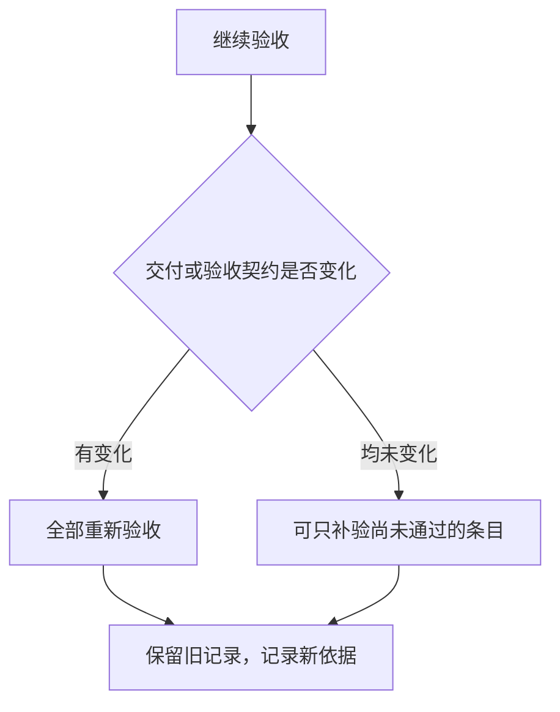

#### D112：TaskRun 采用六种业务状态——已确认，待实现

> **R2 修订（D140，已确认）：** TaskRun 改为五个状态：待开始、进行中、已交付、失败、已取消。见[目标模型](0001-target-model.md)。

用户接受 TaskRun 的六种状态：**待开始、进行中、等待继续、成功、失败、已取消**。进行中覆盖执行、验收和归档；具体阶段、阻塞原因与取消意图单独记录，不增加“归档中”“终结处理中”等同级 TaskRun 状态。成功、失败、已取消为终态，沿用 D102；再次做任务创建新尝试，不重开旧终态。

本轮执行结束但任务尚未完成时，可以进入等待继续，包括单次执行失败或验收未通过。明确继续并取得执行资源后回到进行中；继续仍须按 D97 重新排队，排队事实单独表达，不将同次尝试重置为初次待开始。全部验收条件通过且约定归档完成才能成功；明确判定本次尝试无法完成才结束为失败。

取消请求不立即改变为已取消：保留原状态和取消意图，阻止后续启动，确认受管工作停止后才能终结。环境暂停、AgentExecution 是否运行、工具是否停止仍由各自事实核对；不能仅凭 TaskRun 为等待继续释放资源、卸载 Workspace 或认定环境已暂停。停止未知时继续核对并保留占用。具体竞态、持久化字段和英文非终态枚举在实现设计中落实，不在本条另行确认为已实现。

当前状态图见第 3 节；AgentExecution 的阶段草图仍待细化，本次确认仅适用于 TaskRun。

#### D113：等待期间只暂停本任务的执行容器——已确认，待实现

> **R2 修订（D140，已确认）：** 暂停作用于保留待细化的 Sandbox，规则不变：只暂停执行容器，依赖服务不动。见[目标模型](0001-target-model.md)。

本条细化 D98 的“保留并暂停环境”：TaskRun 等待继续时，确认本轮 Agent 与工具已停止使用资源后，暂停本任务的执行容器，保留 Workspace 文件与依赖服务，**不自动暂停数据库等依赖服务**。依赖服务具有独立生命周期，可能被其他任务使用，不因一个 TaskRun 等待就一并冻结。

等待期间不保证整个环境内容冻结：依赖服务仍可能运行和变化。继续时按已有规则重新取得执行资源并检查环境可用性，再恢复任务；不把保留环境解释为完整快照或精确重放保证。Workspace 仍遵守 D109 的现有实现复用决定。

停止未知时记录停止尚未确认，不宣称暂停完成，不提前释放占用；暂停失败也不得伪报已暂停。TaskRun 的等待状态、执行停止事实与实际容器暂停事实分别记录。暂停的权限与技术适配仍遵循既有资源归属，不赋予调用方控制他人资源的权限；具体失败重试与适配方式在实现方案中落实。

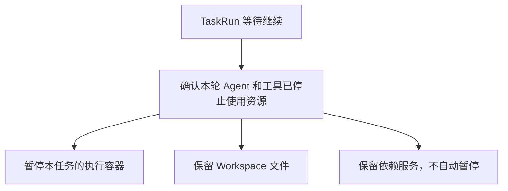

#### D114：本次不设计运行中旧 DevRun 的迁移——已确认

用户明确说明切换时不会存在正在运行的旧 DevRun，因此本次以此作为实施前提，不实现运行中接管、热迁移或让旧任务通过保留旧执行流程逐步收尾的机制。刚提出的“新任务走新模型、旧运行原地收尾”方案不采纳，不能列为一期必做项。本条是用户给定的使用前提，不是工具检查得到的当前运行状态结论。

保留 D38 的公共环境治理收敛与单一权威状态原则，但删除为运行中旧 DevRun 设计双流程过渡、实例移交协议和相关验收要求的工作。切换后的任务由新模型统一处理；代码可以分阶段开发和验证，无需为上线过程建设运行中迁移能力。

历史记录、配置及已保存交付如何兼容或转换仍是独立问题；本条不授权删除历史数据，也不等于所有旧数据格式都无需处理。既有运行时资源归属、停止确认和安全回收规则继续适用。

#### D115：保留独立 Agent 整轮验收，Grader 适配不强制——方向已确认，具体适配待定

> **R1 修订（D130 / D131，已确认）：** 独立验收适配为 Grading 内置的独立验收评分器，并保留本条要求的单次调用、逐条报告与独立性。

**最终确认：** 用户接受保留一次独立 Agent 完成整轮验收的入口，优先复用通用 Agent 执行、隔离和存取能力；不强制将验收适配到 Grader，不增加逐条评分器配置、实验依赖或额外调用步骤，完整逐项报告与独立性必须保留。是否进一步适配公共 Grading 由实现收益决定，具体接口与记录映射仍待设计。下文方案比较保留评审过程，以本段及补充结论为准。

用户此前要求重新审查复用是否合理。本条不改变 D110–D114 的既定规则。依据软件设计哲学中的知识归属、信息隐藏与机制 / 策略分离，建议复用独立评价能力，但不把所有完成检查包装为评分，也不合并验收与评测的业务状态。

| 方案 | 取舍 |
| --- | --- |
| 所有验收、归档与任务成功都交给 Grader | 会使评分器知道 TaskRun 生命周期、存储回执等不属于评价的知识；Agent Judge 的完成检查若再次强制调用 Judge，还会产生递归。拒绝。 |
| 完全独立的验收与评分引擎 | 重复实现测试执行、Agent Judge 调用、材料绑定、证据采集及错误处理，未来容易不一致。当前不推荐。 |
| 共享 Grading / Grader 评价能力，任务用例负责完成判定 | 既有 D48 的 Grading 应用服务封装材料准备、评价与记录，Grader 专注依据标准评价；验收仅在需要评价时调用，聚合逐项结论并核对基础交付与归档事实。推荐，待确认。 |

**建议边界：**

1. Grader 的公共语义为对固定对象 / 材料按指定标准评价，返回结果与依据；不得要求 Experiment / EvalRun，也不得修改 TaskRun 状态。规则、测试、Agent Judge 可复用。Grading 用例仍负责读取材料、调用 Grader 和保存记录，不再为验收复制一套评分执行链。
2. TaskType / 任务处理能力负责交付类型和结构契约；应用用例依据存储回执确认归档。格式合法、引用可读、归档成功等基础事实不必创建 Grader 或启动 Judge。是否满足全部完成条件仍由任务侧决定。
3. 当验收涉及行为或语义判断时，可引用 Grading 的评价证据，但验收契约必须明确每个条目如何判定通过。一个总分或“整体不错”不能自动证明逐项满足；不擅自把任意数值评分转换为通过。通过阈值 / 分类映射、评价策略绑定的具体配置仍待设计，Task 不因此拥有具体 Grader 实现。
4. 原有验收中的独立判断、盲验依据、逐项证据和矛盾结论应保留；共享能力不等于将完整 VerificationReport 压成一个 Grade。验收汇总与 GradingRecord 的持久化复用方式仍待定，不能复制两份同义的评价事实，也不能丢掉验收特有依据。
5. Agent Judge 使用普通执行能力产生评价输出；其任务完成可由确定性的输出结构、标尺范围及归档检查闭合，不默认再调用一个 Judge 验收 Judge。格式有效只证明可作为评价结果读取，不证明判断客观正确；后者属于评分质量与校准问题。

**源码依据：** [evaluation.ts](../../typescript/src/evaluation.ts) 的 GraderBase 已支持 criterion 范围与 decision / score 标尺，GraderSubmission 将 error 与质量结果分开，说明“评价契约条目”和“评价质量”确有共通输入 / 输出知识；[EvalModule.reserveGrader / submitGrader](../../typescript/src/eval-module.ts) 当前仍要求 EvalRun 并验证其选定 Grader，不能直接让通用任务验收依赖这套入口。需抽出独立评分用例，旧评测调用它，而非通用任务反向依赖评测。

[VerificationReportInput](../../typescript/src/domain.ts) 包含逐条独立判断、对照与最终结论；[VerificationRun](../../typescript/src/verification-run.ts) 记录 blind / freeze / reconcile 等阶段且不承载第二份验收结论；[候选 standing 汇总](../../typescript/src/module.ts) 保留 disputed。它们说明共享测试 / Agent 执行机制不能抹掉验收协议及矛盾证据。

本次为源码与设计评审，未修改生产代码，未运行功能测试。该建议等待用户确认，不将现有 EvalModule 视为已解耦的公共 Grading 服务。

##### D115 补充：保留一次独立 Agent 完成整轮验收的使用方式——已确认，待实现

用户澄清希望保留现有体验：交付候选后启动独立验证 Agent，由它读取固定交付与验收标准，自主选择测试或代码推理方法，形成逐项结论并通过工具提交，不要求用户提前为每条标准编写测试或配置单独 Grader。

现有 [独立验证工作流](../../plugins/grounds/skills/grounds/references/workflows/verify.md) 正是由宿主协调新验证者，提供固定候选、契约与受限材料，先独立盲验、再固定结果并对照作者材料。CLI 本身不会因 Candidate 提交就自动拉起 Agent。验证者填写逐项报告并生成交接，协调者调用提交工具落库；[submitVerification](../../typescript/src/module.ts) 检查身份区别、Candidate / tree / context 绑定及条目覆盖，新增 Verification，候选验收情况由记录派生。它不是直接修改 Candidate 内部的一组布尔值，也不是逐条任意改写已提交结果。测试不能改变被验收的固定候选，所需临时文件应与固定代码身份分开。

**修正建议：** 保留整个独立验收工作流作为一个完整能力。若适配公共 Grader，应由一个 Agent 型实现封装整轮验收，而不是将每个 Criterion 拆成一个 Grader / Agent；Agent 仍可自主选择验证方法。调用方只提供确切交付、固定契约及允许材料，已有默认验证者配置可由用例选择，不因接口复用强制创建 Experiment / EvalRun 或逐任务手工定义 Grader。参数名称与默认配置机制仍待实施设计。

Grader 内部复用通用 Agent 执行、材料准备和证据保存机制，验收报告仍保留逐项结论与独立 / 对照阶段。当前通用 Grade 的数值或分类不足以独自替代完整 VerificationReport；可引用完整报告，或在适配时提供结构化逐项结果，具体表示尚待定，不先承诺合并持久化模型。不能把报告只降为一个分数，也不能把“更新验收情况”实现为覆盖旧证据。

是否接入公共 Grading 以真实收益判断：只有在保持上述单次调用体验、独立性、逐项报告且减少重复实现时才适配；若必须引入多余配置和状态转换，一期先复用通用执行与存取，保留已有验收入口即可。D115 不作为必须立刻把验收改造成当前 eval Grader 的决定。源码核对不等于本次实际运行独立验收 Agent，生产代码未改。

#### D116：正式交付明确提交完整清单，修正保留历史——已确认，待实现

> **R2 修订（D140，已确认）：** 每个 TaskRun 只有一份 Manifest；替换清单改为发起 `origin = caller` 的 refinement TaskRun。见[目标模型](0001-target-model.md)。

每次正式交付明确提交完整交付清单，列出本次采用的确切 Candidate 与 Artifact 引用。未结束的 TaskRun 修正交付时，以新的完整清单更新当前选择，旧清单和交付保留；未变化的产物可以继续引用，不要求复制文件或重新生成内容。系统不按创建时间自动挑选最新候选，也不将历次产物自动合并。

验收绑定确定的清单内容及任务契约；交付选择变化按 D111 全部重新验收。TaskRun 成功时固定采用的交付清单与验收依据，已终结尝试不通过替换清单重新打开。清单沿用 D43 / D104 的固定引用值，不新增独立身份与生命周期实体。提交、原子选择和历史保存的具体字段与接口由实现方案落实。

#### D117：应用层深模块关系——已确认，待实现

> **R2 修订（D140 / D141，已确认）：** TaskRun 改为五个状态，没有“继续”入口；Verification 并入 Grading；新增 SandboxProvisioning。现行模块见目标模型第 7 节。见[目标模型](0001-target-model.md)。

> **R1 修订（D130–D132，已确认）：** Verification 并入 Grading，新增 SandboxProvisioning，Grading 不再调用 TaskExecution。现行模块图见[目标模型](0001-target-model.md)第 7 节。

用户认可当前领域图，开始讨论应用层深模块。按深模块与信息隐藏原则，以下是应用层职责边界，不按领域实体逐个创建 Service，不要求各自成为独立进程、公共 SDK 或部署服务。D118 的命名与 D119 的环境 / Workspace 拆分已纳入当前方案，用户已确认当前模块划分与依赖关系；具体包、端口与外部入口仍待细化。

| 模块 | 调用方表达的意图 | 内部承担的复杂性 / 边界 |
| --- | --- | --- |
| 任务执行 TaskExecution | 发起、继续、取消一次任务，提交交付、查询完成情况 | 固定 TaskRevision / TaskType，维护 TaskRun 六状态，协调类型处理能力、具体 Agent 执行、完整交付清单、所需验收和完成判定。调用者不拼装这些步骤；不拥有模型协议、Git / Docker 实现。 |
| Agent 执行 AgentExecutionService | 运行或恢复一次确定配置的 Agent，取得已归档结果 | 维护 AgentExecution 身份、会话和宿主恢复，准备本次允许材料与运行资源，协调内部状态、工具边界、轨迹与输出归档、停止确认和 Agent 名额（默认 20）。不决定 TaskRun 是否验收通过。 |
| 独立验收 Verification | 验收一组确定交付是否满足任务契约 | 固定候选 / Artifact 清单及标准，准备独立与分阶段材料，调用通用 Agent 执行，接收并校验完整逐项报告，保存验收依据。保留单次完整验收入口，不按条目创建一组 Agent，不强制依赖 Grader。 |
| 评分 Grading | 按固定 GraderRevision 评价明确对象与材料 | 封装材料读取、规则 / 测试 / Agent Judge 策略、结果合法性、故障与质量结论区分、记录保存及补评。独立于 Experiment；不决定被测 TaskRun 成功。Agent Judge 经通用任务路径保留自己的 TaskRun 与执行记录，使用确定性输出契约检查，不默认再启动验收 Judge。 |
| 实验运行 ExperimentExecution | 运行固定实验、补评、停止与查询实验结果 | 组织批次 / EvalRun / 重复次数，默认任务并发 5，每项先执行后评分，局部故障与补评保持样本身份；结果视图由持久事实计算，不委派 Agent 写权威报告。复用任务执行和评分，不再建执行引擎。 |
| Workspace 管理 | 准备、取得和保留确定的文件空间，释放使用保护或清理 | 复用已有配置版本、仓库缓存、固定基线与独立可写区，管理文件范围、使用保护及保留策略；不启动运行环境，不直接执行容器挂载，不因拆分新增 Workspace 领域模型。 |
| Environment 治理 | 准备运行资源、挂载文件空间，暂停、恢复和回收环境 | 统一环境实例生命周期、所有权、占用、运行时与依赖服务，落实挂载及权限并核对实际状态。D113 等待策略由执行侧请求；回收环境不等于删除 Workspace，不维护另一套仓库缓存，不依赖实验。 |
| 交付与证据存取 | 保存 / 读取确切交付、轨迹与证据，并取得可靠回执 | 应用侧按类型定义 Candidate、Artifact、Trajectory 等存取端口，封装 Git / 文件 / 对象存储及元数据协调、完整性与可读性。不是把所有对象变成 Artifact 的通用大接口；Agent 内部检查点存储仍独立。存取不决定任务是否成功，交付清单当前选择归任务执行。 |

关键区分：TaskExecution 负责一次尝试的业务推进，AgentExecutionService 负责一次 Agent 调用。对用户主要呈现任务级入口；单 Agent 能力供内部复用，不要求普通用户串联两套 API。Verification 可直接使用单 Agent 能力完成验收，不反向调用“带独立验收的任务流程”；Grading 的 Judge 通过确定输出契约的通用任务路径运行，避免自动无限验收。此前笼统的 Execution 接口在这份初稿中展开为两个内部职责，不表示已批准新增两个对外执行服务。

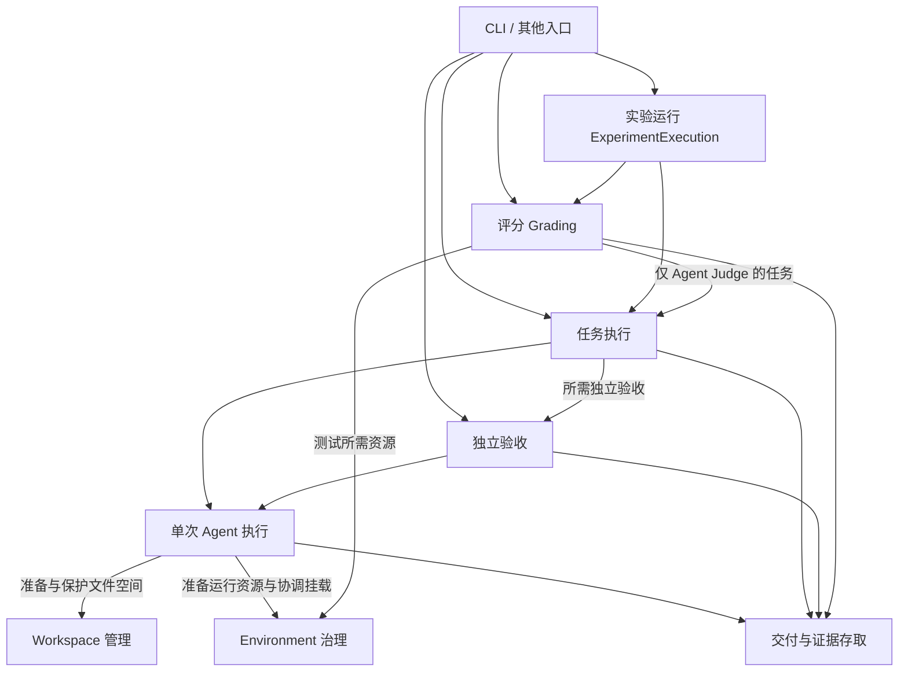

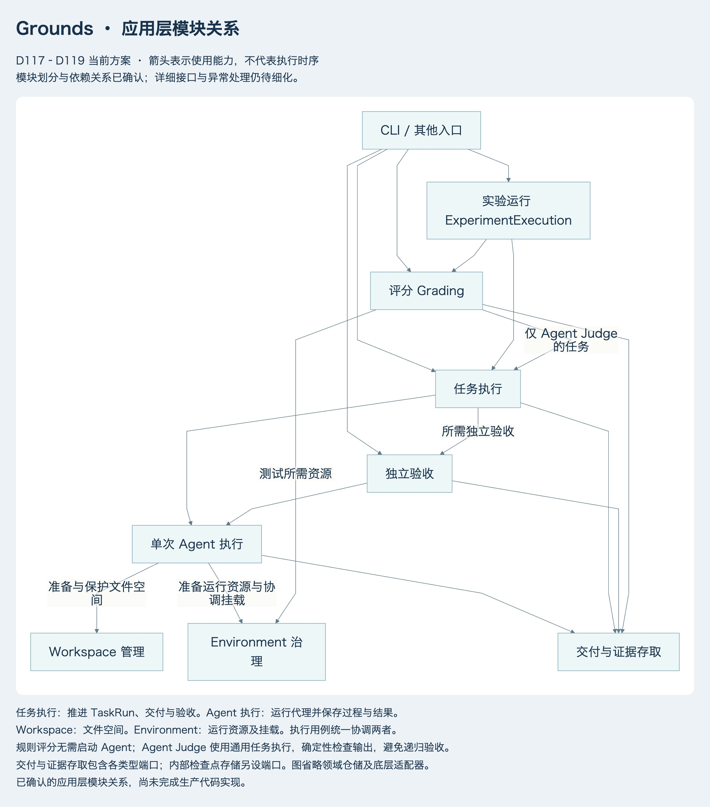

可单独查看 [Mermaid 源文件](../assets/application-modules-latest.mmd)。

箭头表示依赖内侧能力接口，不是同步阻塞的调用栈；各模块的存储事务与取消传播仍需后续设计。图省略领域仓储读写、类型处理组件以及资源保留策略的协商，不能据此让所有资源都随单 Agent 结束自动删除。执行用例向环境侧提供 Workspace 文件视图，并封装挂载、停止确认、卸载及释放使用保护的顺序与失败处理；CLI 不直接串联两套资源接口，两个模块也不互相接管生命周期。

**三条流程检查：** 普通任务经任务执行协调具体执行、交付与验收，不需要实验；独立验收已有候选可直接进入 Verification，不重跑开发；实验由 ExperimentExecution 调用相同任务执行并在交付完成后评分，Judge 自身尝试不计为被测样本。基础契约检查不强制启动 Agent；适配器不重新实现整条业务流程。

**暂不新增模块：** Task / Agent / Grader 等版本发布与配置校验先作为相关应用能力的命令入口，共享版本规则和仓储；查询作为基于事实的只读能力，暂不为所有对象建立 CRUD Service。TaskType 的处理组件贡献类型差异，不拥有调度器；并发与受管宿主恢复按所属层次协调，不另造与业务状态并行的通用工作流引擎。具体编码时若共享知识不足或边界过薄，应合并，而非为了固定数量维持包的划分。

##### D117 命名讨论：Grading 与 Evaluation——结论由 D118 确认

用户询问两者关系及 Grading 是否应改名。职责关系为：批次编排组织任务执行，在每项获得明确交付后发起一次或多次评分；单次评分也能独立用于历史交付，不要求存在实验。规则 / 测试评分无需 Agent，Agent Judge 则调用通用任务执行能力。一个 EvaluationCase 可选择多个 Grader，因此不是一个 EvalRun 只对应一次 Grading。

建议保留 Grading 表达“按标准评价明确对象并形成 Grade”的应用能力，与 Grader（评分器）、Grade（结果）、GradingRecord（记录）保持词义一致；实现类若需要可称 GradingService，接口仍无需 Service 后缀。更需要收窄的是目前宽泛的 Evaluation 模块名：其写侧主职责是组织 ExperimentRun，可在总览称“实验运行”，应用入口候选名为 ExperimentExecution。查询仍为只读入口，不因该命名改变既定报告生成规则。用户随后采纳此命名，按 D118 替换 D52 的应用接口名称；D48 的 Grading 命名保持不变。此处其余具体方法与实现类名称仍是建议，当时尚未确认整体划分；后续用户已确认当前 D117 总图，具体接口仍待细化。

#### D118：实验运行接口命名为 ExperimentExecution，保留 Grading——已确认，待实现

用户采纳命名调整：负责实验批次编排的应用接口从 Evaluation 更名为 **ExperimentExecution**，中文“实验运行”；**Grading** 继续表示针对确定对象与材料、按固定评分定义进行评分的应用能力。ExperimentExecution 使用任务执行和 Grading 组织各评测项，Grading 也可独立用于历史交付，不依赖实验存在。

本次仅收窄应用能力的命名，领域 Experiment、ExperimentRun、EvaluationCase、EvalRun、GradingRecord、Grader 和 Grade 名称不变。历史讨论中的 Evaluation 应用接口按本条理解；不据此更名已有源码文件或 CLI 命令。本条当时仅确认命名；后续用户已确认当前 D117 模块关系，详细接口仍待细化。

#### D119：环境治理与 Workspace 管理拆分——已纳入设计，待实现

> **R1 修订（D132，已确认）：** 两个模块的拆分保留，但只由 SandboxProvisioning 调用，由它统一协调挂载顺序。

用户询问 D117 将两者合为一个深模块是否合适。结合 D77 的独立生命周期、D109 的现有 Workspace 复用及实际源码，本次将应用层方案拆成两个逻辑模块：Workspace 管理负责确定文件空间，Environment 治理负责运行资源及其使用文件空间的事实。它们可以留在同一代码库与进程，不因拆分新增独立部署或一套 Workspace 领域模型。

| 模块 | 掌握的知识 | 不承担的职责 |
| --- | --- | --- |
| Workspace 管理 | 已有仓库配置版本、缓存、固定基线、可写 worktree、允许呈现的文件范围、保留与清理；提供确定的可使用文件视图并保护使用中的文件不被回收 | 不选择容器镜像，不启动服务，不直接实现 Docker 挂载 |
| Environment 治理 | 环境定义与实例、运行时及依赖服务、实例占用、挂载事实与实际权限落实、暂停 / 恢复 / 回收 | 不解析多仓组合规则，不维护另一份 Git 缓存或决定哪些文件是正式 Artifact |

执行用例统一协调两者：取得并保护本次文件视图，准备环境并挂载，运行后确认不再使用文件，再解除挂载与释放文件使用保护，最后按归属与保留策略处理资源。调用者仍通过一个执行入口表达目的，不自行拼接跨模块步骤。挂载技术操作与确认结果归环境侧，Workspace 侧保留防止清理的使用保护；二者事实相关但不同，不能各自保存互相矛盾的“执行已结束 / 可以清理”真值。具体租约、操作回执和失败补偿协议由执行协调封装，不在本条新增领域实体或固定端口字段。

拆分收益是文件配置、缓存及保留策略的变化可以局部处理，环境实现或镜像变化不必牵动 Workspace；换环境保留 Workspace、无活动容器时准备文件也有自然边界。代价是挂载与清理需要跨模块协调，因此要明确资源归属与停止确认，不能只拆文件而把调用顺序转嫁给 CLI。D28 的统一目标仍是开发与评测共用同一套环境治理，不是把运行资源与文件空间强制合并。

当前 [code-workspace.ts](../../typescript/src/code-workspace.ts) 已集中仓库配置、基线准备与恢复，[repository-environment.ts](../../typescript/src/repository-environment.ts) 管环境配置，[code-route-execution.ts](../../typescript/src/code-route-execution.ts) 已组合这些能力；这是可沿用的职责分离基础，不证明通用接口及跨模块协议已经实现。本次按用户要求将此拆分同步到 D117 的应用层总表与 Mermaid；后续用户已确认当前 D117 整体模块关系，详细接口仍待细化，生产代码未改。

#### D120：TaskExecution 发起契约与资源配置来源——已确认，待实现

> **R2 修订（D140，已确认）：** TaskRevision 只引用 EnvironmentDefinition；受理时解析，或由调用方显式指定修订。见[目标模型](0001-target-model.md)。

> **R1 修订（D132 / D133，已确认）：** TaskRevision 改为声明环境要求，受理时解析；资源由任务 Sandbox 承载。

普通发起入口接收确定的 TaskRevision 与 AgentRevision 引用。TaskRevision 固定引用本任务采用的 Workspace 配置版本与 EnvironmentRevision，TaskExecution 读取这些配置，不要求调用方重复提交配置内容、提前创建 Workspace 或环境实例，也不要求实验 ID。Workspace 配置沿用 D109 的现有配置版本与组装能力，不新增 WorkspaceDefinition / WorkspaceRevision 体系。

TaskExecution 创建并持久化 TaskRun 后返回其身份和当前状态，表示已受理，不表示任务完成；后续由受管执行流程推进资源准备、执行、交付和验收；单次 Agent 所需资源与归档协调委托 AgentExecutionService，职责详见 D127。调用方凭 TaskRun 身份查询、继续或取消。发起请求的幂等规则见 D122；受理前后校验边界见 D125；请求字段、具体检查项与原子提交协议仍待接口设计，本条不承诺未设计的具体方法签名。

配置说明任务需要什么，实例记录这次实际用了什么。TaskRun 关联运行所用资源，AgentExecution 记录具体使用情况；继续同一 TaskRun 时保留并核对其已关联 Workspace，资源恢复仍遵守既定停止确认和手动恢复规则，不保证环境已经可用。新任务是否允许显式指定已有 Workspace、如何校验基线 / 权限 / 占用，仍是待讨论能力，不作为默认复用规则。

#### D121：环境配置版本使用 EnvironmentRevision，区分镜像与实例——已确认，待实现

> **R2 修订（D140，已确认）：** EnvironmentInstance 并入 Sandbox 的运行资源；EnvironmentDefinition 与 EnvironmentRevision 保留。见[目标模型](0001-target-model.md)。

> **R1 修订（D133，已确认）：** 三个概念不变；TaskRevision 不再直接固定 EnvironmentRevision，改为声明 `pinned` 或 `follow`。

环境领域采用以下职责：

| 概念 | 职责 |
| --- | --- |
| EnvironmentDefinition | 环境的稳定身份，组织其多个配置版本。 |
| EnvironmentRevision | 不可变的环境配置版本，包含镜像引用、启动配置和依赖服务等；配置变化产生新版本。TaskRevision 固定引用确切版本。 |
| EnvironmentInstance | 按确定 EnvironmentRevision 准备出来的实际运行资源，具有占用、暂停、恢复和回收等运行状态，并记录创建依据。 |

EnvironmentSpec 不再作为单独具有身份与生命周期的领域实体；如实现需要，可保留 Spec 作为 EnvironmentRevision 内部的配置值类型。历史设计中的 EnvironmentSpec 固定版本按本条的 EnvironmentRevision 理解，不机械替换现有源码类型或宣称已完成迁移。

EnvironmentInstance 更接近实际容器，而不是 image。Docker 适配器以 EnvironmentRevision 引用的 image 创建任务容器；实例也可能关联其管理或使用的依赖服务，不要求领域实例与一个容器严格一一对应。服务归属、暂停与回收遵守 D113，不因存在关联就默认暂停或删除共享服务。镜像属于构建输入，不另增必需的 Image 领域实体；镜像等外部依赖应固定版本或摘要，单有配置版本号不保证外部内容不漂移。

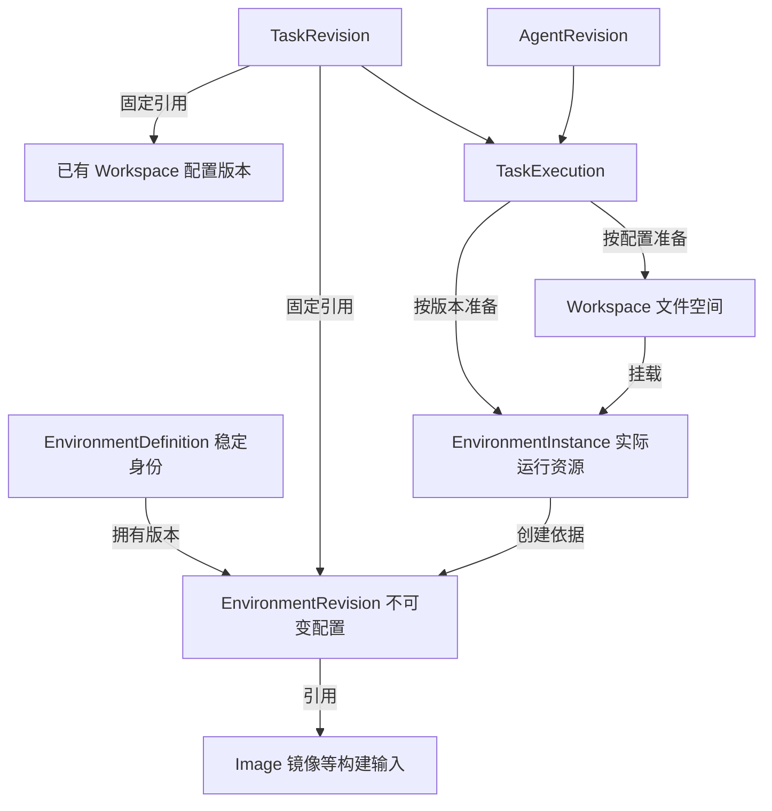

本图跨领域配置与应用编排表达关系，不表示 TaskExecution 自己实现容器或文件操作。Workspace 管理与 Environment 治理仍按 D119 分工，由执行用例统一协调；环境不直接归属实验。

#### D122：TaskExecution 发起请求重试返回同一 TaskRun——已确认，待实现

用户接受将稳定请求身份用于 TaskExecution 发起契约：首次提交前生成并保留请求 ID，同一次请求因连接中断或回执丢失而重试时沿用该 ID，返回同一个已持久化 TaskRun 的身份及当前状态，不重复创建任务尝试或重复调度执行。用户明确重新运行时使用新的请求身份，即使 TaskRevision 与 AgentRevision 相同，也创建新的 TaskRun；不能按配置相同自动合并独立实验。

本条将 D54 的启动防重原则落实到 TaskRun 受理边界，不混同 TaskRun 与 AgentExecution 身份：一个 TaskRun 内部仍可有多个 AgentExecution。沿用 D54，同一请求身份携带不同输入应报告冲突，不覆盖原请求；调用方保留重试身份，应用侧持久化唯一映射并处理并发重试。具体字段、作用域、事务及后台启动协议仍待实现设计。

该规则只解决受理与逻辑尝试的重复问题，不承诺外部工具副作用恰好一次；执行状态未知时仍按既定核对规则处理，不能借重试盲目启动新的 Agent。

#### D123：资源准备失败保留文件空间，原 TaskRun 等待继续——已确认，待实现

> **R2 修订（D140，已确认）：** 资源准备失败时 TaskRun 以 infrastructure 失败，保留的 Sandbox 可由 refinement 接手后继续准备。见[目标模型](0001-target-model.md)。

> **R1 修订（D129 / D132，已确认）：** 准备受阻记录在 Sandbox 上；TaskRun 按完成策略进入等待继续或失败。

用户接受资源准备失败时保留已准备的 Workspace 和准备记录，例如 Workspace 已就绪但容器启动或挂载失败。TaskRun 进入“等待继续”并记录失败原因及准备进度，不因该次准备失败自动新建任务尝试。

执行用例仅协调清理本次创建且确认可安全释放的运行资源，不删除保留的 Workspace，也不释放借用或共享且无权回收的资源。若启动、挂载或停止结果不明，先保留关联与使用保护并核对实际状态，不把未知当作未启动或已停止，不直接重建或解除保护。进入“等待继续”不等于容器已经暂停或工具已经停止，仍按 D113 分别核对。

用户明确继续时沿用原 TaskRun，检查资源归属、状态及可用性，复用仍有效的准备结果并补做失败步骤；已安全清理或确认不可用的运行资源可按原固定配置重新准备，并记录实际关联。该规则不保证复用原容器、不自动恢复执行，也不绕过 D75 的工具重试限制。准备进度、资源回执和失败补偿的具体字段与端口仍待实现设计。

#### D124：取消受理与停止完成分开表达——已确认，待实现

用户接受 TaskExecution 的取消入口先持久记录取消意图，并返回 TaskRun 当前状态；收到取消请求不等于取消完成。不新增“取消中”主状态，使用取消意图、处理进度和必要的核对原因表达停止过程，保留 D112 的六状态模型。

执行用例协调停止本任务相关 Agent 与工具，确认停止后才将 TaskRun 标为“已取消”。无法确认时保留取消意图和资源使用保护，明确显示停止状态待核对，不伪造已取消，也不据此卸载仍可能使用中的 Workspace。取消不等于删除 Workspace、交付或历史记录；资源处理继续遵守归属、保留和安全释放规则。

重复取消同一个 TaskRun 返回当前处理情况，不重复发起另一套取消流程。已经成功、失败或已取消的 TaskRun 保留原终态，不因取消请求覆盖历史结果。具体返回字段、停止回执、并发完成与取消的原子状态更新协议仍待实现设计；本条不新增取消超时自动认定停止的规则。

#### D125：启动前校验分为受理前定义检查与受理后资源检查——已确认，待实现

> **R2 修订（D140 / D141，已确认）：** 受理后资源检查失败时，TaskRun 以 infrastructure 失败；保留的 Sandbox 可由 refinement 接手后继续准备。见[目标模型](0001-target-model.md)。

> **R1 修订（D129 / D138，已确认）：** 受理后资源检查失败记为 Sandbox 准备受阻；TaskRun 按完成策略进入等待继续，或以 infrastructure 类别失败。

用户接受 TaskExecution 的两阶段校验边界：

- 受理前检查确定的版本引用存在、输入符合 TaskType 契约，以及仅依据配置即可确定的兼容性问题；不创建容器或调用模型。无效请求直接拒绝并返回原因，不创建已受理的 TaskRun。
- 检查通过后持久化 TaskRun 并返回已受理，再准备 Workspace 与环境，检查实际材料可获取、挂载成功、依赖服务和工具可用。资源就绪后才启动 Agent；准备或资源检查失败按 D123 保留进度、记录原因并等待继续。

本条落实 D76 的提前拦截原则：明显无效的定义请求在受理前拒绝，需要真实准备才能发现的问题保留在可追踪的 TaskRun 中。启动前检查不等于保证整个执行期间资源始终可用；运行中故障仍由既定执行与恢复流程处理。具体检查项清单、错误码和端口字段留待实现细化。

D122 的请求防重仍成立：已受理请求的同身份重试应取回原 TaskRun，不因重复进行资源准备而创建新运行；具体校验与受理事务顺序由实现保障。

#### D126：继续原 TaskRun 只推进未完成工作——已确认，待实现

> **R2 修订（D140，已确认）：** 继续未完成的工作，改为恢复原 AgentExecution（同一身份）或发起 refinement TaskRun。见[目标模型](0001-target-model.md)。

用户接受 TaskExecution 的继续入口沿用原 TaskRun 及其固定定义版本，保留有效交付、验收依据与执行记录，仅推进尚未完成的工作，不从头重跑整个任务。已完成的 AgentExecution 不重复调用；仅归档失败则补归档，仅验收未完成则继续验收。验收范围仍按 D111：交付或契约变化需重新验收，未变化时可补验未通过项并引用仍有效的依据。

结果不明的操作先核对，再遵守 D75 的工具重试限制，不把继续请求视为对未知副作用的盲目重放授权。继续时按 D97 重新取得所需并发名额，按 D113 / D123 检查保留资源的实际状态和可用性；继续请求不保证立即执行，也不保证原容器仍可复用。

已经成功、失败或已取消的 TaskRun 不通过继续重新打开；明确重新运行应以新的发起请求创建新 TaskRun，按 D122 处理请求身份。具体继续请求字段、并发重复请求的协调和恢复步骤的持久化协议仍待实现设计。本条收敛既定恢复规则，不新增自动恢复策略。

#### D127：AgentExecutionService 输入、结果与恢复职责——设计补充，待实现

> **R2 修订（D140 / D141，已确认）：** AgentExecutionService 只运行 AgentExecution，不准备资源；一个 TaskRun 至多一个 worker。见[目标模型](0001-target-model.md)。

> **R1 修订（D131 / D132，已确认）：** 资源准备与回收移交 SandboxProvisioning，本服务只凭租约占用；评价者执行也直接由本服务承载。

状态说明：本节由助手依据用户授权补齐高置信设计细节，收敛 D1 / D53–D55 / D66–D67 / D71–D75 / D117 / D120–D126 的既定规则，不标为用户逐项确认，不声称接口已实现。保持一期 Pi Durable 单内核目标，不新增多 Provider 平台或通用工作流引擎。

**职责边界。** TaskExecution 决定本次任务推进目的、固定定义、采用的交付及是否需要验收；AgentExecutionService 封装一次 Agent 执行的资源准备、运行、轨迹与输出归档、停止核对及可恢复过程。TaskExecution 对任务级结果负责，可委托 AgentExecutionService 完成执行所需的资源协调，不在两层各自实现一套挂载 / 归档 / 回收流程。Workspace 与 Environment 模块分别落实文件和运行资源操作，技术适配器不反向决定 TaskRun 成功与否。

**输入契约（概念字段，非已发布签名）。**

| 输入 | 语义与来源 |
| --- | --- |
| 稳定发起请求身份 | 对应一次逻辑 AgentExecution；与 TaskRun 发起请求身份区分，不能把一个 TaskRun 内全部执行合并为一次。相同身份不同输入报告冲突。 |
| AgentRevision 引用 | 本次执行的确定配置；不将 SDK 类型、数据库连接或容器对象作为业务输入。 |
| 固定的执行输入 | 本轮目标、允许提供的材料及版本、结果输出约定，由任务类型处理组件或验收用例形成。它是值 / 引用的组合，不新增必须发布的领域实体。 |
| 资源准备依据 | 依据已固定的 EnvironmentRevision、已有 Workspace 配置版本准备资源；恢复或后续执行可引用原关联资源，由服务核对归属、权限和实际可用性。不是给 CLI 增加一个任意覆盖任务配置的入口。 |
| 来源关联 | 记录本次由哪项任务或验收发起，供追踪与所有权核对；不要求 Experiment / EvalRun 存在，也不以这些关联决定执行技术流程。 |

被测执行只收到允许公开的材料；验收使用它自己的受控材料视图与权限，不能把 TaskRun 的所有上下文或作者结论默认复制给独立验收 Agent。Agent Judge 的独立任务按 D117 经过 TaskExecution，评分定义及允许材料由 Grading 组织，不能隐式继承被测 Agent 会话或内部检查点。

**对外操作与结果。** 仅需发起、查询、请求停止、核对及恢复现有执行这组意图；具体方法名称可以随实现调整，不新增“每个阶段一个调用”的外部流程。

- 发起受理后返回 AgentExecution 身份和当前进度，不等待全程结束，不表示模型已启动。
- 查询提供运行事实、归档情况、阻塞 / 错误原因、实际资源引用及已保存输出 / 轨迹引用。运行结束与归档完成分开表达；状态未知、轨迹不完整与输出缺失不能合并为成功。
- 成功完成依 D1 表示本次约定输出与轨迹已持久化且可读取；不表示任务验收通过或获得合法 Grade。未通过质量标准的内容仍可成功归档，质量结论由对应业务模块判定。
- 正式交付经 D41 的明确选择与类型接收能力形成 Candidate / Artifact 引用，不能把终端文本或工作目录全部文件自动当成交付。服务协调保存，不解释 Candidate 的验收结论，也不更新 TaskRun 的当前完整交付清单。
- Provider 已结束但归档失败时，核对并补做原归档，不重启模型。任务需要下一轮执行时，创建新的 AgentExecution 并保留历史，不把已完成执行伪装成恢复。
- 请求停止与停止确认按 D55 / D124 区分；服务返回其实际核对到的事实，TaskExecution 据此推进任务级取消。恢复仅针对同一次尚未完成且具备可核查恢复依据的执行，不用新会话冒充原会话恢复。无法证明恢复条件时明确阻塞，由既定调用方规则处理。

**内部端口与信息隐藏。** AgentProvider 隐藏 Pi Durable 会话协议并转换公共可观测事件；Workspace 和 Environment 端口隐藏文件准备与运行资源操作；各类型证据存取端口隐藏归档，内部状态存储保持独立且按执行身份隔离。AgentExecutionService 维护执行事实与资源使用关联，协调这些端口；TaskExecution 不解析 SDK 事件、拼容器命令或读取 Durable 数据库。内部检查点不得进入 Agent 可见 Workspace。使用共享数据库不改变单个执行仅一个有效运行拥有者的约束。

**恢复与并发。** 一次逻辑执行只由一个有效拥有者推进；重复发起、恢复或停止请求不能同时启动两个工作进程。默认 20 个 Agent 名额由通用执行能力管理，实际是否仍运行未知时不能因客户端失联释放占用。任务级默认 5 个评测名额仍由 ExperimentExecution 管理，普通执行不依赖实验调度。Agent 已完成不代表应删除任务仍需保留的 Workspace 或环境；业务用例给出保留 / 释放意图，执行侧协调安全核对，治理模块实施操作。

**收敛依据与取舍。** 将已准备的裸目录、容器和 SDK 句柄全部交给调用方虽然能缩短执行接口实现，却要求 TaskExecution 与 Verification 各自理解准备顺序、归档重试和停止核对。本方案让调用方提交执行目的与固定资源依据，复杂步骤留在 AgentExecutionService；需要保留的策略信息仍显式传递，不让服务猜测文件是否可删。已有 [code-route-execution.ts](../../typescript/src/code-route-execution.ts) 的 RouteExecution / RouteEngine 已表达运行意图、资源身份和状态核对，可作为迁移参考；它当前仍绑定编码路径，不证明上述通用服务已存在。

**实现验收场景。** 普通任务与独立验收可复用执行能力但不共享可变会话；相同请求并发提交只得到一个逻辑执行；Provider 完成而归档失败时补归档不再调用模型；停止结果不明时保留占用且不误报取消；更换环境仍保留合法 Workspace；相同持久状态不可被两个恢复拥有者同时推进。以上是待实现验证目标，本轮仅检查设计文档一致性，没有运行真实模型或容器测试。

#### D128：适配器层总览与装配边界——总体关系已确认，待实现

此前 D2 / D46 / D66–D72 / D78 / D127 已分别约定 Provider、文件、容器与存储的端口适配，但没有一张完整适配器层总图。本节按用户要求汇总并补齐高置信实现边界，用户随后认可总体职责与依赖关系；具体接口细节由实现设计落实，不表示所有后端已经实现。端口名称是职责名，不要求一行表格等于一个新 package / 进程。

**分层原则。** 入口适配器将 CLI / TUI 请求转换为应用用例调用、格式化结果，不编排容器和归档。应用用例依赖领域规则及内侧定义的出站端口；外侧适配器实现端口、调用外部技术并翻译事件 / 错误 / 回执。应用层有自己的业务编排实现，不能将整条任务流程下放成 DockerAdapter 或 PiAdapter 的职责。运行时调用会到达适配器，源码依赖仍面向内侧契约。

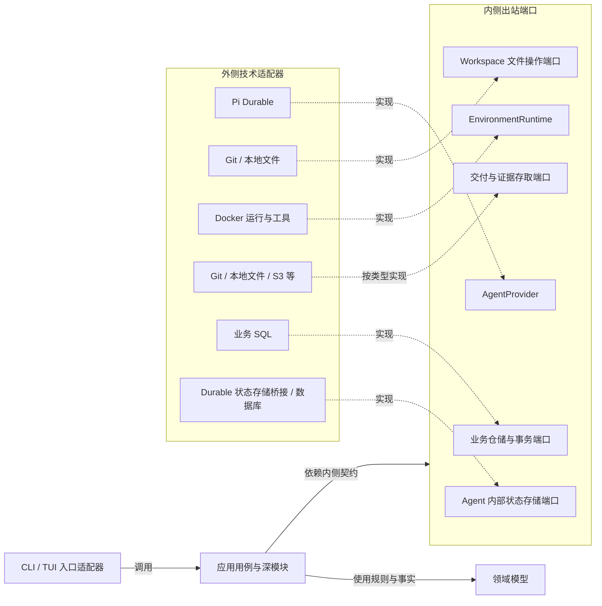

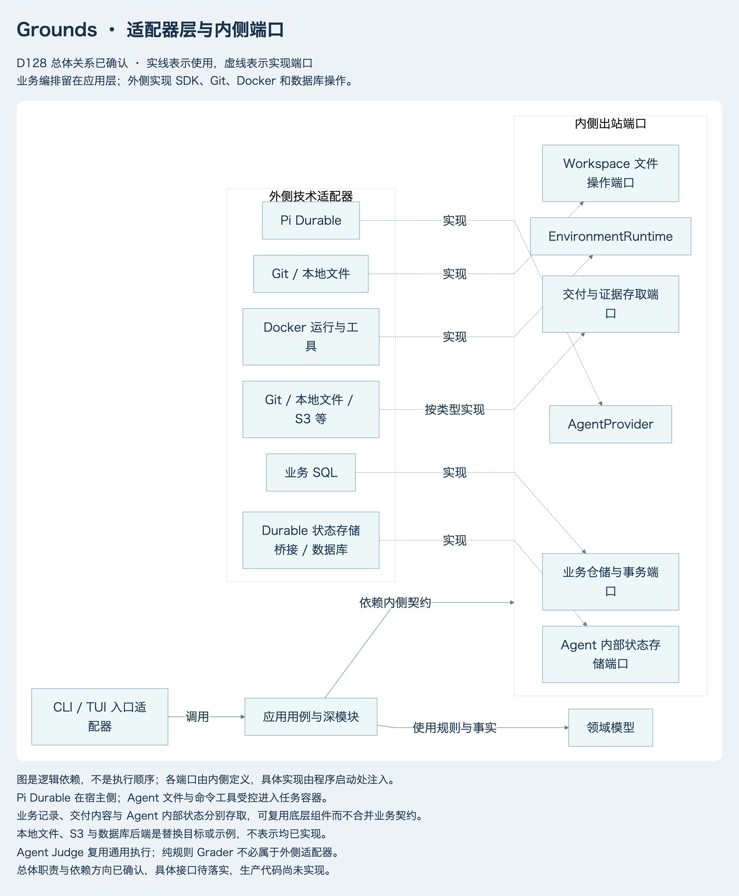

[Mermaid 源](../assets/adapter-layer-latest.mmd) · 图中实线表示使用，虚线表示实现端口；图是逻辑依赖而非执行顺序。交付存取及内部状态存储的不同后端属于设计目标或可替换示例，不表示本轮全部交付。

| 端口归属 / 能力 | 外侧适配器如何实现 | 必须隐藏或保留的边界 |
| --- | --- | --- |
| AgentExecutionService / AgentProvider | 一期 Pi Durable：启动、可核查的恢复与停止协作、公共事件转换、可获得原始记录 | SDK 类型、内部会话协议不进入领域；Provider 结束不等于归档完成，不直接改变 TaskRun 或 Grade。 |
| Workspace 管理 / 文件操作 | 复用既有 Git 缓存、基线、worktree 与本地文件机制，抽取必要技术边界 | 配置引用、文件空间身份和保留策略仍属内侧；不能为了适配器分层重写一套 Workspace 模型。 |
| Environment 治理 / EnvironmentRuntime | Docker 资源创建、查询、挂载、权限落实、暂停恢复与安全回收；容器文件与命令工具桥接 | 依据明确资源身份报告实际状态，不将连接失败转换成已停止；挂载不转移 Workspace 的生命周期所有权。 |
| 交付与证据存取 / 分类型端口 | Candidate 使用 Git 引用及所需元数据；Artifact / 轨迹通过本地文件、对象存储或可复用数据库能力保存 | 端口返回可读取的稳定身份与保存回执，不返回唯一有效的临时路径；Candidate 不继承 Artifact。按类型组织端口，不设计万能存储接口。 |
| 业务仓储与事务 | 沿用并迁移现有 SQL 基础设施，存取 TaskRun、AgentExecution、验收、GradingRecord 等业务事实 | 状态转换规则在领域 / 应用，适配器保证所声明的原子性和唯一性；业务数据库与外部 Git / 容器之间不能伪装成一个原子事务。 |
| Agent 内部状态存储 | 按 D72 优先桥接 Durable 已有存储契约，外侧接可选择的数据库后端 | 独立于 Artifact 与业务记录，不强制每执行一个数据库文件；按执行身份隔离，检查点不暴露给任务工具。后端交付顺序及真实兼容性需实现验证。 |

**宿主与容器的连接。** Pi Durable 在宿主侧运行，模型驱动的文件读写和命令调用经受控工具桥接进入本次环境实例。桥接只能使用已授权 Workspace 视图，不能回退到宿主默认文件 / 命令工具。可信 Workspace 管理准备本地仓库与目录属于资源治理，不意味着被测 Agent 有宿主文件权限。停止确认同时核对 Agent 宿主执行和任务工具，单侧结束不能冒充整个执行已停止。

**评分与类型扩展不按文件夹机械外移。** Agent Judge 构造评分任务、调用 TaskExecution 并解释结果属于 Grading 的应用策略；它复用同一个 Pi Durable 适配器，不另造 Judge 内核。纯规则 Grader 不涉及外部 I/O 时可直接是内侧规则实现；测试 Grader 调用受管环境端口。TaskType 的契约及业务差异保留在领域 / 应用组件，只有 Git 操作、格式协议等外部技术转换进入适配器。不能因为一个类实现接口就自动把它视为基础设施适配器。

**装配。** 程序启动处的组合根读取部署配置，创建具体适配器并注入应用服务。内侧不按 Docker、Pi 或数据库名称散布分支，不以全局服务定位器绕过依赖。多个存储端口可共享连接池、文件组件或底层字节存储，但不合并业务模型、授权边界与事务承诺。数据库凭据和存储连接参数只在配置 / 适配器边界处理，不作为 TaskRevision 材料或模型输入。

**实现检查。** 用伪适配器验证应用编排及恢复语义，用同一组端口契约测试验证具体适配器，包括请求防重、真实停止核对、归档失败、错误保真、会话隔离和容器工具文件可见范围。跨 Git / SQL / 文件保存时由内侧协调持久操作身份与恢复，适配器提供可核查结果。此处为测试目标，未执行后端集成测试；本次只有设计文档和图示更新。

#### D129–D137：目标模型 R1——已确认，待实现

> **R2 修订（D140，已确认）：** D129 的完成策略、`completion_basis`，以及 D133 的 pinned / follow 两种模式，已被 D140 取代。现行模型见[目标模型](0001-target-model.md)。

**状态与来源：** 2026-11-02，用户要求助手对领域层与应用层设计做评审，授权“按评审意见调整设计”，审阅修订稿后确认全部 D129–D137。受影响旧决策的原文保留为历史，其标题下注明被修订的部分，以本节和目标模型为准。结构、图示与不变量的完整说明见[目标模型](0001-target-model.md)，本节只记录选择、理由和放弃的方案。生产代码未改动。

| 决策 | 选择 | 理由 | 放弃的方案 |
| --- | --- | --- | --- |
| D129 完成策略 | TaskRun 发起时携带 `acceptance`（required / none）与 `on_unfinished`（wait / fail）。开发默认 required + wait，评测样本默认 none + fail。状态集合不变 | D110 与 D95 组合后，评测中未通过验收的被测交付会停在等待继续，评分无法开始；评测要的是对已交付内容打分 | 让 ExperimentExecution 每次手动结束 TaskRun：等于把策略散落在调用方；评测时把验收结论当作质量分：混淆了门槛与度量 |
| D130 三级检查 | 接收校验归 TaskType（确定性）；验收与评分统一为 GradingRecord，用途分 gate / measure；Grade 增加逐条结论形式；独立验收成为内置评价器 | 契约检查、验收记录与 GradingRecord 都在表达“依据标准对确切对象下结论并保留证据”，三套模型会重复并逐渐偏离 | 维持 D115 的“适配不强制”：会长期保留两套评价事实与执行链 |
| D131 评价者执行 | 验收者与 Agent Judge 都直接使用 AgentExecutionService，AgentExecution 记录发起方（TaskRun 或 GradingRecord）和角色 | 经 TaskExecution 运行 Judge 需要合成 Task，还要临时规定 Judge 任务不再验收以免递归；而验收与评分原本就走不同路径 | 让二者都经 TaskExecution：评分任务需要临时 TaskRevision，还要额外的禁止验收规则 |
| D132 Sandbox | 新增 Sandbox 聚合（Workspace + 实例 + 挂载 + 占用者 + 归属者）与 SandboxProvisioning 模块；归属者负责申请、暂停、释放，执行凭租约占用 | 顺序复用、等待暂停、准备受阻、终结回收都以 TaskRun 为单位，交给单次执行的服务管理会让两层都去碰资源；测试评分器也需要同样的协调 | 维持 D127：资源规则同时散落在 TaskExecution 与 AgentExecutionService |
| D133 环境要求解析 | TaskRevision 声明 `pinned` 或 `follow`（默认）；TaskRun 受理时解析并记录；Experiment 创建时形成环境解析表 | 固定版本会让镜像小修连带改 Task、评测项、快照和实验；改为记录解析结果，可追溯性不变 | 维持 D120 直接固定；或允许实验覆盖环境：违背 D79 |
| D134 共享版本机制 | Definition + 不可变 Revision 使用同一套仓储与发布逻辑，各自只定义内容 schema | 五组对称概念几乎没有各自的行为，分别实现只会复制代码 | 为每组单独建模与实现 |
| D135 TaskType 收敛 | 一期只内置 coding / working，用联合类型加版本化 schema；扩展能力推迟 | 一期只有两种类型，注册与插件框架没有使用者 | 按 D82 / D86 先建扩展框架 |
| D136 受理与驱动 | 请求账本、意图记录、核对循环、按需启动的本地宿主由三个模块共用；Agent 名额按宿主统一计数 | 三个模块是同一种“受理后后台推进”模式；D56 与 D127 对名额范围的表述矛盾 | 各模块自建；或引入通用工作流引擎 |
| D137 一期收缩 | Durable 状态只实现 SQLite；不做通用 Provider 能力矩阵 | 一期目标是三任务并发闭环 | 一期同时交付三种数据库后端 |

**验证计划：** 对每个聚合的不变量编写不依赖数据库与容器的领域测试；按目标模型第 7 节的两条流程编写应用层测试，使用伪适配器；评测样本流程覆盖“未通过验收的交付仍能被评分”和“基础设施失败不计作质量结论”。

#### D138：R1 独立评审后的补充——已确认，待实现

> **R2 修订（D140，已确认）：** EvalRun 的有状态记录、实例唯一绑定、`caller-ended` 失败类别、`gate_grader` 冻结，已被 D140 取代。现行模型见[目标模型](0001-target-model.md)。

**来源：** 2026-11-02，用户请独立评审 Agent 复查 R1，评审给出 22 条发现（结论 BLOCK）。助手逐条核对后认为全部成立，提出处理建议；其中四项需要业务取舍，经用户确认采纳。全部内容已并入[目标模型](0001-target-model.md)，本节只记录选择。

**需要业务取舍的四项：**

| 问题 | 选择 | 放弃的方案 |
| --- | --- | --- |
| 同一清单有多条结论相反的 gate 记录 | 每条 gate 记录必须完整覆盖全部条目，并绑定 TaskRevision、条目全集摘要、清单摘要和 GraderRevision；补验写新的完整记录，引用旧的已满足条目；TaskRun 采用绑定一致的最近一条完整记录；更早的相反记录只显示为 disputed | 沿用现有“存在 disputed 即阻止”：开发中修正验收错误后仍无法成功；允许任选一条通过记录：结论不可预测 |
| 一期 working 的 Workspace | 复用现有配置，以 Git 仓库为只读材料，再加一个可写输出目录；Git 以外的材料推迟 | 一期新建通用 Workspace 模型；或把 working 移出一期 |
| 交付清单由谁提交 | Agent 通过交付工具声明交付提案，归档后由 TaskExecution 以“执行 ID + proposal”为操作身份自动提交；开发中调用方可随时整体替换；没有提案即本轮未交付 | 按最新产物推断（违反 D43）；评测时要求外部调用方再提交一次（多一个环节，也多一种失败） |
| `fail` 策略下基础设施故障的去向 | 修订 D102：`failed` 表示“不再继续”，附必填失败类别；EvalRun 把 infrastructure 显示为执行错误 | 让基础设施故障留在进行中：评测批次会悬而不决 |

**直接补齐的规则：** 已解析环境带来源，并由 TaskExecution / Grading 校验；GraderRevision 声明环境要求，默认 `pinned`；一个实例至多绑定一个未释放的 Sandbox；逐条结论保留独立、对照、最终三段，协议阶段记在评价者执行上，并给出旧 Verification 的映射；取消意图登记后不再接受新执行、清单或 gate，晚到结果只记为历史；测试评分器以 CommandRun 作为受管操作；子流程完成事件在同一事务写入并由驱动可靠投递给父流程；ExperimentRun 成员键唯一，先登记成员再幂等发起；接收校验分为 valid / invalid / unavailable，TaskType 不做读写；`gate_grader` 在受理时冻结；成功结果必须带 `completion_basis`；暂停事实只由 Sandbox 记录，实例主阶段去掉“已暂停”；资源操作由负责归属者的应用用例发起；“租约”拆分为使用授权与带 fencing token 的占用租约；两张流程图补齐异步回执、失败分支和 gate 展开；SuiteSnapshot 明确为 Suite 的修订。

**文档：** D34、D79、D82、D83、D100、D102、D125 增加 R1 修订标注。

#### D139：R1 第二轮复审后的补充——已确认，待实现

> **R2 修订（D140，已确认）：** 推进槽与沙箱句柄已被 D140 删除；CommandRun 改为 GradingRecord 内部的命令步骤（D143）。现行模型见[目标模型](0001-target-model.md)。

**来源：** 2026-11-02 第二轮独立复审确认上一轮 22 条中 21 条已闭合，另提出 12 条新发现（结论 BLOCK）。助手核对后全部成立；其中两项业务取舍经用户选择，其余为直接补齐。内容已并入[目标模型](0001-target-model.md)。

| 问题 | 选择 |
| --- | --- |
| 有效交付已归档，但提供交付的执行随后被判失败 | **用户选择：以交付为准。** 交付被接收且回执齐全即成功，执行失败只保留为历史；`agent-execution` 仅用于“执行失败且没有可接收交付” |
| 交付提案的来源 | **用户选择：两种都保留（与 D41 一致）。** 工具显式声明优先，否则由 TaskType 按输出契约从归档输出中确定性提取；两种来源共用“执行 ID + proposal”操作身份 |
| gate 补验可能引用基于旧轨迹的结论 | gate 绑定加入 GraderRevision 声明的全部目标与材料的确切身份；只有完整绑定相同的记录才能被引用和采用 |
| 等待继续时“提交清单”与“继续”并发 | TaskRun 增加推进槽：执行预留、清单处理、gate 都要先以 CAS 取得，失败方返回冲突与当前状态；同一 TaskRun 同时只有一次 gate |
| CommandRun 在宿主崩溃后没有退出结果 | 以“退出结果未知”终结，GradingRecord 记为评分器故障，不自动重跑；重试需新建 GradingRecord；只有适配器能证明可安全续跑时才恢复原身份 |
| “使用授权”的能力范围不清、安全承诺过强 | 改为不透明的“沙箱句柄”，一期不承担安全承诺；归属者用例可以凭它暂停、恢复、释放，受管操作只能凭它申请占用租约 |
| 文档与图示 | D37 修订提示去掉“已暂停”；D41、D43 增加修订提示；第 3 节旧收敛版改名为历史版；评测序列图区分准备失败、回执不可用（阻塞核对）与正常终结，并只在确认无占用后释放；领域图加入环境要求节点；模块图把 CommandRun 画为 Grading 拥有的运行事实 |

#### D140：领域层精简与 refinement 尝试链（目标模型 R2）——已确认，待实现

> **D143 修订：** 下文“CommandRun 与 AgentExecution 合并为 Operation”已被 D143 取代。

> **D141 修正：** 下文“工作结论 = 最近一份交付上……”的说法已收窄：工作结论只针对单个已交付的 TaskRun，整棵 refinement 树不下总结论。

**来源：** 2026-11-02，用户请一个 Agent 挑战领域层设计。该 Agent 盘点了 R1 的约 40 个具名概念和 8 个状态机，逐个做了反事实检验，提出三个替代方案，并分开标注“确定更好”与“品味偏好”。助手核对后建议全部采纳，用户确认。完整模型见[目标模型](0001-target-model.md)。

| 修改 | 理由 | 放弃的方案 |
| --- | --- | --- |
| **TaskRun 只表达“这一轮是否交付”**：五个状态（待开始、进行中、已交付、失败、已取消），去掉完成策略、“等待继续”、推进槽和两种成功。验收不通过时，发起 refines 上一轮的新 TaskRun，可接手上一轮保留的 Sandbox。工作结论 = 最近一份交付上最近一条完整 gate 记录的查询结果 | 两轮评审中近一半问题集中在完成策略区域。交付与验收拆成两个正交的事实后，相关竞态随之消失；这一做法也与现有 DevRun refinement（`refines_candidate_id`）一致 | 保留 R1 的完成策略（即同一个 TaskRun 内反复修改） |
| **CommandRun 与 AgentExecution 合并为 Operation**（kind 为 agent 或 command） | 二者的停止确认、身份和租约规则完全相同 | 两个聚合各自实现 |
| **EnvironmentInstance 并入 Sandbox** | 一期不做跨 Sandbox 借用运行资源；合并后，跨聚合唯一约束和重复的暂停事实一并消失 | 保留独立实例；需要借用时再拆出来 |
| **删除沙箱句柄**：直接用 Sandbox ID，生命周期操作只能由负责归属者的用例发起 | 句柄本身没有独立语义 | — |
| **EvalRun 降为 ExperimentRun 内的不可变成员记录**：采用规则与完整性改为查询 | 这些可变状态都能从 GradingRecord 推导出来 | 有状态的 EvalRun |
| **交付提案与交付清单合并为一个 Manifest 值**：origin 为 tool、contract 或 caller，status 为 pending-receipt、accepted、rejected 或 unavailable | 两者只是同一份引用清单的两个阶段 | 两个名词 |
| **环境要求简化**：TaskRevision 引用 EnvironmentDefinition，受理时取最新修订，或由调用方显式指定、或从接手的 Sandbox 继承；GraderRevision 直接固定 EnvironmentRevision | 去掉 pinned / follow 两种模式和解析来源证明；严格复现靠显式指定 | R1 的两种模式 |
| **TaskType 降为 TaskRevision 上的 `kind` 与 schema 版本** | 一期只有内置类型，规则随 Grounds 发布 | 独立实体 |

**保持不变**（反事实检验表明这些已是较优解）：gate / measure 统一为 GradingRecord，以及其绑定与“最近一条完整记录”采用规则；评价者执行不产生 TaskRun；先归档、再判成功；显式失败类别；取消须确认停止；共享版本机制；复用现有 Workspace；受理与驱动机制。

**结果：** 具名概念从约 40 个降到约 27 个，状态机从约 8 个降到 5 个，聚合为 8 个，跨聚合规则从 4 条降到 2 条。

**代价：** 开发场景的 TaskRun 记录会变多，CLI 需要提供“工作结论”视图；必须实现可靠的 Sandbox 移交（原归属者已终结、无占用、只能移交给 refine 它的 TaskRun、同一个 Sandbox 只有一个接收方）；将来如需跨 Sandbox 借用运行资源，需再把它拆出来。

#### D141：R2 复审后的补充——已确认，待实现

> **D143 修订：** 表中“Operation 的合法组合”一项已随 D143 失效，联合类型不再存在。

> **D142 修订：** 表中“工作结论只对单个 TaskRun 定义、整棵树不下结论”改为：单个 TaskRun 的结论称为“验收结论”；一项开发工作的工作结论取其当前工作头的验收结论。

**来源：** 2026-11-02，独立复审 R2（结论 BLOCK）：上一轮 12 条均已解决或因概念删除不再适用，新发现 14 条。助手逐条核对后认为全部成立。这些都是规则补齐，不改变 D140 的业务取舍，按用户既定授权并入[目标模型](0001-target-model.md)。

| 问题 | 处理 |
| --- | --- |
| 工作结论的采用对象不唯一 | 工作结论只对单个已交付的 TaskRun 定义：在 Manifest 摘要与验收条目摘要一致的完整 gate 记录中，按稳定请求顺序取最近一条，不论评分器版本。整棵 refinement 树不下总结论，也不按创建时间推断当前分支；CLI 展示整棵树和各节点的结论 |
| Sandbox 移交、释放、到期清理之间的竞态 | Sandbox 增加生命周期操作预留：先以 CAS 登记预留，再做外部 I/O，最后核对完成；崩溃后沿原预留继续。做法与现有 Workspace 清理的 `cleanup_operation_id` 一致 |
| Manifest 被拒收且 worker 失败时，失败类别有歧义 | 写成互斥的判定顺序：accepted → 已交付；rejected → agent-output；无 Manifest 且 worker 失败 → agent-execution；其余 → agent-output |
| 准备受阻的 Sandbox 无法按“恢复容器”的步骤移交 | 移交分为“预留 → 改归属 → 按当前阶段继续”；准备受阻的继续准备，已暂停的恢复并核对 |
| caller 提供的清单可能引用其他 Task 的 Candidate | 清单只能引用同一 Task 下 TaskRun 的交付；一期不支持跨 Task 采用 |
| 文档承诺 gate 可以单独取消，却没有取消契约 | GradingRecord 增加取消意图和“已取消”状态，Grading 增加取消入口；批次取消也走这个入口 |
| 显式环境版本、Sandbox 继承和新 TaskRevision 组合时没有优先级 | 接手 Sandbox 时一律继承；显式版本不一致，或新修订引用了另一个环境定义，都不允许接手 |
| Operation 字段组合可能不合法 | 写明合法组合：TaskRun 的 worker 只能是 agent；评价者可以是 agent 或 command；两类各自的必填与禁止字段 |
| “评分未开展”没有记录位置 | 由成员 TaskRun 状态、批次取消意图和评分记录的缺失推导，不另写事实 |
| refine 一个尚未终结的 TaskRun | 受理直接拒绝 |
| 文档与图示 | 补齐 D7、D41、D43、D49、D50、D52、D60–D66、D70、D84、D85、D94、D117、D125、D127 的 R2 标注；修正“8 个聚合”的计数，以及正文中残留的 EvalRun；应用图增加 command Operation 节点；开发序列图改为由 TaskExecution 查询工作结论；Sandbox 状态图标出预留 |

#### D142：当前工作头（Work 聚合）——已确认，待实现

**来源：** 2026-11-02。D141 规定工作结论只对单个 TaskRun 定义、整棵 refinement 树不下总结论；用户明确希望有“当前工作头”的概念。

**选择：** 新增一个小聚合 **Work**，表示一项开发工作：同一 Task 下的一棵 refinement 树，加一个当前工作头指针，并记录只追加的工作头变更历史。

- **开发入口**：开始工作（创建 Work 和第一个 TaskRun）；继续（refine 当前工作头并移动工作头，默认接手它的 Sandbox）；选择工作头（显式切换到树上任意节点）；结束工作（释放该 Work 下所有保留的 Sandbox）。
- **工作结论**：取当前工作头的验收结论。工作头只能显式移动，不按创建时间或验收结果自动推断。
- **并发**：移动工作头时按版本比较并带上期望的旧工作头，两个同时到达的“继续”只有一个成功。TaskRun 受理与工作头更新在同一个账本事务里提交。
- **范围**：评测样本不属于任何 Work。

**为什么不放在别处：**

| 方案 | 不采用的理由 |
| --- | --- |
| 放在 Task 上 | Task 是版本化定义，不应携带运行期的可变状态；同一 Task 也可能有多项并行的开发工作 |
| 放在根 TaskRun 上 | TaskRun 终结后不可修改，而工作头需要在终结后继续移动 |
| 按创建时间推断 | D141 复审已指出会得出错误结论，例如较早的交付后来通过了验收 |

**代价：** 运行聚合从 8 个增加到 9 个，增加一条“TaskRun 受理与工作头同事务提交”的规则。现有 Issue 下的 DevRun 序列可以迁移为一个 Work。完整模型见[目标模型](0001-target-model.md)。

#### D143：执行按实际生命周期建模——AgentExecution 聚合、命令步骤与占用者契约——已确认，待实现

**来源：** 2026-11-02，用户质疑 D140 的 Operation 合并是否合理。助手逐项比较了 Agent 执行与命令运行的生命周期，并对照现有代码，建议改为下述方案，用户确认。

**分析：**

- **两者真正共有的规则只有三条**：持久身份与防重；占用 Sandbox（租约 + fencing token）；停止确认与崩溃后核对。后两条本来就由 Sandbox 守护，Operation 自身只剩身份和阶段，是个浅抽象。
- **其余都是 Agent 专属**：宿主侧 Durable 进程与工具桥接（D71）、内部状态存储（D70 / D72）、轨迹与交付声明的归档、归档受阻只补归档、恢复原会话（D74）、工具重试清单（D75）、Agent 名额、评价协议阶段。合在一起，不变量就要按 kind 分支，还得靠 D141 的合法组合表兜底。
- **命令运行没有独立的生命**：它只属于一条评分记录，不可恢复，不会被单独查询或引用。现有代码也把它建模为子记录：`verification-run.ts` 中的 `RunCommand`、`eval-process.ts` 中的 `ProcessResult`。
- **名称冲突**：代码中 `operation_id`、`runtime_operation`、`cleanup_operation_id` 已经用 “operation” 表示幂等操作身份。

**选择：**

| 方案 | 结论 |
| --- | --- |
| A：Operation 合并（D140） | 不采用。浅抽象，不变量按类型分支，并与现有术语冲突 |
| B：AgentExecution 与 CommandRun 两个平级聚合（D138） | 不采用。命令没有独立生命，做成聚合会把“命令结束后评分才能完成”变成跨聚合规则 |
| **C：AgentExecution 聚合 + GradingRecord 内部的命令步骤 + Sandbox 定义的占用者契约** | **采用**。共享的是“角色”，不是实体：两者各自实现契约（出示当前 fencing token、报告停止事实、可被核对），租约记录带类型的占用者引用 |

**结果：** 运行聚合仍为 9 个（AgentExecution 替换 Operation）；不再有按类型分支的不变量和合法组合表；评分完成与命令结束在同一聚合内原子成立。

**代价：** GradingRecord 稍大，命令运行期间的状态更新会落到它的版本上；评价者有两种形态（外部聚合与内部实体）。这种不对称有业务依据：只有 Agent 执行具有独立生命与恢复能力。将来若 TaskRun 也需要确定性的命令步骤，可以复用同一内部实体类型，有独立查询或恢复需求时再升级为聚合。完整模型见[目标模型](0001-target-model.md)。

## 3. 核心领域概念

**领域用语：** Task 统一称为“任务”；“题目”仅用于具体评测场景的口语描述。评分可依据标准或偏好，参考答案不是必需字段。

**最新任务模型修订（D89 / D90）：** 编码任务纳入通用 TaskType / Task，不再另设与 Task 并行的 Issue 实体；Task 是稳定身份，TaskRevision 是不可变定义版本，TaskRun 固定引用确切修订。下文历史图中的 Task 版本引用按此理解，旧 Issue 名称仅用于现状证据、历史方案或兼容说明。

**D48 命名修订（已确认）：** Grading 是应用层评分用例接口，GradingRecord 是领域评分记录，Grade 是记录内的结果值。历史决策中的记录旧称 Grading 按本条理解；既定事实模型与重评规则不变。

**当前修订提示：** 下列文字按已确认的 D20 Candidate / Artifact 并列关系及 D21 Trajectory 独立评分关系组织，具体接口仍待对齐；旧图中的统一 Artifact 关系仅作为历史方案，不得与本轮方案混用。

以下是职责约定，尚不是已发布的 TypeScript 接口或 JSON schema。最终名称、字段和版本迁移须在实现时落实到现有机器契约。

### D128 历史收敛版：已由目标模型 R1 取代

> **R1 提示：** 本节反映 D128 时的状态。D129–D137 已确认，凡与[目标模型](0001-target-model.md) 冲突之处（完成策略、验收记录、评价者执行、Sandbox、环境要求、Verification 模块等）以目标模型为准；其余内容继续有效。

本节按 D1–D126 的已确认决策与 D127–D128 的设计补充（D117 模块关系、D118 命名及 D119 环境 / Workspace 拆分已确认，详细接口仍待细化）汇总当前已确认的业务边界，替代后文历史图作为开发阅读入口。关系图是对已定概念的收敛表达，不新增默认自动编排、快照、预算或多内核能力；状态图与迁移方式是供 review 的实现设计草案，不等于用户已批准完整枚举、基数与全部异常转换。代码尚未按此方案实现。

**D120 / D121 当前配置引用：** TaskRevision 固定引用已有 Workspace 配置版本及 EnvironmentRevision；TaskExecution 读取配置并协调实例准备。EnvironmentDefinition 是稳定身份，EnvironmentRevision 是不可变配置，EnvironmentInstance 是实际运行资源；Image 是配置引用的构建输入。历史 EnvironmentSpec 名称按 D121 理解。

**本轮补充：** D98 明确等待时保留环境；D113 细化为确认本轮 Agent 与工具停止使用资源后暂停本任务的执行容器，保留 Workspace 和依赖服务，不自动暂停依赖服务，继续前检查可用性。实际暂停与执行停止分别核对。D99 已确认 AgentDefinition / GraderDefinition 为稳定身份，AgentRevision / GraderRevision 为不可变修订。当前图采用新名；历史正文与旧图中的 AgentSpec / GraderSpec 按对应 Revision 理解，Grader 能力接口不变。

**D100 关系确认：** 每条 EvalRun 关联一个被测 TaskRun 和多次评分记录；Judge 自己的任务尝试由评分记录关联，不计为被测样本。TaskRun 交付成功与 EvalRun 评分完整性分别记录，补评不重跑任务。

**D102 / D103 补充：** TaskRun 的 succeeded / failed / cancelled 三种终态已确认；逐项契约完成情况必须可查询，条目、证据和检查结论的通用模型为当前建议，不能将 Agent 自检直接作为验收通过。

**D110 验收汇总确认：** 一期所有验收条件均必须通过，且约定交付与轨迹完成归档，TaskRun 才可成功；不通过、无法判定、验收器故障分别记录，阻止成功但不自动终结任务。附加产物是否必交与验收条目是否必须满足是不同问题。

**D111 重新验收确认：** 交付或契约变化时全部重验；两者未变时可补验尚未通过项并引用仍有效的通过依据，历史记录不覆盖。一期不做差异影响分析。

**D115 验收入口确认：** 保留一次独立验收 Agent 自主核验全部条目并提交完整报告的使用方式；共享通用执行、隔离与存取能力，Grader 适配不是一期必做项，不以统一接口为由增加用户配置、实验依赖或丢失逐项证据。

#### 最新纯领域图：D116 完整交付清单确认后


图分五块以便手机阅读，同名节点在各块代表同一概念，不是多份实体；箭头表达关联，不表达调用顺序或继承。图仅包含领域身份、版本、运行事实和值对象，不要求每个框独立建表。Grader 是评分能力接口，Execution / Grading 是应用层接口，均不作为领域实体画入。

本次重点修订：D116 明确完整交付清单及其历史选择；D115 保留独立 Agent 整轮验收入口，不强制适配 Grader；D107 移除 Requirement / RequirementRevision；D109 复用现有 Workspace 配置版本、实例与组装能力，D108 内嵌 WorkspaceSpec 建议不采纳。契约属于 TaskRevision；验收记录针对确切 Candidate / Artifact 或组合；TaskRun 关联采用的验收依据。验收记录与 GradingRecord 的通用化或复用尚待设计，图中分开展示业务职责，不要求实现两套执行引擎。TaskRun 的 succeeded / failed / cancelled 终态已确认，完整状态转换另见下方状态图。

**01 · 任务、版本与执行**

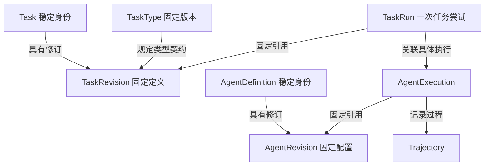

TaskRun 有独立状态；一次尝试可包含多次具体执行。任务目标、背景、约束和交付要求由 TaskRevision 固定，较长文档可作为输入材料引用。

[Mermaid 源](../assets/domain-latest-task.mmd) · [分图 JPG](../assets/domain-latest-task.jpg)

**02 · 环境与文件空间**

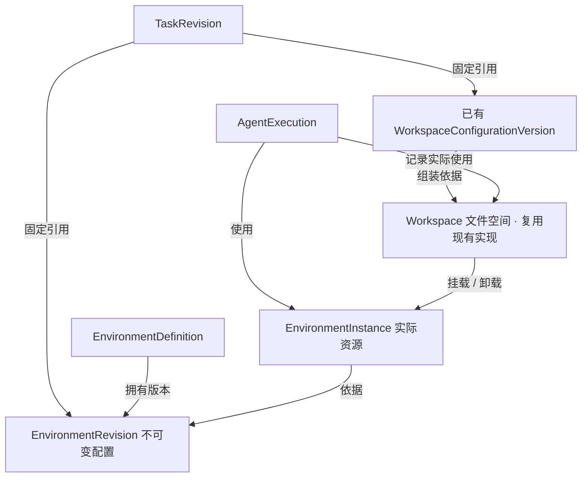

环境属于通用任务执行，实验不直接拥有环境。D109 保留现有配置版本、实例、基线与开发 worktree，不新增 WorkspaceSpec。TaskRevision 固定配置引用的接入仍待实现；当前源码仍绑定 Issue / DevRun。Workspace 独立保留，确认停止使用后才能卸载；新任务的等待暂停策略尚待接通。

[Mermaid 源](../assets/domain-latest-environment.mmd) · [分图 JPG](../assets/domain-latest-environment.jpg)

**03 · 交付与逐项契约验收**

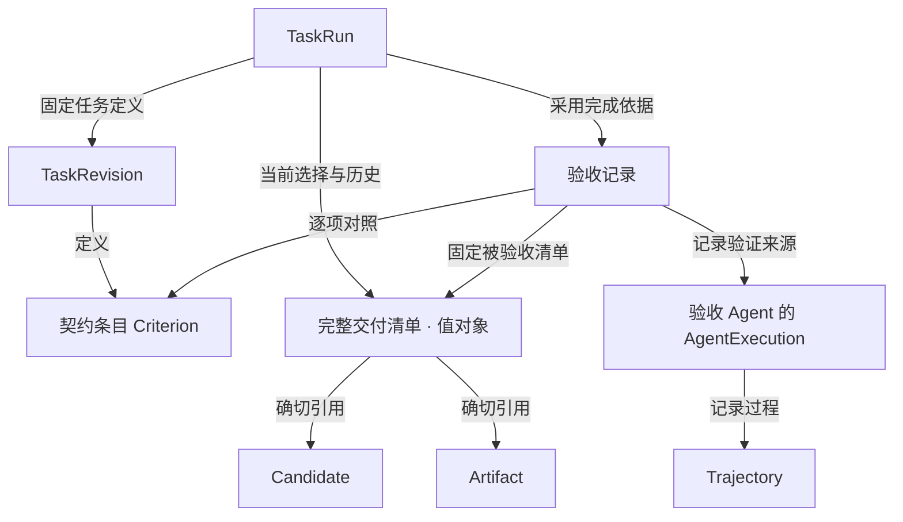

D116：每次正式交付提交完整引用清单，修正保留历史；成功时固定采用的清单和验收依据。验收由独立 Agent 完成，不强制适配 Grader。所有验收条件必须通过，并满足约定归档条件；验收执行不混作被测 Agent 的表现。

[Mermaid 源](../assets/domain-latest-acceptance.mmd) · [分图 JPG](../assets/domain-latest-acceptance.jpg)

**04 · 评测定义与固定方案**

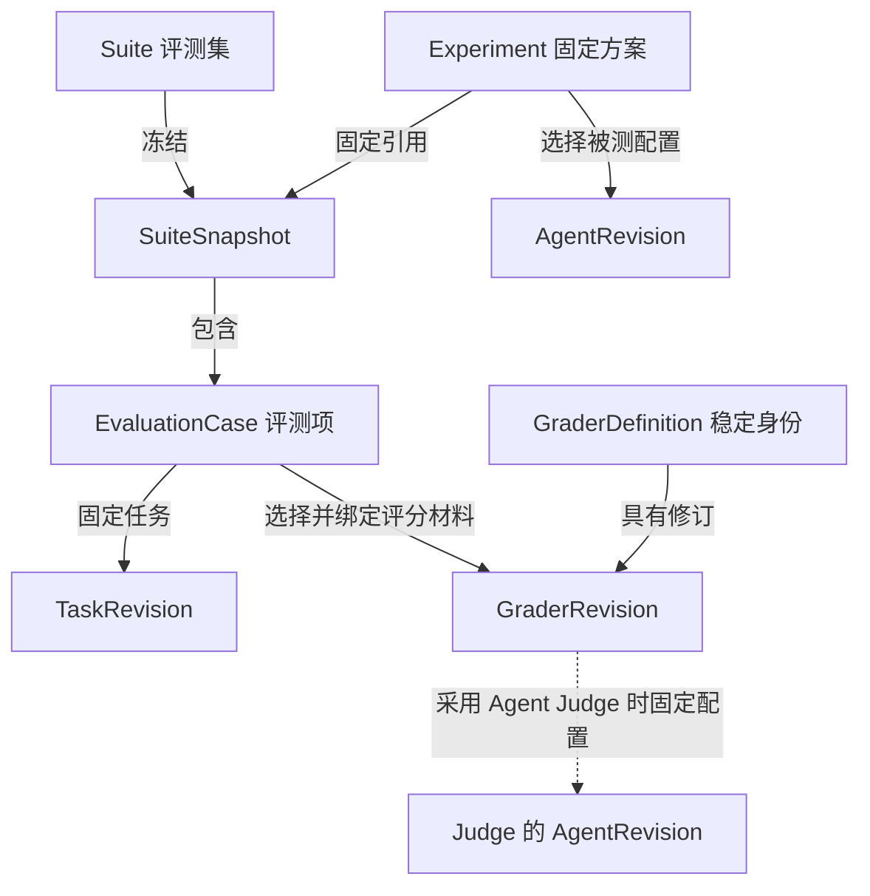

EvaluationCase 组合任务与评分要求，Task 不包含 Grader。评分材料可以是标准、偏好、参考答案或其他证据；参考答案不是必需项。

[Mermaid 源](../assets/domain-latest-plan.mmd) · [分图 JPG](../assets/domain-latest-plan.jpg)

**05 · 评测运行与评分事实**

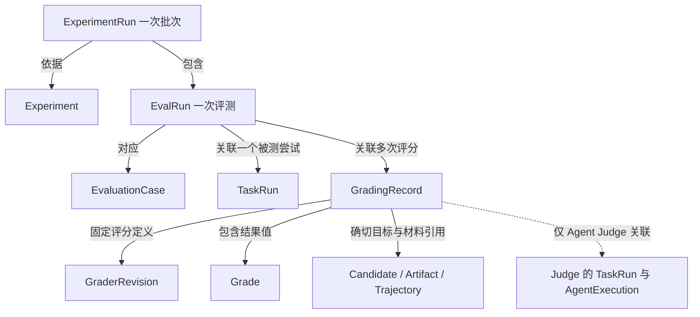

目标框是三种并列对象的简写，不是新增实体。Judge 使用同一套 TaskRun / AgentExecution，不能计作被测样本。独立任务和独立评分不要求存在实验。

[Mermaid 源](../assets/domain-latest-evaluation.mmd) · [分图 JPG](../assets/domain-latest-evaluation.jpg)

**仍待细化：** 验收记录的通用名称、它与 GradingRecord 的复用关系、冲突处理以及聚合 / 事务边界。图中的关联不提前确定这些实现选择。

#### 应用分工参考：此前的跨层关系图

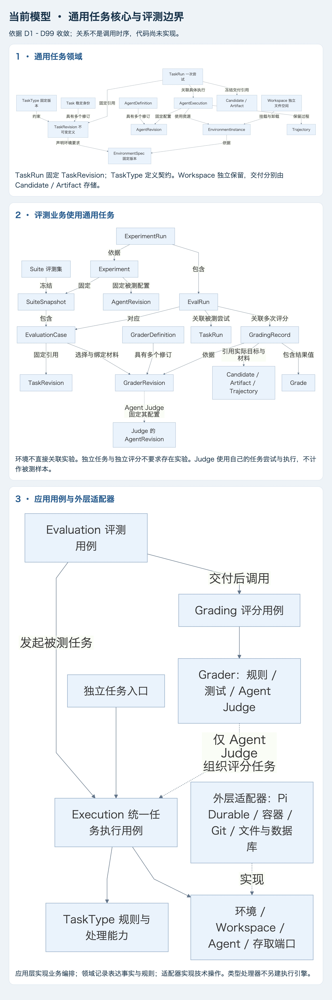

**通用任务领域**

```mermaid
flowchart TB
  TYPE[TaskType 固定版本] -->|约束| REV[TaskRevision 不可变定义]
  TASK[Task 稳定身份] -->|具有多个修订| REV
  REV -->|声明环境要求| SPEC[EnvironmentSpec 固定版本]
  RUN[TaskRun 一次尝试] -->|固定引用| REV
  RUN -->|关联具体执行| EX[AgentExecution]
  AD[AgentDefinition] -->|具有多个修订| AGENT[AgentRevision]
  EX -->|固定配置| AGENT
  EX -->|使用资源| ENV[EnvironmentInstance]
  ENV -->|依据| SPEC
  WS[Workspace 独立文件空间] -->|挂载与卸载| ENV
  EX -->|保留过程| TRACE[Trajectory]
  RUN -->|冻结交付引用| OUT[Candidate / Artifact]
```

**评测关联**

```mermaid
flowchart TB
  SU[Suite 评测集] -->|冻结| SNAP[SuiteSnapshot]
  PLAN[Experiment] -->|固定| SNAP
  PLAN -->|固定被测配置| A[AgentRevision]
  SNAP -->|包含| CASE[EvaluationCase]
  CASE -->|固定引用| TASK[TaskRevision]
  GD[GraderDefinition] -->|具有多个修订| GS[GraderRevision]
  CASE -->|选择与绑定材料| GS
  GS -.->|Agent Judge 固定其配置| JA[Judge 的 AgentRevision]
  B[ExperimentRun] -->|依据| PLAN
  B -->|包含| E[EvalRun]
  E -->|对应| CASE
  E -->|关联被测尝试| R[TaskRun]
  E -->|关联多次评分| G[GradingRecord]
  G -->|依据| GS
  G -->|引用实际目标与材料| OUT[Candidate / Artifact / Trajectory]
  G -->|包含结果值| V[Grade]
```

**应用与适配边界**

```mermaid
flowchart TB
  EV[ExperimentExecution 评测用例] -->|发起被测任务| EX[Execution 统一任务执行用例]
  CLI[独立任务入口] --> EX
  EV -->|交付后调用| G[Grading 评分用例]
  G --> GR[Grader：规则 / 测试 / Agent Judge]
  GR -.->|仅 Agent Judge 组织评分任务| EX
  EX --> TYPE[TaskType 规则与处理能力]
  EX --> PORT[环境 / Workspace / Agent / 存取端口]
  AD[外层适配器：Pi Durable / 容器 / Git / 文件与数据库] -.->|实现| PORT
```

关系说明：Task 是稳定身份，TaskRevision 固定类型版本及具体内容，TaskRun 固定修订并关联一次或多次 AgentExecution。AgentRevision 在实际执行上固定；Workspace 与环境实例独立治理，不由实验持有。图中的 Candidate / Artifact 是并列交付类型，不将 Candidate 继承为 Artifact；Trajectory 保存过程，可独立评价。

EvalRun 关联被测 TaskRun 及多次评分，不能自己再维护一套“做题尝试”。任务成功交付后仍可能有评分正在进行，所以 TaskRun 成功不等于 EvalRun / ExperimentRun 完成；默认 5 的评测任务名额覆盖本次任务的执行与评分活动，不能在被测 TaskRun 成功时一律提前释放。Agent 名额默认 20，被测与 Judge 共用计数，等待且确认无活动工作时按 D97 处理。

GradingRecord 固定 GraderRevision、目标与实际材料，并在使用 Agent Judge 时关联其独立 TaskRun / AgentExecution；Judge 尝试不计作被测样本。规则评分无需创建 AgentExecution。图为可读性省略该组回指及 TaskType 处理实现的端口细节；独立执行 / 评分仍不要求 Experiment 存在。D107 已移除独立 Requirement / RequirementRevision，需求内容由任务定义和固定输入材料承接。

Execution 仍是一套统一应用能力。本节不因为同时存在 TaskRun 与 AgentExecution，就强制拆成两个公开调度服务；内部可以分职责推进尝试和具体执行。调用方表明发起、继续或恢复意图，服务负责校验、资源协调、保存与防重，不让调用方拼装容器和存储步骤。

#### 状态图：TaskRun 六状态已确认，AgentExecution 阶段草图待细化

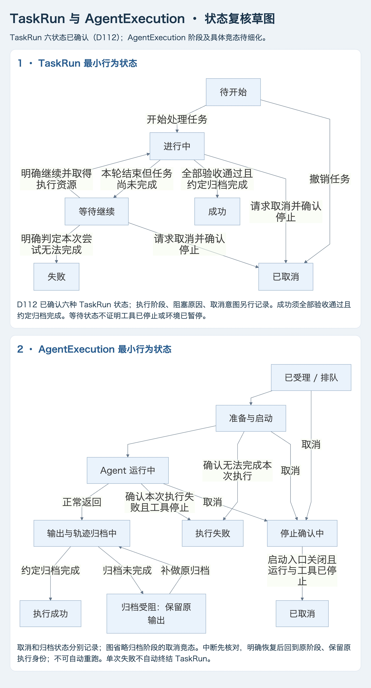

**TaskRun**

```mermaid
flowchart TB
  Q[待开始] -->|开始处理任务| A[进行中]
  A -->|本轮结束但任务尚未完成| W[等待继续]
  W -->|明确继续并取得执行资源| A
  A -->|全部验收通过且约定归档完成| S[成功]
  W -->|明确判定本次尝试无法完成| F[失败]
  Q -->|撤销任务| X[已取消]
  A -->|请求取消并确认停止| X
  W -->|请求取消并确认停止| X
```

**AgentExecution**

```mermaid
flowchart TB
  Q[已受理 / 排队] --> P[准备与启动]
  P --> R[Agent 运行中]
  R -->|正常返回| A[输出与轨迹归档中]
  A -->|约定归档完成| S[执行成功]
  P -->|确认无法完成本次执行| F[执行失败]
  R -->|确认本次执行失败且工具停止| F
  A -->|归档未完成| B[归档受阻：保留原输出]
  B -->|补做原归档| A
  Q -->|取消| C[停止确认中]
  P -->|取消| C
  R -->|取消| C
  C -->|启动入口关闭且运行与工具已停止| X[已取消]
```

TaskRun 的六种业务状态按 D112 已确认；执行阶段、阻塞原因、取消意图和归档完整性单独表达。AgentExecution 图仍为阶段视图，不要求按图逐个建立数据库状态。统一状态模型必须保留以下区分：

| 场景 | 必须保持的结果 |
| --- | --- |
| 一个 Agent 已正常返回，归档失败 | 原执行保留原输出，停在归档未完成 / 受阻；补归档，不启动新 Agent；TaskRun 不报成功。 |
| 某次执行已确认失败 | 该执行失败事实保留，TaskRun 等待调用方决定继续或结束；不是自动重做。 |
| 受管进程 / 工具是否停止不明 | 保留核对中及原占用；不能按无活动等待释放 Agent 名额、卸载或把资源交给替代执行。 |
| 宿主重启、可恢复中断 | 先核对，再由调用方明确恢复；保留原 AgentExecution / TaskRun 身份；受阻是原阶段上的信息，不伪装成永久失败再创建替代执行。 |
| 明确新增一次执行继续任务 | 同一非终结 TaskRun 下新 AgentExecution；等待继续重新排队，合法性和资源条件需检查。 |
| 明确重做已经结束的任务尝试 | 创建新 TaskRun，关联明确的 TaskRevision；不重开旧终态。 |
| 收到取消请求 | 记录取消意图并阻止后续启动，确认工具停止后才是已取消 / 已结束。取消与成功并发，以已确认的终结事实处理；不能事后覆盖已成功结果。 |
| 已取消但部分轨迹归档失败 | 运行停止事实与归档缺失分别保存；取消不等于完整归档，仍保留可取得证据。图省略该正交组合，实施时不能丢掉。 |
| TaskRun 已成功、某个 Grader 出错 | TaskRun 仍成功交付；GradingRecord 记录评分故障，EvalRun 显示评分缺失，不记零分。 |
| TaskRun 已终结，但资源清理失败 | 不回写任务质量或假称资源已释放，单独保留资源清理状态和后续处理依据。 |

TaskRun 图已按 D102 区分 succeeded / failed / cancelled 三种已确认终态。取消意图、停止观测、归档完整性及错误原因不应被挤进一个 success 布尔值，也不应为所有组合制造大量枚举。D112 确认六种 TaskRun 状态及阶段、阻塞原因另行表达；具体字段和竞态处理仍待实施设计。D103 补充逐项契约完成情况，不能用总体状态代替条目证据。

#### 旧模型迁移对应：建议顺序，尚未执行

| 现有入口或模型 | 目标模型 | 迁移必须保留的含义 |
| --- | --- | --- |
| Requirement / RequirementRevision | 目标模型移除独立实体，需求内容归入任务定义或固定输入材料 | 按 D107 保留历史版本内容、来源及意图追溯依据；另行实现兼容读取和旧入口退役，不直接删除数据。 |
| Issue 的结构与校验规则 | 编码 TaskType 及其处理能力 | 仓库、目标、约束、基线与 Candidate 关联规则保留；不复制一套可独立修改的 Issue 和 Task。 |
| Issue / IssueRevision 具体记录 | Task / TaskRevision | 稳定身份、前后修订、需求版本引用与旧 ID 可追溯；新核心不再并列一个独立 Issue 实体。 |
| DevRun | 编码 TaskRun + 特有事实 | open / submitted / abandoned 与新状态不能按名字直译；核对实际交付、归档和来源事实。refinement 与基线信息保留。 |
| 现有 TaskDraft / EvalTask | EvaluationCase 的来源 | 当前包含 Issue / QA 引用和 graders，不能直接迁为通用 Task。先拆任务定义与评分绑定。 |
| QA 定义 | 相应 TaskType / TaskRevision + 评分材料绑定 | 公开问题与材料进入任务，参考答案和隐藏标准按权限保留在评分输入；不把整份旧 QA 结构暴露给被测 Agent。 |
| 现有 EvalRun / experiment 等评测记录 | Experiment / ExperimentRun / EvalRun，关联 TaskRun | 显式新批次有身份；无法证明旧批次边界时保留来源，不伪造历史批次。旧做题与重评记录分开映射。 |
| 评测 execution、Provider 会话与容器 RouteExecution | 按职责拆为 GradingRecord、AgentExecution、环境事实 | 现有 evaluation.execution 是评分执行记录，不能因同名直接复制成 AgentExecution；有实际受管证据才映射 Agent 执行，容器运行不等于 Agent 会话。 |
| Candidate / Git 归档 | 保留 Candidate，关联新任务修订与尝试 | 不重新提交制造新候选，不丢原 commit / tree / archive binding，旧关联可解析；校验先于迁移切换。 |
| QAArtifact 及附件 | Artifact 及统一存取适配 | 保存已有正文、引用、附件内容和来源；不为迁移虚构轨迹覆盖。 |
| Workspace 配置版本、CodeWorkspaceInstance 与 CodeWorkspaceRoute | 按 D109 复用现有模型与准备、缓存、清理机制，接入通用任务 | 不复制 WorkspaceDefinition / Revision 新体系，不实施 D108；迁移 Issue / DevRun 绑定时保留版本、基线、准入与资源归属。 |
| 评测环境与代码路线环境 | 单一环境定义、实例与 Workspace 治理 | 保留资源所有权、占用、未知状态处理、固定材料和归档；按 D114 不设计运行中旧 DevRun 的资源接管。 |

对应源码依据：[domain.ts](../../typescript/src/domain.ts)、[DevRun 生命周期](../../typescript/src/devrun-lifecycle.ts)、[evaluation.ts](../../typescript/src/evaluation.ts)、[QA 定义](../../typescript/src/eval-qa.ts)、[代码路线执行](../../typescript/src/code-route-execution.ts)。本表基于源码职责审阅，不是实际数据库迁移结果。

建议分四步实施：①确定版本与身份映射、迁移校验和兼容读取；②让一个编码和一个非编码案例共用 TaskRun / Execution / 环境主线；③迁移评分、批次和旧 CLI 入口，确认同一事实源；④再移除重复生命周期路径。按 D114 不设计运行中接管或新旧任务并行收尾；必要的历史读取适配不形成两套权威运行状态。尚未确认的旧数据映射应报待处理，不依据记录名称或时间猜造受管执行历史。

#### 仍待收敛，但无需继续增加领域概念

- **等待处理时的运行资源策略：** D98 / D113 已确认保留环境、仅暂停本任务的执行容器，Workspace 与依赖服务保留且依赖服务不自动暂停；暂停适配、借用资源权限及具体失败处理需落实。D97 的名额释放条件不因暂停请求而自动满足。
- **状态实现与竞争处理：** 上述状态图、非成功终态命名、取消 / 完成 / 归档并发、继续与恢复请求的防重，需以具体接口和状态表验证。
- **迁移与类型处理接口：** 旧身份映射、外部 / 人工执行的来源保留、类型处理器版本绑定及公共 / 特化规则归属，需形成实现设计；不自动批准任意插件钩子。

建议下一轮直接 review 本节的状态表与迁移表；其余已确认原则不重新逐项提问。本文不声称当前业务代码已有这些新对象或能力。

### 历史领域总览：D82 前的讨论快照

**最新统一核心修订：** D82 已确认 TaskRun / AgentExecution 两个通用粒度，将 DevRun 的通用尝试职责纳入 TaskRun；版本化任务类型契约及兼容迁移仍在讨论。以下总览为 D82 之前的模型快照，尚未展示 TaskRun，不应据此省略已确认的任务尝试。开发前需收敛身份与状态映射。

**分层审查提示（D78）：** 最新讨论允许领域层 AgentExecution 记录与应用层 Execution 用例并存；前者表达执行事实与状态，后者推进流程。图中执行记录不代表应用服务，具体实体行为和接口仍待细化。业务编排实现与外层技术操作实现须区分，见 D78 最新讨论方向。

手机可直接查看 [JPG 领域总览](../assets/domain-overview-mobile.jpg)。同一模型分成三个区域以便阅读；下方 Mermaid 保留完整引用关系。


**结论：主要概念及关系已有共识，领域层尚未完全定稿。** 最近的 Provider 选型、进程部署、数据库后端、CLI 与宿主生命周期属于应用或适配器设计，不代表已经完成领域设计。本图仅汇总任务执行与评测范围内的核心对象；现有需求开发的 Issue / Requirement / Delivery 等完整模型不在本图展开。

图中箭头表达领域引用、归属或结果关联，不是服务调用或实际执行顺序，也不表示每个框都要建表、服务或独立聚合。带“可”的关系是按场景选择；被测执行与 Judge 执行使用同一种 AgentExecution 模型，但为不同实例、配置和轨迹。

```mermaid
flowchart TB
  subgraph DEF[定义与固定方案]
    SU[Suite 评测集] -->|冻结版本| SS[SuiteSnapshot 评测集快照]
    SS -->|包含评测项| EC[EvaluationCase 评测项]
    EC -->|引用任务版本| T[Task 任务定义]
    EC -->|选择评分器并绑定评分输入| GS[GraderSpec 评分定义]
    EP[Experiment 实验方案] -->|固定引用| SS
    EP -->|固定被测配置| AS[AgentSpec Agent配置]
    T -->|声明所需环境| ES[EnvironmentSpec 环境定义]
    GS -.->|Agent Judge策略引用其配置| AS
  end
  subgraph RUN[运行事实]
    BR[ExperimentRun 一次实验批次] -->|依据| EP
    BR -->|包含多次任务尝试| ER[EvalRun 单任务评测运行]
    ER -->|对应| EC
    ER -->|关联被测执行| AE[AgentExecution 一次逻辑执行]
    ER -->|关联评分记录| GR[GradingRecord 一次评分记录]
    GR -.->|Agent Judge时关联独立执行| AE
    AE -->|固定引用| AS
    GR -->|依据确切版本| GS
    GR -->|正常评价所得结果值| G[Grade 评分结果]
  end
  subgraph OUT[交付与过程证据]
    C[Candidate 代码候选]
    A[Artifact 答案、报告等产物]
    TR[Trajectory 执行轨迹]
  end
  AE -->|Coding可交付| C
  AE -->|任务可交付多个| A
  AE -->|记录自身过程| TR
  GR -->|可评价| C
  GR -->|可评价一个或多个| A
  GR -->|可评价过程| TR
  AE -->|关联所用环境| EI[EnvironmentInstance 环境实例]
  EI -->|依据定义版本| ES
```

阅读要点：

1. Task 不包含 Grader。EvaluationCase 将任务、所选 GraderSpec 与任务特定评分输入组合；参考答案可缺省，标准与偏好仍可用于评分。Suite 收集这些评测项，Experiment 固定快照和被测 Agent 配置；环境要求由快照所引用的 Task 声明，按 D79 间接关联。
2. Experiment 是方案，ExperimentRun 是某次批量运行，EvalRun 是批次中的一次任务尝试。重复尝试增加 EvalRun；恢复原工作或重新评分不增加作答样本。图中三层不是三个执行引擎。
3. Candidate 与 Artifact 是并列交付抽象；Coding 可以交付两者，Working 可交付多个 Artifact。Trajectory 描述过程，既能作为评分目标，也能按声明作为其他评分的参考材料；图仅画目标关系，每条评分另保存实际材料引用。
4. GradingRecord 记录实际评了谁、依据哪个评分定义及使用的材料，Grade 是记录内的结果值。故障不产生质量分数，合法无法判定可作为正常结果。Agent Judge 有自己的 AgentExecution；规则评分不必有。
5. 任务执行和评分可独立于实验发起，图中的 EvalRun 关联不是强制归属；已有外部交付可能没有完整的受管执行来源，应保留真实来源而不补造记录。
6. Grader 是既定的评分能力契约，具体规则、测试或 Agent Judge 执行方式在应用与适配边界展开；本图画其领域定义 GraderSpec 和记录，不把 Grader、Grading 应用接口、Grade 结果混成同一概念。Execution、ExperimentExecution、Grading 应用服务以及 ArtifactStore、内部状态存储端口、Pi Durable、容器、数据库不属于本图的领域对象。

**还需收敛的领域问题：**

- 各运行记录完整的合法状态及转换条件：终结、成功交付、评分完整性、取消、阻塞和恢复如何一致表达。D1 / D13 / D50 等已经定下的规则不重开，但尚缺完整状态模型。
- 独立 Coding / Working 工作与 EvalRun 尝试的关联，以及冻结交付清单的具体归属。已定的“重做产生新尝试、重评只新增评分”保持不变，不先强加新的 Attempt 实体。
- 聚合边界与领域不变量由谁维护；哪些改变必须一致完成，以及跨执行、交付和评分关系怎样保持可追溯。技术事务和存储实现留在外层。

本图是既有决定的当前汇总，供整体 review；不表示用户已逐条批准新的字段、基数细节或所有状态转换。应用层整体图应在这轮领域回顾之后单独整理。

### 应用层与领域层同图：执行用例和执行记录的区别

本图按用户要求将两层放在同一张图中。蓝色为应用接口及用例实现，绿色为领域概念；同一框并列列出的名称仍是不同概念，不表示合并成一个实体。Grade 是结果值，EvaluationCase 是评测项组合，不把所有框都称为独立实体或聚合。领域内部实线表示关联，不表示调用顺序；跨层虚线表示应用服务协调或更新领域事实。

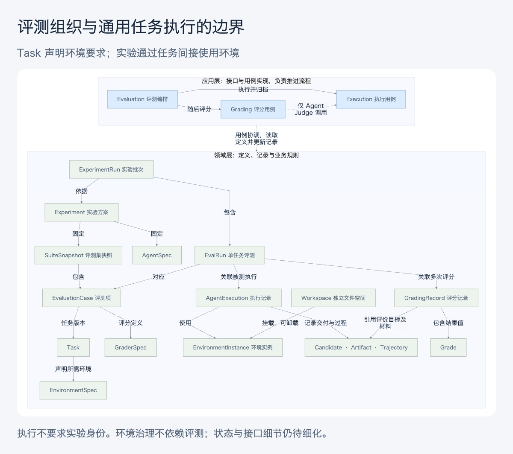

```mermaid
flowchart TB
  subgraph APP[应用层：接口与用例实现，负责推进流程]
    direction LR
    EV[ExperimentExecution 评测编排] -->|执行并归档| EX[Execution 执行用例]
    EV -->|随后评分| GA[Grading 评分用例]
    GA -.->|仅 Agent Judge 调用| EX
  end

  subgraph DOMAIN[领域层：定义、记录与业务规则]
    direction TB
    PLAN[Experiment 实验方案] -->|固定| SS[SuiteSnapshot 评测集快照]
    SS -->|包含| CASE[EvaluationCase 评测项]
    CASE -->|任务版本| TASK[Task]
    CASE -->|评分定义| GS[GraderSpec]
    PLAN -->|固定| CONFIG[AgentSpec]
    TASK -->|声明所需环境| SPEC[EnvironmentSpec]
    BATCH[ExperimentRun 实验批次] -->|依据| PLAN
    BATCH -->|包含| RUN[EvalRun 单任务评测]
    RUN -->|对应| CASE
    RUN -->|关联被测执行| REC[AgentExecution 执行记录]
    RUN -->|关联多次评分| GR[GradingRecord 评分记录]
    REC -->|使用| ENV[EnvironmentInstance 环境实例]
    WS[Workspace 独立文件空间] -->|挂载，可卸载| ENV
    REC -->|记录交付与过程| OUT[Candidate · Artifact · Trajectory]
    GR -->|引用评价目标及材料| OUT
    GR -->|包含结果值| G[Grade]
  end

  APP -.->|用例协调，读取定义并更新记录| DOMAIN

  classDef app fill:#dcecff,stroke:#3973ad,color:#143b63;
  classDef domain fill:#edf4ed,stroke:#698667,color:#203c29;
  class EV,EX,GA app;
  class PLAN,SS,CASE,TASK,GS,SPEC,CONFIG,BATCH,RUN,REC,GR,ENV,WS,OUT,G domain;
```

读图时沿三条主线：ExperimentExecution 依据实验方案组织批次和各任务评测；Execution 准备工作空间与运行资源、协调挂载、调用 Agent 并归档，留下 AgentExecution 与交付、轨迹；Grading 依据评分定义和输入材料调用 Grader，保存 GradingRecord 与 Grade。每个任务内部先执行归档后评分，任务之间可以并发；已有交付可独立评分，任务执行也不必先创建实验。Agent Judge 调用 Execution，规则和测试评分不必启动 Agent。

为保持草图简洁，省略 Suite 冻结为 SuiteSnapshot、每次执行固定 AgentSpec、环境实例依据 EnvironmentSpec、评分记录引用 GraderSpec，以及 Judge 评分记录关联其独立 AgentExecution 的连线；这些关系仍按前述总览成立。Workspace 与执行的确切绑定记录、基数、完整状态机及聚合边界尚待细化。外层适配器未画入两层图：文件、容器、Pi Durable 和存储通过应用所依赖的端口接入，业务编排实现留在应用层。具体图示不代表已实现或新关系已逐条确认。

### D77–D79 设计评审：边界成立，但关系尚未闭合

2026-11-01 按用户要求复审，依据当前决策、应用 / 领域总览和已阅读的实现；采用普通任务独立执行、Agent Judge 评分、两个并发尝试、保留 Workspace 后更换环境四个场景推演。以下是评审发现与建议，不是用户已接受的新决策，也不是运行测试结果。

**总体判断：** ExperimentExecution 依赖通用 Execution / Grading，环境治理不反向依赖实验，这一方向合理。应用层编排与领域记录并存、Workspace 与环境实例生命周期分离也能够成立。不需要为了这些缺口推翻分层或新增一套通用工作流框架，但必须在实施前补齐以下契约。

| 优先顺序 | 尚未闭合的位置与具体反例 | 建议及取舍（待确认） |
| --- | --- | --- |
| 1 | **Judge 的通用执行输入未定义。** D79 让 Task 声明环境，D48 又让 Grading 通过 Execution 运行 Judge。若只接受已有的被测 Task，Judge 会误用被测材料 / 环境；若转回实验配置 Judge 环境，又破坏刚修订的边界。 | Grading 根据评分定义和允许材料形成一份独立的执行输入，其中明确任务目标、环境要求、材料和结果契约，再走 Execution。它可使用同一任务描述结构，但是否必须创建持久化 Task 实体另定，避免把每次内部调用都变成题集管理操作。环境要求来源必须明确，不能隐式继承被测环境。Judge 的结构化响应由 Grading 校验并形成 Grade，Execution 不解释评分含义；要对齐 D1 中“所需输出已归档”的通用完成契约。 |
| 2 | **实例隔离不足以保证文件隔离。** D34 限制一个环境实例只有一个活动执行，但实例 A、B 若挂载同一个可写 Workspace，仍会互相修改输入、污染重复尝试和评分。 | 独立尝试使用隔离的可写区域，可共享固定版本的只读材料；一期建议同一可写区域仅一个有效写入者，不开放多执行协同写入。共享可写空间需要冲突处理与更复杂的占用规则，当前无必要先引入。精确互斥范围是可写区域还是整个 Workspace 待定。 |
| 3 | **Workspace 的身份不代表历史内容。** 同一工作空间可长期保留并继续修改；执行 E1 只保存 Workspace ID，之后 E2 改了文件，就无法知道 E1 开始时看到什么。 | 分开记录 Workspace 的长期身份与每次执行的已固定输入版本 / 文件清单 / 摘要，以及当次有效文件视图和权限。正式交付仍按 Candidate / Artifact 的冻结规则归档。只保存路径最简单但证据会漂移；对所有中间文件做全量版本化成本高，建议先固定声明输入与正式交付，不承诺重建每一个瞬间。如何保留动态工作区内容、保证引用内容可取得仍需定契约，摘要本身不等于保存内容。 |
| 4 | **资源生命周期已独立，但释放权和失败处理尚未贯通。** Execution 可能使用新建资源，也可能取得已有 Workspace / 环境。若启动失败一律清理，会删除用户保留的文件；若从不清理，新实例和挂载会泄漏。 | 延续 D33，将资源归属、当前占用和本次创建 / 借用事实明确记录。上层工作过程决定保留意图，Execution 封装正常与失败路径的协调，环境治理统一核对使用状态并处理资源。只处理本次有权释放的资源；确认工具停止使用后才能卸载，结果未知先核对。无需现在新增独立资源管理微服务，但不能让每个调用方自行拼补偿顺序。 |

**补充的定义边界：** Task 关联 EnvironmentSpec 不意味着任务可以忽略 AgentSpec 选用工具的依赖。按 D31 必须检查兼容，不静默改环境或删除工具。D120 / D121 已选择由 TaskRevision 直接固定 EnvironmentRevision；环境配置引用变化产生新的任务修订，不增加运行前动态解析版本的规则。此处只记录取舍，不重开“环境属于通用执行、不是实验配置”的已定归属。

**图的表达限制：** 当前两层图为阅读省略了 AgentExecution 对 Task / AgentSpec / 当次 Workspace 视图的准确引用，以及 EnvironmentInstance 到 EnvironmentSpec 的依据关系。Review 和实现契约中必须补回；尤其不能从“执行记录 → 环境实例 → 当前挂载”动态反查历史文件视图，因为挂载会改变。没有画出的连线不应被解释为不需要保存关联。

源码佐证仅限现有基础：[DockerRouteEngine](../../typescript/src/code-route-docker.ts) 已区分可写代码目录与只读基线；[问答环境脚本](../../plugins/grounds/scripts/grounds_eval_environment.py) 已保存 workspace manifest 并校验材料。这些可复用为输入固定和访问控制机制，不证明通用 Workspace 的写入互斥、历史视图或所有权契约已经实现。本轮仅做设计与源码审阅，未运行容器或真实 Agent。

建议先讨论第 1 项，让被测任务和 Judge 都能经同一通用执行契约运行，再定第 2、3 项的文件身份与隔离；资源释放依据这些身份和占用规则进一步细化。所有建议保留待确认，不直接修改当前运行代码。

### 六边形架构中的领域核心边界

本项目采用端口与适配器的内外隔离原则，并在应用内部进一步区分纯领域模型与用例协调。这是本项目的分工，不声称六边形架构原文强制规定某个固定层数或六个模块。参考 [Alistair Cockburn 的原始说明](https://alistair.cockburn.us/hexagonal-architecture)。

| 位置 | 放什么 | 不能越过的边界 |
| --- | --- | --- |
| 最内层：领域模型 | Task、AgentSpec、GraderSpec 等定义；Experiment、EvalRun、AgentExecution、Candidate、Artifact、Trajectory、GradingRecord 等事实；身份、版本、允许的关系、冻结规则、结果与状态合法性。 | 不引用 SDK 类型、进程、Docker 命令、SQL 客户端、文件系统或 CLI 参数解析器。输入是领域值和已经获得的事实，输出是合法状态变化、值或明确的领域错误。 |
| 内侧：应用用例与端口 | “执行任务并交付已保存结果”“评价指定产物”“恢复一次运行”等用例；安排并发、调用外部能力、协调回执和保存。 | 根据领域规则编排；不复制一套自己的产物冻结、评分标尺或身份关联规则。端口由使用能力的内侧边界定义，不要求所有端口都塞进纯领域层。 |
| 外侧：适配器 | CLI 输入、Codex / Pi SDK、容器、Git / SQL 存储、事件解析与文件提取等具体技术实现。 | 实现内侧端口并做格式转换；不得自行改变领域中的运行身份、评分标准、产物归属与完成条件。 |

例如，D1 在领域中表达为“缺少有效归档回执时，不能把执行标记为成功交付”；在应用用例中表达为“调用证据存取端口，确认回执，再请求领域对象转换状态”；具体如何写 SQL、上传字节或定位 Git 对象由适配器处理。领域规则可以在没有数据库、容器和线上模型的测试中验证。

TaskSpec 中的工具 / 环境要求表达能力与约束；实际镜像、容器 ID、挂载目录和进程属于外层绑定。AgentSpec 可以保留实现标识与版本等可追溯的配置值，但不导入具体 SDK 对象。Candidate 与 Artifact 分别保留各自身份和业务语义；评分引用明确区分对象类型。纯领域层不负责读取 Git 仓库或数据库。

当前讨论只逐项确定这些对象的含义、关系与不变量；应用服务接口、并发实现和存储技术选择在领域核心对齐之后再细化。此前图中的“Execution 服务”与本节的“AgentExecution 领域对象”必须区分：前者协调执行用例，后者维护一次逻辑执行的身份、事实和合法状态。

| 概念 | 业务含义与边界 |
| --- | --- |
| Task / 任务 | 用户要 Agent 完成什么，以及公开输入、可用上下文、工具和环境要求。评分标准属于评测定义，不应全部暴露给被测 Agent。 |
| Suite / 评测集 | 用户组织的 EvaluationCase 集合，每项关联任务及所选评分定义与输入；SuiteSnapshot 冻结集合版本。不是裸 Task 集合。 |
| Agent / AgentProvider | 执行任务的能力端口；一期仅 Pi Durable 实现，同一实现可用于做题或评分，使用独立会话与配置。Agent Provider 与模型供应商是两个不同层次，不能把模型切换称为切换 Agent 内核。 |
| AgentExecution / 执行记录 | 一次实际调用的身份、配置、运行状态和时间等事实；关联所属评测运行、角色、容器会话及 Provider 会话。概念不要求覆盖现有同名评分记录，具体命名待迁移设计。 |
| Trajectory / 执行轨迹 | 可观测的消息、工具调用、工具结果、错误与终止事件。按 D67，由 Provider 适配器转换公共事件并保留可获得的原始记录及来源关联，Execution 协调归档；缺失与覆盖限制明确记录。 |
| Candidate / 候选 | Coding Task 的交付对象，保留代码、仓库及候选身份语义；按 D20 修订方向与 Artifact 并列。 |
| Artifact / 产物 | 内容交付抽象，例如答案与引用、报告或数据文件；用于 Working，按 D51 也可随 Coding 的 Candidate 一同交付。按 D45，公共契约包含独立身份、内容类型、可读取的冻结内容与来源，具体内容形态及存储表示可不同。不作为 Candidate 的父类型。 |
| Grader / 评分器接口 | 根据冻结标准评价 Candidate、Artifact 或 Trajectory 及声明材料；具体实现声明支持的对象类型。Agent Judge 是一种实现策略，规则和测试是其他策略。 |
| Grade / 评分结果 | 分数、判定、依据和无法判定的原因，与被测 Agent 的任务产物分别建模。 |

### 对象关系：整理后的推荐方案

本节针对**预期改造后的设计**。用户已确认先整理对象关系，并参考《软件设计的哲学》的深模块、信息隐藏和解耦原则；以下为据此收敛的推荐方案，具体字段、状态机及迁移尚未实现，也不视为已获逐项批准。上一版流程式领域图仅保留为[历史导览](../assets/evaluation-domain.jpg)，本节旧关系图记录 D20 之前的统一 Artifact 方案；Candidate / Artifact 的当前并列讨论以 D20 草图及下列表述为准。

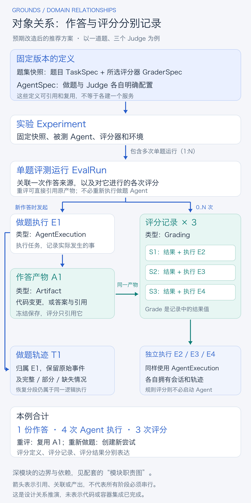

当前图已移除新增预算配置。D12 已明确一期不建设预算或通用额度限制，实验冻结原则由 D11 确认；历史图片中的预算建议不再作为一期开发依据。

#### 定义与事实分别表达

定义说明“准备怎样做”，运行事实说明“实际发生了什么”。定义引用固定版本，执行记录补充实际观察到的配置与偏差，不能只凭配置声明认定实际环境一致。

| 定义 | 负责表达 | 引用关系 |
| --- | --- | --- |
| EnvironmentSpec / 环境定义（名称暂定） | 按 D29 / D31，固定版本的运行条件，包括运行时、软件依赖和配套服务；不重复选择 Agent 的工具与 Skill。 | Task 按 D79 关联所需定义，环境不依赖实验；一版定义可创建多个 EnvironmentInstance；任务材料按 D32 在执行时绑定，材料变化不必重定义环境，但真实构建依赖变化不能被忽略。 |
| TaskSpec / 任务定义 | 按已确认 D4，表达做什么、公开输入 / 能力和产物要求，不绑定具体 Agent 或评分器。任务相关内容保留具体类型；Coding 与 Working 的范围澄清见 D19，最终类型表示待对齐。 | Task 按 D79 关联所需环境定义；评测项组合任务与评分策略的固定引用，实验另选执行者。隐藏评分材料不混入公开任务输入。 |
| EvaluationCase / 评测项 | 按 D25 / D40，表达一个任务采用哪些评分方式，并为所选评分器绑定任务特定评分输入。 | 引用一个 Task 版本与一个或多个 GraderSpec 版本；公开要求直接引用 Task，补充输入须符合对应评分契约，随评测集快照固定。作为值对象，不要求独立生命周期。 |
| Suite / 评测集；SuiteSnapshot / 评测集快照 | Suite 组织 EvaluationCase，SuiteSnapshot 冻结某一版集合。 | Experiment 引用固定快照；后续编辑集合不改变已有实验。集合成员是评测项，不是裸 Task。 |
| AgentSpec / Agent 配置 | 按已确认 D5，表示不可变版本的实现、模型、通用指令、Skill / 工具定义和相关策略。 | 每次执行固定引用一个版本，可供多个执行复用；Agent Judge 的配置由评分定义或其冻结绑定引用。环境和凭证另行绑定。 |
| GraderSpec / 评分器定义 | 按已确认 D6，独立表达评分标准、结果标尺、可访问证据范围与策略，统一支持规则、测试或 Agent Judge。 | 引用适用的任务 / 输入契约；按 D44，Grader 可接收若干 Artifact 作为评价输入。只有 Agent 策略需要额外引用 Judge AgentSpec；D20 / D21 的 Candidate、Artifact、Trajectory 评价关系保持不变。 |

这些是版本化的定义和值对象，不意味着每一个都要建立类、服务、数据库表或独立仓储。现有 Suite、QA、Issue 和 Grader 的兼容表示在迁移时保留。现有 `Subject` 只有名称和描述，但受管问答已通过环境绑定的 `execution_config` 冻结并核对部分配置；公共 AgentSpec 是对职责的收敛，不是从无到有发明配置冻结。

#### 运行事实的最小集合

**评分完整性（D50）：** EvalRun 分别表达运行是否终结与所需评分是否完整，质量结论保留在各 Grade 中。单项评分器故障不丢弃成功评分，也不自动取消其他独立评分；允许只补评失败项，保留原错误记录并新增 GradingRecord，不重新执行被测 Agent。具体汇总关联及状态字段仍待细化。

**任务尝试边界（D49）：** 一次明确发起的工作可包含多轮阅读、自检与修改，内部轮次及可靠恢复不增加作答样本。明确重做产生新尝试并保留历史；重评已有交付只新增 GradingRecord。该边界不要求新增 TaskAttempt 实体，具体与开发流程、EvalRun 和 AgentExecution 的映射仍待细化。

**Working 交付完整性（D41–D43）：** 明确选择产物并逐项持久保存，最终以冻结清单把 Task 的交付项对应到确切 Artifact 引用。部分保存成功不等于整次交付完成；必需项齐全且所列引用可读后才确认清单，成功执行另需满足轨迹归档条件。清单先作为任务尝试 / 执行结果中的值，不新增独立交付实体；质量结论仍由 GradingRecord 表达。

**环境治理已确认边界（D28–D36）：** 评测与开发使用同一模型。环境实例具有自己的身份、定义版本引用、资源归属和状态；同一工作过程可明确保留实例并顺序复用，一期同一实例最多由一个顶层 AgentExecution 占用，独立评测尝试使用独立实例。业务流程决定释放时机，环境模块核对使用状态后回收；中断先核对真实状态，无法确认时不重分配、不自动重跑。Task 声明材料及读写用途，AgentSpec 选择行为能力，环境在已授权范围内提供运行条件并落实访问边界。上述关系已确认，具体字段、状态机、归属记录及兼容迁移仍待设计。

| 对象 | 只承担什么职责 | 重要关系与基数 |
| --- | --- | --- |
| EnvironmentInstance / 环境实例 | 按 D29–D37，记录实际环境的身份、定义版本、资源归属和生命周期；主阶段为已登记、准备中、可用、占用中、释放中、已释放，错误与未知信息分别表达。 | 可跨同一工作过程的顺序执行保留，一期最多一个顶层执行占用；申请释放先关闭新占用入口，确认停止并回收后才标已释放。完整异常转换及迁移待设计。 |
| Experiment / 实验 | 按 D11 / D26 及 D79 修订，固定一组评测条件，组织在这些条件下增加的任务运行。 | 引用 SuiteSnapshot 和被测 AgentSpec 版本；所需环境通过快照中的 Task 关联，不直接配置环境绑定。评分器由 EvaluationCase 固定，不重复配置。方案改变新建实验，按 D61 包含 0..N 个 ExperimentRun，由各批次关联 EvalRun。按 D12，一期不新增预算配置或限制策略引用。 |
| ExperimentRun / 实验批次运行 | 按 D61，记录固定 Experiment 的一次明确批次运行及其运行事实。 | 归属一个 Experiment，关联本批次的 EvalRun；记录实际采用的任务级 / Agent 级并发配置，默认 5 / 20；按 D66 保存每个评测项的独立重复次数，默认 1，各次尝试形成独立 EvalRun。查询、停止与恢复指向确定批次，可靠恢复不新建批次；具体状态及补评关联待细化。 |
| EvalRun / 单任务评测运行 | 按已确认 D7，组织一个任务的一次评测，关联作答来源与各次评分，和 AgentExecution 分别建模。 | 归属一个 ExperimentRun，通过批次关联固定 Experiment，并引用其中一个快照评测项；新作答可发起一个做题 AgentExecution，Agent Judge 各自独立执行，重评复用已有产物；关联 0..N 次 GradingRecord。 |
| AgentExecution / 逻辑执行 | 记录一次确定输入与 Agent 配置下的逻辑执行、会话身份、状态和观测结果。 | 每个执行有自己的轨迹；做题与 Judge 均使用这一类型，但各自独立。恢复可产生新的进程 / 事件分段，不自动新增逻辑执行或作答样本。 |
| Candidate / 候选 | 按 D20 修订方向作为 Coding 交付的独立抽象，保留已有候选身份及冻结规则。 | 与 Artifact 并列，GradingRecord 绑定被评候选的确切身份；不以转换成 Artifact 为评分前提。 |
| Artifact / 产物 | D20 将其用于 Working 交付，D51 扩展为也可随 Coding 的 Candidate 一同交付；按 D41，由明确交付选择经统一校验与持久保存形成，D8 的独立身份与冻结规则继续适用。 | 保留类型、来源与读取契约，输入材料和普通中间文件不自动成为正式交付；内容变化创建新产物，评分绑定确切产物。按已确认 D42，Working 一次执行可交付多个 Artifact，Task 声明必需与可选项；多个产物仍属同一次尝试，失败或未交付时可以没有有效产物。 |
| Trajectory / 轨迹 | 按已确认 D9 / D67，记录一次逻辑执行的公共事件、可获得原始记录及覆盖情况，不覆盖原历史，不补造缺失事件；两种表示不形成两套执行状态权威。 | 独立归属一个 AgentExecution；可靠恢复追加明确分段。不是一个需要单独启动、推进的业务流程，具体追加与封存状态协议另定。 |
| GradingRecord / 一次评分记录 | 按已确认 D10，承载对确切评分目标、按确切评分器版本进行的一次评价及其结果 Grade；目标类型按 D20 / D21 包括 Candidate、Artifact 和 Trajectory。 | 按已确认 D23，可独立于实验存在，由需求开发流程或 EvalRun 发起并关联；明确重新评分新增记录并保留旧结果，规则评分不必启动 Agent，Agent Judge 关联独立执行。 |

按已确认 D10，`Grade` 是 GradingRecord 中的评分结果值，包含合法的分数 / 判定、依据及无法判定的原因，不先增加一个独立生命周期的“Grade 实体”。评分 Agent 的原始返回保存为其执行证据，经评分策略校验后成为 Grade；它不冒充被测代码或答案产物。以后出现需要多 Agent 共同评分的具体需求，再扩展 GradingRecord 与执行的关系。

Artifact 来源在新受管执行中关联 AgentExecution；历史或已有外部 Candidate 没有完整执行记录时，保留其真实来源并明确轨迹缺失，不补造会话。跨运行重用产物只增加引用，不改变原执行和产物的归属。

#### 一个任务、三个 Judge 的关系

正常作答：一个 EvalRun R1，发起做题执行 E1；E1 留下轨迹 T1 并产生答案产物 A1；若是 Coding 任务则关联 Candidate，此例用问答产物说明基数。R1 再关联三条评分记录 S1、S2、S3，全部引用 A1。若三者都是 Agent Judge，分别调用 E2、E3、E4，各自保留轨迹并将评分结果写入对应评分记录。

因此，这个例子是 **1 份作答、4 次逻辑 Agent 执行、3 次评分**。若某个评分器是确定性规则，它不必创建 AgentExecution；若要再次评分，创建新的重评运行并引用 A1，不重复启动 E1；若明确要求重新作答，才创建新作答尝试和新产物。恢复 E1 的 Provider 会话时继续其历史，不能把恢复后的部分输出误当成第二份独立样本。

按 D60，实验结果由代码从已保存记录按需查询、计算和展示，不依赖 Agent 撰写，也不强制预生成报告文件。现有关闭运行时产生的不可变 `result` 可以作为汇总回执保留；不要让它成为另一份可以独立修改、与原始评分冲突的事实。任务级与 Agent 级并发参数按 D59 分别表达，默认分别为 5 和 20，占用起止细节仍待细化。

### 深模块：按知识归属封装，而非每个对象一个模块

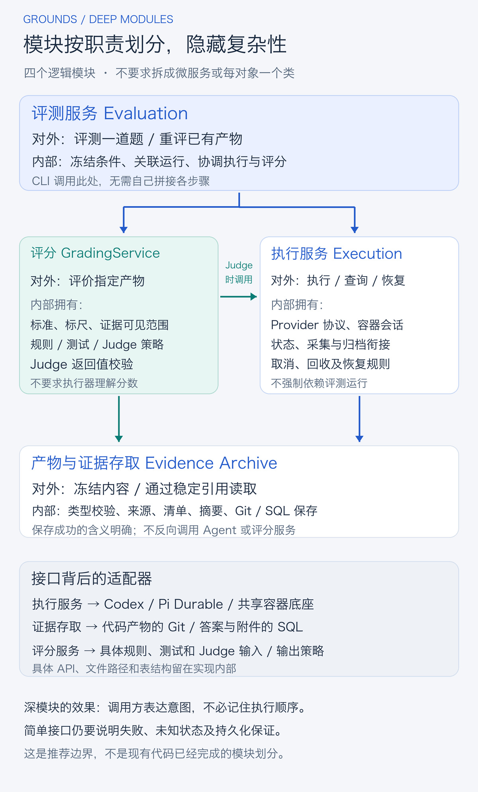

这里的模块是逻辑职责边界，不要求四个进程、四个微服务或恰好四个类。沿用同一 CLI 和部署方式，也可以做到这些边界。

**六边形架构归类补充：** 本图是能力职责图，不是纯领域层的包图。领域规则放在各能力的领域模型中，表里的运行协调、归档衔接和对外调用属于应用用例；Provider / 容器 / Git / SQL 由外侧适配器实现。不得因为一个深模块对上层隐藏这些细节，就把其所有代码都放入最内层 Domain 包。

| 深模块 | 调用方表达的意图 | 模块内部拥有的知识 | 返回与失败边界 |
| --- | --- | --- | --- |
| ExperimentExecution 接口及其评测应用服务实现 | 按 D52 / D58 / D61，依据固定 Experiment 发起 ExperimentRun 并组织其 EvalRun，每个任务先执行归档再评分，独立任务之间并发推进；经 Execution 和 Grading 接口协调，已有交付重评可跳过做题执行。 | 快照与实验绑定、运行身份、作答与重评区分、评分关联及关闭规则；按 D62 关闭取消批次的新工作入口并协调其活动工作停止，保留历史且不影响其他批次。应用协调部分安排并发和调用下列模块，领域规则本身不操作进程或 Docker。 | 返回可追溯的运行与各部分状态。部分失败保留原事实；不把关闭运行等同于质量通过。 |
| Execution 接口及其 Agent 执行应用服务实现 | 按 D53 / D54，持久受理请求后返回稳定执行引用，同次启动请求重试关联原执行，再按引用查询或等待结果；使用确定配置在给定环境内执行任务；按 D55，取消先登记意图，确认停止后才标已取消，具体停止与按能力恢复的协议待细化。 | Provider 协议、环境会话生命周期、启动意图、原始事件捕获、分段恢复、输出采集以及持久化回执衔接；现有超时等行为保持现状，不新增 D12 所排除的限制框架。 | 按已确认 D1，成功完成包含约定产物与轨迹已归档、返回稳定可读引用；归档未完成与 Agent 已结束分开表达。启动或回收不确定时返回未知 / 阻塞信息，不隐式付费重跑。 |
| Grading 接口及其 GradingService 应用服务实现 | 按 D48，经存取端口准备确切材料、调用 Grader 评价并保存 GradingRecord；支持指定 Candidate、一个或多个 Artifact 或 Trajectory。 | 标准与标尺、产物兼容性、证据可见范围、规则 / 测试适配、Judge 输入构建、会话独立和返回结果校验。Agent Judge 通过 Execution 运行。 | 返回评分记录及合法结果，或明确的错误 / 无法判断。普通 Agent 执行器无需理解分数含义。 |
| Evidence Archive / 产物与证据存取 | 冻结并读取带类型的产物或证据，取得稳定引用。 | 类型校验与来源绑定、清单、摘要、原始字节、不可变保存，以及 Git / SQL 的具体存储选择。 | 冻结成功表示约定内容已保存且可校验读取；提供者内容缺失或校验失败要明确报错。摘要不等于真实性证明。 |

**依赖方向固定为无环：** 实现 ExperimentExecution 的应用服务依赖 Execution 和 Grading 接口；实现 Grading 的应用服务使用 Execution 与证据存取；Execution 使用证据存取，并调用 Provider 和环境适配器；证据存取不反向调用评测、评分或 Agent。通用执行请求不强制要求存在 Experiment 或 EvalRun；按 D23，评分同样不以实验为前提，需求开发与评测用例各自组织并关联 GradingRecord。评测与评分记录在业务侧关联返回的执行 ID。

调用方不需要依次记住“创建容器 → 起 Agent → 解析某个事件格式 → 写若干文件 → 提交附件 → 回收”。这些步骤由 Execution 内部协调。但这个模块不吞掉评分语义，证据存储也不决定 Agent 是否应恢复；各自隐藏掌握的实现决策，重要的失败与持久化保证仍在接口上可见。

证据存取可同时服务轨迹和产物，因为二者共享不可变字节、清单与摘要规则；两者的业务类型和可见范围仍分别表达，不合并成一个无约束 JSON。代码保留 Candidate / Git 语义，答案保留正文与引用语义。具体任务的输出抽取和格式校验放在相应类型适配器，避免通用执行器继续积累编程 / 问答分支。

#### 方案比较与当前推荐

| 方案 | 优点 | 总体代价 | 推荐 |
| --- | --- | --- | --- |
| 每个实体 / 流程阶段拆成一个公开服务 | 文件职责表面上细。 | 调用方要理解先后、状态与恢复条件；多个模块重复理解相同 Provider 协议或证据格式。 | 不采用。 |
| 一个通用引擎管理全部评测、Agent、产物和评分 | 单个入口方便。 | 普通执行需要知道评测特有概念，评分变更牵动执行器，Provider 变更可能影响业务规则。 | 不采用。 |
| 按评测、执行、评分、证据知识划分四个深模块 | 将重复协调放到提供能力的一侧；评分和普通执行可独立复用。 | 需要明确回执、幂等及外部副作用边界，不能仅靠一次数据库事务覆盖所有动作。 | 本轮整理后的推荐方案。 |

深模块与信息隐藏原则依据本项目的[软件设计原则](../software-design.md)。以上划分是结合本项目的设计应用，不声称原书规定应采用四个模块。当前先确定关系与职责，不提前增加工作流 DSL、事件总线、每实体一个 Repository、统一继承树或分布式事务框架。

#### 对象关系层面的自检

- 更换 Codex / Pi 只影响执行适配与实际配置，不改变 EvalRun、Artifact 和 GradingRecord 的含义。
- 更换模型、工具或 Skill 产生可追溯的新配置；真实运行记录实际观测到的版本和偏差。
- 新增一个规则评分器不强迫启动 Judge，也不重做被测 Agent 的作答。
- 同一产物重复评分不修改原产物；明确重新作答不会覆盖先前样本。
- Agent 已结束但输出提交回执丢失，由原执行核对归档回执后继续；不能立即重新做题。
- 代码与问答并发时，不共享可变的当前运行 / 当前会话；共享准备资源另有清楚的所有者与释放条件。
- 单任务质量不通过、基础设施失败、轨迹部分缺失分别留存事实，不抹成同一状态。

这些是设计用例推演，不是代码或容器验收通过。详细状态字段、租约协议、事务边界及契约迁移另行落实；用户本轮要求先定对象关系。

### Candidate 与 Artifact 的读取和评分要求（D20 修订稿）

- Candidate 保留提交、树或变更身份及现有不可变绑定与仓库语义，作为独立候选抽象读取。
- 问答产物保留回答、引用及证据定位，不要求它伪装成代码候选。
- 评分入口按 D20 / D21 区分 Candidate、Artifact 与 Trajectory 的目标引用，并按各自读取能力获得材料；评分器校验类型相关语义，不强迫这些对象实现共同 Artifact 接口。
- 现有代码中的 `Outcome` 已表示评分判定。不要为了表达“Agent 的产出”而直接复用这个名称、改变其含义或混合两类记录。
- 失败运行也应保留已有轨迹和部分产物，并标明是否有效；不能要求每次执行都一定成功地产出可评分结果。

### 产物如何保存：当前事实与待确认建议

**当前事实。** 问答产物已有持久化，不必为了统一产物概念而迁入 Git。`QAArtifact` 包含答案正文、引用片段与定位、任务版本、运行 ID、执行信息、采集覆盖情况，以及关联文件清单。

提交时，`EvalModule.submitArtifact` 在同一账本事务内校验文件清单、大小和 SHA-256，保存附件内容及产物记录，并将产物 ID 绑定到 Run。产物是不可变记录，同一回答尝试不能覆盖已冻结产物；新回答产生新尝试和新产物，重评可以引用原产物。

| 保存内容 | 当前位置与含义 |
| --- | --- |
| 答案正文、引用、任务和运行关联等结构化数据 | 作为 JSON 写入 SQL 的 `eval_records`，读取时校验记录摘要与身份。 |
| 轨迹、工具响应及其他已提交的证据文件 | 清单记录文件名、大小和内容摘要；文件字节经压缩分块存于 `eval_blobs` / `eval_blob_chunks`，按摘要读取并校验。 |
| Agent 临时会话、工作目录中的输出 | 属于采集阶段；提交成功后的权威产物是上述持久记录和已保存的附件，不能只保留临时路径。 |

具体实现：[QAArtifact](../../typescript/src/eval-qa.ts)、[提交与文件读取](../../typescript/src/eval-module.ts)、[SQL 持久化](../../typescript/src/sql-tx-core.ts)、[表结构](../../typescript/src/sql-schema.ts)。

例子：任务问“退款期限是多少？”，Agent 的产物可以包括“签收后七天内”的回答、支持该回答的引用片段，以及文档章节定位。Judge 读取这一次已冻结的回答及允许访问的证据评分；再次评分不必再次调用被测 Agent。轨迹另行记录它当时查了什么、调用了哪些工具，与最终答案分别表达。

**重构建议，尚未确认为新的存储后端决策。** 统一的是产物的业务接口，存储方式可以按类型选择：代码继续使用现有 Git 产物机制，答案沿用结构化数据库记录和内容寻址附件。公共流程通过产物身份及读取操作使用它们，无需知道具体存储后端。当前先复用已有 SQL 能力；是否增加对象存储、统一存储端口或新的内容格式，待容量与部署需求明确后再定，不在本次讨论中预先引入。

对引用还需明确：只保存网址或文档路径，不能保证以后看到相同内容。现有 `citations.content` 可以保存当时的引用片段，清单中的工具响应等文件也可作为已冻结证据；但当前并不因此保证每条引用都保存了完整外部来源。建议后续契约明确最低要求：保存实际使用的证据片段及可获得的来源版本 / 摘要，并声明缺失，不能把动态链接当成已归档的原文。摘要用于校验内容一致性，本身不能证明来源真实或回答正确。

### 轨迹接口的具体要求

- 统一记录执行身份、来源 Provider、事件顺序和可用的时间信息，并关联产物。
- 归一化后仍保留原始 Provider 事件，支持核查和后续重新解析。
- 区分完整、部分与缺失，说明未知事件、截断、捕获失败等限制；不补造没有获得的字段或模型内部推理。
- 实时事件窗口、容器 stdout、最终回答都不能单独等同于完整轨迹。导出持久记录时也要处理分页、窗口和遗漏。
- 做题与评分的轨迹分别归属各自执行记录；评分对轨迹的可见范围需要明确，不能默认让 Judge 看到所有环境或处理组信息。

### 轨迹现在怎样采集和保存

**问答受管执行已支持，编程开发 Agent 尚未统一接入。** 当前问答采集器读取 Codex 的 JSONL 事件输出，原始字节逐步写入 `events.jsonl`；通过 GraphKB 代理执行的查询，另将调用参数、起止时间、退出码和输出写入 `tools.jsonl`。后者是该代理覆盖的工具记录，不代表所有 Agent 工具都经由它。`stderr.txt` 保存进程错误输出，`capture.json` 保存会话身份、执行状态、时间、可获得的用量和采集限制。

回答阶段生成包含这些文件的摘要与大小清单。调用产物提交后，文件内容随答案对应的产物一起持久化到 SQL 的内容寻址附件表；产物记录保存引用，后续可以按产物身份读取原文件。因此保存的是实际轨迹字节，不只是临时日志路径。评分 Agent 也复用采集器，但通过独立的评分证据提交路径保存，关联评分执行而非复用回答会话。

未知事件、非法 JSONL、缺少终止事件、超时或捕获超限等情况会写入采集限制，覆盖状态相应标为部分；这里的“完整”表示当前采集契约满足，不代表拿到了模型全部内部状态。接下来的重构是把已有采集与保存能力放到共同接口后，并补齐编程任务和其他 Provider，而不是从零创造日志存储。实现入口为 [capture 与 Broker](../../plugins/grounds/scripts/grounds_eval_capture.py)、[产物及评分证据提交](../../typescript/src/eval-module.ts)。

## 4. 已确认的流程与分工

用户已确认下图表达的总体分工。它是目标结构，不能作为功能已实现的证明。

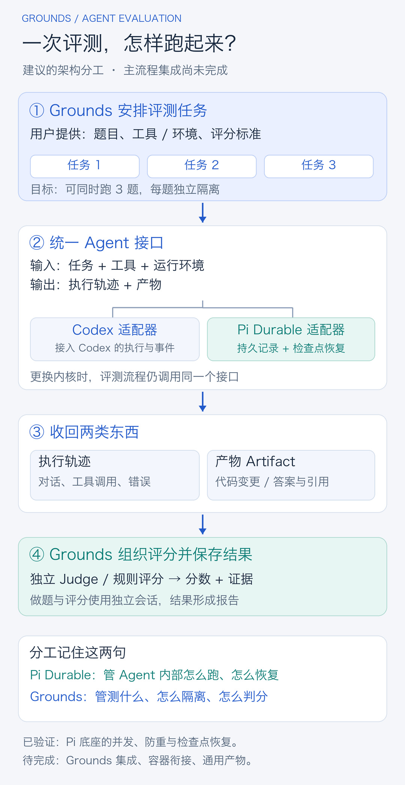

一次评测的共同流程：

1. 用户定义题集、运行条件和评分标准，Grounds 冻结本次评测输入。
2. Grounds 调度任务，在独立运行环境中调用 Agent 接口。
3. Pi Durable 适配器驱动独立的 Agent 执行，并采集执行轨迹与产物。
4. Grounds 校验并保存产物与证据，再组织规则评分或独立 Judge。
5. 保存评分结果及其任务版本、实际执行、轨迹和产物关联；按 D60 通过 CLI 按需查询并由代码计算展示实验结果，不强制预生成报告。

| Grounds 负责 | Agent 适配器 / Pi Durable 负责 |
| --- | --- |
| 题集、任务版本、评分标准与评测快照 | 具体 Agent 的调用、协议和事件转换 |
| 批次调度、并发配额、运行环境隔离与回收 | Agent 内部的模型调用、工具执行与会话状态 |
| 执行身份关联、产物校验、证据归档与报告 | 导出可获得的原始轨迹、执行信息与产物 |
| 做题与评分的独立性、权限和证据可见范围 | 在能力允许且策略授权时，从已有会话恢复 |
| 评测运行是否完成、阻塞或需要明确重跑 | Pi Durable 内部的持久化、检查点与工具重放机制 |

“同时运行三个 Pi 会话”和“Grounds 同时调度三个完整评测任务”是两个层次。后者还包含环境准备、产物回收、评分、写入与清理，必须单独实现和验收。

## 5. 当前实现与确认的缺口

以下是 2026-10-31 源码核查时的状态。实现变化后同步更新；不能仅因设计获认可就把缺口标为已完成。

| 项目 | 当前状态 | 本次目标 |
| --- | --- | --- |
| 题集与历史结果 | 已有 Suite、Snapshot、Experiment、Run、重评和报告等基础。编程题与问答题分别建模。 | 保留版本和追溯语义，在共同评测基础上接入两类任务。 |
| 被测 Agent 轨迹 | 问答路径采集事件流及工具响应；编程开发 Agent 尚无统一的自动轨迹采集。 | 两类任务都通过共同轨迹契约归档，并明确覆盖情况。 |
| 产物 | 编程路径围绕 Candidate；评测 `artifact` 类型目前绑定 QAArtifact。 | 按 D20 讨论方向保留 Candidate / Artifact 并列抽象，评分接口按 D20 / D21 支持候选、产物与轨迹目标，并分别校验。 |
| Agent 实现 | 受管问答采集器的配置、命令和事件解析直接围绕 Codex。 | 隔离 Provider 协议，一期迁移到 Pi Durable 单一实现，用于做题和评分；保留既有记录并验证迁移。 |
| 批次并发 | Python 协调器只接受非空 QA 任务集合，按题串行，题内评分也串行。 | 按 D56 支持可配置的 Agent 执行并发，默认 20，做题与 Judge 共用名额；显式配置 3 验证实际重叠、独立记录、隔离和回收。 |
| 容器复用 | 问答执行与 Go 评分复用了共享 `env up/run/down` 底座；旧系统隔离路径已退役。新的 Code Workspace 执行仍有不同生命周期和约束。 | 统一适用的执行机制和职责；不能把旧路径已退役误写成所有执行路径已经统一。 |
| 编程环境接入 | `EvalModule.createExperiment` 仍拒绝给含编程任务的实验绑定评测环境。 | 补齐编程任务接入共同受管执行流程的能力。 |

源码入口：

- [领域模型与验证](../../typescript/src/evaluation.ts)、[评测业务流程](../../typescript/src/eval-module.ts)、[CLI](../../typescript/src/eval-cli.ts)。
- [问答产物与证据](../../typescript/src/eval-qa.ts)、[环境契约](../../typescript/src/eval-environment.ts)。
- [批次协调器](../../plugins/grounds/scripts/grounds_eval_run.py)、[当前 Codex 采集器](../../plugins/grounds/scripts/grounds_eval_capture.py)、[受管协调](../../plugins/grounds/scripts/grounds_eval_managed.py)。
- [容器调度适配](../../plugins/grounds/scripts/grounds_eval_runtime.py)、[评分进程执行](../../typescript/src/eval-process.ts)。
- [Code Workspace 执行](../../typescript/src/code-route-execution.ts)、[Docker 实现](../../typescript/src/code-route-docker.ts)、[路由租约边界](../../typescript/src/env-route-lease.ts)。

### D109 Workspace 复用核验（2026-11-01）

使用仓库已有测试隔离工具创建临时 HOME、数据根和本地 Git 仓库，以 SQLite 执行以下四个现有测试文件，**36 / 36 通过，0 跳过**：

- [配置版本与实例](../../typescript/test/code-workspace.test.ts)：保存、版本冲突、重试与完整性。
- [缓存与基线准备](../../typescript/test/code-workspace-preparation.test.ts)：共享对象库、固定 commit、局部失败恢复、显式缓存回退、路径与保留引用检查。
- [开发路线](../../typescript/test/code-workspace-route.test.ts)：独立 worktree、并发准备与跨进程控制、拒绝接管无归属目录。
- [清理](../../typescript/test/code-workspace-cleanup.test.ts)：保留期与 pin、未保存文件保护、Git / SQL 回执失败恢复、活动或暂停执行阻止清理。

Docker 挂载、Git 只读视图和暂停语义本次仅核对源码；清理测试中的执行引擎为替身，不算真实容器验证。未调用线上模型，未验证新的通用 Task 接入，也未修改生产代码。

## 6. Pi Durable 的接入结论与边界

2026-11-01 选型已确认（D69）：一期采用 Pi Durable 单一内核，理由见[多内核研究报告](../research/multi-agent-kernel-adapters.md)。当前 API 实验性、单存储拥有者限制、工具副作用以及请求内容冲突校验仍需适配层和应用层处理。具体发布版本、部署方式与集成验收尚未完成。

已确认其能力适合承担 Pi Agent 内部的执行、持久记录和恢复。将其封装在 Agent 适配器后面，公共评测领域模型不依赖其存储表、任务类型或事件 API。Grounds 的账本仍是评测定义、证据关联和最终结果的权威记录。

Pi Durable 是独立的 Agent harness，不等同于 Pi Coding Agent SDK。两种方案的工具、提示、循环和恢复策略可能不同；评测应明确记录实际使用的实现及配置，不能只写“Pi”就假定行为相同。

接入约束：

- 锁定已发布版本，按实际导出的 API 开发。调研时已发现上游主分支文档与 npm 1.4.0 的接口存在差异。
- 记录 Grounds Run、执行角色、Provider 会话和请求 ID 的稳定映射；同一请求的恢复不能偷偷变成一次新的评测尝试。
- Durable 状态要能在临时执行容器退出后按策略保存和重新挂载；只把数据库放在随容器删除的目录中无法提供跨容器恢复。
- 尊重存储的单一所有者要求，不能让多个进程无协调地同时打开同一份状态。并发会话与跨进程共享存储分别设计。
- 工具可否重放必须明确。请求 ID 防重不保证外部工具副作用恰好一次；提交代码、写外部系统等操作仍需要自己的幂等或未知状态处理。
- 恢复、模型重试和真正重跑分别记录。次数、时间及可获得的用量不能因恢复而被隐藏，否则影响评测结果解释。
- Provider 内部恢复不能绕过现有执行控制、取消、隔离和独立评分要求；D12 已排除一期新增统一预算机制。取消等待是否停止实际执行也要由适配器明确处理。

调研已用 npm 1.4.0 和模拟模型验证三个有限场景：三个会话同时执行工具并分别留存轨迹；SQLite 重开后同请求 ID 取回原答案且不再调用模型；保存检查点后被 SIGKILL 的工作进程由新进程继续执行。**这些只说明底座可行，不代表 Grounds 主流程、真实模型、三容器并发或任意工具副作用恢复已经通过验收。** 内部实验原始记录不随本设计文档发布。

参考：[官方介绍](https://earendil.com/posts/pi-durable/)、[官方源码与文档](https://github.com/earendil-works/pi/tree/main/packages/durable)。上游内容可能演进，实施时以锁定版本为准。

## 7. 架构取舍

| 方案 | 调用与维护成本 | 兼容与失败处理 | 结论 |
| --- | --- | --- | --- |
| 在编程、问答路径上分别增加 Provider 和并发分支 | 初期改动局部，但同一种 Agent 协议、轨迹规则和恢复逻辑需要维护多份。 | 两类任务容易出现不一致的证据和恢复语义。 | 不采用为长期结构。 |
| 保留现有账本和业务语义，把共同机制收敛为接口，任务与 Provider 通过适配接入 | 需要迁移现有调用边界，但调用方无需理解各 Provider 的协议。 | 可渐进迁移，并对新旧产物、证据和操作 ID 做兼容验证。 | **采用此方向。** |
| 让 Pi Durable 接管全部评测业务与持久记录 | 批次、题集和结果会与单个 Agent 内核绑定，Codex 也被迫适应该内核。 | 增加账本迁移与实验性 API 的耦合风险。 | 不作为本次目标。 |

重构代价尚未量化，不能沿用此前“只读状态汇总改动很小”的判断。当前目标涉及跨模块接口、产物验证、恢复和执行调度，需要逐步实现并验证；不要求一次重写所有 CLI 或数据库。

### 领域设计评审：方向成立，边界还需明确

以下保留 2026-10-31 本轮对象关系收敛前的评审依据，**不是对最新关系方案仍无进展的描述**。当前推荐方案以第 3 节为准；字段、状态与迁移细节尚待落实。评审结论是保留核心概念与依赖方向，先明确身份、约束和失败语义，再实施接口；继续增加对象名称本身不能解决这些问题。

值得保留的结构：

- 任务及评分标准有版本，实验引用快照，能够说明一次结果到底在什么条件下产生。
- 轨迹与产物分别描述过程与交付；代码与答案有共同身份，但保留不同类型和存储实现。
- 独立评分可以引用已经冻结的产物，支持多个评分器和重评。
- Agent 与环境能力通过适配器提供，领域规则不依赖 Codex、Pi Durable、Docker 或 SQL 的具体 API。
- 当前代码已经有产物冻结、评分上下文摘要、评分错误与质量判定分开等有价值的约束，应复用而非全部重做。

优先明确以下六项：

| 优先项 | 设计问题与具体影响 | 建议的职责与约束 |
| --- | --- | --- |
| 1. 评测运行、作答尝试、实际执行的身份 | 图中的连续箭头容易让实现把所有执行当成新作答。一个任务一次作答、三个 Agent Judge，通常对应一次评测运行、一个作答执行和三个独立评分执行；并非四个作答样本。 | EvalRun 关联本任务尝试及各评分；实际执行记录会话与角色。恢复有证据时延续原逻辑执行，Provider 内部重试或重新拉起进程保留为执行事件 / 分段；明确重新作答才新增作答样本。重评引用原产物，可新增评测运行而不增加原作答次数。 |
| 2. 被测对象的公共定义 | 只有“Codex”或“Pi”名称无法判断是否同一被测方案；配置若只藏在某类环境绑定里，跨任务使用和比较会依赖底层知识。 | 引入或落实可冻结引用的 Agent 配置，包含实现与版本、模型、指令 / Skill / 工具定义及相关策略；实验绑定具体版本。环境规格与 Agent 配置分别表达并校验兼容性。凭证值仍由运行时注入，不纳入公开配置或摘要材料。 |
| 3. 评分策略与 Agent 执行分别承担职责 | Grader 是评分能力，Agent Judge 是一种实现。若公共评分模型只接 Agent 或只接某种答案类型，就不能覆盖规则、测试和不同标尺。 | 评分契约定义输入产物、可访问证据、标准和结果标尺；Agent、规则或测试适配器各自产生受校验结果。Agent Judge 通过同一执行端口运行，评分适配器解释并校验其结果；普通 Agent 执行器无需理解分数含义。 |
| 4. 运行、证据保存、质量结果的状态边界 | 进程退出成功不等于产物已持久化；产物存在不等于已经评分；评分不通过不等于执行失败。 | 分别记录实际执行、产物 / 证据保存和评分结果。关闭运行表示结果集合冻结或明确停止，不直接代表质量通过。若 Agent 已完成而入库响应丢失，优先核对原提交回执，不能立即重新调用 Agent。未知启动、取消和超时由明确的状态与恢复规则处理。 |
| 5. 产物类型与公共读取契约 | 把所有产物变成任意 JSON 会丢失代码身份和答案语义；强迫所有类型使用同一存储又会让业务依赖存储细节。 | 公共部分表示身份、类型、来源、清单 / 摘要及冻结状态；代码具体载荷绑定已有 Candidate / Git 身份，答案具体载荷包含正文与引用。可采用带类型判别的值对象和适配器，不必先建立复杂继承树。评分器声明支持哪些产物，运行前校验匹配。 |
| 6. 领域规则与用例编排的所有权 | 接口再细，如果 CLI 或脚本仍需自己拼接冻结、状态、关联和恢复规则，复杂性并未被封装。把整个批次做成跨容器、Git 和 SQL 的单一事务也不可行。 | 领域规则集中约束身份、合法关联、会话独立和冻结；应用服务协调环境、Agent、归档与评分。外部动作使用可核查回执和幂等操作，各单元持有独立上下文，容器 / 共享准备资源明确所有者。具体聚合与账本事务大小结合现有存储实现确定。 |

与目标仍不一致的当前实现，不应被接口外壳遮住：

- `EvalData.artifact` 固定为 `QAArtifact`，而代码运行另用 `candidate_id`；通用产物尚未真正覆盖两者。
- 当前 `execution` 是评分执行；做题的会话、状态和轨迹分散在 QAArtifact、DevRun 和环境实例中，尚无覆盖两类任务的公共执行记录。
- `finishQA` 仍需要写入 `development_duration: unknown`，理由为“QA has no code development”；这是编程指标渗入公共结果模型的表现。建议使用公共执行指标，并将任务特有指标按类型扩展。
- `decodeGrader` 对 QA 明确要求 Agent、diagnostic 和 `qa_decision`。因此即使公共类型中有数值分数，QA 仍不能直接使用任意数值标尺或规则评分；是否扩展、怎样兼容应作为具体开发项确认。
- 受管问答已有配置冻结和独立环境校验，Coordinator 也会对未知启动阻塞；需要的是公共化与验证衔接，不是移除这些机制来简化接口。

源码依据：[类型与评分器验证](../../typescript/src/evaluation.ts)、[运行创建、预留评分与结果关闭](../../typescript/src/eval-module.ts)、[冻结执行配置核对](../../plugins/grounds/scripts/grounds_eval_managed.py)、[启动意图与恢复](../../plugins/grounds/scripts/grounds_eval_run.py)。

建议用四个具体用例评审这些边界：同题新作答与原产物重评；一个产物同时交给多个独立 Judge；Agent 完成但提交回执丢失；混合编程与问答并发且其中一个任务中断。逐项确定身份、状态、允许重试的操作和证据归属之后，再据此落具体字段和测试。当前图可以继续作为概念导览，不应直接当作完整的状态机、聚合设计或事务设计。

## 8. 实施顺序建议

本节是开发排序建议，后续可随讨论调整；不把尚未讨论的具体方法当成用户已决定的实现细节。

环境迁移方向以已确认 D38 为准：先建立公共治理核心并保留 Coding / 评测业务职责，再逐条迁移完整执行链，最后停用旧的独立治理入口。按 D114，以无正在运行的旧 DevRun 为切换前提，不做运行中移交或旧流程收尾；历史记录兼容与单一权威状态原则保留，具体开发顺序仍待实施评估。

1. **明确接口与兼容边界。** 落实任务、执行、轨迹、产物、评分职责和状态；按 D28 梳理并统一评测与开发环境的身份、状态、资源归属与恢复规则，确定旧入口和记录的迁移方式；确定现有 Candidate、QAArtifact、Outcome 如何映射，先写关键行为测试。
2. **贯通 Pi Durable 最小链路。** 锁定发布版本，按 D70 为每个顶层执行配置独立运行进程与持久存储归属，并按 D71 在宿主侧管理 Durable、经环境适配器驱动容器工具，通过小的 AgentProvider 端口及任务适配，让编程和问答在同一运行契约下收集轨迹、交付并独立评分；不建设多内核注册或通用协议框架。
3. **迁移现有执行入口。** 验证 Durable 状态保存、工具与事件导出及做题 / Judge 隔离；核对现有 Codex 入口、配置和历史记录的兼容性，通过替代验证后再按明确方案退役旧执行路径，不直接删除现有能力。
4. **补齐可配置并发和生命周期。** 按 D56 默认 20 个 Agent 执行名额，做题与 Judge 共用；显式配置为 3 验证原并发场景。 每个工作单元拥有独立上下文与运行记录；共享准备资源的所有权和回收不得因并发而失效。
5. **完成恢复、取消及迁移验证。** 同一批次包含编程和问答，覆盖异常、中断、重新打开及兼容已有记录。

每一步同时交付受影响的帮助、配置、schema、分发资源和测试；实现后的当前业务概念与架构文档应随代码补齐，并由本文件链接。

## 9. 验收目标

- [ ] 工具中断处理遵循 D75：自动重试仅适用于受信任配置中明确列出的操作，清单外默认等待人工确认，模型不能修改策略或绕过未决调用重试。模拟操作已成功但回执丢失，按原身份取回结果而不重复创建；结果未知时保存事实并阻塞。具体清单条目与人工处置接口需落实，手动恢复执行不自动批准未知副作用重放。

- [ ] 宿主重启遵循 D74：重启只发现并核对未完成工作，不自动恢复模型和任务工具执行。确认原执行仍运行则接管监控；已停止且满足条件时，手动恢复沿用原身份和状态，未知时拒绝盲目启动。取消中的工作继续停止核对，已完成工作不重跑，归档缺失仅补归档。

- [ ] CLI 生命周期遵循 D73：断开提交后的终端或等待连接，受管宿主仍驱动原工作；重新打开 CLI 能发现并按原执行或批次身份查询。覆盖受理与启动间断连，不误报启动、不创建重复执行；明确取消仍遵循 D55 / D62。宿主故障不伪装成任务继续运行。

- [ ] 内部状态存储遵循 D72：同一执行与恢复流程经存储抽象使用 SQLite、PostgreSQL、MySQL 后端，调用方不分支处理 SQL 方言。对各已交付后端验证原子提交、回执丢失后核对、重开与不同执行的数据隔离，维护同一逻辑存储的单一有效拥有者。ArtifactStore 独立；已有数据库驱动不计作 Durable 后端已验收。各后端交付顺序另定，不把未实现后端报告为支持。

- [ ] 部署分工遵循 D71：Durable 进程及内部持久状态由 Grounds 宿主侧管理，模型驱动的任务文件读写、命令及代码执行经适配器进入对应容器，不回退到宿主默认工具环境；验证任务工具不能访问内部检查点。停止与恢复同时核对 Durable 和容器工具状态，单侧退出不误报整体已停止，恢复记录存在不等于工作区可继续。容器故障下已持久保存的宿主记录仍可读取，不扩大为宿主或存储故障下绝不丢失的保证。

- [ ] Durable 隔离遵循 D70：不同顶层 AgentExecution（包括被测与 Judge）使用独立运行进程与持久存储；取消其中一个不终止其他独立执行。模拟进程中断后，仅在确认旧拥有者已停止且环境可继续时接管原存储；未知时不得双重打开。明确重做使用新执行与新存储，临时容器回收不删除恢复所需持久状态；核对工作区与工具状态，不仅检查数据库存在。

- [ ] Provider 事件适配遵循 D67 / D69：Pi Durable 事件经适配器转成内侧公共契约，Execution 统一归档且上层无需解析 SDK 类型；保留可获得原始记录和来源关联，不能映射或采集缺失时明确标记。Provider 终结事件不直接将尚未归档的 AgentExecution 标为成功完成。

- [ ] 独立重复遵循 D66：重复次数默认 1 且可配置；十个评测项配置三次时形成三十次计划尝试，各自关联独立 EvalRun、执行、交付与轨迹，并保持 5 / 20 两层可配置并发。恢复与重评不额外计样本，不因失败补足成功次数；查询区分评测项数量、尝试数量及完成覆盖。

- [ ] 汇总遵循 D65：按评分器版本、评价维度与可比较标尺分组；数值平均仅使用选定记录中的有效数值（包括真实零分），分类显示数量，错误、缺失及无法判定分别披露。十项中八项数值、两项错误时平均分分母为八且同时显示八 / 十覆盖；无有效数值不显示零分。重评不重复计样本，不同标尺不自动合成总分。

- [ ] 重评结果选择遵循 D64：同一评分要求及相同目标、评分器版本和材料下，默认采用按稳定发起顺序最近一次正常完成的合法 Grade；4 分后正常重评得 2 分展示 2 分，重评报错保留原有效结果并显示错误，合法无法判定替换旧分数。保留全部历史与采用记录引用，不重复计样本，不将不同条件或未关联的独立评分隐式合并。

- [ ] 只读结果查询遵循 D63：指定 Experiment 展示方案与各批次概况，指定 ExperimentRun 展示该批次结果，指定 EvalRun 可追溯执行、产物和评分依据；默认不隐式选最近批次或混合多批次，查询不启动执行或评分。

- [ ] 批次取消遵循 D62：取消确切 ExperimentRun 后不再启动其排队任务和后续评分，活动做题与 Judge 执行经 Execution 取消，其他活动评分工作也须确认终结；保留已完成结果和未执行原因。同实验其他批次及独立执行不受影响，未知活动工作不误报批次取消完成。

- [ ] 实验分层遵循 D61：同一 Experiment 明确发起两次形成两个 ExperimentRun，各自关联 EvalRun、实际并发配置与运行事实；查询或取消某批次不误作用于另一批次。可靠恢复保留批次身份，实验总览按批次区分结果，不默认混合重复运行样本。

- [ ] 局部任务失败遵循 D57：保留失败任务事实，其他独立任务继续各自执行、归档和评分；查询包含失败、未执行和未知情况，共同依赖故障不得按普通局部故障盲目继续。
- [ ] 两层并发按 D59 分别配置和计数：未指定时任务级默认 5、Agent 级默认 20，两项显式配置均可覆盖各自默认值；活动评测任务与实际 Agent 执行分别满足约束，Judge 不新增任务名额。名额完整起止协议在实现前补齐。
- [ ] 结果查询遵循 D60：只读取已保存数据，由代码计算并经 CLI 展示任务、评分及错误和缺失情况，不调用 Agent、不自动重评、不要求预生成报告文件；后续补评可在新查询中反映，原记录保持不变。

- [ ] 调度顺序遵循 D58：每个任务仅在自身有效交付与所需材料归档后开始评分；不同任务可独立并发。以 A 先完成、B 仍在执行且存在空闲名额的场景验证评分 A 可推进，无需等待 B；做题与 Judge 总并发继续满足 D56，任务间不设置整批执行后统一评分的同步点。

- [ ] 并发配置遵循 D56：未指定时为 20，显式设置可覆盖默认值；做题与 Grading 发起的 Agent Judge 共用本次调度的名额。分别以默认值 20 和配置值 3 验证峰值不超上限、空闲名额允许推进；等待流程及纯规则评分不占 Agent 名额，状态未知的执行核对前不释放名额。

- [ ] 取消执行遵循 D55：取消受理不立即标已取消，确认停止前保留环境占用；未启动执行取消后不得再启动，已完成执行保留原完成状态。取消保留已存交付与轨迹，归档缺失或失败单独表达，环境回收仍遵循归属与使用规则。

- [ ] 启动防重遵循 D54：模拟受理回执丢失及并发重试，同请求标识和相同输入只关联一个 AgentExecution；同标识不同输入报冲突，新标识允许独立重复实验。Provider 启动状态未知时不因重试重复启动，先核对原执行。

- [ ] Execution 遵循 D53：受理回执只在请求持久登记后返回，并包含稳定执行引用；查询与等待指向同一 AgentExecution，受理不误报启动或成功完成。成功完成须满足 D1 的交付与轨迹归档条件；CLI 可封装发起与等待，后台运行能力另行验证。

- [ ] ExperimentExecution 应用入口遵循 D52：依据固定 Experiment 组织 EvalRun，经 Execution 与 Grading 接口编排并记录关联，不在 CLI 或评测服务内重复 Provider、容器及存储实现。独立执行和独立评分无需创建实验，已有交付重评不重跑做题 Agent。

- [ ] 评分应用服务遵循 D48：按声明需求经存取端口准备指定材料，调用 Grader 并保存 GradingRecord 及实际引用；评分器无需处理存储后端、对象键或凭据。必需材料读取故障记录准备失败，不作为零分，也不重跑被测 Agent。

- [ ] Coding 交付遵循 D51：同一次尝试可交付独立 Candidate 与 Artifact，两者身份和类型不混同，样本数不因附加报告增加；无附加交付需求时仍允许只交付 Candidate。

- [ ] 评分部分失败遵循 D50：三个独立 Grader 中两个正常完成、一个报错时保留成功结果并标明评分缺项；运行可终结但不误报完整。明确补评仅执行失败项，新增评分记录且保留原错误，不重跑被测 Agent；合法不通过或无法判定不作为评分器故障。

- [ ] 任务尝试遵循 D49：内部自检修改与可靠恢复不增加作答样本；明确重做保留旧记录并形成新尝试；重评只新增评分记录，不重新执行做题 Agent。

前四项对应已经讨论的产品要求；后续项目将其展开为开发时应验证的可靠性条件。以下均为**待实现 / 待验收**，不能凭底座实验勾选完成。

- [ ] 用户可构建自定义题集，提供任务输入、上下文 / 工具和评分标准。
- [ ] 编程和问答共用执行基础，分别得到可核查的代码产物或答案产物，以及执行轨迹。
- [ ] 一期仅 Pi Durable 通过 AgentProvider 端口接入，做题与评分角色可分别配置并隔离；既有 Codex 路径按经验证的方案迁移，历史证据仍可读取。不得以更换模型宣称支持另一 Agent 内核。
- [ ] 批次并发数设为 3 时，三个任务的实际执行可重叠，各自拥有独立环境、轨迹、产物和评分。
- [ ] 同一批次可包含编程与问答任务；报告能追溯任务版本、Provider 配置、产物和评分证据。
- [ ] 按 D79，Task 关联所需环境定义，实验经固定评测项间接引用，不直接维护环境绑定；通用 Execution 无须实验身份即可准备资源与执行，实际环境版本可追溯，定义复用不破坏实例隔离。
- [ ] 原始轨迹保留且覆盖状态准确；未知事件、截断、缺失和捕获失败可见，不伪造完整性。
- [ ] Working 可按 Task 声明交付多个独立 Artifact，必需项缺失不报告成功交付，已保存部分结果可保留；产物数量不增加任务尝试或评测样本数，多文件可组成一个产物。
- [ ] 多产物交付遵循 D43：部分保存失败保留已有引用且不误报整次完成；最终清单校验必需项及全部所列引用后冻结，确认后不能悄悄追加或替换产物。恢复优先补归档和核对回执，不自动重新生成内容。
- [ ] ArtifactStore 保存遵循 D47：模拟保存成功后回执丢失以及并发重试，同一操作身份及相同内容和元数据返回同一 Artifact 引用；同身份不同内容或元数据报冲突且不覆盖；未完整保存不返回成功，独立交付不因内容相同而合并领域身份。
- [ ] Artifact 交付符合 D41：显式提交或按已声明输出契约提取后，经统一校验与持久保存取得可读引用；不把输入或临时文件自动作为交付，保存失败不报告交付成功，质量评分与接收校验分开。
- [ ] 规则评分和 Agent Judge 的结果经过契约校验；基础设施失败不冒充质量判定，评分会话无法越权读取被测会话的私有状态。
- [ ] Grader 能按声明契约接收若干 Artifact 作为一次评价的输入，GradingRecord 保存实际输入引用；不强制合成一个新 Artifact，也不自动逐项打分或汇总。
- [ ] 重启后有确切证据时复用已有请求或恢复已有会话；无法判断是否已启动时显式阻塞，不自动重新做题。明确重跑产生新尝试。
- [ ] 取消和超时能停止受管执行、回收拥有的容器并保留已采集证据；重新打开不会重复启动未授权的会话。
- [ ] 并发下互不覆盖文件、运行记录或可变协调状态；单任务失败不破坏其他任务的证据，批次报告明确包含各题状态。
- [ ] 现有 Candidate 不可变身份、盲评分、快照、重评、操作 ID 防重及远端归档保护语义不被削弱。
- [ ] 容器生命周期复用有集成测试；真实容器、模拟执行与真实模型的验收证据分别标注。
- [ ] 环境收敛符合 D38 / D114：以无正在运行的旧 DevRun 为切换前提，不建设运行中移交与旧流程收尾机制；历史记录可读，切换后不保留两套独立的新实例治理。
- [ ] 环境主生命周期符合 D37：准备失败不标可用、回收失败不标已释放；状态未知保留最后已知阶段且阻止新占用，释放期间不能接受新执行。
- [ ] 评测与代码工作区开发通过同一环境领域模型和治理契约管理资源，环境身份、状态及恢复规则只有一个权威来源；兼容入口不再独立维护旧治理流程。
- [ ] 环境整合覆盖需保留的现有记录，验证隔离、归属校验、未知状态处理和受控回收不退化；D114 排除运行中旧 DevRun 的迁移；Working 任务无需为使用公共环境而创建代码路线。

## 10. 尚未决定与暂不抢占优先级的事项

### Artifact 源码调研：首轮完成，设计取舍待讨论

用户要求通过源码调研为本项目的 Artifact 领域模型提供借鉴。2026-11-01 已完成 ADK、LangChain、smolagents 的首轮固定提交源码阅读，报告见 [开源 Agent 的 Artifact 设计](../research/agent-artifact-design.md)，其中明确交付与统一保存的边界已通过 D41 确认，Working 的多产物和完整性规则已通过 D42 确认，具体字段与提交协议仍待设计。未运行这些框架或其测试，不据此宣称集成验证完成。

- 选择业界有代表性、设计质量较好的开源 Agent 项目，实际阅读源码，不仅查看产品介绍或文档。
- 研究 Artifact 的领域定义、身份、类型、内容与存储引用、版本和生命周期，以及它与任务、执行、轨迹的关系。
- 追踪 Agent 如何通过工具或协议生成、声明、提交和校验 Artifact，直到保存与读取；区分正式产物、普通文件、最终回答和轨迹。
- 交付带仓库版本及代码位置依据的对比，说明哪些设计值得借鉴、如何适配本项目，以及取舍。调研不自动改变 Candidate 与 Artifact 并列的已确认关系，也不替代 D18 的产物数量讨论。

### 剩余讨论盘点：D93 后收敛，优先级建议待确认

TaskType / Task / TaskRevision / TaskRun / AgentExecution 的主要职责、版本规则、Issue 收敛方向、有效交付成功边界、同次尝试内修正、Workspace 写入隔离，以及复用 Candidate / Artifact 保存交付均已有明确决定。此前“是否需要通用尝试实体”“Coding 是否可附带 Artifact”等问题已解决，不再作为待确认项重复提出；默认逐执行快照建议已撤回。

建议只继续讨论三类会改变用户可见行为的规则，不为补齐字段继续增加概念：

1. **多执行组织已由 D94 确认。** 一期由用户或上层应用用例明确发起 / 继续，核心统一校验并协调，恢复原执行与新增执行分开；不建设通用自动多 Agent 编排器。具体状态转换并入下一项，不再重复确认组织原则。
2. **失败、阻塞、取消与继续的完整边界。** D95 已确认单次执行失败不自动终结 TaskRun，等待调用方明确继续或结束；可靠恢复保持身份、明确重做新建尝试、成功交付后评分不回改成功状态也已确定。D112 已确认第 3 节的 TaskRun 六状态及阶段、原因分离；实现方继续核对取消竞态、停止确认和归档未完成表达，不重新询问已定状态与原则。评分部分失败规则已有 D50 / D57，仅核对与新 TaskRun 的组合；等待阶段无活动工作释放名额、继续时重新排队已由 D97 确认。
3. **终结后的资源默认规则已由 D96 确认。** 自建环境确认不再使用后默认回收，显式保留除外；借用资源只交还，本次 Workspace 保留后续显式清理，正式交付与轨迹不随环境删除。D97 已确认等待任务的名额规则；D98 / D113 已确认等待期间保留环境并仅暂停本任务的执行容器，依赖服务不自动暂停；具体失败处理待落实，不由名额释放自动推导删除。具体清理权限、存储配置和 Docker 命令交由实现方案落实。

其余内容交由实现设计形成具体可评审产物：TaskType 处理接口与配置 schema、应用端口、任务与运行记录的数据结构、归档回执与防重、Grader 输入到通用执行的适配、IssueRevision / DevRun / EvalRun 历史映射、旧入口兼容和单一权威状态迁移、Pi Durable 与容器 / 数据库适配。新增存储布局或一组字段无需逐项口头确认；若具体设计暴露业务取舍再集中讨论。

在实现前应把历次讨论收敛成一张当前模型图、一组最小状态规则和分阶段迁移计划；保留历史决策但不要求开发者拼接旧图理解现行模型。以上是盘点与建议顺序，不代表未定规则已获批准，生产代码尚未修改。

### D115 后领域复核：当前交付选择已由 D116 确认（2026-11-02）

主要对象、身份、版本与职责边界已有共识。本轮不新增实体。用户追问重复验收的实际触发场景后，撤回第 1 项作为一期必讨论问题，第 2 项的完整清单与当前交付选择随后由 D116 确认。

1. **重复验收冲突处理：已撤回一期必讨论项。** 正常流程为一个独立验收 Agent 验收固定交付；修改后产生新 Candidate，再按 D111 重验，不属于同一候选的矛盾结论。交付未变且验收出错时补验尚未通过项，已全部通过不默认再次验收。此前未明确并发多个验收者或人工主动复验的需求，不为假设场景增加一期流程。保留现有历史报告和 disputed 表达，不删除证据；将来明确需要复验或多个验收者时再讨论采用规则。用户已认可撤回。
2. **尚未结束的 TaskRun 当前采用哪组交付。** 已允许同次尝试修正，Candidate / Artifact 冻结、成功时固定交付清单也已明确；仍需明确修正过程中当前待验收交付组的选择方式。建议通过明确提交完整交付清单来替换当前选择，保留旧版本；不按创建时间自动选最新 Candidate，也不把历次 Artifact 全部合并。每次验收绑定确切清单内容，仍按 D111 处理变化。清单沿用已有值对象，不新增独立生命周期实体。该具体选择方案已由 D116 确认。

独立验收 Agent 的运行归属、Verification 的通用命名与 GradingRecord 的存储映射仍需在应用接口 / 数据设计中给出具体方案，不能丢失被测执行与验收执行的区分；本轮不把这些字段设计逐一升级为需要用户决策的新领域概念。本次复核中的第 1 项已撤回一期必讨论范围，第 2 项按 D116 实施；接口和存储结构仍待具体设计，未改生产代码。

### D128 后实现准备盘点（2026-11-02）

领域主干、应用层模块关系、TaskExecution 的主要行为契约，以及适配器层职责与依赖方向已明确。当前没有已识别的、必须由用户再作选择才能开始实现方案整理的架构问题；不等于所有技术接口已定或集成已通过。下表保留的历史“待定”项需结合后续决策阅读，不能将已确认规则重新提交用户确认。

可直接推进：收敛现行接口与状态规则、核对现有模块复用边界、确定存储与原子更新协议、验证 Pi Durable 的容器工具和存储桥接、形成分阶段改造及验收计划。新任务显式复用指定已有 Workspace、额外后端交付顺序和后续分析能力暂留扩展范围；若实现验证发现需要缩减已承诺能力、改变用户行为或作出显著部署取舍，再带具体证据和建议讨论。当前不新增批准流程，也不将技术验证责任转交用户。

### 其他待定事项

| 事项 | 当前约定 |
| --- | --- |
| Workspace 与统一环境治理的关系 | D77 明确可见文件空间职责、独立生命周期与挂载方向，并确认停止使用后才允许卸载；D78 确认应用层 Execution 编排、适配器实现技术操作。D109 确认复用已有配置版本、缓存、实例和路线；具体通用任务接入、状态与端口仍待细化。 |
| 接口字段、持久化结构与契约版本 | Grading 应用层接口、Grader 评分能力接口、GradingRecord 领域记录和 Grade 结果的名称已确认；其余签名、字段与存储结构在实现时提出兼容方案并更新对应 schema。 |
| 领域对象关系、聚合与事务边界 | 已接受 D1–D11 的核心边界，并由 D12 明确一期不新增预算或通用执行额度限制。D13 已确认评分状态与质量结论分开表达，D48 已将 D14 的记录命名修订为 GradingRecord；详细字段、状态与事务边界仍待落实。 |
| 领域评审提出的六项细化 | 对象关联与规则所有权已在第 3 节形成推荐方案；字段、状态和迁移仍需落实。D6 已确认评分器支持规则、测试或 Agent 的方向，具体 QA 标尺与适配器尚待设计和实现。 |
| 现有 Codex 执行路径的迁移与退役 | D69 已将新增多内核支持移出一期；现有入口、配置与历史证据需核对兼容性，在 Pi Durable 替代验证后确定退役步骤。 |
| Pi Durable 的版本、存储与部署方式 | D69 已确认 Durable 单一内核，D70 已确认每个顶层执行独立进程及持久存储归属，D71 已确认宿主侧 Durable 与容器工具分离；D72 要求内部状态接口支持可选数据库；发布版本、各后端交付顺序与默认值、存储保护、桥接协议及完整集成验收仍待落实。 |
| 统一环境模型的对象与迁移方案 | D28 已确认本次必须将评测与开发环境治理收敛为一套领域模型；具体对象、状态机、聚合和兼容迁移待对齐。保留现有租约、路由和工作区约束，不预先认定所有评测都必须直接使用 Code Workspace 执行器。 |
| 产物提交协议、存储与证据归档细节 | D42 已确认 Working 的多产物及必需 / 可选项，D43 已确认逐项保存后校验并冻结交付清单。现有问答使用不可变 JSON 记录和按摘要保存的 SQL 附件；具体事务、补交与幂等字段、是否扩展后端及引用片段的最低保存要求仍待设计。D51 已确认 Coding 可附带独立 Artifact，具体对应与确认协议仍待细化。 |
| Judge 可读取哪些轨迹；评分结果与标尺 | D15 已确认由评分契约声明材料需求，每条 GradingRecord 绑定实际依据，轨迹按需提供；具体可见性细则另行讨论。D17 已确认数值 / 分类结果与提前声明标尺；标尺校准与汇总规则尚未确定。 |
| 两层并发配置及结果查询接口 | D57 已确认局部失败继续其他任务；D56 的 Agent 并发默认 20，D59 的任务级并发默认 5，两项均可配置；占用起止细节待细化。D60 / D63 明确基于持久数据按需查询并按实验、批次与任务分层，D65 已确认按标尺分组统计和展示覆盖，具体命令名称、可聚合声明及格式仍待细化。 |
| CLI 统一状态视图 | 曾讨论的建议；最高优先级缺少证据，当前先推进评测基础。 |
| 逐题对比、重复实验统计、波动与显著性 | 后续评测分析方向，当前不替代通用执行基础的建设。 |
| 竞品优势和真实提效幅度 | 未经用户数据验证，不作为已成立的产品优势或本次验收结论。 |

## 11. 后续讨论怎样进入这份文档

- 每次形成新结论，更新对应正文和“最近更新”，并在下表补记。开发前以正文当前约定为准。
- 新想法先标为提议；明确接受后转为已确认要求。实验通过只更新对应证据范围，不自动提升为完整功能已完成。
- 推翻旧决定时记录原因与替代方案，不静默删除重要取舍。开发完成后写明实现和测试入口，并更新验收状态。
- 后续逐项对齐优先使用 Mermaid 小草图，一次聚焦一个决定；保留 Mermaid 源，并附 JPG 等普通图片以兼容手机阅读。用户手机上的交互可视化存在加载问题，本讨论不使用 visualize skill。此前仅提供 JPG 的偏好随本轮要求更新为 Mermaid 草图加普通图片预览。
- 不在本文件写凭证、私有题集、个人路径或内部验收原始记录；它是产品开发依据，不是聊天逐字稿。

| 日期 | 类型 | 结论 |
| --- | --- | --- |
| 2026-10-31 | 已确认 | 优先建设可由用户定义题集的通用 Agent 评测基础，首批覆盖编程和问答。 |
| 2026-10-31 | 早期已确认，抽象关系后续修订 | 曾按任务、Agent、轨迹、产物和评分划分职责，并将代码与答案视为不同产物实现；D20 随后提出 Candidate 与 Artifact 并列，当前以最新讨论为准。 |
| 2026-10-31 | 已确认 | Agent 接口支持 Codex 和 Pi，做题与评分可使用相同接口的不同独立会话。 |
| 2026-10-31 | 已确认 | 目标包括三任务并发、轨迹归档和复用容器执行能力；补齐当前路径缺口。 |
| 2026-10-31 | 已确认 | 用户认可图中的 Grounds / Pi Durable 分工；底座实验不代表主流程已接通。 |
| 2026-10-31 | 已确认 | 本文件持续记录后续结论，作为开发依据；交流图直接导出普通图片。 |
| 2026-10-31 | 已核实 / 建议 | 补充问答产物的现有 SQL 保存与冻结机制；提出按产物类型保留存储实现、完善引用证据归档的建议，尚不将新后端或新证据要求写成已接受决策。 |
| 2026-10-31 | 已核实 | 补充当前问答轨迹从 Codex 事件文件、代理工具日志到 SQL 附件的保存链路，以及评分独立存证、编程路径尚未统一的边界。 |
| 2026-10-31 | 设计建议 | 补充执行与评测领域关系 JPG：区分评测定义、单题运行、实际执行、轨迹 / 产物、评分和结果，并明确领域规则与外部适配器的依赖方向，等待讨论确认。 |
| 2026-10-31 | 评审建议 | 总体领域方向合理；提出六项实现前必须明确的边界，并核实 QA 评分限制、公共结果中的编程指标和已有受管配置冻结机制。未将评审意见自动提升为用户已确认决策。 |
| 2026-10-31 | 已确认工作方向 / 推荐方案 | 用户明确评审对象是预期改造后的设计，并同意先定对象关系、参考深模块与解耦原则。本轮收敛 Experiment、EvalRun、AgentExecution、Artifact、Trajectory、Grading 的关系，将 Grade 作为评分结果值；给出四个深模块推荐边界与对象基数，细节不冒充已逐项批准。 |
| 2026-10-31 | 已确认 D1 | 执行模块交付已保存的产物与轨迹后才宣布成功完成；归档失败优先补归档，未知时阻塞，不直接重跑 Agent；评分独立进行。 |
| 2026-10-31 | 待讨论 D2 | 下一项聚焦 Provider 协议与任务 / 产物语义分工，推荐在执行模块内部组合适配，避免每个 Provider 重复实现所有任务类型。 |
| 2026-10-31 | 已确认 D2 | 用户同意 Provider 负责对应 Agent 的运行协议，任务输入与产物语义另行封装；按六边形分工，业务规则留在领域内部，适配器转换格式并调用规则。 |
| 2026-10-31 | 已确认 D3 | 用户要求采用六边形架构，先逐项对齐最内层领域设计。四个深模块是跨层能力边界，不能整块归入纯领域层。 |
| 2026-10-31 | 待讨论 D4 | 下一项仅讨论 Task 的业务边界：题目与具体 Agent、评分策略分开定义，通过评测中的固定引用组合。 |
| 2026-10-31 | 已确认 D4 | 用户接受 Task 只表达做什么、提供什么公开输入 / 能力与交付什么；执行者和评分策略独立定义，由评测中的固定引用组合。 |
| 2026-10-31 | 待讨论 D5 | 下一项对齐 AgentSpec：推荐使用不可变版本定义，执行引用确定版本，配置变化不改写历史执行身份。 |
| 2026-10-31 | 已确认 D5 | 用户接受 AgentSpec 的不可变版本语义：发布后不原地修改，配置变化产生新版本，执行引用固定版本，同一版本可多次执行。 |
| 2026-10-31 | 待讨论 D6 | 下一项聚焦 GraderSpec 的业务边界：统一评分契约允许规则、测试或 Agent Judge 策略，不将所有评分器都建模成 Agent。 |
| 2026-10-31 | 已确认 D6 | 用户接受评分器独立建模，统一契约下支持规则、测试或 Agent Judge，领域保留评分标准与判定规则，外部调用经端口完成。 |
| 2026-10-31 | 待讨论 D7 | 下一项仅对齐 EvalRun 与 AgentExecution：组织一次单题评测和记录一次逻辑 Agent 执行是不同职责，一次评测可关联多个独立执行。 |
| 2026-10-31 | 已确认 D7 | 用户接受单题评测运行与 Agent 执行独立建模；一次单题评测可关联做题与多个独立评分执行，规则评分不强制创建 AgentExecution。 |
| 2026-10-31 | 待讨论 D8 | 下一项聚焦 Artifact 的身份与不可变性：评分引用提交时确定的产物，内容改变产生新产物，不覆盖原评分所评价的内容。 |
| 2026-10-31 | 已确认 D8 | 用户接受产物独立身份、提交后冻结、内容变化创建新产物，评分只读并始终引用当时确切的产物。 |
| 2026-10-31 | 待讨论 D9 | 下一项对齐轨迹：按 AgentExecution 独立归属，保留原始历史，可靠恢复追加分段，采集缺失或部分覆盖显式声明。 |
| 2026-10-31 | 已确认 D9 | 用户接受轨迹按执行独立归属、原历史不覆盖、可靠恢复追加分段，缺失或部分覆盖明确声明，不补造过程。 |
| 2026-10-31 | 待讨论 D10 | 下一项聚焦一次评分记录与结果值：Grading 绑定确切产物与评分器版本，Grade 作为记录内结果，明确重新评分新增记录并保留旧结果。 |
| 2026-10-31 | 已确认 D10 | 用户接受 Grading 承载一次评分、Grade 为记录内结果值，明确重新评分新增记录并保留旧结果，不要求被测 Agent 重新作答。 |
| 2026-10-31 | 待讨论 D11 | 下一项对齐 Experiment：固定题目、Agent、评分器版本及评测约束，方案变化新建实验，同一方案下可以增加单题运行与明确重复尝试。 |
| 2026-10-31 | 已确认 D11 | 用户接受实验冻结方案、方案变化创建新实验、同一方案下可增加运行；随后单独质疑预算归属与实际超额，预算语义未一并确认。 |
| 2026-10-31 | 待讨论 D12 | 区分可选执行策略、运行保护和实际消耗；硬限制必须有可验证的控制能力，延迟费用观测不能保证绝不超额，取值可先依据明确默认与实际测量。 |
| 2026-10-31 | 已确认沟通方式 | 用户要求后续关键决定尽量先画 Mermaid 小草图以便快速对齐；本轮为 D12 增加 Mermaid 源与 JPG 预览，预算方案本身仍待确认。 |
| 2026-10-31 | D12 澄清，未确认 | 用户询问不引用限制策略是否无需担心超预算。明确没有金额上限不代表不会花超预期；推荐把“可选引用”改为“可选自定义、否则明确采用默认运行策略”，默认保护不承诺费用封顶。用户此前旁谈不作为同意。 |
| 2026-10-31 | 已确认 D12 一期范围 | 用户明确要求一期简单，暂不做预算或其他执行额度限制。移除新增限制策略对象、实验预算配置及额度控制，保留可获得的用量事实，既有执行机制保持现状。此前预算框架建议暂缓。 |
| 2026-10-31 | 待讨论 D13 | 下一项仅讨论评分器错误、确定质量判定与无法判定的业务区别，避免把评分器故障直接转成被测产物零分，保留原因与证据。 |
| 2026-10-31 | 已确认 D13 | 用户接受评分器故障、质量不通过与无法判定分别记录；评分器出错不自动记零分，保存原因与证据。 |
| 2026-10-31 | 已确认 D14 命名 | 用户指定一次评分记录命名为 Grading，替代早期草稿的 Assessment；Grade 为记录内结果值，评分应用服务另称 GradingService。同步正文和当前草图，生产代码尚未迁移。 |
| 2026-10-31 | 待讨论 D15 | 下一项对齐评分依据：GraderSpec 声明材料需求，Grading 绑定具体版本；过程评分按需引用轨迹，避免默认暴露整个会话与其他评分。 |
| 2026-10-31 | 已确认 D16 命名 | 用户明确接受统一评分接口名 Grader；Grade 保留为结果值，Grading 为一次评分记录。D15 材料边界仍待确认。 |
| 2026-10-31 | 已确认 D15 | 用户接受 Grader 预先声明评分材料需求，轨迹按需提供，每条 Grading 记录实际使用的材料及其版本；具体可见性细则仍待细化。 |
| 2026-10-31 | 待讨论 D17 | 下一项对齐 Grade 的确定结果类型：建议一期支持数值与分类，按 GraderSpec 声明的标尺校验，不自动换算或合成总分；故障与无法判定继续按 D13 表达。 |
| 2026-10-31 | 已确认 D17 | 用户接受数值 / 分类两类确定结果，由 GraderSpec 预先声明标尺与规则；Agent Judge 按规则判断实际取值，规则和测试实现可直接计算，系统校验返回值是否合法。 |
| 2026-10-31 | 待讨论 D18 | 下一项对齐产物数量：建议一次任务执行可交付多个独立 Artifact，Task 声明必需项；多文件不强制拆成多产物，多产物也不增加作答样本数。 |
| 2026-10-31 | D18 确认标记撤回 | 用户澄清此前发言被误识别为接受，实际仍在 review。正文、关系表和草图恢复待确认；不据此实施该方案或继续推进下一设计事项。 |
| 2026-10-31 | 用户提出 D19 场景范围 | 用户要求先澄清 Task 类型：Coding 走需求开发与代码候选流程；Working 读取资料、仓库与工具后产出答案，不修改仓库代码或产生提交 / Candidate。类型模型待对齐，D18 仍未确认。 |
| 2026-10-31 | D19 场景确认 / D20 修订方向 | 用户确认 Coding / Working 的场景划分，并提出 Candidate 不属于 Artifact：两者并列，统一 Grader 可评价两类对象，Grading 记录被评对象与 Grade。具体类型与接口仍待对齐，D18 数量方案仍未确认。 |
| 2026-10-31 | 用户补充 D21 评分范围 | 用户澄清所指为 Agent 执行轨迹 Trajectory，可独立作为评分目标；与 Candidate、Artifact 并列，区分目标与参考材料。具体轨迹范围绑定协议仍待对齐，D18 数量方案仍未确认。 |
| 2026-10-31 | D21 关系澄清 | 用户指出 Candidate、Artifact、Trajectory 与 Grader 是被评价关系，并非实现关系。已明确规则 / 测试 / Agent Judge 实现 Grader，并重画图中的“实现”和“评价”连线。 |
| 2026-10-31 | 已确认 D20 / D21 关系 | 用户明确确认最新关系图：规则评分器、测试评分器、Agent Judge 实现 Grader；Candidate、Artifact、Trajectory 是其评价对象，不实现 Grader。两类交付抽象并列；具体接口与轨迹范围协议待细化，D18 数量方案仍未确认。 |
| 2026-10-31 | 待讨论 D22 | 下一项对齐轨迹评分的目标固定性：建议 Grading 绑定当时已归档的事件范围或快照，后续追加不改变旧评分；明确重评新增记录。评分时机与部分轨迹规则尚未确定。 |
| 2026-10-31 | D22 示例撤回，用户同意 | 用户质疑评分后为何恢复执行，随后明确同意撤掉“先评部分事件、恢复后再评”的例子，仅保留 D21 的轨迹可被独立评分。未确认新的快照、实时或中途评分要求。 |
| 2026-10-31 | 待讨论 D23 | 下一项对齐评分记录与实验的依赖：建议 Grading 可独立存在，由需求开发流程或 EvalRun 发起并关联，不强制先建题集和实验；具体来源与生命周期约束待定。 |
| 2026-10-31 | 已确认 D23 | 用户接受 Grading 独立于实验存在：已有对象可直接评分，需求开发流程或 EvalRun 分别发起并关联评分，不以先建题集、Experiment 或 EvalRun 为前提。 |
| 2026-10-31 | 待讨论 D24 | 下一项对齐可复用评分方法与每题参考材料：建议 GraderSpec 定义方法、标尺和材料要求，参考答案等随评测项或独立评分输入绑定，每条 Grading 记录确切引用。 |
| 2026-10-31 | 用户澄清 D24 | 领域统一使用 Task / 任务，覆盖 Coding、Working 等类型；评分可依据标准或偏好，不要求存在正确答案。已修正当前正文用语和示例，历史讨论表保留原称呼；评分要求的具体归属仍待对齐。 |
| 2026-10-31 | 已认可 D25 | Task 与 Grader 独立，通过 EvaluationCase 组合；Suite 收集评测项，实验引用 SuiteSnapshot。已同步核心对象表，具体字段待细化。 |
| 2026-10-31 | 已确认 D26 | 实验固定评测集快照、被测 Agent 配置版本和适用环境条件；评分器通过评测项引用，不重复配置。 |
| 2026-10-31 | 现状核对 D27 | 评测环境模型仍被受管评测调用，实际运行复用共享 env；代码工作区则采用仓库环境与路线执行模型。仅核对源码调用链，未新增真实运行验证。 |
| 2026-10-31 | 已确认 D28 | 本次重构必须将评测与开发环境治理收敛为一套领域模型；已纳入范围、原则、实施顺序及验收目标，模型细节和迁移方案待对齐。 |
| 2026-10-31 | 新增待调研事项：Artifact | 用户要求先记录：阅读优秀开源 Agent 的源码，研究 Artifact 领域模型及 Agent 产出 Artifact 的机制，为本项目设计提供借鉴。项目选择与调研待开展。 |
| 2026-10-31 | 待讨论 D29 | 继续统一环境模型：建议将可复用、固定版本的环境定义，与有独立身份、资源归属及生命周期的环境实例分开；实例与执行的复用关系另行讨论。 |
| 2026-10-31 | 已确认 D29 | 用户同意环境定义与环境实例分开建模；一版定义可创建多个分别治理的实例，具体字段和执行复用规则待对齐。 |
| 2026-10-31 | 待讨论 D30 | 建议环境实例可在同一工作过程的多次顺序执行之间明确保留；独立评测尝试和 Agent Judge 保持隔离，不按配置相同自动复用旧实例。 |
| 2026-10-31 | 已确认 D30 | 用户同意环境实例与执行生命周期解耦，可在同一工作过程明确保留并顺序复用；独立评测尝试仍保持隔离。 |
| 2026-10-31 | 待讨论 D31 | 建议环境定义提供运行条件，Agent 配置选择工具与 Skill；执行前校验依赖匹配，避免环境与 Agent 重复定义选用配置。 |
| 2026-10-31 | 已确认 D31 | 用户接受 AgentSpec 选择行为能力、EnvironmentSpec 提供运行条件，执行前校验依赖兼容；具体安装和权限机制待设计。 |
| 2026-10-31 | 待讨论 D32 | 建议 Task 声明公开材料引用，执行时绑定到环境实例；环境定义保持运行条件职责，任务材料与隐藏评分材料分别提供。 |
| 2026-10-31 | 已确认 D32 | 用户接受 Task 声明任务材料、环境实例负责承载；隐藏评分材料独立提供，具体材料引用与挂载机制待设计。 |
| 2026-10-31 | 待讨论 D33 | 建议实例具有明确生命周期归属，业务用例决定保留或释放，环境模块统一校验并执行回收；不由单次 Agent 结束隐式决定。 |
| 2026-10-31 | 已确认 D33 | 用户接受业务流程决定环境释放时机，环境模块依据归属、使用状态和资源范围统一负责回收；已归档产物和轨迹不因环境释放而删除。 |
| 2026-10-31 | 待讨论 D34 | 建议一期单个环境实例只允许一个顶层 Agent 执行占用，多执行通过不同实例并发；内部并行工具调用与测试不受此基数规则限制。 |
| 2026-10-31 | 已确认 D34 | 用户接受一期环境实例的顶层执行使用权互斥；多任务在不同实例并发，实例可在明确结束占用后顺序复用。 |
| 2026-10-31 | 待讨论 D35 | 建议中断后通过适配器核对真实资源状态，无法核实时保持未知并阻止重新分配；不把失联视为执行停止或环境已释放。 |
| 2026-10-31 | 已确认 D35 | 用户接受中断后先核对真实状态；不能确认时保留未知状态，不自动重新分配实例或重跑 Agent。 |
| 2026-10-31 | 待讨论 D36 | 建议材料声明区分只读参考和可写工作目标，环境在已授权范围内落实读写边界；Working 输出区域与来源材料分开。 |
| 2026-10-31 | 已确认 D36 / 汇总环境边界 | 用户接受 Task 声明材料用途、环境落实已授权读写边界；已将 D28–D36 汇总到核心模型说明，环境具体状态机与兼容迁移仍待设计。 |
| 2026-10-31 | 待讨论 D37 | 提出环境实例六个主生命周期阶段，受阻原因与未知标记另行表达；释放先关闭新占用入口，再确认停止与回收，详细异常分支尚未定稿。 |
| 2026-10-31 | 已确认 D37 | 用户接受六个主阶段及阶段与错误、未知信息分开表达；已同步核心模型与验收目标，详细异常分支和代码字段仍待设计。 |
| 2026-10-31 | 待讨论 D38 | 源码显示两条路径均带有业务专用约束；建议提取公共环境治理、保留 Coding 与评测业务职责并分阶段迁移，一个实例只由一套权威状态管理。 |
| 2026-10-31 | 已确认 D38 | 用户接受提取公共环境治理并逐条迁移入口；已同步实施顺序和验收要求，具体迁移协议与代码实现尚未完成。 |
| 2026-10-31 | 待讨论 D39 | 建议实验固定各评测项任务执行及所需评分环境的版本绑定，允许不同任务使用不同定义；默认值可简化配置，但实际选择在方案中固定，具体配置结构待定。 |
| 2026-10-31 | 已确认 D39 | 用户接受实验固定各任务及评分步骤的环境选择，允许不同环境并支持默认配置；已同步实验核心定义及验收目标，代码尚未实现。 |
| 2026-10-31 | 待讨论 D40 | 回到 D24 的评分要求归属：建议 GraderSpec 定义评分契约，EvaluationCase 为选定评分器绑定任务特定输入；公开要求引用 Task，独立评分仍无需创建评测项。 |
| 2026-11-01 | 已确认 D40 | 用户接受 Task、GraderSpec 和 EvaluationCase 的评分要求分工；已同步核心对象表并标明 D24 的归属问题由本条补齐，具体字段与实现待完成。 |
| 2026-11-01 | Artifact 首轮源码调研 / 待讨论 D41 | 阅读 ADK、LangChain、smolagents 的固定提交实现、示例与测试，形成带源码依据的研究报告；建议明确交付选择并统一校验保存，未运行框架或开始生产实现。 |
| 2026-11-01 | 已确认 D41 | 用户接受正式 Artifact 需明确交付选择并统一校验、持久保存；已同步核心模型、验收目标和研究采纳状态，字段、幂等与产物数量仍待设计。 |
| 2026-11-01 | 待讨论 D42 | 在已确认类型与交付边界下重新讨论 D18：Working 一次执行可有多个独立 Artifact，Task 声明必需与可选项；多个文件不自动等于多个产物，Candidate 关系不变。 |
| 2026-11-01 | 已确认 D42 | 用户接受 Working 一次执行可交付多个 Artifact，由 Task 声明必需与可选项；已同步核心关系与验收要求，D18 的相关早期提议由本条替代，Coding 附带产物与提交协议仍待设计。 |
| 2026-11-01 | 待讨论 D43 | 建议逐项持久保存 Artifact，整次交付确认时校验必需项并冻结确切引用清单；保存和确认可封装成一次调用，部分失败保留结果并优先补归档。 |
| 2026-11-01 | 已确认 D43 | 用户接受逐项保存、最终确认并冻结交付清单；已同步核心模型和验收要求，部分保存与整次完成分别表达，具体事务及恢复协议待实现。 |
| 2026-11-01 | 待讨论 D44 | 建议一次 Grading 可按 GraderSpec 联合评价多个明确目标并产生一份 Grade；单独评分仍各自记录，参考材料与目标分开，不引入自动总分。 |
| 2026-11-01 | 用户明确 D44 | 用户将要求明确为 Grader 可以接收若干 Artifact 作为评价输入；正文按此简化，不新增联合评分概念，不把此前详细多目标提议全部视为已确认。 |
| 2026-11-01 | 待讨论 D45 | 建议 Artifact 公共契约包含身份、内容类型与契约、冻结内容和来源；具体内容形态可不同，存储表示由端口与适配器隐藏，Agent 产物关联来源执行而不重复内嵌执行模型。 |
| 2026-11-01 | 已确认 D45 | 用户接受 Artifact 的四项最小公共契约；已同步核心对象定义，统一读取契约并隐藏存储表示，具体字段、存储格式与外部导入协议仍待设计，实现尚未完成。 |
| 2026-11-01 | 用户提出 D46 | 应用层定义 Artifact 存取端口、外层实现 S3 或本地等存储适配器；记录依赖方向与冻结规则，端口名称、具体操作及实现选型仍待细化。 |
| 2026-11-01 | 待讨论 D47 | 建议同一次保存沿稳定操作身份重试并返回原引用，同身份不同内容报冲突；不同交付不因内容相同自动合并，具体事务与恢复机制尚待实现设计。 |
| 2026-11-01 | 已确认 D47 | 用户接受同次保存重试返回同一引用、同身份不同内容报冲突；已同步存取契约与验收要求，具体字段、事务和恢复实现待完成。 |
| 2026-11-01 | 待讨论 D48 | 建议应用服务按 GraderSpec 经存取端口准备确切评分材料，Grader 专注评价；具体只读呈现方式待细化，存储读取故障不转换为质量零分。 |
| 2026-11-01 | 用户修正 D48 | Grading 明确为应用层评分用例接口，与实现服务及 Grader 区分；旧评分记录建议改名 GradingRecord，命名与材料准备细节尚待确认，未修改实现。 |
| 2026-11-01 | 已确认 D48 命名 | 用户接受领域评分记录改名 GradingRecord；Grading 保留为应用层接口，Grade 为结果值。已同步当前模型与验收表述，历史命名保留变更依据；材料准备分工仍待确认。 |
| 2026-11-01 | 领域剩余事项盘点 | 建议优先明确任务尝试边界和运行终结规则，另列 Coding 附带 Artifact 的范围选择；区分领域规则与应用层、适配器细节。本轮只记录待讨论清单，未新增已确认决策。 |
| 2026-11-01 | 待讨论 D49 | 建议按一次明确发起的工作划分任务尝试，内部自检修改与可靠恢复不增加样本，明确重做产生新尝试、重评只新增评分记录；尚不引入新的尝试实体。 |
| 2026-11-01 | 已确认 D49 | 用户接受一次明确发起的工作作为尝试边界；内部修改与可靠恢复不增样本，重做与重评分别处理。已同步运行事实及验收要求，实体映射和实现待完成。 |
| 2026-11-01 | 待讨论 D50 | 建议评分部分失败保留成功结果并标明评测不完整，运行终结与完整性、质量分别表达；允许只补评失败项而不重跑被测 Agent，具体汇总关联与状态字段待定。 |
| 2026-11-01 | 已确认 D50 | 用户接受评分部分失败保留已有结果、完整性与质量分开、仅补评失败项；已同步运行事实及验收要求，具体状态字段、汇总关联与实现待完成。 |
| 2026-11-01 | 待讨论 D51 | 建议 Coding 可在 Candidate 之外交付独立 Artifact，同属一次尝试但保持类型与身份独立；没有附加交付需求时仍可只交付 Candidate，具体声明与对应关系待细化。 |
| 2026-11-01 | 已确认 D51 | 用户接受 Coding 可同时交付 Candidate 与独立 Artifact；已同步当前对象范围、开放事项及验收要求，具体交付声明、对应关系与实现待完成。 |
| 2026-11-01 | 已确认 D48 材料准备分工 | 用户接受 Grading 应用服务负责读取准备材料、调用 Grader 并保存 GradingRecord；Grader 专注评价。已同步模块职责与验收要求，接口签名和实现待完成。 |
| 2026-11-01 | 待讨论 D52 | 建议 Evaluation 为应用层实验编排接口，其实现依据固定 Experiment 组织 EvalRun、调用 Execution 与 Grading 并保存关联；独立执行和评分不依赖实验，具体签名与运行控制待细化。 |
| 2026-11-01 | 已确认 D52 | 用户接受 Evaluation 为应用层实验编排接口，Experiment 保留领域方案职责；已同步模块接口、依赖方向与验收要求，具体签名及运行控制待实现。 |
| 2026-11-01 | 待讨论 D53 | 建议 Execution 先持久受理并返回执行引用，再按同一引用查询或等待结果；受理不等于执行成功，CLI 可封装默认等待，后台宿主与恢复机制另行设计。 |
| 2026-11-01 | 已确认 D53 | 用户接受 Execution 受理与执行完成分开、按稳定执行引用查询或等待；已同步应用接口与验收要求，具体签名、启动防重及后台宿主实现待完成。 |
| 2026-11-01 | 待讨论 D54 | 建议以稳定请求标识对执行受理防重，同次重试返回原执行、同标识不同输入报冲突；明确新发起仍可重复实验，Provider 启动状态未知时先核对而不重复启动。 |
| 2026-11-01 | 已确认 D54 | 用户接受稳定请求身份下的启动防重、输入冲突校验及未知状态核对；已同步 Execution 接口约束与验收要求，具体协议和实现待完成。 |
| 2026-11-01 | 待讨论 D55 | 建议取消先记录意图，确认停止后才标已取消；未知状态保留占用，已有交付与轨迹不删除，取消不等于销毁环境或完成归档。 |
| 2026-11-01 | 已确认 D55 | 用户接受取消意图与确认停止分开、未知时保留占用及保存既有事实；已同步 Execution 接口与验收要求，具体停止协议和实验级取消传播待细化。 |
| 2026-11-01 | 待讨论 D56 | 建议本次评测调度按顶层 AgentExecution 计数并发，做题与 Agent Judge 共用名额；与 EvalRun 数量、容器数量及费用预算区分，具体运行配置及调度实现待细化。 |
| 2026-11-01 | 已确认 D56 | 用户接受做题与 Agent Judge 共用 Agent 执行并发名额，并指定并发数可配置、默认 20；已同步实施目标、开放事项和验收要求，具体配置字段与调度实现待完成。 |
| 2026-11-01 | 待讨论 D57 | 建议局部任务故障不取消其他独立任务，完整保留并报告各任务状态；共享依赖故障阻止受影响的新任务启动，批次取消与恢复协议另行细化。 |
| 2026-11-01 | 待讨论 D58 / 澄清流程草图 | 用户指出 D57 草图遗漏执行后评分的依赖；比较逐任务串行、全批次分阶段与单任务内有序且任务间并发，建议第三种并保留 D56 共享名额。未将用户提问作为方案确认，D57 仍待定。 |
| 2026-11-01 | 已确认 D58 | 用户明确采纳单任务先执行后评分、独立任务之间并发推进；已同步 Evaluation 职责与验收要求，继续遵循默认 20 的共享名额，D57 局部失败策略仍待确认。 |
| 2026-11-01 | 继续讨论 D57 | 按已确认 D58 补画逐任务执行、归档、评分流程，澄清 A 局部失败不妨碍 B、C 各自推进的建议；缺失必要交付时对应评分记未执行，D57 仍待用户确认。 |
| 2026-11-01 | 已确认 D57 / 补充 D59、D60 | 用户接受局部失败继续其他独立任务，并要求增加任务级并发参数、通过已存数据由代码生成或按需查询实验结果。已同步流程与验收要求；任务级默认值及起止细节、查询接口与统计口径待定。 |
| 2026-11-01 | 已确认 D59 默认值 | 用户指定任务级评测并发默认 5；Agent 级默认 20 保持不变，两项均可配置。已同步当前模型说明、开放事项与验收要求，占用起止协议及实现待细化。 |
| 2026-11-01 | 待讨论 D61 | 建议用 ExperimentRun 记录同一固定实验方案的一次批次发起，关联各 EvalRun 与实际并发配置，明确查询、恢复和取消范围；尚未确认，不改写当前领域对象关系。 |
| 2026-11-01 | 已确认 D61 | 用户接受 Experiment 固定方案、ExperimentRun 批次运行、EvalRun 单任务评测的分层；已同步核心关系、应用编排、查询范围和验收要求，字段及迁移待实现。 |
| 2026-11-01 | 待讨论 D62 | 建议取消确切 ExperimentRun 时关闭新任务与评分入口，并取消本批次活动执行；保留完成结果，未开始工作记录取消原因，不影响其他批次，确认停止后才确认批次取消完成。 |
| 2026-11-01 | 已确认 D62 | 用户接受批次取消关闭新增工作并停止本批次活动工作、保留既有结果且不影响其他批次；已同步 Evaluation 职责与验收要求，具体协议和实现待完成。 |
| 2026-11-01 | 待讨论 D63 | 建议只读结果查询分为 Experiment 总览、ExperimentRun 批次结果、EvalRun 任务详情；不隐式选择最近批次或混合重复运行，聚合公式及具体命令待细化。 |
| 2026-11-01 | 已确认 D63 | 用户接受实验总览、批次结果与任务详情的只读查询层级；已同步查询范围、开放事项与验收要求，具体命令及实现待完成。 |
| 2026-11-01 | 待讨论 D64 | 建议同一评分要求的同条件重评默认采用最近一次正常结果，保留全部历史并显示失败重评，不选择最高分或增加任务样本；版本及材料变更不自动替换原条件下结果。 |
| 2026-11-01 | 已确认 D64 | 用户接受同条件重评采用最近一次正常结果、保留历史与失败信息的默认规则；已同步查询约定和验收要求，具体顺序字段、聚合公式及实现待完成。 |
| 2026-11-01 | 待讨论 D65 | 建议按评分器版本、维度与标尺分组统计，数值均值或分类数量同时展示有效覆盖与错误、缺失情况；采用记录按 D64 选择，不把失败记零或把重评历史重复计为任务样本。 |
| 2026-11-01 | 已确认 D65 | 用户接受按评分维度与标尺汇总、数值均值或分类数量同时展示覆盖与错误缺失；已同步查询规则和验收要求，可聚合声明、字段及实现待完成。 |
| 2026-11-01 | 待讨论 D66 | 建议 ExperimentRun 可配置每个评测项独立重复次数，默认 1，每次形成独立 EvalRun；与恢复、重评分开计数，保留重复序号及计划覆盖，不默认挑最高分或失败后补足成功次数。 |
| 2026-11-01 | 已确认 D66 | 用户接受批次独立重复次数可配置、默认 1，每次形成独立 EvalRun；已同步批次配置与验收要求，恢复和重评不增加作答样本，具体实现待完成。 |
| 2026-11-01 | 待讨论 D67 | 建议内侧定义公共 Provider 事件契约，由 Codex / Pi 适配器转换并保留可获得原始记录；Execution 统一归档，缺失显式说明，不将 Provider 终结误认成业务归档完成。 |
| 2026-11-01 | 已确认 D67 | 用户接受 Provider 适配器转换统一事件并保留可获得原始记录；已同步轨迹模型及验收要求，事件字段、版本与具体适配实现待完成。 |
| 2026-11-01 | 待讨论 D68 | 建议 Provider 显式表达恢复、控制和事件采集能力，应用层按需核对，不把新会话伪装为恢复；Execution 可组合宿主与容器能力，具体矩阵与实现待验证。 |
| 2026-11-01 | 多内核源码调研 | 按用户要求启动三个研究 Agent，核对 Harbor、Vibe Kanban、ACP 与适配器，并补充 Pi 官方接口及 Grounds 现有路径；新增研究报告与索引。多内核目标可行，主要难点在协议之外的生命周期及证据语义；建议仍待采纳，D68 未自动确认，未执行外部项目或模型集成测试。 |
| 2026-11-01 | 待讨论：一期仅 Pi | 用户询问单内核是否更简单；研究报告补充适配成本、保留的业务可靠性工作、外部 Agent 受管评测范围和现有 Codex 迁移成本。建议保留窄端口与单一实现，不预建插件框架；尚未确认改变一期 Provider 范围。 |
| 2026-11-01 | 已确认 D69 | 用户接受一期采用 Pi Durable 单一内核；已同步原则、模型说明、实施顺序与验收目标。早期 Codex + Pi 交付范围由本条替代，保留窄端口及现有 Codex 迁移验证；具体版本与部署待落实，代码尚未实现。 |
| 2026-11-01 | 待讨论 D70 | 建议一期每个顶层 AgentExecution 独立 Durable 进程及持久存储归属；可靠恢复接管原存储、明确重做使用新存储，进程与容器放置方式待细化。以增加进程管理开销换取更清晰的故障和取消边界，尚未确认或实现。 |
| 2026-11-01 | 已确认 D70 | 用户采纳每个顶层 AgentExecution 独立 Durable 运行进程与持久存储归属；同步实施顺序与隔离、恢复验收要求。进程放置、存储介质及保护机制待设计，实现尚未完成。 |
| 2026-11-01 | 待讨论 D71 | 继续对齐部署边界：建议 Durable 受管进程和状态位于宿主侧，任务文件与命令经适配器在独立容器内执行；明确桥接成本、受信任宿主代码范围及双侧停止核对，尚未确认或实测。 |
| 2026-11-01 | 已确认 D71 | 用户接受宿主侧 Durable 与容器内任务工具的分工；同步实施、存储待定项与隔离及双侧停止恢复验收。内部状态由宿主管理，具体桥接尚未实现或验证。 |
| 2026-11-01 | 待讨论 D72 | 建议一期 Durable 内部状态使用每执行独立的宿主本地 SQLite，明确区别于业务账本与 ArtifactStore；不承诺跨主机自动恢复，保留和备份策略待定，尚未确认或实现。 |
| 2026-11-01 | 用户修正 D72 | 用户要求内部状态存储与数据库实现解耦，支持 SQLite / PostgreSQL / MySQL 等可选后端，ArtifactStore 独立；撤回限定本地 SQLite 的提议。D70 的独立存储明确为逻辑隔离，D71 管理归属不限定数据物理位置；具体后端适配与验收待完成。 |
| 2026-11-01 | 待讨论 D73 | 建议 CLI 连接结束不隐式取消已受理工作，由受管宿主驱动并允许按稳定身份重新查询；显式取消仍走应用接口，宿主故障恢复与 CLI 中断交互另行设计，尚未确认或实现。 |
| 2026-11-01 | 已确认 D73 | 用户明确接受 CLI 断开不取消已受理工作、明确取消才停止；同步验收要求，宿主运行与客户端连接解耦，实现尚未完成。 |
| 2026-11-01 | 待讨论 D74 | 建议宿主重启先发现并核对未完成工作，仍运行则接管监控，已停止且满足条件时等待明确恢复；未知阻塞、取消继续处理、归档失败只补归档，尚未确认。 |
| 2026-11-01 | 已确认 D74 | 用户明确选择宿主重启后先核对、再手动恢复；已同步恢复触发规则和验收要求。CLI 断开继续运行规则不变，具体实现待完成。 |
| 2026-11-01 | 待讨论 D75 | 建议明确工具重放边界：安全声明由受信任适配器提供，有副作用调用中断先按原身份核对；未知时阻塞，不由模型盲目重试，手动恢复不等于授权重复副作用。尚未确认或实现。 |
| 2026-11-01 | 已确认 D75 | 用户接受先列可自动重试工具清单、其余中断操作默认人工确认的策略；正文按实际确认范围收敛并同步验收，具体清单条目、交互与实现待完成。 |
| 2026-11-01 | 待讨论 D76 | 建议启动模型前集中校验可预知的引用、输入契约、材料和实际运行条件；预检不调用模型，局部失败不取消独立任务，运行时仍核对真实结果，尚未确认。 |
| 2026-11-01 | D76 仅拦截原则确认 / 回到领域总览 | 用户认可拦截不满足条件的启动，但明确校验范围与应用层组织待定；要求回顾领域概念和关系。第 3 节新增纯领域 Mermaid 总览，区分已定关系与状态、尝试关联、聚合边界等未定事项，不将运行技术讨论视为领域定稿。 |
| 2026-11-01 | D77 源码核对 / 待讨论 | 用户提出将现有 Workspace 纳入环境治理；已核对编码基线与开发目录、问答材料目录和运行环境模型，提出保留文件空间概念并由环境实例绑定。仅为提议，未改运行代码。 |
| 2026-11-01 | D77 部分确认 / 关系继续讨论 | 用户确认 Workspace 承担 Agent 可见空间职责，要求逐条解释其与环境定义、环境实例和执行的关系；补充同一问答场景的解释，保持关联数量、生命周期及非文件上下文范围待定。 |
| 2026-11-01 | D77 用户补充挂载与独立生命周期 | 用户提出 Workspace 挂载进入环境实例，可解除关系且具有独立生命周期；正文纳入此方向。运行中卸载、多环境共享和写入互斥仍待讨论，不宣称已实现。 |
| 2026-11-01 | D77 卸载约束确认 / D78 编排职责确认 | 用户接受停止使用文件后才允许卸载，明确执行用例串联 Workspace、环境实例、挂载及 Agent 运行；区分应用层 Execution、领域执行记录和外层技术适配器，具体接口待细化。 |
| 2026-11-01 | D78 分层澄清 | 用户再次质疑 Agent 执行的领域归属；明确编排属于应用层，保存记录不是建立领域实体的充分理由，原图执行记录分类重新审查，保留已定身份、轨迹和恢复规则。 |
| 2026-11-01 | D78 两层概念并存的最新讨论 | 用户提出领域执行记录与应用执行接口可以并存；补充业务编排实现留在应用层、技术操作由适配器具体化的建议，避免混淆记录、持久化与流程实现，具体接口待细化。 |
| 2026-11-01 | 两层关系草图 | 按用户要求新增应用层与领域层同图，区分执行用例与执行记录，标注三条应用主线、领域关联、简化省略项及待细化边界，提供 Mermaid 与 JPG。 |
| 2026-11-01 | D79 环境归属修订 | 用户明确环境属于通用任务执行能力，Task 关联环境要求，实验通过任务间接使用；更新当前图与定义，标明 D26 / D39 的直接环境绑定归属被替代，通用执行不依赖实验身份。 |
| 2026-11-01 | D77–D79 设计 review | 通过普通执行、Judge、并发与更换环境场景发现执行输入、可写空间隔离、历史文件视图和释放责任四项契约缺口；记录建议与取舍，未提升为已确认规则，未改运行代码。 |
| 2026-11-01 | D80 Agent Judge 基于通用执行 | 用户明确 Judge 构建在 Agent 执行能力之上；提出 Grader 实现组合 Execution、组织独立评分任务并解释结果的关系，具体接口和输出载体待确认。 |
| 2026-11-01 | D80 关系认可 / D81 Task 建模提案 | 用户认可 Judge 基于通用执行，提出 Task 与 Requirement / Issue 的抽象问题。源码核对后建议公共任务契约加业务来源组合，保留需求与 Issue 层次、编码流程，接口和联合类型优先于共同运行基类；方案待确认。 |
| 2026-11-01 | D82 统一任务核心与类型扩展提案 | 用户要求编码与其他任务只有一套通用领域 / 应用主线并可扩展；核对 DevRun 为开发尝试后，提出 TaskType / Task / TaskRun / AgentExecution 的粒度与旧入口收敛方案，细节待确认，未实现。 |
| 2026-11-01 | D82 尝试与执行两层确认 | 用户接受 TaskRun 表达任务尝试、AgentExecution 表达具体执行；恢复不自动新建尝试、明确重做创建新 TaskRun。TaskType 契约、多执行组合和迁移细节仍待讨论，未改运行代码。 |
| 2026-11-01 | D83 TaskRun 成功完成边界确认 | 用户接受有效交付归档及契约检查后才成功完成；Agent 结束不足以判定成功，评分与业务采纳独立。具体状态机仍待细化，未改运行代码。 |
| 2026-11-01 | D84 类型、任务与尝试边界确认 | 用户接受 TaskType 定义类型契约、Task 提供具体工作内容、TaskRun 记录实际尝试；类型版本与升级规则待讨论，未改运行代码。 |
| 2026-11-01 | D85 类型和任务版本规则确认 | 用户接受已发布类型修改出新版本、任务显式升级校验出新版本、TaskRun 固定原任务版本且历史不受新规则影响；实现版本绑定细节待定，未改运行代码。 |
| 2026-11-01 | D86 扩展边界确认 | 用户接受配置组合已有能力、代码处理接口扩展特殊业务，两者统一启动、取消、恢复和回收机制；接口与注册细节待设计，未改运行代码。 |
| 2026-11-01 | D87 允许修正 / 交付契约归属讨论 | 用户允许未完成尝试内修正交付，并询问验收条件归属；建议 TaskType 定义规则、Task 提供允许参数、TaskRun 保存固定依据与检查结果，类型不得绕过公共归档不变量，细化待确认。 |
| 2026-11-01 | TaskType 定义澄清 | 按用户要求明确 TaskType 为可版本化的类型契约，提出输入、前提、交付及可选处理实现引用的最小组成；与 Task、AgentSpec、运行事实和公共执行机制分开，字段尚待确认。 |
| 2026-11-01 | D88 TaskType 定义确认 | 用户认可可版本化类型契约的定义、五项组成，以及不选择具体 Agent、不管理运行生命周期、交付合法性不等于质量评分的边界；字段名、接口及实现待细化。 |
| 2026-11-01 | 待讨论 D89 | 建议 Issue 为 coding Task 的业务表达，公共契约与编码字段保持同一业务身份和版本边界，Requirement 保留上游意图职责；存储结构及旧 ID 映射待设计，尚未确认。 |
| 2026-11-01 | D89 类型与实例澄清 | 用户询问是否用 TaskType 取代 Issue 概念；建议原 Issue 结构 / 规则纳入编码类型，具体 Issue 映射为 Task，可不保留独立 Issue 实体。命名和兼容策略仍待确认，未改代码。 |
| 2026-11-01 | D89 收敛确认 / D90 TaskRevision 确认 | 用户认可新模型以编码 TaskType 和 Task 承接原 Issue，并明确参考 IssueRevision 对 Task 版本化；固定身份与修订分开、TaskRun 引用确切版本，历史兼容与字段待实现设计。 |
| 2026-11-01 | 待讨论 D91 | 提议不同 TaskRun 默认隔离可写区域，允许共享固定只读材料；同次尝试可在明确交接后顺序复用工作空间，Workspace 仍有独立生命周期。尚未确认，未改代码。 |
| 2026-11-01 | D91 默认隔离确认 / 待讨论 D92 | 用户接受不同尝试隔离可写空间、共享固定只读材料、同次尝试停止使用后顺序复用；下一项提出执行固定起始文件依据以防历史漂移，尚未确认，未改代码。 |
| 2026-11-01 | D92 成本与必要性复审 | 用户要求按奥卡姆剃刀审查快照；撤回默认逐执行保存可写起始内容的建议，改提固定任务 / 配置及必要输入引用、保存轨迹和正式交付，历史全文件状态不承诺，选择性快照留待明确需求。简化方案尚待确认。 |
| 2026-11-01 | D93 正式交付复用确认 | 用户明确代码交付由 Git Candidate 保存，附加产物走 Artifact 存储，不另建 Workspace 快照；核对现有归档与只读挂载代码，明确保证限于已提交归档的交付，不承诺未提交现场恢复。 |
| 2026-11-01 | D93 后剩余事项盘点 | 按用户询问清理过时待办，收敛为多执行组织、非成功状态与继续、资源保留释放三类业务规则；接口字段和历史迁移由实现方先形成具体方案，不重复确认已定概念。 |
| 2026-11-01 | D94 多执行组织确认 | 用户接受一期调用方明确组织执行，核心统一发起、继续与恢复，不自动编排多个 Agent；用户和上层应用均可作为调用方，既定评测调度不受影响。具体状态转换待定，未改代码。 |
| 2026-11-01 | D95 单次执行失败处理确认 | 用户接受 AgentExecution 失败后 TaskRun 不自动终结，等待调用方明确继续或结束，不自动启动新 Agent；状态未知先核对，归档失败只补归档。具体状态和等待占用待细化。 |
| 2026-11-01 | D96 终结后资源默认规则确认 | 用户接受确认停止使用后回收自建环境（显式保留除外），借用资源只交还，Workspace 保留后续显式清理，正式交付及轨迹独立保留；等待处理阶段另定。 |
| 2026-11-01 | D97 等待任务并发名额规则确认 | 用户接受确认无活动工作后等待任务释放相应名额，继续时重新排队；保留 TaskRun、Workspace 和结果，未知执行不提前释放 Agent 名额。计数与资源策略待实现设计。 |
| 2026-11-01 | D97 后当前设计收敛 | 按用户要求更新通用任务 / 评测 / 应用关系图，新增两层最小状态草图、异常事实表与旧模型迁移对应；标明状态枚举及迁移方案待 review，旧图降为历史快照，未改业务代码。 |

| 2026-11-01 | D98 确认 / D99 建议 | 明确 TaskRun 有状态，用户选择等待时保留并暂停环境；提出 AgentRevision / GraderRevision 显式版本命名及稳定定义身份，与既有固定版本语义衔接。暂停细节及新命名待细化 / 确认，未改业务代码。 |
| 2026-11-01 | D83 成功判定表述确认 | 用户明确认可：交付满足 TaskRevision 按 TaskType 声明的交付契约，且要求保存的交付与轨迹已归档，才是 TaskRun 的任务交付验收成功。后续质量评分保持独立；未改业务代码。 |
| 2026-11-01 | D99 命名确认 | 用户接受 AgentDefinition / GraderDefinition 为稳定身份、AgentRevision / GraderRevision 为不可变版本，执行与评分固定引用修订，Agent Judge 引用自己的 AgentRevision；当前领域图同步，代码未改。 |
| 2026-11-01 | D100 关系确认 | 用户接受 EvalRun 组织一次评测并关联一个被测 TaskRun 与多次评分；任务成功不等于评分完整，重评复用交付，重新做任务新建尝试与评测；Judge 尝试通过评分记录关联，未改代码。 |
| 2026-11-01 | D101 历史任务沉淀评测场景 | 用户提出日常开发后选择历史 TaskRun、补充 Grader 并构建评测；记录已有模型如何组合及建议的来源追溯、原起点准备与评分材料隔离，区分历史补评和新 Agent 重跑。接线方案待确认，未改代码。 |
| 2026-11-01 | 待讨论 D102 | 提出 TaskRun 终态区分交付成功、确认无法交付而结束、主动取消；单次执行失败仍等待处理，质量评分独立，尚未确认。 |
| 2026-11-01 | D102 确认 / D103 能力要求 | 用户接受三种 TaskRun 终态并要求逐项查看契约完成情况；核对现有 Criterion、自检、独立验收、争议聚合及相关测试源码，提出通用的条目与证据视图，字段和检查接线待确认，未改代码。 |
| 2026-11-01 | 待讨论 D104 | 用户追问验收归属；建议契约在 TaskRevision，验收记录针对确切 Candidate / Artifact 或目标集合，TaskRun 关联依据并汇总，运行级归档条件另有事实来源；尚未确认，未改代码。 |
| 2026-11-01 | D104 归属确认 / 最新纯领域图 | 用户接受验收记录针对确切交付、TaskRun 关联并汇总；更新纯领域五部分 Mermaid 与 JPG，保留未定的验收通用命名及其与评分记录的复用边界，代码未改。 |
| 2026-11-01 | 待讨论 D105 / D106 | 核对既有 Workspace 配置版本与实例、需求修订与意图追溯；建议 TaskRevision 固定 WorkspaceRevision、实际挂载 WorkspaceInstance，RequirementRevision 移出通用核心但全产品是否删除另定。均未作为已确认变更，未改代码。 |
| 2026-11-01 | D107 确认 / D108 简化建议 | 用户要求移除 Requirement 设计，最新领域图和迁移表已同步；按奥卡姆剃刀撤回 Workspace 三层实体默认方案，改提 TaskRevision 内 WorkspaceSpec 值对象与实际 Workspace 实体，待确认，未改生产代码。 |
| 2026-11-01 | D109 现有 Workspace 复用确认 | 用户明确先复用 Repo 配置与缓存组装，不重构 Workspace；通读现有主链并记录版本、基线、隔离、容器和清理边界，撤回 D108，更新当前领域图。通用 Task 接入待实现，生产代码未改。 |
| 2026-11-01 | D110 全部验收条件必需 | 用户接受一期不引入可选验收条件；全部条件通过且约定归档完成才允许 TaskRun 成功，保留各类未通过原因及继续规则。同步替代 D103 的早期可选条目建议；生产代码未改。 |
| 2026-11-01 | D111 重新验收与复用边界 | 用户接受交付或契约变化后全部重验；均未变时可只补验尚未通过项，复用同一交付及契约下仍有效的通过结论，保留历史记录。不新增差异影响分析，代码未改。 |
| 2026-11-01 | D112 TaskRun 六状态确认 | 用户接受待开始、进行中、等待继续、成功、失败、已取消；阶段、阻塞原因及取消意图单独记录，取消须确认停止。同步当前状态图与 JPG，AgentExecution 阶段图仍待细化，生产代码未改。 |
| 2026-11-01 | D113 等待期间暂停范围确认 | 用户接受确认 Agent 与工具停止使用资源后仅暂停本任务执行容器，保留 Workspace 与依赖服务，不自动暂停依赖服务。继续前检查可用性；停止未知不假称暂停完成或释放占用，生产代码未改。 |
| 2026-11-02 | D114 排除运行中迁移 | 用户明确切换时不存在正在运行的旧 DevRun；撤回旧任务原地收尾建议，移除运行中接管、双流程过渡与实例移交验收要求。历史数据兼容另议，生产代码未改。 |
| 2026-11-02 | D115 Grader 复用评审，待确认 | 对照评分与验收源码及模块职责原则，推荐仅共享独立评价能力；基础契约 / 归档检查与任务完成判定保留在任务侧。指出 EvalRun 耦合、逐条证据丢失及 Judge 递归风险，未作为已确认决定，代码未改。 |
| 2026-11-02 | D115 补充：独立 Agent 整轮验收 | 核对现有 verify 工作流与 submitVerification，确认宿主拉起独立验证者、自主逐项核验并新增报告；复用 Grader 不应增加逐项配置、拆成多个 Agent 或压缩证据。保持现有体验优先，适配方案仍待确认，代码未改。 |
| 2026-11-02 | D115 方向确认 | 用户接受保留单次独立 Agent 整轮验收，优先共享执行、隔离与存取；不强制 Grader 适配，不增加逐项配置或实验依赖，保留完整验收证据。具体适配仍待设计，生产代码未改。 |
| 2026-11-02 | D115 后领域复核，待讨论 | 提出同一交付验收冲突的采用规则，以及修正过程中当前交付清单的选择规则；给出保留争议及明确提交清单的建议，未确认为新规则，代码未改。 |
| 2026-11-02 | 领域复核范围修正 | 用户指出同一候选重复验收缺少实际触发场景，认可撤回多份验收冲突作为一期必讨论项；不同 Candidate 各自验收、原交付补验仍按既定规则。当前交付清单选择继续待讨论，生产代码未改。 |
| 2026-11-02 | D116 完整交付清单确认 | 用户同意每次正式交付明确提交完整清单，修正后更新当前选择并保留历史，未变产物可复用引用；同步领域 Mermaid 和 JPG，总体关系已可用于应用层设计，生产代码未改。 |
| 2026-11-02 | D117 应用层深模块初稿，待讨论 | 用户认可领域图并转向应用层；提出任务执行、单次 Agent 执行、独立验收、评分、评测、环境治理及证据存取职责，区分通用执行与业务推进并保留简单验收入口。模块拆分尚未确认，生产代码未改。 |
| 2026-11-02 | D117 Grading / Evaluation 命名讨论 | 澄清单次评分与实验编排关系，建议保留 Grading 并将实验运行入口收窄命名为 ExperimentExecution；尚未确认改名，现有接口与图未替换，生产代码未改。 |
| 2026-11-02 | D118 应用接口命名确认 | 用户采纳 ExperimentExecution 表示实验运行编排，保留 Grading 表示评分；同步当前应用层草图、职责与验收要求，领域名称不变，D117 整体模块划分仍待讨论，生产代码未改。 |
| 2026-11-02 | D119 环境与 Workspace 分工建议 | 建议分别管理文件空间与运行资源，由执行用例封装挂载、使用保护与回收协调；复用已有 Workspace，不增加用户操作步骤或独立部署。尚未确认，生产代码未改。 |
| 2026-11-02 | D119 同步应用层方案 | 按用户要求将 Workspace 管理与 Environment 治理分为两个模块，同步 D117 职责总表与 Mermaid；执行用例统一协调文件视图、挂载、停止确认与释放，复用现有 Workspace，不新增领域模型。其余应用层接口继续待细化，生产代码未改。 |
| 2026-11-02 | 应用层总图确认 | 用户认可最新 D117–D119 应用层模块划分与依赖关系；具体端口、事务、取消传播和异常补偿仍待细化，生产代码未改。 |
| 2026-11-02 | D120 / D121 配置引用与环境版本确认 | 按用户要求记录 TaskExecution 发起与受理契约、TaskRevision 固定 Workspace 配置和 EnvironmentRevision、环境身份 / 修订 / 实例与 image 的区别；同步当前环境领域图。新任务复用指定已有 Workspace 仍待讨论，生产代码未改。 |
| 2026-11-02 | D122 TaskExecution 请求防重确认 | 用户接受同一发起请求重试返回原 TaskRun，明确重新运行以新请求身份创建新 TaskRun；与 D54 的 AgentExecution 启动防重区分，具体持久化与调度协议待实现。 |
| 2026-11-02 | D123 资源准备失败处理确认 | 用户接受保留 Workspace 与准备记录，仅清理本次创建且确认可安全释放的运行资源；原 TaskRun 等待明确继续，核对后复用有效准备结果并补做失败步骤，未知状态先核对。生产代码未改。 |
| 2026-11-02 | D124 取消接口语义确认 | 用户接受取消受理与停止完成分开表达，不新增取消中主状态；确认停止后才记已取消，未知状态保留意图并核对，重复取消不重复编排，已有终态不覆盖。生产代码未改。 |
| 2026-11-02 | D125 两阶段启动前校验确认 | 用户接受受理前检查定义、版本引用与可静态判断的兼容性，无效请求直接拒绝；受理后准备并检查实际资源，就绪后启动 Agent，失败按 D123 等待继续。生产代码未改。 |
| 2026-11-02 | D126 继续接口边界确认 | 用户接受沿用原 TaskRun 及固定版本，仅推进未完成工作，保留有效交付与记录；未知结果先核对，终态不重新打开，重跑创建新 TaskRun。生产代码未改。 |
| 2026-11-02 | D127 AgentExecutionService 设计补充 | 按用户授权直接补齐高置信接口细节，明确固定执行输入、资源准备依据、受理 / 完成结果、归档恢复、停止核对、单执行拥有者和端口边界；区分助手设计补充与用户逐项确认，生产代码未改。 |
| 2026-11-02 | D128 适配器层设计汇总 | 按用户要求补齐入口、内侧端口、外侧技术适配器及组合根的关系，区分业务编排与技术实现、业务仓储与产物及内部状态存储；新增 Mermaid / JPG，标为设计补充、待实现。 |
| 2026-11-02 | D128 适配器层总体关系确认 | 用户认可适配器层职责与依赖方向；记录当前无已识别的架构决策阻塞，剩余接口、存储和集成验证由实现方案落实，有实质取舍再讨论。生产代码未改。 |
