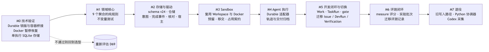
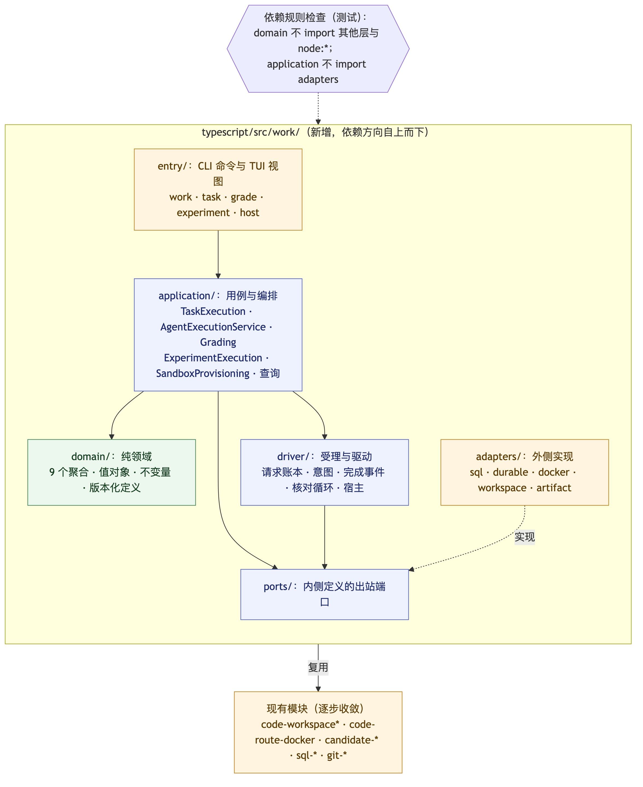
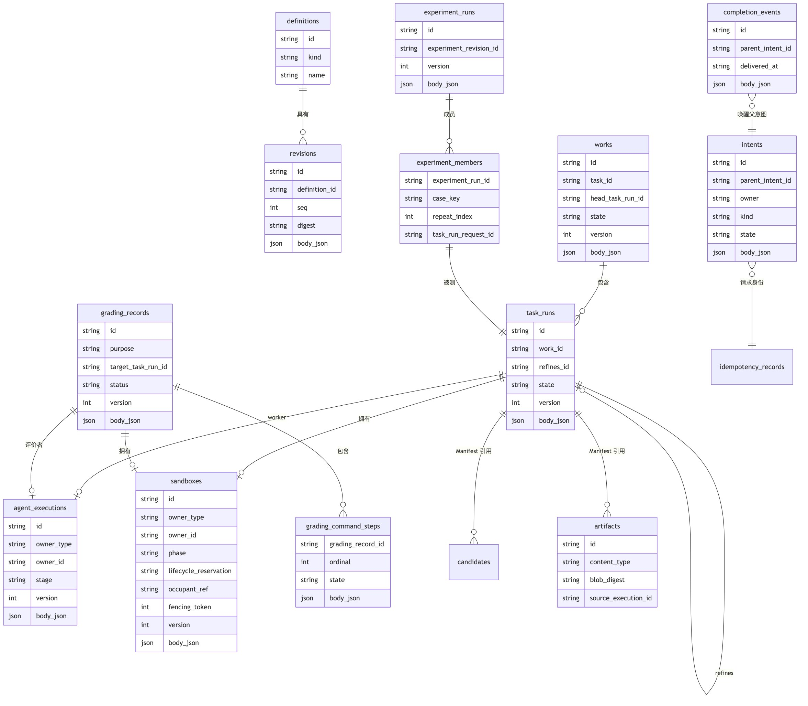

# 0002 通用 Agent 执行与评测：实现方案

- 日期：2026-11-02，第二版。第一版（自建沙箱与驱动、Pi Durable 优先）按 [项目愿景](../vision.md) 修订，原稿见本文件的 Git 历史。
- 状态：**已接受，待实现**（2026-11-02，用户确认第 12 节全部决定；D148 依据复审补充同步驱动、P3 / P4 的测试评分划分、批量执行边界与各阶段验收清单）。
- 实现进度：P0、P1a、P1b、P1c 已完成（用例、gate 与外部评价者协议、任务定义、Git 标签归档、`task` / `work` / `grade` 命令，见 [架构](../architecture.md)）。D149：不做数据迁移，P0 里写的迁移代码已删除；旧模型被替代的部分直接删除（第 9 节）。
- 依据：[项目愿景](../vision.md)；[目标模型](0001-target-model.md)（D129–D148）。
- 范围：一期的交付顺序、代码组织、存储、沙箱集成、Agent 接入、旧模型的退出、测试方式。本文不改变业务规则。

## 1. 结论

1. **先交付价值 1，再交付价值 2，最后才做托管执行。** 第一个可用版本是“自带 Agent 的契约开发闭环”：用户继续用 Claude Code 或 Codex 开发，Grounds 负责契约、冻结、独立验收和工作线。它复用现有的 skill 工作流与开发 worktree，所有操作在 CLI 调用内同步推进（目标模型第 7.3 节的同步驱动），不需要后台宿主、容器或新的 Agent 内核。
2. **价值 2 紧随其后**：从历史开发沉淀评测项、补充评分依据（隐藏测试、参考答案）、用规则或测试评分。这些都可以在没有托管执行的情况下完成。
3. **托管执行放在最后**，用于评测时“换一个 Agent 重跑”。Provider 一期先做命令行 Agent 适配器（Claude Code、Codex 的无界面模式），Pi Durable 作为后续可选的、带恢复能力的 Provider。
4. **沙箱不自建，集成开源实现**：环境定义采用 devcontainer.json，用 devcontainers CLI 构建与启动；生命周期操作（停止、暂停、删除、按标签查询）直接调用 Docker。强隔离后端（microsandbox）作为后续选项。
5. **本地低摩擦是一期目标**：默认使用 SQLite；候选归档只要求把标签推送到远端并读回核对，不再要求配置 ruleset 保护（D147）；`grounds init` 一步完成初始化。
6. 代码组织、存储形态保持第一版的建议；不做数据迁移（D149）。
7. **支持两种工作模式**：本地模式（自带 Agent 在宿主上工作，不需要 Docker）与容器托管模式（Grounds 在容器里运行 Agent）；本地模式还可以按需加上容器运行环境。见目标模型第 4.7 节。

## 2. 现状与复用

| 现有 | 在新结构中的位置 |
| --- | --- |
| SQL 账本（`sql-*.ts`，当前 schema v24，三种数据库） | 新表已并入同一账本，沿用事务、方言与三后端测试夹具；旧表按 D149 待删除 |
| `module.ts`、`cli.ts` 中 DevRun / Candidate / Verification 的命令 | 新代码交付已通过 `work` 用例和 Git 标签适配器实现，不写旧 Candidate；旧业务命令与服务仍待 P1d 删除，不保留只读兼容 |
| `plugins/grounds/skills/grounds` 的开发与验收工作流 | **外部执行的主要入口**：skill 引导自带 Agent 领取 Workspace、提交清单；协调者拉起全新会话做独立验收。改为调用新的 `work` 命令 |
| 旧 `code-workspace*.ts`（配置、缓存、基线、worktree、清理） | 已按 D149 退役，不直接复用旧实例/路线；外部执行使用新 `work/adapters/git/worktrees.ts`，托管 Sandbox 在 P4 实现 |
| 旧 `code-route-docker.ts`、`repository-environment.ts`、`development-image-*.ts` | 已按 D149 整链退役，不保留旧配置只读兼容；P4 重新实现 devcontainer 路径。独立 `env-*` 保留 |
| 旧 `verification-run.ts`、`submitVerification` | 新外部评价者协议与独立性校验已在 `work` 领域/应用层实现；旧 Verification 服务随旧业务退役，不作为新 gate 的依赖 |
| 旧评测模块 | 业务服务、CLI、QA 草稿/线索、TUI 评测及其 skill 已在 P1d 整链退役。仅 `evaluation.ts`、`eval-qa.ts`、`eval-environment.ts` 仍供旧 SQL 完整性校验使用，随存储批次删除；新评测资产按 P3 实现 |

## 3. 交付阶段

[Mermaid 源](../assets/impl-milestones.mmd)

| 阶段 | 交付 | 对应愿景 | 完成标准 |
| --- | --- | --- | --- |
| **P0 领域与存储** | `work/domain` 的 9 个聚合（含外部执行登记）；schema v24；仓储 | 基础 | 不变量与竞态测试（取消先后、移交预留、工作头 CAS、失败类别优先级、外部停止声明）；三后端一致性测试 |
| **P1 契约开发闭环（自带 Agent）** | TaskExecution、Work、外部执行的登记与提交、gate 加外部评价者、内置独立验收协议、`work` 命令、skill 改造、删除被替代的旧模型 | 价值 1 | 见第 10 节 P1 验收清单 |
| **P2 本地低摩擦** | **首要目标：消除安装时对编译工具链的依赖**（为常见平台发布预编译的原生模块，能用 Node 内置能力替代的尽量替代）；默认 SQLite；归档改为“推送标签加读回核对”（D147）；`grounds init` 一步完成 | 价值 3 | 一台只装了 Node 和 Git 的机器，在 5 分钟内完成首个任务的契约、提交与验收（以实测为准） |
| **P3 评测资产** | 从历史 TaskRun 沉淀评测项；补充评分依据（从被采纳的 Candidate 派生隐藏测试、参考答案，先作为材料保存）；规则评分；评测集与快照 | 价值 2 | 见第 10 节 P3 验收清单 |
| **P4 托管执行与沙箱集成** | devcontainer 环境定义与 SandboxProvisioning；测试评分（命令步骤，需要 Sandbox）；命令行 Agent 适配器；AgentExecutionService；后台宿主 | 价值 2、4 | 见第 10 节 P4 验收清单 |
| **P5 实验与对比** | ExperimentExecution、重复次数、批次结果查询与按标尺汇总 | 价值 2 | 见第 10 节 P5 验收清单 |
| **旧 P6 退役（D149 已提前到 P1d）** | 删除被替代的旧路径及表；不保留只读兼容层 | — | 没有新代码引用旧接口；文档与 skill 同步更新 |

P0 结束后，P1 与 P2 可以并行；P3 只依赖 P1（测试评分需要 Sandbox，放在 P4）；P4 是第一个需要容器与后台宿主的阶段。每个阶段单独提交 PR，可以独立发布和回退。

## 4. 代码组织

[Mermaid 源](../assets/impl-layout.mmd)

在 `typescript/src/work/` 下分层：

| 目录 | 内容 | 依赖规则 |
| --- | --- | --- |
| `domain/` | 9 个聚合、值对象、版本化定义、失败类别、Grade 校验 | 不 import 其他层、`node:*` 或现有 I/O 模块 |
| `ports/` | 仓储、AgentProvider（含能力声明）、SandboxRuntime、WorkspacePort、DeliveryStore、EvidenceStore、Clock / Ids | 只依赖 domain |
| `application/` | 用例、编排、查询，以及供驱动调用的事件处理入口 | 只依赖 domain 与 ports；请求账本、意图、完成事件的存储接口也定义在 ports |
| `driver/` | 入站驱动：同步驱动、完成事件投递、核对循环、宿主（P4 起） | 调用 application，依赖 ports |
| `adapters/` | SQL、Workspace、devcontainer 与 Docker、命令行 Agent、交付与证据存取 | 实现 ports，可以复用现有模块 |
| `entry/` | CLI 命令组：work、task、grade、experiment、host | 调用 application；组合根在受理之后调用同步驱动，排空本次请求能推进的步骤再返回 |

领域代码写成纯函数 `decide(state, command) → { state, events }`；`test/work-architecture.test.ts` 静态检查依赖方向。

## 5. 存储

[Mermaid 源](../assets/impl-storage.mmd)

保持第一版的设计：每个聚合一张表，需要唯一约束或索引的字段单独成列，其余字段放进带摘要的 JSON；版本化定义共用两张表；请求防重复与意图合并在 `work_intents`（请求标识唯一，同一标识不同输入报冲突），完成事件另建新表；`candidates` 增加 `task_run_id`。外部执行登记作为 TaskRun / GradingRecord 的内部数据保存，不单独建表。会话记录这类证据写入分块 blob。

实现时对第一版的调整（schema 24，已落地，结构说明见 [架构](../architecture.md)）：

- 请求防重复没有复用 `idempotency_records`：该表绑定账本事件和旧命令的语义，新模型的请求标识要与意图一起在同一事务里登记，所以放进 `work_intents`。
- 只有修订到定义有外键；聚合之间按标识引用，跨聚合一致性由应用层负责，跨聚合的唯一性由仓储用单列唯一约束保证（实例对存活沙箱、执行对工作者、执行对评价者、实验成员对任务运行）。
- 不建二级索引：MySQL 没有 `CREATE INDEX IF NOT EXISTS`，而 `CREATE TABLE IF NOT EXISTS` 是三后端共有的迁移方式；查询由以标识结尾的复合唯一约束提供。
- 实验运行的成员单独成表，聚合正文只保存成员数与成员摘要，读取时校验。
- `candidates.task_run_id` 不再需要：新模型的代码交付是自描述的归档回执（远端、标签、提交、树、父提交），不写旧 `candidates` 表（它的 `dev_run_id`、补丁与自验证字段都绑着 DevRun）。
- 数据迁移已取消（D149）：没有现有用户，P0 第 4 步写的迁移代码（旧表读取、映射、写入与前后校验）已删除，领域里随之去掉迁移标记、可空的工作头与会话身份。

## 6. 沙箱与环境：集成方案

| 需要 | 采用 | 理由 |
| --- | --- | --- |
| 环境定义 | **devcontainer.json** 标准（附 lockfile 摘要与镜像摘要） | 业界通用，用户仓库常常已有；lockfile 可以固定 feature 版本，有利于复现 |
| 构建与启动 | **devcontainers CLI**（`build`、`up --id-label`、`exec`） | 官方参考实现，可以作为 npm 依赖引入，不需要常驻服务 |
| 生命周期 | **Docker CLI** 按标签查询、暂停、恢复、停止、删除 | devcontainers CLI 还没实现 `stop` / `down`；用标签标识归属，与现有的资源归属校验方式一致 |
| Workspace | 新 `work` 的 Git worktree 适配器；P4 实现托管 Sandbox 的工作区准备 | 外部执行的独立 worktree 已落地；旧 code-workspace 实例/路线已按 D149 退役，不直接接入 |
| 强隔离（后续） | microsandbox（本地 microVM，Apache-2.0，带 TS SDK） | 适合不受信任的托管执行；作为 SandboxRuntime 的第二个实现，P4 之后再评估 |

不采用的方案：

| 方案 | 原因 |
| --- | --- |
| container-use | 面向 Agent 的 MCP 服务，自己管理 git 分支，与 Grounds 对 worktree 和分支的所有权冲突；目前还是实验性项目 |
| Docker Sandboxes（`sbx`） | 需要登录 Docker，开源与许可条件有待确认 |
| E2B、Daytona | 以云端为主；Daytona 的开源仓库已于 2026 年 6 月停止维护 |
| AIO Sandbox | 一体化镜像（浏览器、VNC、Jupyter）太重；以后有网页类任务时再考虑 |

**外部执行的隔离**：自带 Agent 运行在宿主上，隔离靠独立的 worktree 加 Agent 自身的沙箱模式。如果任务需要运行时环境（数据库、特定语言版本），Agent 通过 `devcontainer exec` 在该任务的容器中执行命令，多个任务之间互不干扰。

**托管执行**：命令行 Agent 运行在任务的 devcontainer 里，凭据通过环境变量注入，不写入 Workspace。

## 7. Agent 接入

| 方式 | 一期实现 | 能力 |
| --- | --- | --- |
| 外部执行（日常开发） | skill 加 CLI：领取 Workspace 并获得 Grounds 签发的会话身份；凭会话身份提交清单、声明停止或放弃、导入会话记录（Claude Code、Codex 的会话文件格式） | 不受 Grounds 控制；停止靠声明；会话记录覆盖说明为“外部提供”；外部执行的 worktree 不移交给下一轮 |
| 托管执行：命令行 Agent 适配器 | 在容器内以无界面模式运行 `claude -p` 或 `codex exec`，采集它们输出的会话文件并转为公共轨迹事件，同时保留原始记录 | 可以停止（停掉容器内进程），**不支持恢复**；中断以 infrastructure 结束 |
| 托管执行：Pi Durable（后续可选） | 作为带恢复能力的 Provider 接入 | 支持恢复原会话；按需评估 |

Provider 用能力声明表达差异（D68），应用层只依赖声明，不按 Agent 名字写分支。

## 8. 本地低摩擦

| 现状 | 一期目标 |
| --- | --- |
| 必须先配置 SQL 台账 | `grounds init` 默认在数据根目录下创建 SQLite，零配置可用；共享数据库仍可选 |
| Candidate 归档必须写入受保护的远端命名空间，无法确认 ruleset 保护时拒绝 | **归档只要求推送标签并读回核对**（D147）：标签推送成功，并读回确认指向确切的提交，才算归档成功，否则拒绝。ruleset 保护等级（受保护、无保护、未知）只作记录；完整性检查时比对远端标签与账本，发现标签丢失或被移动就明确报告 |
| 原生依赖（项目自带的 `native/*.c`、`node-pty`、`fs-ext`）需要 Python 3 与 C/C++ 编译工具链 | **P2 的首要目标**：为 macOS 与 Linux 的常见架构发布预编译的原生模块；逐一评估能否用 Node 内置能力替代；以“只装 Node 和 Git 即可安装”为验收标准 |
| 需要 Docker | 只有需要运行时环境或容器托管模式时才需要；devcontainers CLI 作为 npm 依赖打包，用户不用单独安装 |

P2 安装验收使用实际 npm tarball、空数据目录和仅含 Node、npm、Git 的 PATH。从安装开始计时，经默认 SQLite 初始化、建任务、工作树开发、推送并读回交付标签、逐项验收，到 Work 以 accepted 结束。源码构建保留编译工具依赖；发布流程汇集 Linux/macOS、x64/arm64 四个平台各自验证过的 Node-API 模块。

D147/D148 查询批次在工作头、单次执行和评分旁展示实时归档观察，并保留可选的操作方保护策略证据。不可确认与已确认不可用分别返回。`work repair` 在远端写入前登记意图，以独立标签、精确读回和新的持久回执记录修复；已有 Manifest 和评分保持原样，工作头、评分和精化读取可采用已验证的新归档。P3 以后新建评测资产时的可复现性准入另行实现。

## 9. 旧模型的退出

不迁移数据（D149）：没有现有用户，新旧模型不并存。旧模型中被新模型替代的部分直接删除，连同它们的表一起从 schema 删掉，没有只读兼容层。

**被替代，直接删除：** Requirement / Issue / DevRun / Candidate / Verification / 选择 / 完成 / 交付链接 / 预检（写入与读取）、`devrun` 与 `verification` 命令、`module.ts` 与 `sql-tx-*` 中对应的部分、Python 协调器、Codex 采集，以及它们的契约 schema、测试与 skill 内容。

**按依赖划边界：** 用户确认“只删新模型已替代的”，而 eval 的编码评测直接用 `tx.getCandidate`、`startDevRunInTransaction`，`code-workspace` 全部、部分 `code-route` 与 `repository-*` 依赖 DevRun / Candidate，删除这些表之后无法原样保留。它们对应的新实现分别在 P3（评测资产）、P4（托管执行与沙箱）、P5（实验）；在那之前，依赖旧表的部分随旧表一起删除，不做临时兼容。`env-*`（环境定义）这类不依赖旧模型核心的部分保留，到 P4 由 devcontainer 环境取代时再处理。

**共享 env 的核心退役前置条件（D150，已实现待审查）：** 用户选择独立 env + 显式仓库授权，不在本批接入新 TaskRun 准入。CLI 已移除旧 Repository / DevRun 回调，由 `env-repository.ts` 解析实际 Git common directory 的路径及设备/inode 身份；凭据和共享服务匹配显式 `repository` 授权，准备与启动前重查。`env repository` 可在无账本时查询授权身份。旧 DevRun 绑定及不可核验旧授权明确拒绝、不迁移。目录占用、损坏标记和旧路线拒绝保护保留，不自动回收资源。审查修复补齐损坏预约完整检查、只读查询无副作用和共用目录注册锁的占用发布；聚焦 103/103、0 skip；修复后完整 CLI 最近重跑 1122 pass / 1 fail / 261 skip，macOS 停止观察 unknown/confirmed 失败尚未解决，不能称完整验证通过；真实 Docker 未执行，待独立审查及后续验证。详见 [D150](0001-unified-agent-evaluation.md#d150旧核心退役后env-独立运行并使用显式仓库授权已实现待独立审查)。

**P1d 当前删除进度：** 已先删除无业务调用方的旧品牌/数据目录迁移工具（`migrate patchledger`、`migrate data`）、路径搬运与绑定修复、旧配置读取和迁移门禁。命令不会搬动、转换或清理历史文件。一次删除全部旧 CLI 会同时破坏仍在使用它构造数据的 eval、容器路线及验收测试；因此业务入口、调用方及对应表按依赖一起退役，而不是先删表或批量跳过测试。随后删除了 Python 包装器、实验协调器、Codex 采集器、容器准备代理和仓库快照适配，以及专用测试；分发清单与安装/包测试同步收敛。开发 skill 改为直接调用 task/work/grade，并要求主 agent 在交付冻结后启动全新子 agent 盲验；eval/知识改进入口明确自动实验暂不可用，不保留临时 runner。下一批已整链删除旧 TypeScript eval 服务/CLI/评分执行、QA 草稿与来源线索、TUI 评测界面及其客户端、评测与知识改进 skill、旧格式的纯文件材料工具和对应公开 schema/专用测试；随后用户确认先退役剩余旧 TUI 包，而不是本批重写界面：移除候选审阅/legacy 两个入口、客户端、专用测试/PTY、安装/发布及开发镜像依赖，保留 CLI 与 skill。新版工作模型 TUI 单独设计，当前未实现。共享 env 保留。之后整链退役 code-workspace 实例/路线、容器执行和 Git/sync 路由、服务/卷回收、Repo 环境默认、配方/镜像准备，连同 CLI、七个公开 schema 和专用测试；DevRun/Candidate 的这些调用方改为只走仍保留的宿主 worktree。保留独立 env 与只读目录占用拒绝检查，不执行或清理旧容器/卷/目录，不增加替代 runner。SQL 操作完整性校验仍留在存储批次处理。剩余旧开发命令/表尚未删除，也未重编号 schema；旧评测类型/校验器及事务接口仍由 SQL 完整性检查引用，随存储收敛一起删除，不是公开兼容入口；独立 env 仓库授权已合并。旧 draft/workspace 发布及其 preflight CLI、契约编辑与静态渲染、草稿格式转换和对应分发资产已移除。SQL 操作完整性校验保留至存储批次，旧草稿留在原目录。随后退役旧 Candidate 选择、Issue 完成登记、交付工作树以及依赖选择的集成授权与落地流程。旧 delivery-link 登记、撤回、查询和基于代码行的 trace 已退役，公开 schema 和分发副本同步移除。其余历史只读投影及 SQL 完整性校验保留至存储批次。旧 Candidate review 的完整追溯、摘要与 Markdown 导出已移除。Verification 分页以及用于独立验证的审阅工作树和会话保留。task/work/grade 的结果与外部评价者评分文件已有公开 schema，随插件分发。2026-11-08 在本机以 Claude Code 2.1.303 和 Codex CLI 0.167.0 各完成一次外部工作者冒烟：两个独立临时仓库均完成远端标签读回，冻结后分别启动全新评价会话，两项任务标准逐项通过，两个 Work 均以 accepted 结束。测试采用本机 bare Git 远端，未涉及托管执行。

本批将剩余旧业务命令、服务及表作为依赖闭包一起删除。新工作账本使用协议 2、schema 1；初始化仅接受空目标或同协议同身份账本，旧库不迁移。独立 env 保留原有授权、占用与停止校验。

P1 按下面四步切分，每步一个 PR，可独立评审和回退：

| 步骤 | 内容 |
| --- | --- |
| P1a | 应用层用例：开始工作、外部执行登记与提交（含回执检查）、取消、精化、工作头选择、结束工作；请求标识与意图保证重复请求安全；用伪端口与 SQL 仓储测试，含取消与迟到提交的竞态 |
| P1b | gate 用例：请求验收、外部评价者登记与独立性校验（会话在交付冻结之后签发且不同于工作者）、协议阶段、提交评分、验收结论查询 |
| P1c | 适配器与入口。P1c-1：任务定义用例、Git 标签归档与回执检查（D147：推送标签并读回）；P1c-2：工作区（精化从冻结的交付开新 worktree）、`task` / `work` / `grade` 命令组、端到端 CLI 测试 |
| P1d | 删除被替代的旧模型（按第 9 节的依赖划分，分若干步）；skill 改造；新结果类型的契约 schema；人工冒烟 |

## 10. 批量执行的边界

愿景原则 5 要求不自建通用的批量运行基础设施。P5 的边界如下：

- **Grounds 自建**：冻结的批次成员、样本身份、结果与交付的绑定、采用规则与按标尺汇总。这些是评测资产的核心语义，属于 Grounds 的差异化部分。
- **最小本地实现，有意接受**：宿主内的并发限制（Agent 名额与任务名额）与持久化的名额记录。它是一个计数器，不是通用队列或分布式调度器。
- **不直接集成 Harbor、Inspect 的运行器**：它们是 Python 框架，有自己的任务与结果格式；把运行交给它们，Grounds 就失去对样本身份与交付绑定的控制。与它们互通（导出评测集、导入结果）作为后续选项。

## 11. 测试策略

| 层次 | 方法 |
| --- | --- |
| 领域 | 纯函数单元测试，加命令序列的性质测试 |
| 应用 | 伪适配器加故障注入；外部执行的停止声明、迟到提交与取消竞态 |
| 存储 | `test/backends.ts` 三后端一致性测试 |
| 适配器 | 端口契约测试，伪实现与真实实现跑同一组用例；devcontainer 与 Docker 测试沿用 `*-docker.test.ts` 约定 |
| 端到端 | 每个阶段都有用伪 Agent 实现的确定性回归测试，计入常规 CI；用真实 Agent 的冒烟测试作为人工验收关卡，单独标注 |

**各阶段验收清单：**

| 阶段 | 必须通过 |
| --- | --- |
| P0 | 9 个聚合的不变量与竞态测试（取消先后、移交预留、工作头 CAS、失败类别优先级、外部提交与取消的线性化）；三后端一致性；依赖方向检查 |
| P1 | 伪外部 Agent 走完“开始工作 → 提交 → gate rejected → refine（新 worktree）→ 提交 → gate accepted → 结束工作”；取消与迟到提交的竞态；同步驱动在每次外部 I/O 之后崩溃，下一次命令能核对续接；用 Claude Code 或 Codex 各做一次人工冒烟 |
| P2 | 在 macOS（arm64）与 Linux（x64、arm64）的干净环境中，只装 Node 与 Git，从安装到完成首个任务的提交与验收；记录实际耗时。前提与断言：自动化测试使用临时的本地裸仓库作为远端（`file://`），断言归档标签已推送并读回指向确切提交；另做一次人工验收，使用专用的 GitHub 测试仓库，凭据通过环境变量注入，需要网络。耗时从安装开始计到验收完成，测试远端的预先配置时间单独记录，不从总时间中扣除 |
| P3 | 用固定 fixture 中至少 20 个历史 TaskRun 生成评测集；每个评测项可追溯到 TaskRevision、交付与评分依据；规则评分的结果可重算一致 |
| P4 | 3 个托管任务在 devcontainer 中并发且互不干扰；测试评分在评价者 Sandbox 中运行；宿主在每个外部动作前后崩溃，重启后只核对、不重复执行；命令行 Agent 的轨迹转换有契约测试 |
| P5 | 同一评测集分别用两个 Agent 跑一个批次，D63–D66 的查询与汇总结果与预先计算的期望一致；`unavailable` 的交付不进入新的批次 |

### P3 首批实现

`suite publish` 从显式指定的历史运行与交付固定快照。案例保留原任务版本，绑定评分器版本、材料摘要及来源。每项可绑定多个确切评分器版本。规则可比较文件字节或检查文件是否存在；自定义分类标尺随评分器修订固定。参考答案和隐藏测试从显式选中的已验证 Git 树取得，补充材料可来自后续修正交付。快照的发布与 `suite measure` 历史补评各有幂等操作回执。隐藏测试的沙箱执行属于 P4。

## 12. 已确认的决定

| # | 决定 | 推荐 |
| --- | --- | --- |
| 1 | 代码组织 | 新建 `src/work/` 子树，分层并用测试守护依赖方向 |
| 2 | 存储形态 | 每个聚合一张专用表，需要约束的字段单独成列 |
| 3 | 数据迁移 | 不迁移（D149）：没有现有用户 |
| 4 | 旧模型的退出 | 被新模型替代的部分直接删除，不留兼容层（D149） |
| 5 | 交付顺序 | 先做价值 1（自带 Agent 的开发闭环），再做价值 2，最后做托管执行 |
| 6 | 托管 Provider | 一期先做命令行 Agent 适配器（Claude Code、Codex 的无界面模式），Pi Durable 后续可选 |
| 7 | 环境与沙箱 | devcontainer.json 加 devcontainers CLI，生命周期操作用 Docker CLI；microsandbox 作为后续的强隔离选项 |
| 8 | 归档要求 | **已由用户决定（D147）**：归档只要求推送标签到远端并读回核对，不要求 ruleset 保护；保护等级只作记录，篡改由完整性检查发现。不提供本地归档模式 |

## 13. 风险

- **外部执行的独立性较弱**：一期只能证明“交付冻结之后、与 worker 不同的会话”，自报的 Agent 身份不作认证，也无法像托管执行那样隔离材料。应对：记录中如实标注为“协议约束下的独立会话”；托管执行就绪后，可以用托管评价者复核。
- **命令行 Agent 的输出格式会变化**：Claude Code、Codex 的会话文件格式不是稳定接口。应对：锁定版本，转换器写契约测试，同时保留原始记录。
- **devcontainers CLI 的缺口**：它还没实现 stop / down，生命周期需要直接调用 Docker。应对：用标签管理资源归属，只回收带 Grounds 标签的资源。
- **归档从“防篡改”降为“可发现篡改”**（D147）：有推送权限的人或 Agent 可以删除或移动未受保护的标签。这是为了降低门槛做的明确取舍；完整性检查必须能发现这类改动，并在结果中注明保护等级。
- **SQLite 重建表的迁移风险**与**旧入口体量大**，同第一版的分析。

### P4 环境与沙箱准备进度

已接入版本化 devcontainer 配置、受理时的 TaskRun 环境解析、按账本和 Sandbox 标签识别 Docker 资源，以及准备完成回执的核对。运行结束后，Work 关闭事务预留资源释放。真实 CLI 夹具同时创建三个 TaskRun，故障注入覆盖容器准备完成后账本写入中断，并在真实初始化步骤中终止 CLI，验证独立启动进程继续完成且初始化只执行一次。宿主监管、托管 Agent、测试评分和跨外部操作的完整故障矩阵继续按 §11 验收。
