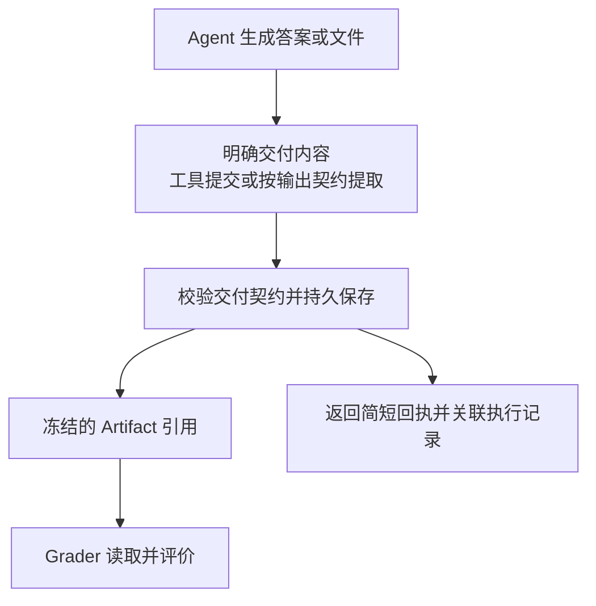

# 开源 Agent 的 Artifact 设计：源码对比

- 调研日期：2026-11-01。
- 状态：首轮源码调研完成；明确交付与统一保存的边界已通过开发共识 D41 接受，其他细节仍待讨论，生产代码未修改。
- 目的：回答 Artifact 如何建模，以及 Agent 如何生成、提交、保存并交付它。
- 方法：读取下列官方仓库固定提交的实现、示例及相关测试。未安装或运行这些框架，未调用线上模型；测试文件提供设计证据，不代表本次测试通过。

## 1. 对比范围与结论

选择三种互补实现，不宣称它们是市场排名前三或已经证明最优：ADK 观察版本化存储，LangChain 观察工具消息与数据分离，smolagents 观察最终输出协议。三者都是可用于构建 Agent 的开源框架，不能把框架局部能力当成完整终端产品的交付保障。

| 项目及固定提交 | 主要抽象 | 生成与交付路径 | 对 Grounds 的启发 |
| --- | --- | --- | --- |
| Google ADK Python，`8cd3b12c8a5d658c5e0d3ea0731d8be34a092a4a` | 文件身份、内容、版本元数据、Artifact Service | 工具生成内容，Context 保存，存储服务返回版本；事件记录变化，之后按版本读取 | 保存职责应封装在服务中，调用者取得可读取的确定引用 |
| LangChain，`6671bf76d3e1cb3ae5fc38aabca409879e602050` | ToolMessage 的 content 与 artifact | 工具返回摘要及完整数据，框架构造工具消息 | 给 Agent 的回执与供应用保存、评分的完整内容可以分开 |
| Hugging Face smolagents，`96f33faaf028479119ec8d34507b47694cf14e34` | FinalAnswerTool、类型化输出、FinalAnswerStep | Agent 调用最终回答工具；执行循环识别终结输出，按配置进行检查 | 应有可识别的交付信号，不能仅凭目录中新出现文件推断任务交付 |

最值得借鉴的是三个职责的区分：**生成内容、持久保存、声明交付**。它们可以被一个简单操作封装，不要求设计成三个用户命令或三个新实体。

## 2. Google ADK：有版本的内容与存储服务

### 领域与存储

`BaseArtifactService` 提供保存、读取、列举、删除及版本查询；身份由应用、用户、可选会话和文件名定位，保存返回递增版本。`ArtifactVersion` 包含版本、内容 URI、MIME 类型、创建时间和自定义元数据。具体内容使用 Google 的 `types.Part`，这是其 SDK 选择，Grounds 不应将该类型直接带入自己的领域模型。[接口源码](https://github.com/google/adk-python/blob/8cd3b12c8a5d658c5e0d3ea0731d8be34a092a4a/src/google/adk/artifacts/base_artifact_service.py#L33)

文件实现将每版正文和元数据先写入暂存目录，再通过重命名公布完整版本；读取时可指定版本，省略版本则取最新。它支持文本或内联二进制内容；基类提到的外部文件引用并非每个后端都同样支持。此实现可借鉴完整保存后再可见的做法，但不能仅据此宣称跨服务事务、任意断电持久性或业务上的恰好一次提交。[保存与读取实现](https://github.com/google/adk-python/blob/8cd3b12c8a5d658c5e0d3ea0731d8be34a092a4a/src/google/adk/artifacts/file_artifact_service.py#L476)

### Agent 如何产出

官方示例把 `generate_report` 注册为 Agent 工具。该函数构造报告内容，调用 `ctx.save_artifact`，返回文件名、版本和简短说明；示例的报告正文是模板生成，并不是证明模型已写出复杂报告。多媒体示例同样先生成文件、读取字节、保存，再离开临时目录。[工具与 Agent 示例](https://github.com/google/adk-python/blob/8cd3b12c8a5d658c5e0d3ea0731d8be34a092a4a/contributing/samples/core/artifacts/agent.py#L115)

Context 隐藏会话与用户参数，委托 Artifact Service 保存，并把文件名和返回版本加入当前事件的 `artifact_delta`。这展示了“内容存储”和“执行事件关联”可以分工；两次写入出错时如何保证业务一致性仍须 Ground 自己设计。[Context.save_artifact](https://github.com/google/adk-python/blob/8cd3b12c8a5d658c5e0d3ea0731d8be34a092a4a/src/google/adk/agents/context.py#L568)

ADK 的 Artifact 也包括用户上传的输入附件。其上传插件在处理用户消息时保存附件，再将引用放回消息；因此 ADK 的“已保存 Artifact”不等于 Grounds 的“任务正式交付”。[上传插件实现](https://github.com/google/adk-python/blob/8cd3b12c8a5d658c5e0d3ea0731d8be34a092a4a/src/google/adk/plugins/save_files_as_artifacts_plugin.py#L41)

已读取保存/加载/删除、列版本及防止调用者修改已存数据的测试。它们覆盖存储契约，未证明 Grounds 的 Candidate、评分或执行完成规则。[上游测试](https://github.com/google/adk-python/blob/8cd3b12c8a5d658c5e0d3ea0731d8be34a092a4a/tests/unittests/artifacts/test_artifact_service.py#L262)

### 适用边界

- 可借鉴：统一存取端口、确定版本引用、事件记录内容变化。
- 不直接照搬：按会话与文件名作为唯一业务身份、以 SDK Part 为领域载荷、默认读取 latest。
- Grounds 已确认提交后冻结；评分应绑定确切产物身份，不能因同名文件后来更新而改变依据。是否增加“逻辑产物下多版本”的额外身份层尚未决定。

## 3. LangChain：工具回执与完整数据分开

`ToolMessage` 定义 `content`、`tool_call_id`、`artifact` 和调用状态。`artifact` 是任意类型的附加数据，契约意图是供应用使用，而非直接作为模型可见的消息正文；这不构成整个应用的安全隔离保证。[ToolMessage 定义](https://github.com/langchain-ai/langchain/blob/6671bf76d3e1cb3ae5fc38aabca409879e602050/libs/core/langchain_core/messages/tool.py#L25)

工具声明 `response_format="content_and_artifact"` 后，工具返回摘要与完整数据的二元组；执行器拆分并构造 ToolMessage。直接调用且没有工具调用身份的路径可能只返回 content，不能假设所有调用方式都会自动保留附加数据。[工具执行解析](https://github.com/langchain-ai/langchain/blob/6671bf76d3e1cb3ae5fc38aabca409879e602050/libs/core/langchain_core/tools/base.py#L1099)、[输出封装](https://github.com/langchain-ai/langchain/blob/6671bf76d3e1cb3ae5fc38aabca409879e602050/libs/core/langchain_core/tools/base.py#L1390)

上游测试用结构化工具返回文本与参数数据，并检查完整 ToolMessage 的内容和 artifact。[测试源码](https://github.com/langchain-ai/langchain/blob/6671bf76d3e1cb3ae5fc38aabca409879e602050/libs/core/tests/unit_tests/test_tools.py#L1708)

该字段本身不提供独立产物身份、不可变版本或持久化服务。不能据此推论整个 LangChain 生态没有存储能力；这里只评估所读的消息与工具协议。Grounds 可采用简短回执加持久内容引用，但不能仅把一份任意 JSON 挂到轨迹消息上就视为已完成归档。

## 4. smolagents：显式最终回答与类型化输出

`FinalAnswerTool` 接受一个 answer 并返回它，工具本身不负责持久化。Agent 默认加入此工具；工具调用路径识别其名称并产生终结标记，执行循环可运行 `final_answer_checks`，再形成 `FinalAnswerStep`。[最终回答工具](https://github.com/huggingface/smolagents/blob/96f33faaf028479119ec8d34507b47694cf14e34/src/smolagents/default_tools.py#L82)、[终结与检查流程](https://github.com/huggingface/smolagents/blob/96f33faaf028479119ec8d34507b47694cf14e34/src/smolagents/agents.py#L580)

工具产生图片或音频时，所读路径会把对象放进 Agent state，并生成简短观察消息；最终回答还可以用 state 中的名称取回对象。这里存在固定媒体名称的实现限制，不能当成通用多产物目录。[工具输出与最终结果选择](https://github.com/huggingface/smolagents/blob/96f33faaf028479119ec8d34507b47694cf14e34/src/smolagents/agents.py#L1335)

`AgentImage` 可包装路径、字节或图片对象，转成字符串时可能写临时图片文件。可显示、可返回不等于永久归档。达到最大步数的兜底路径也与显式最终回答不同，不能把此框架的“最终输出”直接等同于 Grounds 的“约定内容已保存，执行成功”。[类型与临时文件实现](https://github.com/huggingface/smolagents/blob/96f33faaf028479119ec8d34507b47694cf14e34/src/smolagents/agent_types.py#L133)、[最终回答测试](https://github.com/huggingface/smolagents/blob/96f33faaf028479119ec8d34507b47694cf14e34/tests/test_final_answer.py#L28)

可借鉴显式的交付信号和接收前检查；不直接采用临时路径作为最终产物身份，也不把整个 Agent state 当成交付物集合。

## 5. 对 Grounds 的设计建议：先定交付协议，再定字段

以下为建议，不自动改变已确认的 Candidate / Artifact / Trajectory 关系。

1. **保留语义边界。** Task 的输入材料、执行中的普通文件与 Working 正式交付的 Artifact 不因使用同一存储后端就成为同一个业务概念；Candidate 仍独立，轨迹仍记录过程。
2. **明确选择什么交付。** Agent 可通过交付工具指定内容或文件；对只提供最终回答的 Provider，任务适配器可依据明确输出契约转换。不要靠扫描整个目录或拼接所有消息猜交付物。
3. **统一接收与保存。** 两种入口均由应用服务校验类型、文件范围、所需内容及来源，并通过存取端口保存、冻结，取得持久引用。此处检查结构与交付契约，内容好坏由 Grader 评价；契约合法的低质量回答仍可交付并被评分。
4. **给模型回执，给应用完整对象。** 大文件不必全部回灌模型上下文；返回可读摘要及引用。Grading 通过确切引用取得实际评分材料。
5. **保存与交付成功可追溯。** 记录来源执行与相应事件，回执丢失不自动重复生成；沿用 D1 的归档恢复与完成语义。去重、原子性和失败补偿须以本项目实现及测试证明。

2026-11-01 用户已确认“正式交付需要明确选择并经过统一保存”这一边界，正式决策见 [开发共识 D41](../decisions/0001-unified-agent-evaluation.md)。随后用户通过开发共识 D42 确认 Working 一次执行可交付多个 Artifact，由 Task 声明必需与可选项，多文件也可组成一个产物。具体字段、是否存在独立交付集合对象、存储后端及提交协议仍待设计；这些采纳决定来自用户后续确认，不由调研本身自动产生。
