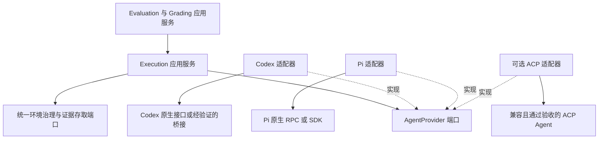

# 多 Agent 内核接入源码调研

日期：2026-11-01。状态：源码研究与实现建议；不是已实现能力，也不自动成为已确认决策。对应[开发共识 D67 / D68](../decisions/0001-unified-agent-evaluation.md)。

本次三个研究 Agent 分别检查 Harbor、Vibe Kanban、ACP 及适配器，主 Agent 对照 Grounds 现有捕获链路和 Pi 官方接口文档。阅读了源码及部分测试源码，没有运行这些项目的测试、容器或线上模型。

## 结论与难度

支持 Codex、Pi 等多个真实 Agent 内核可行，已有直接参考。基本启动、消息与工具事件采集、最终输出可以通过适配器统一。主要成本在不同内核的完成判定、会话继续、异常恢复、取消确认、工具配置及轨迹覆盖差异，以及版本升级后的持续兼容。

“支持多模型 API”不足以证明支持多内核：将 Pi 的模型切换到 OpenAI，仍然运行 Pi 的工具循环和上下文管理，不等于运行 Codex。反过来，统一一个 `run` 或 `resume` 方法名，也不证明底层行为一致。

以下难度是根据源码作出的相对判断，不是工时估算：

| 工作 | 相对难度 | 原因 |
| --- | --- | --- |
| 两个内核各自启动、获取最终输出 | 中 | 原生机器接口已存在，但安装、配置及授权方式不同 |
| 保存原始记录并转换公共轨迹 | 中到高 | 工具事件、用量、重试、子 Agent、历史回放格式不同；缺失不能补造 |
| 统一环境与两级并发 | 中到高 | 可复用已有执行底座，但需迁移两条环境路径并落实独立会话、占用与回收 |
| 可靠取消、失联核对、崩溃恢复和防重 | 高 | 请求受理不等于停止；加载历史不等于原操作恢复；外部工具可能已经产生副作用 |
| 所有内核支持同样的工具、Skill、恢复能力 | 不适合作为隐含保证 | 需要逐版本能力验证；不能通过空方法或静默降级模拟支持 |

## 固定源码快照

| 项目 | 本次检查的提交 | 参考重点 |
| --- | --- | --- |
| [harbor-framework/harbor](https://github.com/harbor-framework/harbor) | `ac533ec72bc506c8a6bf6f296ba6ab80707fad89` | 多内核、统一环境、评测执行与轨迹 |
| [BloopAI/vibe-kanban](https://github.com/BloopAI/vibe-kanban) | `7c3807084daad0d9d315064f60fa869de254f027` | 执行器接口、原生协议适配、日志规范化 |
| [agentclientprotocol/agent-client-protocol](https://github.com/agentclientprotocol/agent-client-protocol) | `b4c72a80f32f4c61d87270d90891c7ce14511b9a` | 公共接入协议与可选能力 |
| [agentclientprotocol/codex-acp](https://github.com/agentclientprotocol/codex-acp) | `927c4802f83c0859b439e7d641b5eb692560e5df` | Codex App Server 桥接和取消竞态 |
| [svkozak/pi-acp](https://github.com/svkozak/pi-acp) | `04d0a15d6bb42bb65cce5c9caedcdcb2cdcb6905` | Pi 社区桥接的边界与限制 |
| [earendil-works/pi](https://github.com/earendil-works/pi) | `2c8d1feb147f6b3d97e855da803bfe7b19f3c403` | 官方 RPC / SDK 集成与结束事件说明 |

提交固定的是调研证据，不代表选定这些 main 快照作为生产依赖。实际集成仍须选择发布版本、核对许可证与兼容性。

## Harbor：最贴近 Grounds 的整体参考

Harbor 的 `BaseAgent.setup/run` 接收共享 `BaseEnvironment`；Trial 串联 Agent 执行、日志同步、产物收集和 Verifier。当前主仓库已有 Codex、Claude Code 和 Pi 专用适配器。[接口](https://github.com/harbor-framework/harbor/blob/ac533ec72bc506c8a6bf6f296ba6ab80707fad89/src/harbor/agents/base.py#L670)、[执行后验证流程](https://github.com/harbor-framework/harbor/blob/ac533ec72bc506c8a6bf6f296ba6ab80707fad89/src/harbor/trial/single_step.py#L37)。

最值得借鉴的三点：

- **能力显式声明。** `AgentCapabilities` 分开表达原生续会话、导入原生轨迹、导入 ATIF、工具与 Skill 等。Pi 声明 resume，但未声明两种轨迹导入能力；不会因共同基类而自动拥有全部能力。[能力模型](https://github.com/harbor-framework/harbor/blob/ac533ec72bc506c8a6bf6f296ba6ab80707fad89/src/harbor/agents/capabilities.py#L8)、[Pi 能力](https://github.com/harbor-framework/harbor/blob/ac533ec72bc506c8a6bf6f296ba6ab80707fad89/src/harbor/agents/installed/pi.py#L94)。
- **保留原始日志，再转换轨迹。** Pi 使用 `pi --print --mode json --session-dir`，续接使用 `--continue`；转换器读取原生 JSONL 并生成 ATIF。此处接的是 Pi CLI，不是 Pi Durable。[启动](https://github.com/harbor-framework/harbor/blob/ac533ec72bc506c8a6bf6f296ba6ab80707fad89/src/harbor/agents/installed/pi.py#L437)、[转换](https://github.com/harbor-framework/harbor/blob/ac533ec72bc506c8a6bf6f296ba6ab80707fad89/src/harbor/agents/installed/pi.py#L565)。
- **调度与内核分开。** TrialQueue 有任务 semaphore 和 Agent 配置池 semaphore，可参考其分层方式；不能据此认定其恰好实现 Grounds 的任务默认 5、被测 Agent 与 Judge 共用默认 20 的规则。[队列](https://github.com/harbor-framework/harbor/blob/ac533ec72bc506c8a6bf6f296ba6ab80707fad89/src/harbor/trial/queue.py#L112)。

不宜照搬的部分：这里的 resume 是步骤之间继续原生会话，不能当成崩溃后工具操作不会重复的证明。取消主要由 Trial 协调异步取消、剩余输出收集与环境停止；不能替代 Grounds 的持久受理、未知状态核对和确认停止规则。[取消处理](https://github.com/harbor-framework/harbor/blob/ac533ec72bc506c8a6bf6f296ba6ab80707fad89/src/harbor/trial/trial.py#L601)。ATIF 也需版本管理：当前模型默认 v1.8，而 Pi 转换器输出 v1.7。[轨迹模型](https://github.com/harbor-framework/harbor/blob/ac533ec72bc506c8a6bf6f296ba6ab80707fad89/src/harbor/models/trajectories/trajectory.py#L12)。

## Vibe Kanban：执行器边界和协议差异的参考

`StandardCodingAgentExecutor` 封装启动、follow-up、review 和日志规范化；Codex 使用 app-server，Claude 使用 stream-json，Gemini / Qwen 复用 ACP harness。这是实际多内核集成，不只是模型路由。[接口](https://github.com/BloopAI/vibe-kanban/blob/7c3807084daad0d9d315064f60fa869de254f027/crates/executors/src/executors/mod.rs#L222)、[日志类型](https://github.com/BloopAI/vibe-kanban/blob/7c3807084daad0d9d315064f60fa869de254f027/crates/executors/src/logs/mod.rs#L53)。

值得警惕的是同名 follow-up 的不同实现：Codex 使用 `thread_fork`，Claude 使用 `--resume`，ACP harness 使用 `new_session` 加历史。这些都有继续工作的用途，但不能都解释为原执行的可靠恢复。[Codex](https://github.com/BloopAI/vibe-kanban/blob/7c3807084daad0d9d315064f60fa869de254f027/crates/executors/src/executors/codex.rs#L594)、[Claude](https://github.com/BloopAI/vibe-kanban/blob/7c3807084daad0d9d315064f60fa869de254f027/crates/executors/src/executors/claude.rs#L360)、[ACP](https://github.com/BloopAI/vibe-kanban/blob/7c3807084daad0d9d315064f60fa869de254f027/crates/executors/src/executors/acp/harness.rs#L322)。

该快照没有 Pi adapter。local `ContainerService` 管理工作区与子进程，不应因名称而当作 Docker 环境治理实现。其停止流程先更新 completion 再请求取消和 kill，日志持久等待超时可被忽略；Grounds 已确认的停止与归档完成语义更严格。[停止流程](https://github.com/BloopAI/vibe-kanban/blob/7c3807084daad0d9d315064f60fa869de254f027/crates/local-deployment/src/container.rs#L1406)。

## ACP：可复用协议，不是完整执行底座

ACP 可减少重复编写客户端协议的工作，但 `loadSession`、工具原始输入输出等是可选能力。统一事件流并不保证完整原生轨迹，也不证明容器全部后代进程已经停止。[能力定义](https://github.com/agentclientprotocol/agent-client-protocol/blob/b4c72a80f32f4c61d87270d90891c7ce14511b9a/agent-client-protocol-schema/src/v1/agent.rs#L5035)、[工具事件](https://github.com/agentclientprotocol/agent-client-protocol/blob/b4c72a80f32f4c61d87270d90891c7ce14511b9a/agent-client-protocol-schema/src/v1/tool_call.rs#L60)。

活跃 Codex adapter 是 `agentclientprotocol/codex-acp`。它封装 App Server，处理取消时 turn 尚未注册等竞态，适合作为复用候选或实现参考。[取消竞态处理](https://github.com/agentclientprotocol/codex-acp/blob/927c4802f83c0859b439e7d641b5eb692560e5df/src/CodexAcpServer.ts#L4398)。

Pi 的社区 ACP adapter 当前有明显的编辑器场景假设：

- 同一连接只保留一个活跃 Pi 子进程；不能复用单连接来承载多任务并发。[会话切换](https://github.com/svkozak/pi-acp/blob/04d0a15d6bb42bb65cce5c9caedcdcb2cdcb6905/src/acp/agent.ts#L966)。
- Pi error 可映射为 `end_turn`；若直接用结束原因判断成功，会吞掉错误语义。[错误映射](https://github.com/svkozak/pi-acp/blob/04d0a15d6bb42bb65cce5c9caedcdcb2cdcb6905/src/acp/agent.ts#L888)。
- 历史工具回放包含合成事件，`rawInput:null`；MCP 参数接受但未透传。不能将其宣称为完整轨迹和完整工具支持。[历史回放](https://github.com/svkozak/pi-acp/blob/04d0a15d6bb42bb65cce5c9caedcdcb2cdcb6905/src/acp/agent.ts#L1045)、[已知限制](https://github.com/svkozak/pi-acp/blob/04d0a15d6bb42bb65cce5c9caedcdcb2cdcb6905/README.md#L199)。

因此不建议一期无条件将 Codex、Pi 都套到同一个 ACP 客户端后宣称完成。可以保留自己的 AgentProvider 端口，按实际质量选择原生协议或 ACP 适配路径；ACP 类型留在外层。

## Pi 原生接口对接提示

官方提供进程内 TypeScript SDK 与子进程 JSONL RPC。当前 RPC 文档明确：prompt 成功响应仅表示受理，`agent_end` 后仍可能发生重试、压缩或后续工作；需要等待 `agent_settled` 判断不再自动继续。接受、低层运行结束、稳定结束须分别处理，最后仍由 Grounds 完成交付归档。[RPC 文档](https://github.com/earendil-works/pi/blob/2c8d1feb147f6b3d97e855da803bfe7b19f3c403/packages/coding-agent/docs/rpc.md)。

SDK 提供会话持久化、事件订阅、abort / waitForIdle 等；会话切换会替换 AgentSession，事件订阅也需重新绑定。这支持直接适配的可行性，但尚未证明 Grounds 中的容器接入与异常恢复。[SDK 文档](https://github.com/earendil-works/pi/blob/2c8d1feb147f6b3d97e855da803bfe7b19f3c403/packages/coding-agent/docs/sdk.md)。Pi Coding Agent 与 Pi Durable 需分别识别；本次没有重新验证此前 Durable 实验，也不把其能力自动归给 Pi CLI。

## 首轮对 Grounds 的建议与迁移落点（一期范围已由 D69 修订）

研究时的 [grounds_eval_capture.py（已按 D149 退役）](https://github.com/MaybeLL/Ground/blob/83d5a62c3033a9716a7d406f3f6778d6484d8ff3/plugins/grounds/scripts/grounds_eval_capture.py) 将 Codex 配置校验、版本锁定、临时 home、启动参数和任务 / 评分 prompt 组织在同一条路径中。它要求 `codex_command` / `codex_version` 并调用 `codex exec --json --ephemeral`。因此增加 Pi 不能只改一条可执行文件路径；要把 Provider 专属配置、启动和事件解析从任务材料、评分输入及业务归档中拆出。

研究时的 [grounds_eval_runtime.py（已按 D149 退役）](https://github.com/MaybeLL/Ground/blob/83d5a62c3033a9716a7d406f3f6778d6484d8ff3/plugins/grounds/scripts/grounds_eval_runtime.py) 曾封装共享 `env up/run/down` 与输出收集，可作为提取公共执行底座的现有基础；仍须遵循已确认的统一环境治理迁移要求，不能再引入第三套独立环境状态。

建议保持现有六边形边界，避免新增一套领域模型：

1. **一期集中 Codex + Pi。** 以 Harbor 的共享环境、能力声明、轨迹转换为主要参考；不直接引入整个 Harbor 框架替代 Grounds 的领域与流程。
2. **共同契约保持小而明确。** 配置和输入、启动身份、可观测事件、结束原因及输出由适配器转换。任务语义、Candidate / Artifact 归档和 GradingRecord 不进入 Provider。
3. **恢复等能力分开表达。** 会话续接、分叉、历史导入、崩溃后恢复不能合为一个模糊的 resume。这里支持 D68 的研究理由，但 D68 仍待用户确认；没有取消已接受的防重、状态核对或停止确认要求。
4. **直接协议与桥接按实测选择。** Pi 原生 RPC 是容器场景的优先验证候选；Codex 可比较原生接口与 codex-acp 的维护成本。SDK 也可以运行在容器内，RPC 不是唯一可行方案。
5. **统一适配器契约验收。** 两个实现均验证正常输出、工具记录、内核错误、取消确认、失联核对、并发隔离、回收后证据可读。使用原始事件 fixture 测转换，再做固定版本真实容器集成；不能只跑文本问答就宣布可靠接入。

当前建议不承诺所有内核同等恢复能力，也不降低已确认的一期要求。若选定内核不能满足所需能力，应在正式集成前明确阻塞点，选择宿主补足、换适配路径或与用户调整范围。后续仍需决定具体接入路径，并验证任务 5 / Agent 20 的调度、同一内核同时承担被测与 Judge 时的隔离。

## 补充比较：一期只支持 Pi——已采纳为 Pi Durable 单内核

用户提出是否只支持 Pi 会显著简化。判断是：执行适配与长期兼容维护会明显简化，但整个评测系统的业务与可靠性工作不会随之消失。目前没有实现工时数据，不给出百分比估算。

只维护一种内核时，可以省去 Codex 与 Pi 之间的事件、配置、工具和会话语义对齐，减少协议与版本组合的测试，也无需一期建设多 Provider 注册、路由或通用能力协商框架。仍须实现统一环境治理、执行受理与防重、轨迹和交付归档、取消确认、独立评分及任务 / Agent 两级并发。Pi 自身的会话持久化不自动满足 Grounds 的完整业务恢复要求。

建议条件：若一期目标是让用户用我们提供的执行底座完成 Coding / Working 任务，并比较模型、指令、工具或 Skill 配置，则 Pi 单内核是值得优先考虑的收敛方案。如果一期目标包含直接比较 Codex、Claude Code 等完整 Agent 产品的行为，只支持 Pi 则缩小了评测覆盖：Pi 调用某家的模型，不能等同于运行那家的 Agent 内核。已有产物的独立评分可按已确认接口保留，但不能据此宣称已经支持那些外部 Agent 的受管执行与轨迹采集。

在六边形设计上仍保留 Execution 与一个小的 AgentProvider 端口，当前只提供 Pi 实现；接口用于隐藏 Pi SDK、协议和会话细节，不预建完整插件框架。Task、Candidate、Artifact、Trajectory、Grader 等既定领域对象无需因只有一个实现而绑定 Pi 类型。

单内核还应明确指 Pi Coding Agent 还是 Pi Durable，不能同时引入两套运行机制却按一个内核估算成本。建议先验证一种集成路径和其可靠性边界；此前 Durable 的局部实验不代表已接通完整评测链路。现有 Codex 捕获路径也存在迁移成本，不能在没有替代验证前直接移除。

用户后续已确认一期仅采用 Pi Durable，见开发共识 D69。本节保留选型理由；未修改生产代码，D68 通用能力矩阵未自动确认。

## Pi Durable 与 Pi Coding Agent SDK 选型——已采纳 Durable，待实现

2026-11-01 针对用户进一步提问，对照上述同一 Pi 提交中的 Durable README、`types.ts`、`harness/tool.ts`、`harness/submissions.ts` 与 Coding Agent SDK 文档。建议在现有需求不变的前提下优先选择 **Pi Durable**：Grounds 已明确持久受理、防重、状态核对、恢复与证据留存，这些要求与 Durable 的运行模型更贴近。若目标只是尽快嵌入已有交互式 Pi 的工具、Skill 与会话体验，Coding Agent SDK 的初始接入更直接；不能仅因 SDK 更薄就假定整套可靠运行实现更省事。

| 比较项 | Pi Coding Agent SDK | Pi Durable |
| --- | --- | --- |
| 主要集成方式 | 创建 AgentSession，配置工具与资源、订阅事件、调用 prompt | 在持久存储上打开 Harness，提交工作、等待结果、恢复内部任务 |
| 已有便利 | Coding Agent 的会话、模型、工具、Skill 和扩展加载接口 | 持久提交身份、内部任务检查点、会话记录、工具重放策略 |
| 恢复边界 | 保存和加载会话；不能据此推定在途工具操作可可靠恢复 | 重开存储可继续未完任务；仅允许安全重放的工具自动重跑 |
| 本项目主要补充工作 | 业务治理之外，需自行补充更多在途执行恢复协调 | 将内部执行状态映射到 Grounds，落实环境所有权、归档及恢复边界 |
| 代价 | 现成 Coding Agent 行为更容易复用，但可靠运行仍需额外设计 | 新的扩展和工具接入方式，API 明确标为实验性，需锁版与升级验证 |

来源：[Coding Agent SDK](https://github.com/earendil-works/pi/blob/2c8d1feb147f6b3d97e855da803bfe7b19f3c403/packages/coding-agent/docs/sdk.md)、[Durable README](https://github.com/earendil-works/pi/blob/2c8d1feb147f6b3d97e855da803bfe7b19f3c403/packages/durable/README.md)、[官方定位说明](https://earendil.com/posts/pi-durable/)。这两者是不同 harness，不能把 Durable 当成原 Coding Agent SDK 的持久化开关，也不能假定已有扩展无须迁移。

需在接入中解决的具体边界：

- **工具副作用。** `ToolTask` 在执行前保存调用意图，恢复时要求保存的策略和当前策略都为 `safe` 才重跑，否则记 interrupted。它不保证任意外部操作恰好执行一次，模型也可能随后再次提出类似操作；业务工具仍需自身幂等或核对协议。[实现](https://github.com/earendil-works/pi/blob/2c8d1feb147f6b3d97e855da803bfe7b19f3c403/packages/durable/src/harness/tool.ts#L195)。
- **请求冲突校验。** 当前 `admit` 对相同 conversation/requestId 返回旧提交，只检查提交类型是否相同，并未对输入内容作同等校验。Grounds D54 的同标识不同输入报冲突仍须由自己的受理层保证，不能直接透传后宣称完成防重契约。[实现](https://github.com/earendil-works/pi/blob/2c8d1feb147f6b3d97e855da803bfe7b19f3c403/packages/durable/src/harness/submissions.ts#L232)。
- **存储所有权。** Durable 要求一个存储同时由一个进程拥有，未提供跨进程锁；不能让 20 个容器同时打开同一存储。每个执行宿主独立存储或单一拥有者管理多会话需另行选择。进程恢复前先确认旧拥有者与环境占用，不能绕开 Grounds 的未知状态规则。SQLite 默认 WAL / NORMAL 的最近提交在断电或宿主故障时可能丢失，不能把进程崩溃恢复扩大为所有故障下不丢数据。[存储说明](https://github.com/earendil-works/pi/blob/2c8d1feb147f6b3d97e855da803bfe7b19f3c403/packages/durable/README.md#storage)。
- **领域边界。** Durable 的 Task 是内部执行状态机，不是 Grounds 的业务 Task；其 ExecutionEnv 是工具访问环境的接口，不接管 Grounds EnvironmentInstance 的分配、占用和回收。内部存储保存运行机制所需状态，Grounds 继续保存实验、正式交付、评分及可查询证据，二者以明确身份关联。
- **版本和验证。** 当前 main 明确声明 API 可能无通知变更；本次新增的是源码核对，未重跑此前 npm 1.4.0 的模拟实验，也未验证当前发布版。选定发布版本后需测试工具中断、保存失败、停止确认、持久卷恢复及并发隔离。

用户已接受一期 Pi Durable 单一内核，开发共识 D69 为当前选型依据。前面的 Codex + Pi / ACP 图与建议保留为调研阶段的方案比较，不再代表一期支持清单。该选择不表示 Durable 接入比一次 SDK prompt 调用更少工作；它只管理内部执行机制，不管理整个实验。具体发布版本、部署和完整集成验收仍待完成。
